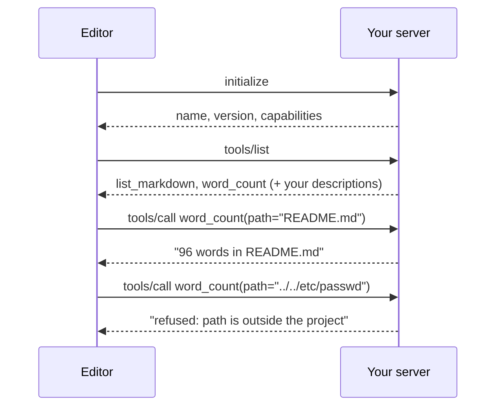
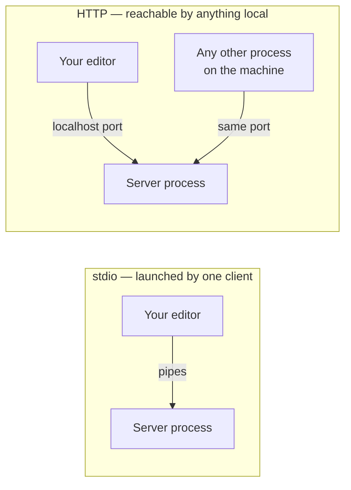

*Every line of JSON below came off the wire of a server I wrote for this post,
connected to Claude Code 2.1.205 on a laptop, with both directions of the pipe
tee'd to a file. The server is sixty-two lines. Paths have been shortened; nothing
else has been edited.*

## TL;DR

- An MCP server is an ordinary program. Two tools and sixty lines is a complete
  one, and it teaches you everything the installed ones are doing.
- The description is the interface. In the Python SDK your docstring *is* the
  wire format, which makes it very easy to ship a bad one by accident.
- Tee the traffic once and the protocol stops being abstract. It is four kinds
  of message and you can read all of them.
- Validate paths in the server. The client is not checking your arguments for
  you, and the model is not the only thing that can call you.
- Read-only over stdio is the default you should have to argue your way out of,
  not the thing you argue your way into.

## Where this sits

This is the fourth post in **How your AI coding tool works**, and it needs the
one before it:
[MCP, explained without the spec](/engineering/mcp-explained-without-the-spec/).
That post covers what the protocol is, which side your editor is on, what a
server can offer, and why the transport choice is really a decision about where
your credentials sit. I use those words here without redefining them. The parts
of the harness a server plugs into are mapped in
[the words for the layer around the model](/engineering/harness-engineering-vocabulary/),
and single terms have one-line entries in
[the AI vocabulary](/engineering/the-ai-vocabulary/).

This post is the one where you build it.

One boundary, stated up front so you are not waiting for it. The security of MCP
servers — prompt injection through tool output, the confused deputy, token
passthrough, what a malicious server does to a machine it was installed on — is
the subject of the next post, and this one deliberately stops short. I will say
that read-only is the right default and that `stdio` beats an open port, give you
one line of reasoning for each, and leave the rest where it belongs.

The analogy, and it holds all the way through: **a service counter.** You decide
what is on the menu. You decide who may order from it. You decide what the answer
looks like when it comes back. And the customer, however politely they ask, cannot
reach behind the counter.

## 01 — The thing you have already noticed

You install somebody's MCP server. A command, a config entry, a restart. The
tools appear in your assistant's list with names like `query` and `search_issues`
and `list_resources`, and they work.

And you still have no idea what any of them can reach.

The names tell you nothing about scope. The descriptions were written to
persuade a model to call them, not to inform you. There is no manifest of files
touched or hosts contacted. In the previous post I took apart a real handshake
from a server somebody else wrote and found fourteen tools and a boundary that
existed only because of an argument on the command line.

The cure is not more documentation. It is writing one of these yourself. Sixty
lines makes every part of the mechanism concrete, and after that, reading
somebody else's server stops being an act of faith.

## 02 — The whole server

Two tools. `list_markdown` returns the Markdown files in a project.
`word_count` counts the words in one of them. Both read. Neither writes, deletes,
moves, renames or shells out. That is the whole menu, and it is deliberately
boring, because the interesting parts are the ones around it.

The Python SDK is `mcp`, installed as `mcp[cli]`; this ran against version
**2.3.0**, which wants Python 3.10 or newer. The shape of this SDK has changed
before — the class you import and the decorator you hang on a function are not
what they were two revisions ago — so take the API from the project's own
[build-a-server guide](https://modelcontextprotocol.io/docs/2026-07-28/develop/build-server)
rather than from memory or from an old blog post.

```sh
uv init mcp-wordcount && cd mcp-wordcount
uv add "mcp[cli]"
```

```python
"""wordcount: two read-only tools over stdio. Read-only on purpose."""

from pathlib import Path
from typing import Annotated

from mcp.server import MCPServer
from pydantic import Field

mcp = MCPServer("wordcount", version="0.1.0")

ROOT = Path.cwd().resolve()


def _inside_project(path: str) -> Path | None:
    """Resolve a caller-supplied path; return None if it escapes ROOT."""
    target = (ROOT / path).resolve()
    return target if target.is_relative_to(ROOT) else None


def _project_markdown() -> list[Path]:
    """Every .md under ROOT, skipping dot-directories such as .venv and .git."""
    return sorted(
        p.relative_to(ROOT)
        for p in ROOT.rglob("*.md")
        if not any(part.startswith(".") for part in p.relative_to(ROOT).parts)
    )


@mcp.tool()
def list_markdown() -> str:
    """List every Markdown file in this project, as project-relative paths.

    Call this first when you do not already know the exact path to a file.
    Returns one path per line. Reads only; changes nothing.
    """
    files = _project_markdown()
    return "\n".join(str(p) for p in files) or "no Markdown files in this project"


@mcp.tool()
def word_count(
    path: Annotated[
        str,
        Field(description="Project-relative path to a Markdown file, e.g. README.md or docs/notes.md"),
    ],
) -> str:
    """Count the words in one Markdown file in this project.

    Use after list_markdown. Returns a one-line count. Reads only; changes
    nothing. Refuses any path that resolves outside the project root.
    """
    target = _inside_project(path)
    if target is None:
        return "refused: path is outside the project"
    if not target.is_file():
        return f"refused: no such file in this project: {path}"
    words = len(target.read_text(encoding="utf-8", errors="replace").split())
    return f"{words} words in {path}"


if __name__ == "__main__":
    mcp.run(transport="stdio")
```

Four things in there are worth stopping on.

**`_inside_project` is the one piece of defensive code a read-only server still
needs.** It resolves the path the caller asked for — which collapses any `..`
segments and follows symbolic links — and then checks that the result is still
under the project root. If it is not, the function returns nothing and the tool
refuses. This is the counter. It does not matter how the request was phrased or
who phrased it; what is behind the counter stays behind it.

The thing people get wrong is checking the string before resolving it.
`"docs/../../etc/passwd"` has no suspicious prefix and passes any
reasonable-looking substring test; it is only after `resolve()` that it is
obviously outside the project. Resolve first, compare second.

**The docstrings are not comments.** The SDK turns each function's docstring into
the tool's `description` and sends it to the model, and turns the type hints into
the parameter schema. I will show the exact bytes in section 05. For now:
whatever you write in triple quotes is what the model reads when it decides
whether to call you.

**`mcp.run(transport="stdio")`** means the client launches this as a subprocess
and talks to it over standard input and output. The specification describes the
binding as "newline-delimited messages over the standard streams of a
client-launched subprocess", which has a consequence you will hit within ten
minutes: on a stdio server you must never `print()`. Standard output is the wire.
Use the `logging` module, which writes to standard error and the client ignores.

**`_project_markdown` skips dot-directories, and that line exists because the
first version did not.** My first `list_markdown` was a one-liner over
`ROOT.rglob("*.md")`, which looked obviously correct and was obviously wrong the
moment I ran it against a project with dependencies installed:

```text
.venv/lib/python3.14/site-packages/httpcore2-2.13.1.dist-info/licenses/LICENSE.md
.venv/lib/python3.14/site-packages/httpx2-2.13.1.dist-info/licenses/LICENSE.md
.venv/lib/python3.14/site-packages/idna-3.20.dist-info/licenses/LICENSE.md
.venv/lib/python3.14/site-packages/starlette-1.7.0.dist-info/licenses/LICENSE.md
.venv/lib/python3.14/site-packages/typer/.agents/skills/typer/SKILL.md
.venv/lib/python3.14/site-packages/uvicorn-0.54.0.dist-info/licenses/LICENSE.md
README.md
docs/notes.md
docs/release-notes.md
```

Six of the nine were from the virtual environment. Nothing escaped the project
root, so the boundary held — and the result was still wrong, because the menu I
thought I was offering and the menu I actually offered were different things. A
read-only tool can leak by being too generous about what "every file" means, and
I learned that by running the code rather than reading it.

### Check it before you wire it up

A stdio server is just a program that reads lines, so you can talk to it by hand.
Three messages are enough to prove it starts, handshakes and lists the right
tools:

```sh
printf '%s\n' \
  '{"jsonrpc":"2.0","id":1,"method":"initialize","params":{"protocolVersion":"2025-11-25","capabilities":{},"clientInfo":{"name":"check","version":"0"}}}' \
  '{"jsonrpc":"2.0","method":"notifications/initialized"}' \
  '{"jsonrpc":"2.0","id":2,"method":"tools/list","params":{}}' \
  | uv run server.py
```

```text
{"jsonrpc":"2.0","id":1,"result":{"capabilities":{"prompts":{"listChanged":false},"resources":{"listChanged":false,"subscribe":false},"tools":{"listChanged":false}},"protocolVersion":"2025-11-25","serverInfo":{"name":"wordcount","version":"0.1.0"}}}
{"jsonrpc":"2.0","id":2,"result":{"tools":[ ... ]}}
```

Do this first, every time. If a server misbehaves inside an editor you are
debugging two things at once; here you are debugging one.

## 03 — Wiring it to your editor

Claude Code registers a stdio server with a single command, and the flag that
matters most is the one deciding who else gets it:

```sh
claude mcp add --scope local wordcount \
  -- uv --directory ~/code/mcp-wordcount run server.py
```

Everything after `--` is the command the client will launch, passed through
unchanged. `uv --directory` matters because `ROOT` in the server is
`Path.cwd()`: the server's idea of "the project" is whatever directory it was
started in, and the client will not pick that for you.

`--scope local` is the default: this project, for you alone, stored in your home
directory, which is the right scope for a server you are still writing. The
previous post has all three scopes, the precedence order between them, and the
servers that plugins and connectors add without appearing in any scope file.

Confirm it loaded from the terminal rather than from the editor's UI, because
this tells you the client actually launched the process and completed a
handshake:

```sh
claude mcp list
```

```text
wordcount: uv --directory ~/code/mcp-wordcount run server.py - Connected
```

To see the traffic, put a wrapper in front of the command. This is the whole
thing:

```sh
#!/usr/bin/env bash
# mcp-tee.sh -- put this in place of the server command. Transparent otherwise.
exec "$@" < <(tee /tmp/mcp-in.jsonl) > >(tee /tmp/mcp-out.jsonl)
```

Register the wrapper instead of the server, and the next session writes both
directions of the pipe to two files while behaving exactly as before:

```sh
claude mcp add --scope local wordcount \
  -- ~/code/mcp-wordcount/mcp-tee.sh uv --directory ~/code/mcp-wordcount run server.py
```

This works on any stdio server, including ones you did not write. It is the
single most useful thing in this post.

## 04 — Reading the wire

Here is a complete session. I asked the assistant to list the Markdown files,
count the words in the README, and then deliberately ask for a path outside the
project. `-->` is the editor; `<--` is my server. Nothing is elided except where
marked.

The handshake. Both sides state a protocol version and what they support:

```json
--> {"method":"initialize","params":{"protocolVersion":"2025-11-25","capabilities":{"roots":{"listChanged":true},"elicitation":{}},"clientInfo":{"name":"claude-code","title":"Claude Code","version":"2.1.205",...}},"jsonrpc":"2.0","id":0}
<-- {"jsonrpc":"2.0","id":0,"result":{"capabilities":{"prompts":{"listChanged":false},"resources":{"listChanged":false,"subscribe":false},"tools":{"listChanged":false}},"protocolVersion":"2025-11-25","serverInfo":{"name":"wordcount","version":"0.1.0"}}}
--> {"method":"notifications/initialized","jsonrpc":"2.0"}
```

The `serverInfo` block is mine, straight from `MCPServer("wordcount",
version="0.1.0")`; leaving the version off sends an empty string, which is what
my first run did. Note the client's side too: it declares `roots` and
`elicitation`, meaning it is willing to tell a server which directories are in
scope and willing to be asked a question mid-call. My server uses neither.

One detail worth a sentence because it will confuse you otherwise. The current
specification revision is `2026-07-28`, and the SDK knows it — but the version
negotiated here is `2025-11-25`. In current implementations — the SDK's and the
editor's alike — `2025-11-25` is the newest revision reachable through the
`initialize` handshake at all; the newer one uses a
different, per-request shape and is discovered a different way. So the date on
the wire is not the date on the specification, and a mismatch between them is not
necessarily a bug.

Then discovery. Three requests, not one:

```json
--> {"method":"tools/list","jsonrpc":"2.0","id":1}
--> {"method":"prompts/list","jsonrpc":"2.0","id":2}
--> {"method":"resources/list","jsonrpc":"2.0","id":3}
<-- {"jsonrpc":"2.0","id":2,"result":{"prompts":[]}}
<-- {"jsonrpc":"2.0","id":3,"result":{"resources":[]}}
```

The client asks for all three of the things a server can offer, and my server
honestly answers "none" to two of them. This is where the tools, resources and
prompts distinction from the previous post stops being a taxonomy and becomes
three method names.

The `tools/list` answer is the interesting one, pretty-printed and trimmed to
`word_count`:

```json
{
  "name": "word_count",
  "description": "Count the words in one Markdown file in this project.\n\nUse after list_markdown. Returns a one-line count. Reads only; changes\nnothing. Refuses any path that resolves outside the project root.\n",
  "inputSchema": {
    "properties": {
      "path": {
        "description": "Project-relative path to a Markdown file, e.g. README.md or docs/notes.md",
        "title": "Path", "type": "string"
      }
    },
    "required": ["path"], "type": "object", "title": "word_countArguments"
  },
  "outputSchema": { "properties": {"result": {"title": "Result", "type": "string"}}, ... }
}
```

That is my docstring, on the wire, as the thing the model will read. Nobody
edited it in between.

While that response is in front of you, the context cost. The whole `tools` array
is **1,072 characters**, of which **389** are description text; tokenised with
`Qwen/Qwen2.5-0.5B` that is **240 tokens**, charged on every turn for as long as
the server is connected. The fourteen-tool filesystem server I measured in the
previous post cost 3,374 tokens on the same basis. Tool count is the lever.

Now the calls. One succeeds, one is refused:

```json
--> {"method":"tools/call","params":{"name":"list_markdown","arguments":{},"_meta":{"claudecode/toolUseId":"toolu_01Dw...","progressToken":4}},"jsonrpc":"2.0","id":4}
<-- {"jsonrpc":"2.0","id":4,"result":{"content":[{"text":"README.md\ndocs/notes.md\ndocs/release-notes.md","type":"text"}],"isError":false,"structuredContent":{"result":"README.md\ndocs/notes.md\ndocs/release-notes.md"}}}

--> {"method":"tools/call","params":{"name":"word_count","arguments":{"path":"README.md"},...},"jsonrpc":"2.0","id":5}
<-- {"jsonrpc":"2.0","id":5,"result":{"content":[{"text":"96 words in README.md","type":"text"}],"isError":false,"structuredContent":{"result":"96 words in README.md"}}}

--> {"method":"tools/call","params":{"name":"word_count","arguments":{"path":"../../etc/passwd"},...},"jsonrpc":"2.0","id":6}
<-- {"jsonrpc":"2.0","id":6,"result":{"content":[{"text":"refused: path is outside the project","type":"text"}],"isError":false,"structuredContent":{"result":"refused: path is outside the project"}}}
```

Read the last exchange carefully, because it is the one to copy. The editor
passed `../../etc/passwd` through to my server without comment. It was not
blocked, sanitised or rewritten on the way. The only reason nothing was read is
that four lines of my own code said no. If I had trusted the client to be
checking, the file would have come back.



*The last exchange is the one to copy. Your server refuses; it does not rely on
the client to have asked nicely.*

Four kinds of message, then: a handshake, a discovery, a call, a result. Every
MCP server you install is doing exactly this, and you can now watch any of them
do it.

## 05 — Writing a description the model reads correctly

In the Python SDK, writing a tool description is writing a docstring. That is
convenient and quietly dangerous, because docstrings are the one kind of text
engineers are most practised at writing badly: short, for themselves, assuming
the reader can see the code.

Here is what the wire carries for a one-line docstring and a bare `path: str`
parameter — real output from the same server, cut back to its first draft:

```json
{
  "name": "word_count",
  "description": "Count words.",
  "inputSchema": {
    "properties": {"path": {"title": "Path", "type": "string"}},
    "required": ["path"], "type": "object", "title": "word_countArguments"
  }
}
```

Two words of description, and a `path` field with no description at all — just a
title the SDK generated from the variable name. In section 04 that field carried
*"Project-relative path to a Markdown file, e.g. README.md or docs/notes.md"*.
The difference is three lines of Python.

Three lines that matter a great deal: in
[a tool call is a request, not an action](/engineering/a-tool-call-is-a-request-not-an-action/)
I measured a seven-word example in exactly that field being the whole difference
between a tool a model called and one it left untouched.

So the question for a server author is not what to write. It is where the words
end up. `Annotated[str, Field(description=...)]` puts your text inside
`inputSchema`, attached to the parameter, which is where a client renders it and
where anything reading the schema will find it. A Google-style `Args:` block in
the docstring is also accepted — but those words land in the tool's description
text and the `path` property stays bare, exactly as it is above. The same
sentence, written two reasonable ways, arrives in two different places.

Neither is wrong, and you cannot tell which one you chose by reading your own
code. Tee the traffic once and look at where your sentence came out. The menu is
only above the counter if the customer can see it.

## 06 — Why read-only, and why stdio

Two defaults, one line of reasoning each.

**Read-only** because the cost of being wrong is asymmetric. A read tool that
misfires returns text nobody wanted; a write tool that misfires changes
something, and the apology does not undo it. Most of the value in a database or
ticketing server is in reading, so the write half usually buys the last tenth of
the use case and carries most of the risk.

**stdio** because of who can reach it. A stdio server is a subprocess your client
launched, holding a private pipe to that one client. When the client exits, the
process exits. An HTTP server is an independent process listening on a port, and
a port on your machine is reachable by everything else on your machine — other
applications, other agents, a stray browser tab that was told the right address.



*Notice the third arrow. It is the only difference that matters when choosing a
transport for a local server.*

The specification knows about that arrow and puts three obligations on anyone who
opens a local port — `Origin` validation, localhost-only binding, authentication
— none of which exists on stdio, because there is no port to find.

That is the whole of the security argument this post is making. What a hostile
server does with the access it was given, and what to check before you install
one, is the next post's subject and gets the room it deserves there.

**Where Copilot differs.** The server above is unchanged; only the registration
moves. GitHub's documentation puts MCP configuration for a repository in
`.vscode/mcp.json`, shared with anyone who opens the project in VS Code, and
personal servers in your `settings.json`, available in every workspace — and it
advises configuring a given server in one place only, because duplicates
conflict. You confirm you trust a server before it starts, and the tools are
discovered the same way. The transferable parts are the ones in this post: a
server is a program, the docstring is the interface, the transport decides who
can reach it. The part that does not transfer is which file to edit, and that is
a thing to look up on the day rather than carry around.

## 07 — Going deeper: what a write tool obliges you to add

Suppose you do need one. The honest version of "add a write tool" is not one
decorator; it is four obligations you have just taken on, none of which the
protocol provides.

**Confirmation that reaches a human.** Not a `readOnlyHint: false` annotation —
those are a courtesy from the server, and the specification says descriptions of
tool behaviour "should be considered untrusted, unless obtained from a trusted
server." If an irreversible action needs a person to agree, the agreement has to
happen somewhere the person actually is.

**Idempotency.** Agent loops retry. Timeouts, cancellations and a model that
decides the first attempt did not take all produce a second identical call.
Either the operation is naturally safe to repeat, or you give it a caller-supplied
key and make the repeat a no-op.

**An audit line per call.** Who asked, with what arguments, at what time, and
what changed. Written to standard error or a file, never standard output. Without
it, "the agent changed something" is the complete account you will be able to
give afterwards, and that is not an account.

**A way to undo.** Soft deletes, a previous version kept, a reversing operation
that is itself a tool. If the only rollback is a backup somebody else owns, the
write tool is not finished.

If all four look like more work than the feature, that is the finding, not an
obstacle. Most write tools I have wanted turned out to be better as a read tool
plus a change landed through the pipeline that already has review and rollback.
The counter can take your order without letting you into the kitchen.

## Try it yourself

1. **Add a third read-only tool** to the server above — longest file, or total
   word count across the project. Write the docstring last, deliberately, and
   check on the wire that the field description you wrote is where you expected
   it.
2. **Break a description on purpose.** Cut one of them to three words, restart
   the client, ask a question that should trigger it, and watch what the model
   does instead. Then put it back. This takes four minutes and it recalibrates
   how seriously you take the docstring.
3. **Tee the traffic of a server you did not write.** Put `mcp-tee.sh` in front
   of something you installed months ago, use it once, and read the log. Count
   the tools, count the tokens in `tools/list`, and see whether any tool can
   write.

## Common mistakes

**Shipping a write tool by default.** Because the SDK makes it as easy as a read
tool, and because the request that prompted the server mentioned one thing you
could not do read-only. Add the write half when the four obligations in section
07 are met, and not before.

**Descriptions written for humans.** A docstring that assumes the reader can see
the function body is fine in a codebase and useless on the wire. The model gets
the text and nothing else.

**No path validation, because the model would not do that.** The model is not the
only caller, the client is not checking, and `../../etc/passwd` arrived at my
server untouched. Resolve the path, then compare it to the root.

**An HTTP port with no auth, because it was easier.** Usually it was easier for
about an hour — a port is simpler to debug and does not need the client to launch
anything. The price is a listener on your machine that anything local can talk to,
plus three mitigations the specification requires and nobody implements.

**Assuming the client validates your arguments.** It validates against the schema
you published, at best. It does not know your semantics, your root directory or
your limits. A schema says `string`; only your code knows which strings are
allowed.

## References and further reading

- [The Model Context Protocol specification](https://modelcontextprotocol.io/specification/2026-07-28),
  revision `2026-07-28` — open this when a vendor's description and another
  vendor's disagree. Note that the revision on the wire may be older than the
  revision on the page, for the reason given in section 04.
- [Build an MCP server](https://modelcontextprotocol.io/docs/2026-07-28/develop/build-server)
  — the project's own quickstart, in seven languages. Open this for the current
  SDK's class and decorator names rather than trusting any example, including
  mine, after a few months.
- [Streamable HTTP transport](https://modelcontextprotocol.io/specification/2026-07-28/basic/transports/streamable-http)
  — open this before you put a local server on a port; the three obligations
  named in section 06 are specified here, with the reasoning behind them.
- [Claude Code MCP documentation](https://code.claude.com/docs/en/mcp) — open
  this for the `claude mcp add` syntax, the three scopes and the `/mcp` command.
  It changes often; check it rather than trusting this paragraph in six months.
- [Extending Copilot Chat with MCP](https://docs.github.com/en/copilot/how-tos/provide-context/use-mcp/extend-copilot-chat-with-mcp)
  — open this for the `.vscode/mcp.json` and `settings.json` locations referenced
  in section 06.
- [MCP, explained without the spec](/engineering/mcp-explained-without-the-spec/)
  — open this first if any of client, host, server, resources or transports felt
  assumed rather than explained above.

## Final thoughts

The gap between "I use MCP servers" and "I have written one" is about an hour,
and it closes several other gaps on the way. Once you have watched your own
docstring come back as a `description` field, tool descriptions stop being
documentation. Once you have seen `../../etc/passwd` arrive at your own function
with nothing in between, you stop assuming the client is looking after you. Once
you have counted the tokens two tools cost on every turn, the question of how
many servers to leave installed answers itself.

None of that is advanced. It is the difference between reading about a mechanism
and running one. The server is sixty-two lines; the whole log above is fifteen
messages — seven requests, seven replies and one notification. Build it, tee it,
read it once, and the next server you install is a program you can reason about
rather than a box of tools that appeared.
