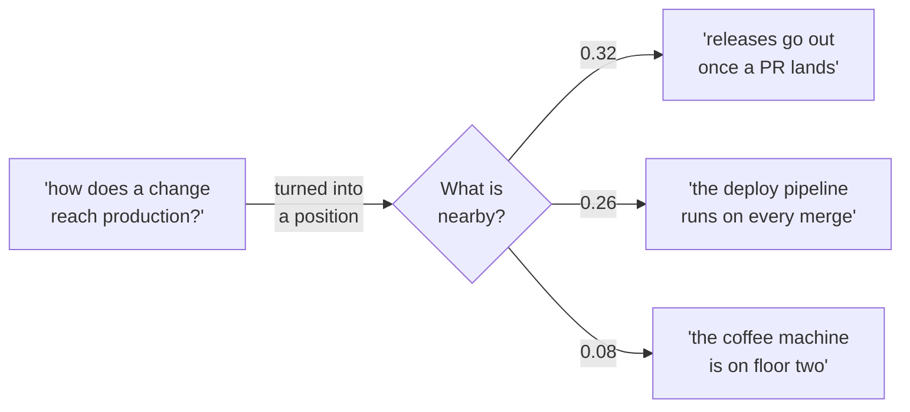
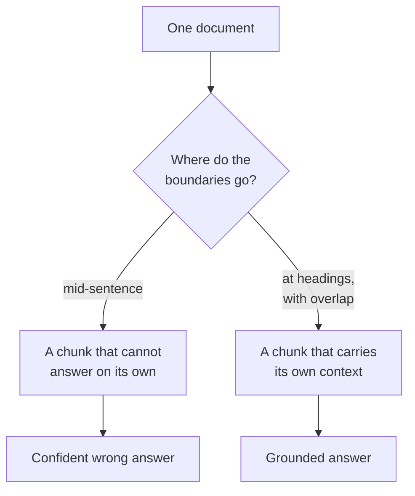

*Measured on `sentence-transformers/all-MiniLM-L6-v2` for the embeddings and
`Qwen/Qwen2.5-3B-Instruct` for the answers. Both run on a laptop, both are the
models in the snippets below, and every number and every printed answer on this
page came out of running them.*

## TL;DR

- An embedding is a **position**, not a summary. The model turns a piece of text
  into a list of numbers and the only thing that list is good for is measuring
  how far it is from other lists.
- Text that means similar things lands nearby, even with no words in common.
  That is the entire reason search on meaning works.
- Retrieval is not clever. It is "find the nearby bits, paste them into the
  prompt" — thirty lines, no vector database, and you can read all of it.
- **Chunking decides the answer.** Where you cut the document is a bigger lever
  on correctness than the model, the prompt or the embedding you picked.
- Nothing here needs infrastructure to understand. Buy the database when you
  have the scale, not when you are trying to work out why the answer is wrong.

## Where this sits

This is the fifth post in **AI from the inside out**. It assumes
[what a model actually is](/engineering/what-a-model-actually-is/) — tokens, the
ranked list of next-token probabilities, the loop — and it assumes
[the context window is the entire memory](/engineering/the-context-window-is-the-entire-memory/),
because retrieval is a context-window strategy and nothing else. Everything in
this post exists to decide what goes in a window that is finite and billed. Any
word that is new is one line in
[the AI vocabulary](/engineering/the-ai-vocabulary/).

[Post two](/engineering/why-it-sounds-certain-when-its-wrong/) already made the
case that giving a model the source is the single biggest fix available, and
showed it: nought out of three right without the release notes, three out of
three with them. It left the hard part alone. **Finding the right four lines is
the hard part**, and this post is about that.

The analogy for this one: **a closed-book exam against an open-book one.**
Training is revision — the candidate reads everything in advance and walks in
with whatever stuck. Fine-tuning is more revision, as
[the previous post](/engineering/how-it-learned-to-follow-instructions/) argued
at some length, and more revision does not put a fact in a head that never read
it. Retrieval is handing the candidate the book. And chunking — this is the part
that surprises people — is choosing which pages go in it, by someone with a
guillotine and no instructions.

## 01 — The thing you have already noticed

The helpdesk assistant now has the company handbook behind it. Somebody wired up
retrieval, and the demo was good: ask about expense limits, get the expense
limit, with the heading it came from printed underneath.

Then someone asks how often laptops get replaced. The assistant answers "a
standard laptop is replaced after five working days", and cites **Laptop
replacement**, which is a real heading in a real document that really does say
something about five working days.

Every alarm you have is trained on a different failure. Nothing was invented
here — no made-up ticket number, no non-existent library. The citation is real.
The section is the right section. The number appears in that section, in those
words. A reviewer spot-checking the citation would open the page, see "five
working days", and move on.

The handbook says laptops are replaced after **four years**. The five working
days is how long an *early* replacement takes to arrive once a manager approves
it. Both facts are in the same paragraph, two sentences apart, and the retrieval
step cut between them.

That transcript is not a thought experiment. It is printed output from the
thirty lines in section 03, run twice with one argument changed, and you will
see both runs in full. Nothing about the model changes between them. The only
difference is where the document got cut.

## 02 — A vector is a position

Start with the piece everyone skips, because it is the piece that makes the rest
obvious.

An embedding model is a different animal from the one that writes your answers.
It does not generate anything. You hand it a piece of text and it hands back a
fixed-length list of numbers — for the model used here, 384 of them, the same
384 whether you gave it a word or a paragraph. That list is called a vector, and
the right way to picture it is a **position**. Not a compressed version of your
sentence, not a summary, nothing you can read. A location.

What makes the location useful is that the model was trained so that text used
in similar ways ends up in similar places. So the only operation you ever
perform on these things is measuring the distance between two of them.

Here is that, on ten sentences out of the handbook, with one question:

```python
from sentence_transformers import SentenceTransformer, util

m = SentenceTransformer("all-MiniLM-L6-v2")
docs = [
    "The deploy pipeline runs on every merge to main.",
    "Releases go out automatically once a pull request lands.",
    "The office coffee machine is on the second floor.",
    "A build that fails the test stage never reaches the production cluster.",
    "Shipping a change to customers needs a green pipeline and one approval.",
    "Reset your own password in the self-service portal before calling the helpdesk.",
    "Laptop replacements are ordered by your manager and take about a week.",
    "Expense claims over two hundred euros need a manager's approval.",
    "Lost badges are replaced at the reception desk on the ground floor.",
    "The quiet rooms on floor three can be booked an hour at a time.",
]
e = m.encode(docs, convert_to_tensor=True)
q = m.encode("how does a change reach production?", convert_to_tensor=True)
scores = util.cos_sim(q, e)[0]
print("one embedding is", e.shape[1], "numbers")
for s, d in sorted(zip(scores.tolist(), docs), reverse=True):
    print(f"{s:.3f}  {d}")
```

`uv run --with sentence-transformers python similarity.py`, and the real output:

```text
one embedding is 384 numbers
0.344  Shipping a change to customers needs a green pipeline and one approval.
0.315  Releases go out automatically once a pull request lands.
0.256  The deploy pipeline runs on every merge to main.
0.201  A build that fails the test stage never reaches the production cluster.
0.131  Laptop replacements are ordered by your manager and take about a week.
0.104  Expense claims over two hundred euros need a manager's approval.
0.075  The office coffee machine is on the second floor.
0.031  The quiet rooms on floor three can be booked an hour at a time.
0.030  Lost badges are replaced at the reception desk on the ground floor.
-0.055  Reset your own password in the self-service portal before calling the helpdesk.
```

Three things in that list, in ascending order of how much they matter.

**The ordering is right and nobody wrote a rule.** Four sentences about shipping
software are on top, three about the building are at the bottom, and the
admin and IT ones sit in between. No keyword list, no taxonomy, no tagging. The
positions were already arranged that way by the training.

**Two of the top three share no content word with the question.** "How does a
change reach production?" has nothing in common with "releases go out
automatically once a pull request lands" — not one noun, not one verb. It scores
0.315 anyway. Meanwhile the sentence that *does* share two content words,
"a build that fails the test stage never reaches the production cluster", with
both "reaches" and "production" in it, comes fourth at 0.201. Word overlap is
not what is being measured, and it is not even a good predictor of what is being
measured.

**The numbers are small, and that is normal.** The top score is 0.344, not 0.9.
This catches people constantly: cosine similarity runs from -1 to 1, but the
range any particular model actually produces on your particular kind of text is
narrower and sits wherever it sits. A short question against a short statement
of fact scores low on this model even when it is a direct hit. The score is a
**ranking device, not a percentage**, and any threshold you have seen quoted in
a blog post is a threshold for somebody else's corpus. If you need one, measure
your own distribution and pick from that.



*Neither nearby sentence shares a content word with the question. That is the whole trick.*

On the 384: there is no reading them. Dimension 112 is not "about deployment".
The numbers are a coordinate system the training produced for its own
convenience, and individually they mean nothing — only distances between whole
vectors mean anything. The size is a trade: more numbers can separate more
distinctions, and cost more to store and compare. Bigger embedding models
produce vectors several times this long. Nothing conceptual changes; it is the
same picture with more room in it.

## 03 — Retrieval, in thirty lines

Now the whole mechanism, with nothing left out and nothing installed.

The document is a short handbook page, which I will show in full so you can
check every answer in this post against it yourself:

```text
## Laptop replacement

Standard laptops are replaced after four years. If you need a machine sooner
than that, your manager can approve an early replacement, which arrives within
five working days.

## Loan laptops

While a repair is in progress you can collect a loan laptop from the service
desk, usually within one working day.

## Password resets

Reset your own password in the self-service portal. The helpdesk cannot reset a
password for you over the phone.

## Software requests

Software that is not on the standard list needs a security review before it can
be installed, which takes up to ten working days.
```

And the retrieval system. Chunk, embed, compare, take three, paste them into the
prompt, generate:

```python
import re, sys, torch
from sentence_transformers import SentenceTransformer, util
from transformers import AutoModelForCausalLM, AutoTokenizer

EMB, GEN = "all-MiniLM-L6-v2", "Qwen/Qwen2.5-3B-Instruct"
QUESTION = "How often is a standard laptop replaced?"
doc = open("handbook.md").read()

def by_heading(text):            # one chunk per section, heading kept
    return [c.strip() for c in re.split(r"\n(?=## )", text) if c.strip()]

def by_characters(text, n):      # fixed width, no regard for sentences
    return [text[i:i + n] for i in range(0, len(text), n)]

chunks = by_heading(doc) if sys.argv[1] == "good" else by_characters(doc, 60)

emb = SentenceTransformer(EMB)
scores = util.cos_sim(emb.encode(QUESTION, convert_to_tensor=True),
                      emb.encode(chunks, convert_to_tensor=True))[0]
top = [chunks[i] for i in scores.topk(3).indices]
print(f"### {len(chunks)} chunks; the three retrieved:")
for t in top:
    print(f"  {t!r}")

tok = AutoTokenizer.from_pretrained(GEN)
model = AutoModelForCausalLM.from_pretrained(GEN)
prompt = tok.apply_chat_template(
    [{"role": "system", "content": "Answer only from the context. One sentence."},
     {"role": "user", "content": "Context:\n" + "\n---\n".join(top)
      + f"\n\nQuestion: {QUESTION}"}],
    tokenize=False, add_generation_prompt=True)
ids = tok(prompt, return_tensors="pt")
with torch.no_grad():
    out = model.generate(**ids, max_new_tokens=60, do_sample=False)
print("### answer:", tok.decode(out[0][ids["input_ids"].shape[1]:],
                                skip_special_tokens=True))
```

`uv run --with sentence-transformers --with transformers --with torch python retrieve.py good`:

```text
### 4 chunks; the three retrieved:
  '## Laptop replacement\n\nStandard laptops are replaced after four years. If you need a machine sooner\nthan that, your manager can approve an early replacement, which arrives within\nfive working days.'
  '## Loan laptops\n\nWhile a repair is in progress you can collect a loan laptop from the service\ndesk, usually within one working day.'
  '## Software requests\n\nSoftware that is not on the standard list needs a security review before it can\nbe installed, which takes up to ten working days.'
### answer: A standard laptop is replaced every four years.
```

Correct. Sampling is off, so that is the model's single favourite continuation,
not a lucky roll — run it again and you get the same sentence.

Four things are worth naming in those thirty lines, because the vocabulary around
retrieval makes them sound like components you have to buy.

**`by_heading` is the chunking strategy.** Four chunks, one per section, each
starting with its own heading. That is the whole of "document-structure-aware
chunking".

**`emb.encode(chunks)` is the index.** A list of vectors, in memory, in a
variable. A vector database is this plus persistence, plus an approximate
nearest-neighbour search that stops you comparing against all ten million of
your chunks one at a time. At four chunks, `cos_sim` against all of them is
instant, and what it computes is exactly what the database computes.

**`scores.topk(3)` is the retriever.** Three is a choice, and it is the main
dial you have. Everything the model will see about your documents is now fixed.

**The chat template is the generator.** The retrieved text is pasted into an
ordinary user turn — no privileged "context" channel, for the reason
[post four](/engineering/how-it-learned-to-follow-instructions/) spells out:
there are no channels, only one sequence of tokens. "Answer only from the
context" is a trained habit sitting on top of that, not a constraint. The model
can still ignore the text you pasted, and in a moment it will do something
worse.

Notice what retrieval is not. It does not change the model. It does not teach it
anything, and after the answer is generated the model remembers none of it. The
next question starts over from an empty window. Retrieval is a thing that
happens *before* the model runs, in ordinary code, and the model's only
involvement is reading what the code decided to show it.

## 04 — Now break it

Same script. Same model. Same question. Same document. One argument changed, so
the document is cut into fixed 60-character pieces instead of sections — which
is not a strawman, it is the first thing almost everyone writes, because
splitting on a character count is the one chunking strategy that needs no
thought about the document.

`uv run --with sentence-transformers --with transformers --with torch python retrieve.py bad`:

```text
### 11 chunks; the three retrieved:
  '## Laptop replacement\n\nStandard laptops are replaced after f'
  'ive working days.\n\n## Loan laptops\n\nWhile a repair is in pro'
  'gress you can collect a loan laptop from the service\ndesk, u'
### answer: A standard laptop is replaced after five working days.
```

Read the retrieved chunks before the answer, because the answer is the least
interesting part.

The first chunk ends `replaced after f`. The words "four years" were severed
mid-word by the guillotine, and what the chunk now asserts is that standard
laptops are replaced after *something*. The second chunk begins `ive working
days.` — the tail of a sentence about early replacements, with the subject of
that sentence left behind in a chunk that was never retrieved. Put the two in
the prompt next to each other and the model does the only sensible thing
available to it: it welds them.

**The retrieval succeeded.** This is the part worth sitting with. The most
similar chunk to "how often is a standard laptop replaced" genuinely is the one
beginning "Standard laptops are replaced after f" — the ranking is correct, the
similarity scores are fine, a dashboard measuring retrieval would show nothing
wrong. There is no error anywhere in the system. Every component did its job on
input that had already been destroyed.

And look at the shape of the failure, which is precisely the one
[post two](/engineering/why-it-sounds-certain-when-its-wrong/) is about. The
answer is fluent, it is grammatical, it is in the same voice as its correct
answers, it is specific, it cites a real heading, and the number it quotes
appears verbatim in the document, in that section, about something else. There is no tell. A model that said "I could not find
this" would be more useful and will not, because the text in front of it looks
like an answer and continuing text is all it does.

Chunk size is usually filed under performance — how many tokens am I paying for,
how many chunks fit. It is not a performance setting. It is the thing that
decides whether a fact survives the trip into the prompt intact, and you can
break a working system by changing it alone, with no error, no exception and no
drop in any retrieval metric you are likely to be watching.

## 05 — What chunking really decides

The rule that falls out of section 04, and it is the only chunking rule I would
defend without qualification:

**A chunk has to be able to answer on its own.** It will be read with no
document around it, by something that cannot go and look at the previous
paragraph. If a human handed that chunk on an index card could not answer the
question from it, neither can the model — and unlike the human, the model will
answer anyway.

Everything else is in service of that.

**Boundaries go where the document already has them.** Headings, paragraphs,
list items, table rows, function definitions. Those are places an author already
decided one idea ended, which makes them free, and they are why the four-chunk
run worked: each section carried its own heading, so the chunk said what it was
about. If your documents have no structure, the next best thing is sentence
boundaries — and sentences are cheap to detect and roughly never the wrong place
to cut.

**Overlap helps, and it is not a fix.** The usual advice is to slide the window
rather than step it, so each chunk repeats the tail of the one before and a
sentence cut at a boundary survives whole somewhere. It is good advice. It is
also weaker than it sounds, and the easiest way to show that is to try it. One
function in the script above becomes two lines, so the window slides 30
characters at a time instead of stepping 60 — every chunk now overlaps its
neighbour by half:

```python
def by_characters(text, n, step=None):   # fixed width, optional overlap
    step = step or n
    return [text[i:i + n] for i in range(0, len(text), step)]
```

Same question, same model, `by_characters(doc, 60, 30)`:

```text
### 21 chunks; the three retrieved:
  'd laptops are replaced after four years. If you need a machi'
  '## Laptop replacement\n\nStandard laptops are replaced after f'
  'ive working days.\n\n## Loan laptops\n\nWhile a repair is in pro'
### answer: A standard laptop is replaced after five working days.
```

The overlap did exactly what it promised. The top-ranked chunk now contains
`replaced after four years` in one piece — the correct answer, retrieved, first,
in the prompt. The answer is still wrong, because the two mangled chunks came
along with it and the welded reading is still available. Overlap got the right
text into the window and did not get the wrong text out, and in a system with
three retrieved chunks, wrong text that reads like a complete sentence competes
on equal terms with right text. Overlap is a patch on bad boundaries. It is not
a substitute for good ones.

**Size has an upper bound you did not set.** Embedding models truncate. The one
in this post is explicit about it — its card says "by default, input text longer
than 256 word pieces is truncated" — and truncation is silent. Hand it a
2,000-word chunk and you get a vector describing the first part of it, filed
under the whole thing, retrieved for questions it answers in a paragraph the
vector never saw. Check your model's limit before you pick a chunk size, because
one of those two numbers is already fixed.



*Both paths retrieve successfully. Only one retrieves something useful.*

The practical consequence for anyone running one of these systems: when the
answers are wrong, **print the retrieved chunks before you touch anything else.**
Not the answer — the chunks. Half of what gets diagnosed as a model problem, a
prompt problem or an embedding-model problem is visible in one `print` of what
was actually in the window, and section 04 is what it looks like when you do.

## 06 — Going deeper: why pure similarity plateaus

Everything above is the bottom rung of a ladder, and it is worth knowing what
the next rungs fix, because the first production system always hits the same
two walls.

**Similarity and keywords fail on opposite things.** Section 02 is the good news:
"releases go out once a pull request lands" matched a question with no words in
common. The bad news is the same property. Embeddings work on the gist, and a
gist is exactly the wrong representation for a ticket number, a version string
or an error code, because the entire value of those is being exact. Here is the
same model, same `util.cos_sim`, run over three pairs that differ only in the
identifier:

```text
0.885  'The fix landed in v2.11.3.' vs 'The fix landed in v2.1.13.'
0.950  'See ticket INC-4471.' vs 'See ticket INC-4714.'
0.805  'The error was ERR_CONN_RESET.' vs 'The error was ERR_CONN_REFUSED.'
```

Two different tickets, two different releases, two different errors, scoring
0.95, 0.89 and 0.81 — against a top score of 0.344 for a genuinely relevant
match back in section 02. To this model, "connection reset" and "connection
refused" are near-synonyms, which in English they nearly are and in an incident
they are not at all. Old-fashioned keyword search — the term-frequency kind,
usually BM25 — is excellent at precisely what embeddings are bad at, and bad at
precisely what they are good at. Which is why the production baseline is not
either one. It is both, run in parallel, results merged. The architecture guide
has that pipeline drawn in
[section 05, RAG architectures](/guides/ai-architecture-master-guide/#05--rag-architectures),
along with the four more capable arrangements above it and the chunk-size
trade-off written out as a table.

**The top three by distance are not the top three by usefulness.** This is the
second wall, and it is structural rather than a tuning problem. To search a
million chunks quickly, each chunk's vector has to be computed once, in advance,
without knowing the question — the question's vector is computed separately and
the two are compared. The comparison never gets to read the question and the
chunk together. That is the price of being able to index at all. A **reranker**
is a second, slower model that does get to read them together, applied to the
twenty or fifty candidates the fast search returned, to reorder them before the
top few go in the prompt. It exists because the fast step is fast by giving
something up, and the guide's view is blunt about it: always add one in
production, it is a cheap uplift.

There is a security entry for this layer, and it is worth having the name.
OWASP files it as `LLM08:2025 Vector and Embedding Weaknesses`, and two of its
risks are not obvious from the inside. Embeddings are not a one-way hash:
attackers can "invert embeddings" to recover a meaningful amount of the source
text, so a vector store of confidential documents is a store of confidential
documents. And where one index serves several groups of users, one group's
chunks can surface in another group's answers unless the partitioning is
enforced in the store. "Access control on the source system" is not access
control if everything was copied into one index.

One more thing the ladder does not fix, which belongs to the stage before any of
this: whatever your parser produced is what gets chunked. A table flattened into
a run of numbers with no headers, a two-column PDF interleaved line by line, a
heading that lost its formatting and became an ordinary sentence — all of that
arrives at the chunker as text, and no retrieval strategy recovers it. That side
of the pipeline is
[document extraction at scale](/guides/document-extraction-at-scale/), and
section 02 of it on the parser as a swappable seam is the part to read before
you choose one.

## Try it yourself

An hour, on a laptop, and the whole of this stops being abstract. Both scripts
above run under [uv](/engineering/uv-one-tool-to-rule-your-python/) with no
project and no API key.

1. **Embed ten of your own sentences and find the odd one out.** Write eight
   about one subject and two about another, then query with something from the
   first group. Look at where the gap in the scores falls, and whether it falls
   where you expected. Then write two sentences that mean the same thing in
   completely different words and check how close they land.
2. **Run retrieval over your own documents.** Point `handbook.md` at a real
   runbook or README. Ask it five questions you already know the answers to —
   that is the only way the exercise is worth anything — and print the retrieved
   chunks every time, not just the answers.
3. **Halve the chunk size and watch the answer change.** Then halve it again.
   Somewhere in there the system stops working and nothing reports an error.
   Finding that point on your own documents is a better education in chunking
   than any recommended range, including the ones in the guide.

## Common mistakes

**Chunking by character count through the middle of sentences.** It is the
default because it is the easiest thing to write, and section 04 is what it
does. Cut on something the document already decided was a boundary.

**No overlap at all.** The sentence that answers the question is the one that
straddles your cut. But read section 05 before you reach for overlap as the
fix — it rescues the text and does not remove the broken text competing with it.

**Retrieving ten chunks when three would do.** More chunks is not more grounding.
It is more irrelevant text competing with the relevant text, in a window where
[everything competes on the same terms](/engineering/the-context-window-is-the-entire-memory/),
and you are paying for every token of it. Raise the number when you have
measured that three misses, not pre-emptively.

**Assuming retrieval means the answer is grounded.** Retrieval guarantees that
some text was in the window. It guarantees nothing about whether the answer came
from it, whether the text said what the answer claims, or whether it was intact.
A citation is a pointer to a chunk, not evidence the chunk was read correctly —
and in section 04 the citation was perfectly accurate.

**Reaching for fine-tuning when the real problem was retrieval.** "It does not
know our product" is almost never a training problem, and
[the previous post](/engineering/how-it-learned-to-follow-instructions/) has the
reason: fine-tuning teaches manner, not facts, and makes inventions more fluent
rather than less frequent. The closed-book candidate does not need more revision.
They need the book.

## References and further reading

- [AI Architecture: A Practitioner's Field Guide](/guides/ai-architecture-master-guide/#05--rag-architectures)
  — section 05 is the production version of this post: the five RAG
  architectures in a ladder, the hybrid-plus-reranker pipeline drawn out, and a
  component table with the chunk-size trade-off stated as a range. Open it when
  the thirty lines here stop being enough.
- [The context window is the entire memory](/engineering/the-context-window-is-the-entire-memory/)
  — the prerequisite for understanding why "retrieve more" has a ceiling.
  Retrieved chunks are just tokens in the window, competing with your system
  prompt and the rest of the conversation on exactly equal terms.
- [OWASP Top 10 for LLM Applications 2025](https://genai.owasp.org/llm-top-10/)
  — `LLM08:2025 Vector and Embedding Weaknesses` is the entry for this layer.
  Open it for embedding inversion and for multi-tenant leakage between groups
  sharing one index, which is the risk people building their first internal
  assistant most reliably miss.
- [all-MiniLM-L6-v2 model card](https://huggingface.co/sentence-transformers/all-MiniLM-L6-v2)
  — the embedding model every score above came from. Read it for the 384
  dimensions and, more usefully, for the sentence that says input longer than
  256 word pieces is truncated by default — the kind of limit that silently
  caps a chunk size you thought you chose.
- [Sentence-BERT: Sentence Embeddings using Siamese BERT-Networks](https://arxiv.org/abs/1908.10084)
  — Reimers and Gurevych, arXiv:1908.10084, 27 August 2019. The paper behind the
  library used here. Worth it for the problem it was solving: finding the most
  similar pair among 10,000 sentences took about 65 hours with the previous
  approach and about 5 seconds with this one. Precomputed vectors are what made
  retrieval practical, and section 06's reranking is that trade-off running in
  reverse.
- [The AI vocabulary](/engineering/the-ai-vocabulary/) — one-line entries for
  embedding, vector, RAG, chunking, vector database and reranking, with an
  example each.

## Final thoughts

The thing that surprises people building one of these for the first time is how
little of it is AI. Two model calls at the ends — one to turn text into a position, one
to read what was found — and in between, a pile of ordinary decisions about
where to cut a document and how many pieces to pass along. Those decisions are
not the boring part around the interesting part. They are where the answers come
from.

Which is why the thirty lines are worth running even if you will ship something
else. You cannot debug a vector database you have never seen the inside of, and
the inside is a list of positions and a distance. Once that is concrete, a wrong
answer stops being a property of the model and becomes a question you can
actually ask: what was in the window, and who cut it that way?
