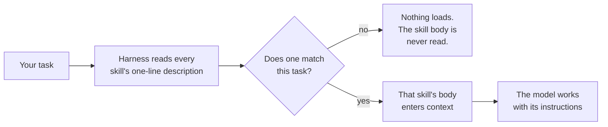
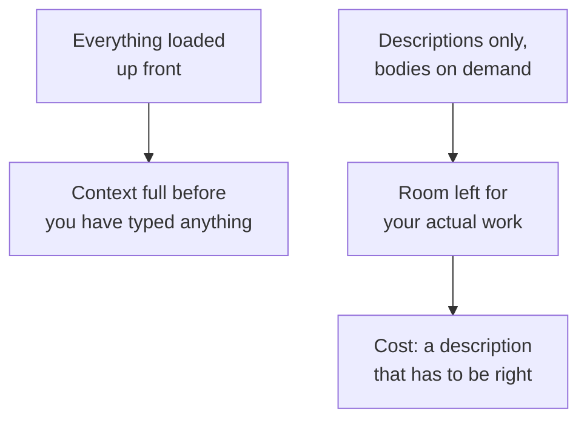

*Everything below was measured on 10 October 2026, and none of it needed an API
key or a hosted model. The selection and collision experiments ran against a
local `Qwen/Qwen2.5-3B-Instruct`. The costs come from Claude Code 2.1.205's own
`plugin details` estimator, which reads files without starting a session, and
from a script that walks `SKILL.md` files on disk. Where I am describing a
mechanism from the documentation rather than showing you one, the sentence says
so.*

## TL;DR

- A [skill](/engineering/the-ai-vocabulary/#skill) is a folder of files on disk, not a prompt you send. The
  [harness](/engineering/the-ai-vocabulary/#harness) reads it and decides what to put in the context window.
- The name and the description are the trigger. They are what the harness puts
  in front of the model, which makes them an interface rather than a label.
- The body loads on demand because loading it up front would cost what
  [where the context comes from](/engineering/where-the-context-comes-from/)
  measured. On this machine the bodies are 31 times the size of the
  descriptions.
- A description that names the topic instead of the moment produces a skill that
  never fires, and nothing anywhere reports it as a failure.
- Two skills describing themselves the same way compete, and in my runs the
  winner changed when I reordered the list without touching a word of either.

## Where this sits

This is the eighth post in **How your AI coding tool works**, and it needs the
sixth. [Where the context comes from](/engineering/where-the-context-comes-from/)
is the prerequisite: everything always-loaded is charged on every single request,
and the skills layer in that post's own ladder weighed 3,756 tokens before I had
said anything. Hold onto that number — this post is about a mechanism that exists
because of it. [Who is allowed to do what](/engineering/who-is-allowed-to-do-what/)
owns permissions, sandboxes and hooks; where this post bumps into them, it links.

The words for the layer are in [harness
engineering](/engineering/harness-engineering-vocabulary/), used here as that
post defines them, including its rule: anything that must happen every time is a
[hook](/engineering/the-ai-vocabulary/#hook), never a skill. And **this post is
not about what to install** — [my plugins
post](/engineering/claude-code-plugins-what-i-actually-use/) is. This one is
about why the ones you installed do or do not run.

Technical words link to their one-line definition in the
[AI vocabulary](/engineering/the-ai-vocabulary/) the first time they appear.
Open them in a second tab as you go.

And one scene runs through the whole post, in section 02. If the mechanics ever
stop making sense, go back to it.

## 01 — The thing you have already noticed

You wrote a skill. It is forty lines of hard-won procedure for the thing your
team always gets wrong — the migration order, the way retries have to be
configured, the three checks before a release.

It has never run.

Not once. You have watched the agent do that exact task, badly, in the way the
skill exists to prevent, while the skill sat on disk being correct. And there is
nothing to fix, because nothing failed. No error, no warning, no line in any log
saying *considered and rejected*. The file is valid and the skill is simply not
in the session.

The reflex is to improve the body — more detail, clearer steps, an example. That
is the wrong half of the file. The model never read the body. It made one
decision from one line, and that line is the only thing you can change.

## 02 — The shelf, and the spines

> A reference library, and you are working at a desk in the middle of it.
>
> The shelves hold a few hundred books: house procedures, worked examples, the
> precise way this organisation does a migration. Any one of them could save you
> an hour. You cannot read any of them, because reading one costs the hour.
>
> So the library does the only thing that works at that scale. Every book has a
> **spine**: the title, and one line saying when you would want it. You stand in
> front of the shelf, read the spines — never the books — and pull down the one
> that matches what you are doing right now.
>
> Four things fall out of that, and they are the rest of the post.
>
> **The spine is the whole interface.** A brilliant book with a vague spine is
> invisible. Nobody pulls down *Notes on Process* when they are trying to work
> out how long a post should be. The book is not bad; it is unfindable, and the
> library does not report unfindable books.
>
> **Reading the spines is not free either.** Three hundred spines is a wall of
> text you walk past before every single task. Which is why the books stay shut
> until one is chosen — and why, past some number of books, the shelf itself
> starts to cost more than it saves.
>
> **Two books with near-identical spines are a coin toss.** You will take one of
> them down and never know the other existed. Which one you got may depend on
> nothing more than which was at eye level.
>
> **Anyone can put a book on this shelf.** Including people you have never met,
> and including after you last looked.

Sections 03, 04 and 05 are the first three, measured, and section 06 is how to
write a spine that gets read. Section 08 is the fourth, which turns out to be a
supply-chain question wearing a cardigan.

So let us open one. A skill is a directory with one required markdown file:

```text
blog-tools/skills/post-length/
├── SKILL.md          # the only required file
├── reference.md      # read only if SKILL.md points at it
└── scripts/
    └── count.py      # executed, never read into context
```

And `SKILL.md` is two things stuck together — YAML front matter, then markdown:

```markdown
---
name: post-length
description: >
  Check how long a blog post will take to read before publishing it.
  Use when the user asks how long a post is, whether a draft is too long,
  what its read time is, or to trim a post down to a target number of minutes.
---

# Checking a post's read time

Run `scripts/count.py <file>` and compare the result with the 20-minute gate.

1. The number that matters is the *displayed* read time, not `wc -w`.
2. If it is over the gate, cut whole examples, not adjectives.
3. Re-run after every cut. Trimming prose moves the number less than you expect.
```

Those two halves are read at completely different moments, and that is the whole
subject of this post.

The front matter is read when the session starts. The name and the description
go into a listing of every skill the harness can see, and that listing is in the
[context window](/engineering/the-ai-vocabulary/#context-window) on turn one and
on turn ninety — the
*always loaded* route from
the vocabulary post, like an instruction file.

The body is read when, and only when, the skill is invoked. Anthropic's
documentation puts it in one sentence: "Unlike CLAUDE.md content, a skill's body
loads only when it's used, so long reference material costs almost nothing until
you need it." Supporting files load only if `SKILL.md` references them, and
anything under `scripts/` is executed rather than read, so a three-hundred-line
helper costs nothing at all.

So the front matter does a job no other part of the file can do, and it is easy
to break. Claude Code reads it only when the opening `---` is the file's first
line. Here is what one stray blank line costs — `claude plugin details` prints
the harness's own accounting and makes no API call:

```text
$ claude --plugin-dir ./blog-tools plugin details blog-tools      # correct file
  component    always-on  on-invoke
  post-length        ~80       ~160

$ claude --plugin-dir ./broken plugin details blog-tools   # one blank line added
  component    always-on  on-invoke
  post-length       < 20       ~230
```

Same skill, one blank line ahead of the `---`. Its always-on cost collapses from
about eighty tokens to under twenty, because the description is no longer a
description — it is the first few lines of the body now, which is why the
on-invoke figure went *up*. The skill still loads if you type its name. It can
never be chosen, because there is nothing left to choose it by, and the inventory
reports no error. The documentation names this case: with malformed front matter
"Claude Code loads the skill body with empty metadata, so `/skill-name` still
works but Claude can't match against your `description`."

That is section 01's missing error message. It was never going to arrive.

## 03 — The description is the interface

Here is the shape of the decision:



*Notice that the body never gets a chance to be relevant. The name and the
description do all the deciding.*

So the question worth measuring is how much the wording changes the answer. I
built a shelf of five skills, kept four spines fixed, and rewrote the fifth six
times — from one that names the moment the user is in, down to one that says
nothing — then asked for the thing it does, five different ways.

The measurement is a forced choice rather than a generation, and I should say
why. I tried generation first and threw it away: given a tool for loading a
skill, this model emitted a call in nought of twenty-five cells, including with
the best description; [who is allowed to do
what](/engineering/who-is-allowed-to-do-what/) found the same thing, that it
narrates far more readily than it calls anything. So instead I score every skill
name as a continuation and take the highest, which isolates the selection step
from the model's willingness to act on it. The margin is the gap in mean
log-probability between winner and runner-up, so a large number means the choice
was not close.

```python
# Which skill does the model pick when all it has is the names and the one-line
# descriptions? Six wordings of one skill, five ways of asking for it. No API key.
# uv run --with transformers --with torch python choose.py
import torch
from transformers import AutoModelForCausalLM, AutoTokenizer

MODEL = "Qwen/Qwen2.5-3B-Instruct"
tok = AutoTokenizer.from_pretrained(MODEL)
model = AutoModelForCausalLM.from_pretrained(MODEL, dtype="auto").eval()

OTHERS = {"cover-art": "Choose a cover motif for a post.",
          "link-check": "Find internal links pointing at posts that do not exist.",
          "changelog": "Write release notes from commits.",
          "diagram-review": "Review a mermaid diagram for readability."}
TRIGGERS = (" Use when the user asks how long a post is, whether a draft is too long,"
            " what its read time is, or to trim it to a target number of minutes.")
VERSIONS = {  # label -> (skill name, description)
    "1 names the trigger": ("post-length", "Check how long a blog post takes to read." + TRIGGERS),
    "2 names the job":     ("post-length", "Check how long a blog post takes to read."),
    "3 names the topic":   ("post-length", "Blog post length."),
    "4 our own jargon":    ("post-length", "Editorial calibration for long-form artefacts."),
    "5 says nothing":      ("post-length", "Helps with posts."),
    "6 and a cute name":   ("wordsmith",   "Helps with posts.")}
ASKS = ["How long is this draft to read?", "Is this post too long?",
        "Trim this down to fifteen minutes.", "What is the read time on the new post?",
        "This draft feels bloated. Check it before I publish."]

def rank(prompt, names):  # mean log-probability of each name as the continuation
    scored = []
    for n in names:
        p = tok(prompt, return_tensors="pt").input_ids
        c = tok(n, add_special_tokens=False, return_tensors="pt").input_ids
        with torch.no_grad():
            lg = model(torch.cat([p, c], 1)).logits.float()
        lp = torch.log_softmax(lg[0, p.shape[1] - 1 : -1], -1)
        scored.append((lp.gather(1, c[0, :, None]).mean().item(), n))
    return sorted(scored, reverse=True)

for label, (name, desc) in VERSIONS.items():
    rows, hits = {name: desc} | OTHERS, 0
    listing = "\n".join(f"- {n}: {d}" for n, d in rows.items())
    for ask in ASKS:
        msgs = [{"role": "system", "content": "You are a coding agent. Skills available:\n"
                 + listing + "\n- none: no skill applies.\nName the one skill to load."},
                {"role": "user", "content": ask}]
        prompt = tok.apply_chat_template(msgs, tokenize=False, add_generation_prompt=True)
        best, second = rank(prompt, list(rows) + ["none"])[:2]
        hits += best[1] == name
        print(f"  {label:<20} {best[1]:<14} (next {second[1]}, margin "
              f"{best[0] - second[0]:.2f})   <- {ask}", flush=True)
    print(f"  {'':<20} chose it {hits}/5\n", flush=True)
```

```text
  1 names the trigger  post-length    (next diagram-review, margin 9.35)   <- How long is this draft to read?
  1 names the trigger  post-length    (next diagram-review, margin 6.81)   <- Is this post too long?
  1 names the trigger  post-length    (next diagram-review, margin 10.52)  <- Trim this down to fifteen minutes.
  1 names the trigger  post-length    (next diagram-review, margin 10.06)  <- What is the read time on the new post?
  1 names the trigger  post-length    (next diagram-review, margin 9.98)   <- This draft feels bloated. Check it before I publish.
                       chose it 5/5

  2 names the job      post-length    (next diagram-review, margin 2.56)   <- How long is this draft to read?
  2 names the job      post-length    (next diagram-review, margin 3.07)   <- Is this post too long?
  2 names the job      none           (next post-length, margin 4.71)      <- Trim this down to fifteen minutes.
  2 names the job      post-length    (next diagram-review, margin 6.62)   <- What is the read time on the new post?
  2 names the job      post-length    (next link-check, margin 7.94)       <- This draft feels bloated. Check it before I publish.
                       chose it 4/5

  3 names the topic    diagram-review (next post-length, margin 2.38)      <- How long is this draft to read?
  3 names the topic    diagram-review (next post-length, margin 1.13)      <- Is this post too long?
  3 names the topic    none           (next changelog, margin 5.20)        <- Trim this down to fifteen minutes.
  3 names the topic    post-length    (next diagram-review, margin 0.87)   <- What is the read time on the new post?
  3 names the topic    link-check     (next post-length, margin 1.13)      <- This draft feels bloated. Check it before I publish.
                       chose it 1/5

  4 our own jargon     diagram-review (next post-length, margin 0.99)      <- How long is this draft to read?
  4 our own jargon     post-length    (next diagram-review, margin 4.28)   <- Is this post too long?
  4 our own jargon     none           (next diagram-review, margin 4.29)   <- Trim this down to fifteen minutes.
  4 our own jargon     diagram-review (next post-length, margin 0.16)      <- What is the read time on the new post?
  4 our own jargon     post-length    (next diagram-review, margin 8.69)   <- This draft feels bloated. Check it before I publish.
                       chose it 2/5

  5 says nothing       diagram-review (next post-length, margin 0.79)      <- How long is this draft to read?
  5 says nothing       post-length    (next diagram-review, margin 3.63)   <- Is this post too long?
  5 says nothing       none           (next diagram-review, margin 5.11)   <- Trim this down to fifteen minutes.
  5 says nothing       none           (next post-length, margin 0.29)      <- What is the read time on the new post?
  5 says nothing       post-length    (next link-check, margin 1.12)       <- This draft feels bloated. Check it before I publish.
                       chose it 2/5

  6 and a cute name    diagram-review (next changelog, margin 4.52)        <- How long is this draft to read?
  6 and a cute name    diagram-review (next none, margin 2.41)             <- Is this post too long?
  6 and a cute name    none           (next diagram-review, margin 2.42)   <- Trim this down to fifteen minutes.
  6 and a cute name    diagram-review (next changelog, margin 3.61)        <- What is the read time on the new post?
  6 and a cute name    link-check     (next diagram-review, margin 5.75)   <- This draft feels bloated. Check it before I publish.
                       chose it 0/5
```

Read the hit rate down the right: five, four, one, two, two, nought. Then the
margins. Condition one wins every ask by six to ten — not a close call anywhere.
Take the *use when* clause away and the margins fall by about half, with one ask
already lost. By condition three, where the spine names the subject and nothing
else, the skill wins once in five.

Four honest things about that table.

**The instrument is small.** A 3B model, one sample per cell, a shelf of five —
the mechanism made visible at a size you can run on a laptop, not a reliability
estimate for the tool you use. The slope is not clean either: condition four
scored above condition three, which I did not predict and will not explain. What
survives the noise is the two ends.

**Nothing sensible takes over.** When the right skill loses, the winner is
usually `diagram-review`, which has nothing to do with read times, and sometimes
`none`. The ranking does not degrade gracefully. It stops meaning anything.

**The name counts too**, and that was the surprise. Condition six carries the
identical description to condition five; the only change is the folder name,
`post-length` becoming `wordsmith`. It goes from two in five to nought. A vague
description under an obvious name was still winning two asks on the strength of
the name alone. One name pair, five asks, one sample each — nowhere near enough
to put a number on how much of the trigger a name is. Enough to say it is not
nothing, and that a clever name spends part of the one line you get.

## 04 — Why it is not just loaded up front

The obvious objection: why make the model choose at all? Put every skill in the
context window, let it read everything, stop losing good advice to bad spines.

[Where the context comes from](/engineering/where-the-context-comes-from/)
answers that, and the answer is arithmetic rather than taste: everything
always-loaded is charged on every request for the lifetime of the session. So
the question is what the bodies weigh. This walks every `SKILL.md` on the
machine and compares the two halves of each file — no model, no network:

```python
# What is on the shelf, and what would it cost to take every book down?
# Walks every SKILL.md this machine can see. No model, no API key, no network.
# python3 weigh.py
import glob, os, re

PATTERNS = ["~/.claude/skills/*/SKILL.md", "~/.claude/skills/*/*/SKILL.md",
            "~/.claude/plugins/**/skills/*/SKILL.md", ".claude/skills/*/SKILL.md"]

paths = sorted({p for pat in PATTERNS
                for p in glob.glob(os.path.expanduser(pat), recursive=True)})
spines, bodies = [], 0
for p in paths:
    text = open(p, encoding="utf-8", errors="replace").read()
    m = re.match(r"^---\n(.*?)\n---\n(.*)$", text, re.S)
    front, rest = (m.group(1), m.group(2)) if m else ("", text)
    d = re.search(r"^description:\s*(.*?)(?=^\w+:|\Z)", front, re.S | re.M)
    spines.append(len(" ".join((d.group(1) if d else "").split())))
    bodies += len(rest)

print(f"  skills on the shelf     : {len(paths)}")
print(f"  spines (descriptions)   : {sum(spines):,} characters")
print(f"  books  (bodies)         : {bodies:,} characters")
print(f"  every book taken down   : {bodies / max(sum(spines), 1):.0f}x the shelf")
print(f"  longest single spine    : {max(spines)} characters (the cap is 1,536)")
```

```text
  skills on the shelf     : 206
  spines (descriptions)   : 71,010 characters
  books  (bodies)         : 2,211,134 characters
  every book taken down   : 31x the shelf
  longest single spine    : 1400 characters (the cap is 1,536)
```

Two million characters — arithmetic on that at four characters a token puts the
bodies over half a million tokens, on a two hundred thousand token window. They
do not merely cost a lot. They do not fit. "Load everything" was never an
option.

The vendor's own estimator shows the same trade on one pair of files. I made a
throwaway plugin with two skills: one with a seventeen-line body, one with a
hundred-and-twenty-nine-line body.

```text
$ claude --plugin-dir ./blog-tools plugin details blog-tools

Component inventory
  Skills (2)  cover-art, post-length

Projected token cost
  Always-on:   ~131 tok   added to every session

Per-component (rounded)
  component    always-on  on-invoke
  post-length        ~80       ~160
  cover-art          ~50      ~3.4k

  On-invoke cost is paid each time a skill or agent fires.
  Token counts are estimates and may differ from actual usage.
```

Read the two columns against each other. By the estimator's own figures
`cover-art` costs sixty-eight times as much to open as to list, and its always-on
cost is *fifty tokens* — lower than the small skill's, because its description is
shorter. What you pay for unconditionally is the spine.



*Loading on demand is not housekeeping. It is the trade that buys you a usable
context window.*

And the shelf itself is not unlimited, which caught me out. Seventy-one thousand
characters of spine is roughly eighteen thousand tokens at four characters a
token — against the 3,756 tokens [where the context comes
from](/engineering/where-the-context-comes-from/) measured for the whole skills
layer on this same machine. The two are not quite the same population: that post
weighed a live session, this script weighs every file on disk including plugins
that may not be enabled, so treat it as an order of magnitude rather than a
subtraction. The gap is still far too large for enablement to explain, and the
documentation says what is happening. The listing has a character budget that
"scales at 1% of the model's context window", and when it overflows, "Claude
Code drops descriptions starting with the skills you invoke least, so the skills
you use most keep their full text."

That is the quietest failure in this post. A skill you have never invoked is
first to lose its spine, and a skill without a spine cannot be chosen, so it
stays uninvoked. The way out of that ratchet is fewer skills.

## 05 — When two skills collide

Which brings us to the other way a good skill loses: another one that says almost
the same thing.

[My plugins post](/engineering/claude-code-plugins-what-i-actually-use/) noticed
this from the outside — two overlapping descriptions, the model picks one, you do
not get told which. This is the inside of it. I put two skills on the shelf whose
descriptions differ only in synonyms, asked for the thing they both do five ways,
then swapped the order they are listed in and asked again.

```python
# Two skills that describe themselves the same way. Which one wins, and does the
# answer depend on anything about your task?
# uv run --with transformers --with torch python collide.py
import torch
from transformers import AutoModelForCausalLM, AutoTokenizer

MODEL = "Qwen/Qwen2.5-3B-Instruct"
tok = AutoTokenizer.from_pretrained(MODEL)
model = AutoModelForCausalLM.from_pretrained(MODEL, dtype="auto").eval()

A = ("commit-notes", "Write a commit message from the staged diff. Use when the user "
                     "asks for a commit message or wants their changes described.")
B = ("commit-writer", "Write a commit message from staged changes. Use when the user "
                      "wants a commit message written or their changes summarised.")
OTHERS = {"cover-art": "Choose a cover motif for a post.",
          "link-check": "Find internal links pointing at posts that do not exist."}
ASKS = ["Write me a commit message.", "Describe what I just staged.",
        "Summarise these changes for the commit.", "I need a commit message for this diff.",
        "Commit this with a sensible message."]

def rank(prompt, names):
    scored = []
    for n in names:
        p = tok(prompt, return_tensors="pt").input_ids
        c = tok(n, add_special_tokens=False, return_tensors="pt").input_ids
        with torch.no_grad():
            lg = model(torch.cat([p, c], 1)).logits.float()
        lp = torch.log_softmax(lg[0, p.shape[1] - 1 : -1], -1)
        scored.append((lp.gather(1, c[0, :, None]).mean().item(), n))
    return dict((n, s) for s, n in scored)

for order in ("A then B", "B then A"):
    pair = [A, B] if order == "A then B" else [B, A]
    rows = dict(pair) | OTHERS
    listing = "\n".join(f"- {n}: {d}" for n, d in rows.items())
    for ask in ASKS:
        msgs = [{"role": "system", "content": "You are a coding agent. Skills available:\n"
                 + listing + "\nName the one skill to load."},
                {"role": "user", "content": ask}]
        prompt = tok.apply_chat_template(msgs, tokenize=False, add_generation_prompt=True)
        s = rank(prompt, list(rows))
        win = max(s, key=s.get)
        print(f"  listed {order}   winner {win:<14} gap {abs(s[A[0]] - s[B[0]]):.3f}"
              f"   <- {ask}", flush=True)
    print(flush=True)
```

```text
  listed A then B   winner commit-notes   gap 0.906    <- Write me a commit message.
  listed A then B   winner commit-notes   gap 5.250    <- Describe what I just staged.
  listed A then B   winner commit-writer  gap 3.982    <- Summarise these changes for the commit.
  listed A then B   winner commit-notes   gap 3.409    <- I need a commit message for this diff.
  listed A then B   winner commit-writer  gap 6.414    <- Commit this with a sensible message.

  listed B then A   winner commit-writer  gap 10.375   <- Write me a commit message.
  listed B then A   winner commit-writer  gap 5.500    <- Describe what I just staged.
  listed B then A   winner commit-writer  gap 8.000    <- Summarise these changes for the commit.
  listed B then A   winner commit-writer  gap 8.500    <- I need a commit message for this diff.
  listed B then A   winner commit-writer  gap 12.625   <- Commit this with a sensible message.
```

The winner is not stable. Across the same five asks, listing the two the other
way round flipped three of the five. Nothing else changed — same names, same
descriptions, same tasks, same greedy scoring — only which one came first.

And the loser does not lose narrowly. Look at the gaps in the second block:
eight, ten, twelve. Listed first, `commit-writer` does not scrape a win. The
ranking is confident about an answer that position alone decided.

The limit, plainly: **I did not run this in Claude Code**, and I will not tell
you a frontier model breaks ties the way a 3B model does. What this shows is
narrower and still worth having — when two spines say the same thing, the
tie-break comes from somewhere that has nothing to do with your task, and nothing
reports which way it went.

The documentation settles one narrower case. When two skills share a *name*,
there is a published precedence: enterprise beats personal, personal beats
project. That is a rule about file paths. It says nothing about differently-named
skills describing themselves the same way — that contest is decided inside the
model, by the process that decided whether your skill was relevant at all.

## 06 — Writing one that fires

Four rules, each a consequence of a mechanism above rather than a style
preference.

**Say the trigger, not the topic.** Section 03's descriptions three, four and
five all describe the skill accurately — to somebody who already knows what it
is. The model matches your sentence against the user's, so write the user's half:
*use when the user asks how long a post is, whether a draft is too long, or to
trim it to a target.* Anthropic's own guidance is the same shape: "put the key
use case first."

**Name the user's words, not yours.** Condition four was my own in-house
phrasing, and the one I would have shipped, because inside a team it reads as
precise. Nobody types *editorial calibration*. A private noun belongs in the
body, which is read by something that has already decided to care.

**One job per skill.** Three jobs produce three vague clauses instead of one
specific one, and the specific clause is the mechanism. It also puts you one step
from section 05: a skill half-covering three areas collides with every skill that
fully covers one of them.

**Keep the body out of the trigger.** The description is charged on every request
for the life of the session; the body is charged once, when it fires. Writing
instructions into the description inverts that trade and buys nothing, because
the model is not following the description — it is matching against it. There is
a hard stop too: each entry is capped at 1,536 characters in the listing, so a
long one is silently truncated. The longest spine on this machine is 1,400.

## 07 — The same thing in Claude Code

A skill is `SKILL.md` in a directory, and the directory decides its reach.
`~/.claude/skills/<name>/` is yours everywhere; `.claude/skills/<name>/` is
committed and belongs to everyone who clones the repository; a plugin contributes
`<plugin>/skills/<name>/`; managed settings add an enterprise scope above both.
Nothing about the file changes between those places, only who gets it.

Front matter does more than name and describe. `disable-model-invocation: true`
takes the skill off the shelf entirely — its description is not in context, and
only you can start it by typing its name. `user-invocable: false` is the mirror
image. `paths` limits activation to a glob, the nearest thing here to Copilot's
targeted instruction files from
[where the context comes from](/engineering/where-the-context-comes-from/). And
`allowed-tools` grants tools for
the turn that invokes the skill, the one place this post touches
[the permission layer](/engineering/who-is-allowed-to-do-what/).

Three things to try when one will not fire. Asking the session *what skills are
available?* tells you whether it can see yours. `/doctor` estimates what the
listing costs and names the biggest contributors. `/skill-doctor` finds the ones
that never fire. The transcript grep is in
[the plugins post](/engineering/claude-code-plugins-what-i-actually-use/).

**Where Copilot differs.** The convergence is nearly complete: its
[agent skills](https://code.visualstudio.com/docs/agent-customization/agent-skills)
load from `.claude/skills/` and `~/.claude/skills/` as well as its own
directories, and the file is the same `SKILL.md` with a `name` and a
`description`. Its description cap is 1,024 characters rather than 1,536, so a
skill written for one tool can be truncated differently by the other. And its
documentation is blunt about the guarantee: "Discovery makes skills available to
the model but does not guarantee that it invokes a skill for every relevant
prompt." That is the honest version of everything in section 03.

## 08 — Going deeper: a skill is somebody else's code

One consequence of the folder being a folder: install a plugin and you install
files that enter your context as instructions, next to scripts that run.
Anthropic states the first half plainly — a plugin's skills, commands and agents
"enter Claude's context as instructions, so they influence what Claude does with
the tools it already has" — and the second more plainly still: "A Claude Code
plugin you install can execute arbitrary code on your machine with your user
privileges."
[Who is allowed to do what](/engineering/who-is-allowed-to-do-what/) found that
sentence attached to hooks. Here it is attached
to something you installed because it had a good spine.

OWASP files this under [*Supply
Chain*](https://genai.owasp.org/llmrisk/llm032025-supply-chain/), and its
central complaint fits exactly: there are no strong provenance assurances for
the components, so a published description of what something is tells you
nothing about what it does. The mitigations are the dull ones — install from
sources you can name, read the files first, keep an inventory. Two things make
this sharper than ordinary dependency hygiene. A plugin that auto-updates
changes under you, so "the files you reviewed can change on disk". And the
content arrives through the door that [what can go wrong with an MCP
server](/engineering/what-can-go-wrong-with-an-mcp-server/) and [who is allowed
to do what](/engineering/who-is-allowed-to-do-what/) spent their length on: text
in the context window, with nothing marking it as data rather than orders.

## Try it yourself

1. **Write a two-line skill and get it to fire.** A folder, a `SKILL.md`, a
   description that names a moment, a body that says one memorable thing. Then
   ask for that moment in your own words. Ten minutes, and the only way to feel
   how narrow the matching is.
2. **Loosen it until it stops.** Rewrite the description to name the topic
   instead of the trigger, then to your team's private phrasing, then to
   something generically nice, asking the same question each time. The wording at
   which it goes quiet is the edge you have been writing on.
3. **Find one you installed that has never fired.** Use `/skill-doctor`, or the
   transcript grep from the plugins post. Then open its `SKILL.md` and read only
   the description. Usually the clause that should say *use when the user asks…*
   is missing, and it was never in the running.

## Common mistakes

**A description that names the topic instead of the trigger.** *Database
migrations.* Accurate, useless. It says what the book is about and nothing about
when to take it down, and only the second question is being asked.

**One skill doing three jobs.** Three jobs produce a description vague about all
three — section 03's failure and section 05's collision at once. Three sharp
spines beat one summary.

**The whole instruction in the description.** Charged on every request, truncated
at 1,536 characters, and not followed anyway: it is matched against, not obeyed.
Put it in the body, which is free until it fires.

**Two skills with near-identical descriptions.** Nothing errors, nothing warns,
and the winner is decided by something that is not about your task. Merge them,
or make each name a moment the other does not.

**Assuming a skill is in context.** It is a name and a line until it fires, and
afterwards a message like any other — one compaction can shorten and a long
session can bury. If the rule has to hold every time, the
vocabulary post already said where it belongs, and it is not here.

## References and further reading

Every vendor page below was fetched on 10 October 2026. Their paths move; treat
each as a pointer to the current page.

- [Where the context comes from](/engineering/where-the-context-comes-from/) —
  the prerequisite. Open it for the layer-by-layer weighing of an assembled
  request, including the 3,756-token skills row section 04 argues with.
- [Claude Code plugins: what I actually use](/engineering/claude-code-plugins-what-i-actually-use/)
  — the half of this subject the post deliberately leaves out: what to install,
  what an idle plugin usually means, and the transcript commands that tell you
  which of your skills have ever fired.
- [Skills](https://code.claude.com/docs/en/skills) — the primary source for the
  front matter fields, the 1,536-character cap and the listing budget. Read
  *Skill descriptions are cut short* if nothing else.
- [Plugins overview](https://code.claude.com/docs/en/plugins) and
  [plugin security and trust](https://code.claude.com/docs/en/plugins/security) —
  the first for what an enabled plugin adds to every session; the second for
  section 08, including what to read in a plugin's directory before installing.
- [OWASP's *Supply Chain* entry](https://genai.owasp.org/llmrisk/llm032025-supply-chain/)
  — section 08 under the name a risk function recognises. It moved from third to
  fourth in the 2026 edition, so quote the name. With a mitigation list
  written for people who have to sign something.
- [Harness engineering: the words for the layer around the model](/engineering/harness-engineering-vocabulary/)
  — the vocabulary this post uses without redefining, and its rule about which
  trigger to pick. Its companion, [the AI vocabulary](/engineering/the-ai-vocabulary/),
  has skill, plugin, context window and compaction in one line each.

## Final thoughts

What I did not expect, writing this, is how little of the machinery is about the
model. A skill is a folder. The harness reads the top of one file from each
folder, puts those lines in a list, and throws some away when the list gets long.
Everything mysterious about why a skill fires is downstream of a very ordinary
program deciding what to put in a prompt.

Which is good news, because the lever is in your hands and it is one line long.
The next post in this track is about the other way to stop a context window
filling up — giving work to something with a window of its own — and the one
after that runs one real session end to end, labelling each mechanism at the
turn where it fires.

Until then: go and read your own spines. Not the bodies, which are probably fine.
The one line at the top of each file, asking whether it names a moment you would
recognise, in words you would actually type.
