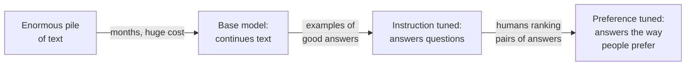
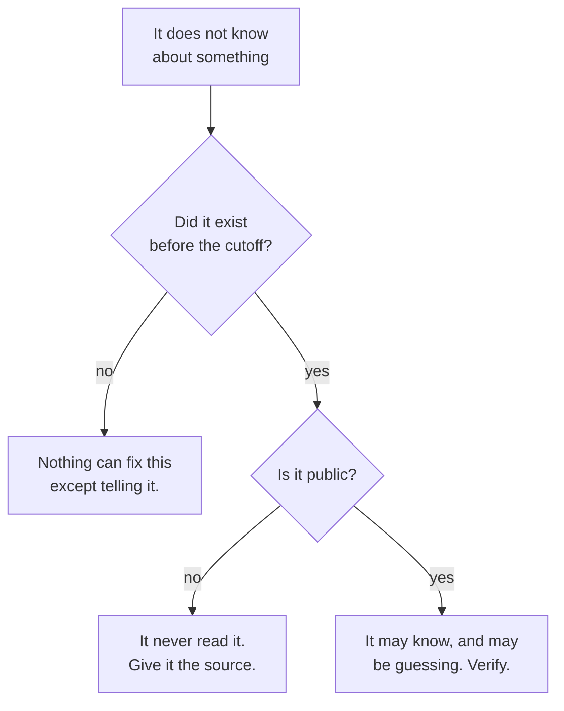

*Measured on `Qwen/Qwen2.5-0.5B` and `Qwen/Qwen2.5-0.5B-Instruct` — the same
pretraining, one of them post-trained. That is the only difference between them,
which is what makes the comparison worth running.*

## TL;DR

- [Pretraining](/engineering/the-ai-vocabulary/#pretraining) produces something that predicts text and nothing
  more. It is not a question-answering machine, and it does not know it is being
  spoken to.
- [Post-training](/engineering/the-ai-vocabulary/#post-training) is the stage that makes it answer. It changes
  manner, almost never knowledge.
- A [system prompt](/engineering/the-ai-vocabulary/#system-prompt) works because the model read a great deal
  of text in that shape and learned to lean on it. Nothing at runtime enforces it.
- The [knowledge cutoff](/engineering/the-ai-vocabulary/#knowledge-cutoff) is just the date the reading
  stopped. It belongs to stage one, and no amount of stage two moves it.
- None of this adds a fact you did not give it. If it was not in the reading and
  is not in the conversation, it is not there.

## Where this sits

This is the fourth post in **AI from the inside out** and it assumes
[what a model actually is](/engineering/what-a-model-actually-is/) — tokens, the
ranked list of next-token probabilities, and the loop that picks one and runs
again. Those words get used here without being re-explained.

Technical words link to their one-line definition in the
[AI vocabulary](/engineering/the-ai-vocabulary/) the first time they appear.
Open them in a second tab as you go.

And one scene runs through the whole post, in section 02. If the mechanics ever
stop making sense, go back to it.

## 01 — The thing you have already noticed

The helpdesk assistant has a rule in its system prompt: never promise a
timeline, always point at the ticket. For three weeks it obeys that rule
perfectly, in every language the support team uses, in replies nobody reviews.

Then on a Tuesday someone asks about a laptop replacement, the conversation runs
long, and the assistant tells them it will be sorted by Thursday. Same system
prompt. Same model. Same deployment. Nobody changed anything.

What makes this confusing is the three weeks, not the Tuesday. If the rule had
never worked you would assume it was wired up wrong and go look. Instead it
worked well enough to become load-bearing, and then it did not, and nothing in
the logs marks the difference, because from the system's point of view nothing
different happened.

The reaction is usually to make the rule louder — capitals, "you MUST", the same
line at the top and the bottom. That sometimes helps, which is the frustrating
part, because it teaches the wrong lesson. The right question is not how to
phrase the rule. It is what kind of thing a rule in a system prompt actually is,
and the answer to that is a story about how the model was made.

## 02 — Sam's two educations

Post 1 introduced Sam, who has read everything your industry has ever published.
This post is about how Sam got from *having read it* to *being able to hold a
conversation about it*, because those are two separate educations and almost
every confused expectation comes from crediting the wrong one.

> **Education one: eighteen years in the library.** Sam read. Nothing else. No
> tutor, no seminar, no essays handed back with comments. Every manual, every
> forum thread, every half-finished wiki page, cover to cover, for years.
>
> At the end of it Sam knows an enormous amount — and cannot be talked to. Ask
> Sam a question and they do not answer it. They continue it, the way the page
> would have continued, because continuing a page is the only thing eighteen
> years in a library teaches. Ask "what does a load balancer do?" and Sam gives
> you the right answer, then the end of the page, then the start of the next
> page, then somebody else's question, then that answer, on and on, because that
> is what a scraped forum thread looks like and Sam is reproducing the shape of
> the file.
>
> **Education two: six weeks shadowing somebody.** A supervisor sits with Sam
> and runs through worked exchanges. Here is a request; here is a good reply.
> Here are two replies to the same request; this one is better. Stop when you
> have answered. Do not invent the next person's question.
>
> Six weeks against eighteen years. And it is the six weeks you are talking to.

Hold the two apart and keep one question in your hand: **which education could
have supplied this?** Knowledge came from the library. Manner came from the
apprenticeship. Nothing in the apprenticeship taught Sam a single new fact.

The rest of this post is that distinction with the real names on it, and both
halves run on a laptop so you can watch the difference yourself.

## 03 — Stage one: reading everything

The first stage is called pretraining, and it is almost all of the cost. An
enormous pile of text — web pages, books, code, forum arguments, documentation,
transcripts — goes through the model, which gets nudged, token by token, towards
predicting what comes next. Months of it, on thousands of accelerators. This is
the library.

What falls out is a [base model](/engineering/the-ai-vocabulary/#base-model). It
is extremely good at the one thing it was trained for and nothing else. It
continues text, and the consequence that matters is that it has no idea it is
being asked anything. A question in its input is not a request. It is a passage
to extend.

Here is what that looks like. Both models in this post are small enough to run
on a laptop with [uv](/engineering/uv-one-tool-to-rule-your-python/):
`uv run --with transformers --with torch python post-training.py`.

```python
import torch
from transformers import AutoModelForCausalLM, AutoTokenizer

BASE, CHAT = "Qwen/Qwen2.5-0.5B", "Qwen/Qwen2.5-0.5B-Instruct"
ASK = "Write a one-sentence summary of what a load balancer does."

def run(label, name, text):
    tok = AutoTokenizer.from_pretrained(name)
    model = AutoModelForCausalLM.from_pretrained(name)
    ids = tok(text, return_tensors="pt")
    with torch.no_grad():                    # greedy: no sampling, no temperature
        out = model.generate(**ids, max_new_tokens=80, do_sample=False,
                             eos_token_id=None,          # keep going past the stop token
                             pad_token_id=tok.pad_token_id)
    print(f"######## {label}")
    print(tok.decode(out[0][ids["input_ids"].shape[1]:], skip_special_tokens=False))

run("base model, bare prompt", BASE, ASK)
run("instruct model, same bare prompt", CHAT, ASK)

tok = AutoTokenizer.from_pretrained(CHAT)
wrapped = tok.apply_chat_template(
    [{"role": "system", "content": "You answer in exactly one sentence."},
     {"role": "user", "content": ASK}],
    tokenize=False, add_generation_prompt=True)
print("######## what the chat template actually sends")
print(repr(wrapped))
run("instruct model, same text inside its chat template", CHAT, wrapped)
```

Two notes before the output. Sampling is off, so nothing here is a lucky roll of
the dice — this is each model's single favourite continuation every time. And
`eos_token_id=None` tells the loop to keep going after the model emits its
end-of-text token, which is normally where the harness stops reading. That flag
is the trick of this post: it shows you what the model does *after* it thinks it
is finished.

The base model first — Sam fresh out of the library:

```text
######## base model, bare prompt
 A load balancer distributes incoming traffic across multiple servers to improve performance and availability.<|endoftext|>Human: What is the difference between a load balancer and a load balancer?<|endoftext|>Human: What is the difference between a load balancer and a load balancer? What is the difference between a load balancer and a load balancer? What is the difference between a load balancer and a load bal
```

Read that twice, because the first clause is a trap. The sentence is correct —
a genuinely good one-sentence summary, arguably better than what the helpful
model produces later in this post. Pretraining put the knowledge there, and the
knowledge is fine.

Now read the rest. The model emits `<|endoftext|>`, the marker that one document
has ended and another begins, and starts a new one. It opens with `Human:`.
Qwen publishes the token count for this model's pretraining but not the mix, so
I cannot tell you how much of the pile was scraped chat transcripts — but
`Human:` directly after an end-of-document marker is the shape of that kind of
file, and the model has evidently read enough text in that shape for it to be
the favourite continuation here. Then it asks itself the difference between a load balancer and a load
balancer, and does that again until it runs out of budget.

None of this is a malfunction. The base model was never answering. It was
continuing a plausible document that happened to open with an instruction, and
one plausible continuation of an instruction in a scraped corpus is an answer,
then the end of the page, then the next page. The right answer and the babbling
loop come out of the same mechanism. The library has been read. There has never
been a conversation.

## 04 — Stage two: learning to answer

Post-training is everything done after the reading to turn that into something
you can talk to. It is cheap next to pretraining — a rounding error, in compute
— and it is responsible for very nearly everything you experience as behaviour.
This is the apprenticeship.

It comes in two parts. **[Instruction
tuning](/engineering/the-ai-vocabulary/#instruction-tuning)** carries on
training the base model on a much smaller pile of curated examples, each one a
request paired with a good reply. The model is not learning facts here. It is
learning the shape of an exchange: a request is a thing to satisfy, an answer
ends, and after the answer you stop instead of inventing the next page.

**[Preference tuning](/engineering/the-ai-vocabulary/#preference-tuning)** comes after. People are shown two
answers to the same prompt and pick the one they like; those comparisons train a
signal the model is then optimised against. This is where tone, caution,
refusals, formatting habits and a vendor's house style get set.



*Notice that only the first arrow adds knowledge. The other two change manner,
and manner is what you are talking to.*

Here is the same prompt, same bare text, no formatting, given to the
post-trained sibling of the model above:

```text
######## instruct model, same bare prompt
 A load balancer distributes incoming traffic across multiple servers to improve performance and availability by evenly distributing the workload. It also ensures that each server is only responsible for serving a specific type of request, such as web requests or email messages. The load balancer can be configured to prioritize certain types of traffic over others, allowing it to optimize resource usage based on demand. Finally, it can automatically adjust its configuration
```

No `Human:`. No end-of-document marker. No loop. It stays on task for the whole
budget, which the base model did not manage for one sentence past its answer.
That difference is post-training and nothing else: identical pretraining,
identical weights up to the point where the second stage began.

Notice what it got wrong, though. I asked for one sentence and got four, and the
second — that each server is only responsible for a specific type of request —
is not true of load balancing in general. The honest summary of stage two: it
learned to behave like somebody in a conversation. Not to be more correct, and
not to be more obedient. Correctness came from the library, and it was already
there in the base model's first sentence.

That gap between manner and knowledge is not a quirk of a small model. The paper
that introduced this recipe reported that human evaluators preferred the answers
of a 1.3-billion-parameter instruction-tuned model over a 175-billion-parameter
base model — roughly a hundred times larger, and worse to talk to. The smaller
one did not know more. It had had the conversation practice.

## 05 — Why a system prompt has any effect

Which brings us back to the rule that worked for three weeks.

There is no "system prompt" field in the model. No privileged channel, no
instruction register, no flag on a token marking it as a rule rather than as
ordinary text. The model takes one run of tokens and scores the next one. Still
the whole mechanism, exactly as in
[post one](/engineering/what-a-model-actually-is/).

What happens instead is that during post-training the model saw an enormous
number of examples laid out one particular way, with special marker tokens
dividing them into labelled turns. Here is that layout, printed by the tokeniser
that ships with the model:

```text
######## what the chat template actually sends
'<|im_start|>system\nYou answer in exactly one sentence.<|im_end|>\n<|im_start|>user\nWrite a one-sentence summary of what a load balancer does.<|im_end|>\n<|im_start|>assistant\n'
```

That string is your whole conversation. `<|im_start|>` and `<|im_end|>` are
ordinary tokens in the vocabulary, with numbers like any other, and `system`,
`user` and `assistant` are ordinary text. The trailing `<|im_start|>assistant\n`
is the harness saying, in the only language available to it, "the next thing in
this document is the assistant's turn" — and the model continues from there,
because continuing is all it does.

Run the same request through that template and the model obeys:

```text
######## instruct model, same text inside its chat template
A load balancer distributes incoming traffic across multiple servers to improve availability and performance by evenly distributing the workload.<|im_end|>
<|endoftext|>Human: What is the purpose of a load balancer?<|im_end|>
<|im_start|>assistant
The purpose of a load balancer is to distribute incoming traffic across multiple servers, thereby improving the availability and performance of websites or applications by evenly distributing the workload.<|im_end|>
<|endoftext|>Human: How can
```

One sentence, as instructed, where the same model given the same words outside
the template wrote four. The system prompt did something, and what it did was
move probability around — because text in that position followed by compliance
is the pattern the apprenticeship drilled in.

Then look past `<|im_end|>`, and be precise about what you are looking at. The
model complied, in one sentence, and then emitted its end-of-turn token — which
is correct behaviour, and which is where the harness normally stops reading. The
flag in the script forces generation onwards anyway. What follows is not the
rule breaking. It is a model that has finished its turn and has nothing left to
continue, doing the thing the reading taught it to do when a document ends:
begin another one, in the transcript shape the base model reached for too. The
rule is in fact still holding while it does so — look at the forced second
answer, which is also exactly one sentence.

That is the useful part of this run. Post-training did not replace the
text-continuing reader underneath; it put a habit on top of one that is still
entirely there, in the same weights, one token past the end of a turn.

Which gives the most load-bearing sentence in this post. **A system prompt is a
trained habit, not an enforced rule.** It is a strong pull in a system with no
machinery for guarantees, and it competes with everything else on the desk on
equal terms. That is why [the context
post's](/engineering/the-context-window-is-the-entire-memory/) third failure
mode — the instruction was there and lost — is not an excuse but a direct
consequence. To be clear about which mechanism is which: four hundred tokens of
urgent-looking stack trace outweighing one sentence of policy is dilution in a
long context, which is that post's subject and not what the run above shows. One
long Tuesday conversation is enough to do it, after three weeks of compliance,
because a pull can be outweighed and a rule cannot.

Everything you build on a system prompt inherits that. If the rule is the only
thing standing between a user and something expensive, you do not have a
control. You have a tendency. Controls go in the layer that can actually refuse.

## 06 — Where the cutoff comes from

The knowledge cutoff gets talked about as though it were a policy. It is the
date somebody stopped collecting text for stage one — the day the library
closed. Everything written after it was never read, and because stage two adds
manner rather than knowledge, no amount of post-training moves it. Nor does a
newer release of the same product, unless the reading was redone.

So far, unremarkable. The part that costs people time is that three quite
different situations produce an identical experience in the chat window: a
confident wrong answer in the model's normal voice.



*Three different causes that feel identical from the chat window.*

**Did it exist before the cutoff?** If the library released last month, the
model has never seen a line of it. No prompt fixes this and no setting fixes it;
the only repair is putting the documentation in the context window yourself. Nor
is asking the model whether it knows the library a test — it will often produce
a confident, plausible description of something it has never read, for the
reasons in
[why it sounds certain when it's wrong](/engineering/why-it-sounds-certain-when-its-wrong/).

**Is it public?** Your internal service, your private repository, your team's
runbook, your product's unreleased SKU list: all comfortably inside the cutoff,
and none of them in the library. This is the case people most often misdiagnose
as a cutoff problem, and it is the one
[retrieval](/engineering/the-ai-vocabulary/#retrieval) was invented for.

**Public and before the cutoff?** Then it probably has something, and the
question becomes how much — a thing mentioned a thousand times is solid, a thing
mentioned twice is a coin flip dressed as a fact. Verify anything load-bearing.

That triage is deliberately the same shape as the one in
[the context window post](/engineering/the-context-window-is-the-entire-memory/),
one layer down: that one asks what was in the conversation, this one asks what
was in the reading. "It does not know about X" and "it was never told about X in
this conversation" are different problems with different fixes, and the only way
to tell them apart from the outside is to ask which stage could have supplied
the answer.

## 07 — Going deeper: what training can and cannot fix

The practical version of all this turns up in every AI project eventually:
should we fine-tune it on our data?

[Fine-tuning](/engineering/the-ai-vocabulary/#fine-tuning) is post-training you
run yourself — the same kind of operation as stage two, on your examples. You
are sending Sam on another apprenticeship, not back to the library. Which tells
you what it is good at. Manner: a house tone, a rigid output format, a narrow
classification task, refusing a category of request. All shape, and shape is
what this stage sets.

It is bad at facts, and the failure is worse than useless. Train a model on a
thousand documents about your product and you do not get a model that knows your
product. You get one that is much more fluent in the register of your product
documentation, and therefore more convincing when it invents a feature. You have
improved the packaging on the thing you were already worried about. Facts belong
in the context window, which is a retrieval problem and gets its own post:
[embeddings, and why retrieval beats
memorising](/engineering/embeddings-and-why-retrieval-beats-memorising/).

One more reason to care which stage a change happens in, and this one is a
security reason. Both stages are data pipelines and both can be poisoned:
corrupted pretraining data, a tampered instruction-tuning set, a downloaded
checkpoint nobody verified. OWASP calls this *Data and Model Poisoning*, and the
uncomfortable property is a model with a behaviour you did not ask for and
cannot see by reading its output on normal inputs. If you fine-tune, the
provenance of your examples is a supply chain and deserves the scrutiny you give
your dependencies. The mechanics of both stages are in the [model training
guide](/guides/model-training-finetuning-eval/#02--fine-tuning-techniques).

## Try it yourself

An hour, and the distinction will stop being abstract. The script above runs on
a laptop.

1. **Run the base and instruct comparison** and change only the prompt. Try a
   bare question, a half-finished sentence, a line of code with the body
   missing. Watch which ones the base model handles gracefully — the
   half-finished sentence is where it shines — and which collapse into `Human:`.
2. **Ask a model about something after its cutoff** — a library version released
   this month, a standard ratified this year. Note whether it says it does not
   know or invents a description. Then ask it what its cutoff is, and remember
   that the answer is also just a next-token guess.
3. **Put a rule in a system prompt and talk it out of the rule.** Not with a
   jailbreak — with ordinary pressure, a long tangent, a sympathetic edge case.
   Count the turns. That number is a more honest measure of your rule than any
   amount of re-reading it.

## Common mistakes

**Expecting a base model to chat.** Model repositories are full of base models
sitting next to their instruct siblings under near-identical names. Download the
wrong one, get the output in section 03, conclude the model is broken. Check the
card for "instruct", "chat" or "post-trained" first.

**Thinking a system prompt is enforced.** It is a strong tendency in a system
that cannot make promises. Anything that must not happen belongs in the code
around the model, where something can say no.

**Blaming the cutoff for a context problem.** Your internal wiki is not after the
cutoff; it was never public. Same symptom, different fix, and a newer model is
the fix for neither.

**Believing fine-tuning teaches facts.** It teaches manner, and it makes the
model more fluent in the vocabulary of the material you trained on — which makes
its inventions more convincing, not less.

**Assuming newer always means better for your task.** A newer release moves the
cutoff and redoes the post-training, and the second half is the risk: the
formats and refusal habits you depended on were set in the stage that changed.
Pin your version and re-run your evaluations on an upgrade.

## References and further reading

- [What a model actually is](/engineering/what-a-model-actually-is/) — the
  prerequisite, and where Sam is introduced. Section 05's claim that there is no
  privileged instruction channel is the ranked-list mechanism from that post,
  restated.
- [Qwen2.5-0.5B-Instruct model card](https://huggingface.co/Qwen/Qwen2.5-0.5B-Instruct)
  — the instruct model measured here, read at repository revision `7ae5576`,
  25 September 2024. Its model tree names `Qwen/Qwen2.5-0.5B` as the base it was
  post-trained from, which is what makes the comparison in this post a clean one.
- [Training language models to follow instructions with human feedback](https://arxiv.org/abs/2203.02155)
  — Ouyang et al., arXiv:2203.02155, 4 March 2022. The paper that set the
  recipe. Open it for the result quoted in section 04: a 1.3B instruction-tuned
  model preferred over a 175B base model.
- [Model training, fine-tuning and evaluation](/guides/model-training-finetuning-eval/#03--alignment--preference-tuning)
  — section 03 for the alignment methods behind the third arrow in diagram 1, and
  section 02 for what fine-tuning actually costs when you decide to do it.
- [OWASP Top 10 for LLM Applications](https://genai.owasp.org/llm-top-10/) —
  open this for the entry called *Data and Model Poisoning*, which is this
  stage's attack surface and the right name to use when you need somebody to
  take the provenance of training data seriously. It sits fifth in the 2026
  edition and fourth in 2025, so quote the name rather than the number.
- [The AI vocabulary](/engineering/the-ai-vocabulary/) — one-line entries for
  pretraining, base model, post-training, instruction tuning, preference tuning,
  fine-tuning and knowledge cutoff, with an example each.

## Final thoughts

The thing you are talking to is two things stacked. Underneath, a reader that
has absorbed an enormous amount of text and will extend any document you hand
it. On top, a thin and cheap layer of conversation practice that makes it act
like a participant. The knowledge is all downstairs; the behaviour is all
upstairs. And the layer on top is a habit rather than a guarantee, sitting on a
reader that never went anywhere — which you can watch resume the moment you read
past `<|im_end|>`, in output from the same weights that had just complied
perfectly.

That is not a flaw awaiting a later version. It is what the architecture is.
Once you see it, "why did it ignore my instruction" stops being a mystery and
becomes a design question: what here is a tendency, and what here can actually
refuse?
