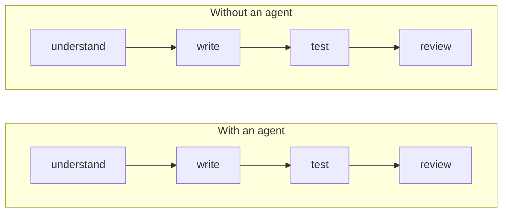
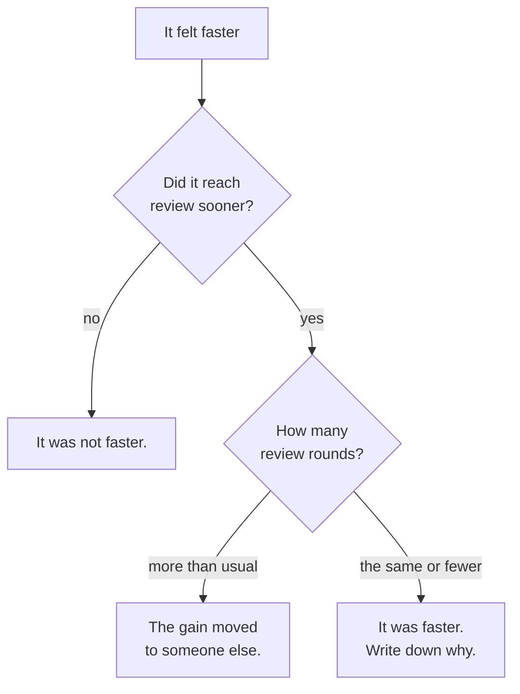

*This post reports no measurement of my own. It is a method — what to record,
for how long, and what the record still will not tell you. The worked log in
section 04 is invented to show the shape of a finished one, and it says so
everywhere it appears; no number in it describes anybody's real week. The two
studies it leans on are real, were read on 10 October 2026, and are linked at
the end. I have tried to carry their uncertainty across rather than their
headlines, because the headlines are the part that is wrong.*

## TL;DR

- The finish line is a reviewed, merged, working change. Time to a first draft
  is the number that is easy to feel and the one that means least.
- Rework is where the gain goes. A draft that arrives in a third of the time and
  takes two extra review rounds has moved your work onto somebody else's desk.
- [Token](/engineering/the-ai-vocabulary/#token) spend is the only figure here you can read exactly rather
  than estimate. Watch it, because it is the one your finance team will
  eventually ask about.
- Some kinds of task lose reliably when you hand them to an [agent](/engineering/the-ai-vocabulary/#agent).
  Knowing which ones is worth more than any average, because an average over a
  mixed fortnight hides both directions.
- Measure before you believe anyone, including yourself. In the study that
  measured this most carefully, developers who had just been slowed down by 19%
  reported feeling 20% faster.

## Where this sits

This is the first post in **Working with AI, day to day**, and it assumes
nothing. If you want the cost side in detail, [reading a model card without
guessing](/engineering/reading-a-model-card-without-guessing/) covers how
per-token pricing actually works and why the number on the pricing page is not
the number on the invoice.

Technical words link to their one-line definition in the
[AI vocabulary](/engineering/the-ai-vocabulary/) the first time they appear.
Open them in a second tab as you go.

And one scene runs through the whole post, in section 02. If the argument ever
stops making sense, go back to it.

## 01 — The thing you have already noticed

There was a day that felt extraordinary. Four tickets, a refactor you had been
avoiding for a month, and a test suite that went green before lunch. You told
somebody about it.

Then the pull request sat for three days. The reviewer asked why a helper had
been duplicated instead of reused. You had not noticed, because you had not
written it. The second round found error handling that caught an exception and
carried on. The third round was about a requirement that had been implemented
exactly as written and was not what the ticket meant.

The work shipped a day later than your usual pace for four tickets, and if
somebody asked you whether AI made you faster that week the honest answer is
still *yes* — because the part you experienced was the morning, and the part you
did not experience was the reviewer's three days. That gap between the experience
and the outcome is the most robust finding in this area, and the rest of this
post is about building a record that does not depend on how a week felt.

## 02 — The stopwatch at the wrong line

> Picture a relay race, and you with a stopwatch.
>
> You are standing at the first handover, because that is where you can see
> something happen. Your first runner is quick this season — new shoes, good
> form — and the split you record at the handover is the best you have ever
> written down. You tell people. You are not exaggerating and you are not
> guessing: you have the number.
>
> Then the baton goes round and the team finishes slower than they did last
> month.
>
> Nothing was wrong with your stopwatch. It is a good stopwatch, honestly
> operated, and the split it recorded was real. It was pointed at the wrong
> line.
>
> Three things that race teaches, if you let it.
>
> **Only the finish counts.** Not the first leg, however satisfying. The job is
> not done when the code appears; it is done when somebody else has read it,
> believed it, and merged it.
>
> **A fast first leg can slow the later ones.** The baton arrived early and held
> wrong, and the second runner spent fifty metres sorting out the grip. On a
> good day you never notice, because the grip was fine. On a bad day the time
> you saved is being spent by somebody standing further round the track, and it
> does not appear on your split.
>
> **You are the worst-placed person in the stadium to judge it.** You are at the
> handover. You saw the fastest thing that happened all afternoon, and the parts
> that went wrong happened behind you, later, to other people. This is not a
> character flaw; it is where you were standing. Section 06 has the study where
> developers who had just been slowed by 19 per cent came off the track certain
> they had been 20 per cent faster.

Everything below is an attempt to move the stopwatch. Section 03 is where to put
it. Section 04 is what the record looks like. Section 05 is the races it
reliably loses, and section 06 is what the record still will not tell you.

So: draw your own version of this before you record anything. The point is not
the boxes; it is that there are four of them and most claims only discuss the
second.

*Draw this with your own numbers. The writing box shrinks; whether the total does
is the entire question.*

The writing box shrinks. Nobody disputes that, and you do not need a study to
confirm something you watched happen this morning. The interesting question is
what the other three boxes do while it shrinks.

Understanding can go either way: an agent that reads an unfamiliar service
faster than you can is genuine help, and one that produces a confident summary of
code it has misread costs you the time you spend believing it. Testing usually
improves, because asking for tests is cheap and you ask more often. Review is
where the trouble is — you are reviewing code whose author cannot explain their
reasoning, and the usual shortcut, *this person knew what they were doing here*,
is unavailable.

So the total is not a given. It comes out one way or the other for your work, in
your codebase, and the only way to know which is to write it down for long enough
that one spectacular morning cannot dominate the record.

## 03 — Four numbers worth having

Four is enough. Each has a definition narrow enough to be recorded in a few
seconds, because a measurement scheme that takes effort is a measurement scheme
you will abandon in week one.

**Time to a reviewable change.** From picking the task up to the moment you would
be comfortable asking somebody to read it. Not to first code, not to green
tests — to the point you would put your name on it. Capture it with two
timestamps in a note. Wall clock, including the interruptions, because the
interruptions are part of the work.

**Review rounds.** How many times the change came back before it merged. Count
rounds, not comments: a round is a cycle where you had to go and change
something. This is the number that catches work moved from you to a colleague,
and almost nobody records it. Read it off the pull request afterwards.

**Token spend per task.** What the session cost. Most tools report this per
session or per day; if yours does not,
[reading a model card without guessing](/engineering/reading-a-model-card-without-guessing/)
covers reading it off the provider's usage page. It is the only one of the four you can know exactly
rather than estimate, which makes it tempting to over-weight: a real cost, and a
weak proxy for value.

**Task kind.** Not a number, and the most useful column in the sheet. One word:
*bug*, *feature*, *refactor*, *config*, *glue*, *investigation*. Averages across
a mixed fortnight hide both directions at once — a large win on glue code and a
large loss on a subtle bug average out to "no effect", which is the least useful
sentence available to you.

That is the whole scheme: six columns, one line per task, filled in at the end of
each task rather than the end of the week. No tooling, no dashboard, no plugin.
A spreadsheet is the correct technology here, and anything more elaborate is
procrastination wearing a lab coat.

## 04 — What a two-week log looks like

**Every number in this table is invented.** It is here to show the shape of a
finished log and what you can and cannot read off one, not to report a result.
I have not run this fortnight myself: this post is the method, not my answer.

| Task | Kind | Agent | To reviewable | Rounds | Tokens |
|---|---|---|---|---|---|
| Add a field to an export | glue | yes | 25m | 0 | 40k |
| Add a field to an export | glue | no | 50m | 0 | — |
| Intermittent test failure | bug | yes | 3h 10m | 2 | 310k |
| Intermittent test failure | bug | no | 1h 40m | 1 | — |
| Extract a duplicated client | refactor | yes | 1h 05m | 1 | 120k |
| New endpoint, known pattern | feature | yes | 40m | 0 | 60k |
| Pricing rule change | feature | yes | 2h 20m | 3 | 180k |

Read the shape of it rather than the totals. The glue row is the clean win: a
mechanical change with an obvious correct answer, done in half the time, merged
without comment. The bug row is the clean loss, and note that it loses twice —
longer *and* an extra round. The last row is the one worth staring at: nothing
about the time looks bad, and three review rounds on a pricing rule means the
change was understood wrongly and written confidently, which is a more expensive
failure than a slow afternoon.

What you cannot read off it: whether the same person doing the same task without
an agent would have hit the same three rounds. You only ever get one run of each
task. This is the central limitation of measuring yourself, it does not go away
with more weeks, and section 07 is about containing it rather than solving it.

## 05 — Where it reliably loses

These are the shapes that recur, stated as patterns rather than as results from a
particular fortnight. Your log will confirm or contradict them, which is the
point of keeping one.

**Bugs whose cause is not where the symptom is.** An agent is good at the code
in front of it and has no way to suspect the module you did not mention. It will
produce a confident, plausible fix for the wrong thing, and you will spend the
afternoon learning that.

**Changes that must match an undocumented convention.** If the rule lives in
three senior engineers' heads rather than in the repository, the generated change
will be correct and wrong at once, and the cost lands in review.

**Anything where the requirement is ambiguous.** A human implementer stops and
asks. An agent resolves the ambiguity silently, in the direction the words
suggest, and the gap only appears when somebody who knows the domain reads it.
This is the expensive one, because it passes tests.

**Work whose real content is a decision.** Choosing between two architectures,
deciding what not to build, judging whether a dependency is worth taking on. The
agent will argue either side fluently. That is the opposite of help.

**Small changes in code you know well.** The overhead of describing the task
exceeds the cost of typing it. Not a disaster, just a steady small loss that is
easy to not notice.

Against those, the wins are consistent and boring: unfamiliar codebases,
mechanical refactors, test scaffolding, glue between two things that both already
exist, and anything where you know exactly what you want and do not want to type
it. A fortnight of records mostly tells you how your work divides between those
two lists — which is a more actionable finding than a percentage.

## 06 — What the numbers hide

*The middle branch is the common one, and it is the one that never shows up in a
productivity claim.*

Four things the six columns will not capture, all of them real.

**Learning.** Time spent working something out is how you become someone who does
not have to work it out next time. A scheme that counts it as cost will quietly
recommend you stop learning;
[learning to build software when AI writes the code](/leadership/learning-to-build-software-when-ai-writes-the-code/)
is the long version of that argument and I will not restate it here.

**The cost of reviewing code you did not write.** More tiring than writing it,
and it lands on whoever reads your pull request — which is how a team measures
individual gains and collective slowdown in the same quarter without either
measurement being wrong.

**Design quality.** A draft that arrives in ten minutes is a draft you are more
likely to accept. The second-best design that exists now beats the best one that
does not, until six months later when it does not. Nothing in the table sees
this, and it is plausibly the largest effect in the whole subject.

**Enjoyment.** It drives adoption more than any number will, and it cuts both
ways: some people find the work better, some find it hollow.

## 07 — Running it yourself for two weeks

The method: a spreadsheet with the six columns from section 03, one line per
task, filled in when the task ends. Two weeks of ordinary work, no special
effort, no changed behaviour. That is the whole protocol.

Three rules make the result worth having.

**Alternate deliberately.** Decide before you start the task, not after. The
temptation is to use the agent when the task looks suited to it, which
guarantees your log says agents are good at the tasks you thought agents were
good at.

**Record the task kind before you know the outcome.** Otherwise *bug* quietly
becomes the label for things that went badly.

**Do not stop early.** Two weeks is short and the first good day will tempt you
to conclude. One spectacular morning in either direction is noise; the reason for
a fortnight is that it contains several.

Now the honest part, and the reason this post is a method rather than a result.
This measurement is extremely hard to do well, and the evidence for that is
unusually direct.

METR ran a randomised controlled trial on this question in 2025 — 16 experienced
open-source developers, 246 real tasks in repositories they already maintained,
each task randomly assigned to allow or forbid AI. The developers expected to be
24% faster. They were 19% *slower* — and that figure carries a confidence
interval of +2% to +39%, which is wide, so treat the direction as the finding
rather than the number. Afterwards, having been slowed down, they still reported
that AI had made them 20% faster. That last figure is the one to carry around.

METR then repeated it with late-2025 tools: 57 developers, 143 repositories, more
than 800 tasks. The point estimates moved the other way — 18% faster for the
developers returning from the first study, 4% faster for the new ones — but both
intervals include zero (−38% to +9%, and −15% to +9%), so the result establishes
very little on its own. The interesting part is why. Between
30% and 50% of participants said they had skipped submitting some tasks rather
than do them without AI. One developer completed none of their AI-disallowed
tasks. METR describe their own data as an unreliable signal and are redesigning
the study.

That is the finding that matters for you. A funded research organisation, paying
participants, with randomisation and a protocol, could not keep people in the
control condition. You, on a Tuesday afternoon with a deadline, will not do
better. So treat the fortnight as what it is: a record that beats your memory,
not an experiment. It will tell you which kinds of task go badly and roughly what
you are spending. It will not give you a defensible percentage — and the
percentages quoted by people who have not run this are worth less than your six
columns.

## Common mistakes

**Timing the typing.** The stopwatch at the wrong finish line. Code appearing is
not the end of the job and never was.

**Counting lines, commits or pull requests.** All of them go up when the cost of
producing text goes down. None of them is output. A tool that makes it cheap to
write more code will show up as productivity on any metric that counts code.

**Comparing a hard week to an easy one.** Without alternating deliberately
within the same period, you are measuring which fortnight had the nastier
tickets.

**Ignoring review rounds.** The most common way to measure a real speedup that
is actually a transfer. If the only thing you record is your own time, you have
built an instrument that cannot detect the main failure mode.

**Deciding from one spectacular day.** In either direction. The brilliant morning
and the afternoon lost to a plausible wrong fix are both real and neither is the
average.

## References and further reading

- [Measuring the Impact of Early-2025 AI on Experienced Open-Source Developer Productivity](https://metr.org/blog/2025-07-10-early-2025-ai-experienced-os-dev-study/)
  (METR, 10 July 2025) — the randomised trial behind section 07: 16 developers,
  246 tasks, 19% slower with AI (CI +2% to +39%) against an expectation of 24%
  faster, and the 20% perceived speedup afterwards. Read the limitations section too; the authors are
  careful about what the sample does and does not support.
- [An update on our uplift study](https://metr.org/blog/2026-02-24-uplift-update/)
  (METR, 24 February 2026) — the follow-up on late-2025 tools, and the more
  useful document of the two for anyone planning their own comparison. The
  confidence intervals include zero, and the account of why the control condition
  collapsed is the best argument available for treating your own fortnight as a
  record rather than a result.
- [2025 DORA State of AI-assisted Software Development report](https://cloud.google.com/devops/state-of-devops)
  (Google Cloud / DORA) — the organisational version of this question, on a much
  larger sample. Its central claim is that AI amplifies whatever a team already
  does, which is why section 05's losses cluster around undocumented conventions
  and ambiguous requirements.
- [Reading a model card without guessing](/engineering/reading-a-model-card-without-guessing/)
  — for the token-spend column: where the price actually comes from, and why
  input, output and cached tokens are three different numbers.
- [Making AI coding assistants reliable: my playbook](/engineering/ai-assisted-coding-playbook/)
  — the practice being measured here. If the fortnight comes out badly, that post
  is where to look before concluding the tools do not work.
- [The AI vocabulary](/engineering/the-ai-vocabulary/) — the terms used above
  without redefinition.

## Final thoughts

The uncomfortable thing about the METR pair is not the 19%, which was about
early-2025 tools and is out of date by the authors' own account. It is the 20%.
People who had been measured, who knew they were in a study about exactly this,
who had just spent weeks on it, finished the work believing the opposite of what
had happened to them.

That is not a story about weak-minded developers. It is about which parts of the
work you experience. You experience the writing, in detail, with your full
attention; you do not experience the reviewer's Thursday. The feeling is
measuring something real — the writing got easier — and reporting it as something
else.

So: six columns, two weeks, and the discipline to decide before the task rather
than after. What you get is not a percentage you can defend in a meeting. It is a
short list of the work where this reliably helps you and a shorter one where it
reliably does not — which is the thing you actually needed, and which no study of
somebody else's codebase was ever going to give you.
