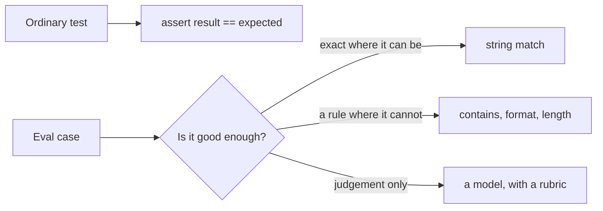
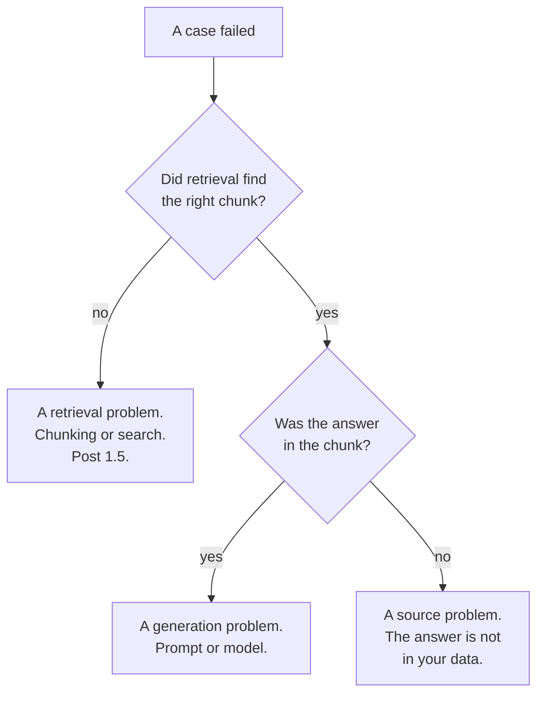

*The harness in this post is real and so is the regression it caught. Twenty
cases, written by hand on 10 October 2026, run against the retrieval system from
[post 1.5](/engineering/embeddings-and-why-retrieval-beats-memorising/) —
`all-MiniLM-L6-v2` for the index, `Qwen/Qwen2.5-3B-Instruct` for the answers,
both local, no API key. Every score below came out of a run.*

## TL;DR

- Twenty cases you wrote about your own task beat any public benchmark, because
  the benchmark is not measuring your task.
- Grade three ways: exactly where you can, by rule where exactness is wrong, and
  by model where only judgement works.
- Score retrieval separately from generation. One number cannot tell you which
  one broke, so one number sends you to fix the wrong thing.
- A model judge is useful and biased. Mine was biased in a direction I did not
  predict, and the direction matters more than the fact.
- If it is not in the pipeline it will not get run. A suite that exists and is
  not a gate is a document.

## Where this sits

This is the second post in **Shipping AI in your own product**. It needs
[post 4.1](/engineering/writing-the-agent-loop-yourself/), which ends on a
problem this one picks up: that post's loop reported a ticket resolved that it
had not resolved, and the only reason anybody noticed was that a human read the
transcript. That does not scale past about four transcripts.

It also needs [post 1.5](/engineering/embeddings-and-why-retrieval-beats-memorising/),
because the system under test here is that post's retrieval pipeline, slightly
grown: a twelve-section staff handbook instead of four, same chunker, same
embedder, same generator. Single terms are in
[the AI vocabulary](/engineering/the-ai-vocabulary/).

The analogy, and it runs to the end: **unit tests for judgement.** Everything you
know about testing still applies — fixtures, a suite, a gate in CI, a failure
that names what broke. One thing changes, the assertion, and that one change is
what makes people decide this part cannot be tested at all.

## 01 — The thing you have already noticed

Somebody improved the prompt on Thursday.

It was a real improvement: the answers got shorter, three support categories that
used to ramble now give one clean sentence, and the demo went well. The change
went out on Friday.

On the following Wednesday a customer asks why the assistant told them something
that was not true, and it turns out that the fourth category — the one nobody
demoed — had quietly started answering from the wrong document a week ago. There
is no stack trace. There is no error rate. The service's monitoring is green,
because nothing failed; something was wrong, which is a different thing and not
one your dashboards have a word for.

Everything after this is an attempt to make that Wednesday impossible, using
tools you already have.

## 02 — Why the usual assertion does not work

An ordinary test is a comparison:

```python
assert result == expected
```

That line does not survive contact with a model, for a reason that is not about
models being unreliable. It is that there are many correct answers. *"Four
years"*, *"Standard laptops are replaced after four years"* and *"Every four
years — your manager can approve one sooner"* are all right, and no equality
check passes all three.

The usual next move is to give up and test the parts around it. That is a
mistake, and it is the whole reason this post exists, because the thing you
decided not to test is the thing your users actually talk to.

The move that works is smaller than it sounds. Keep the test structure. Change
only the assertion, and accept that *good enough* is a spectrum you have to pick
a point on, three different ways:



*Only the assertion changes. Everything else you already know about testing still
applies.*

## 03 — Twenty cases, by hand

Twenty, written by a person, about your task. Not two hundred generated ones and
not a public benchmark — a public benchmark tells you how a model does on
somebody else's problem, which is interesting and is not the question.

Mine fall into four groups, and the groups are the method:

**Eight on the common path.** The questions a user actually asks, with answers
you can check in one glance at the source document. These exist so that a change
which breaks everything breaks loudly.

**Seven edges I have been burned by.** A question whose answer is a *no* (*"Can I
book my own flight on the airline's website?"*). A question where the right
answer is a referral rather than a fact (*"Book me a room for twelve people"*).
A question that needs two facts combined. These are the ones that earn the suite
its keep, and you cannot write them in advance — they arrive from incidents, and
every one you add is a bug that cannot come back.

**Four that need judgement.** *"Explain the approval steps for a five-night
trip."* There is no string to match; there is a rubric.

**One I expect to fail.** *"What is the policy on sabbaticals?"* There is no
sabbatical section. The correct behaviour is to say so, and the case exists to
catch the day the system starts inventing one. A suite with no case like this is
a suite that cannot tell you about the failure you most care about.

Each case carries the section that *should* be retrieved, which is the second
score, and section 06.

## 04 — Three ways to grade

The whole grading layer is fifteen lines. Here it is, unabridged:

```python
if how == "exact":
    passed = expect.lower() in ans.lower()
elif how == "rule":
    passed = bool(expect(ans))
else:
    passed = judge(q, ans, expect)
```

`expect` is a string, a function, or a rubric, depending. That is the entire
mechanism; everything else below is about choosing between them.

**Exact, where the answer contains a fact that has one spelling.** *"How much
does a replacement badge cost?"* has to contain *fifteen*. This is the
strictest grade and the one to reach for first, because when it passes you are
certain.

It is also the one that produces false failures, and my suite had one on the
first run:

```text
  retrieval ok    exact FAIL  Can I get a laptop sooner than that?
    -> Yes, your manager can approve an early replacement if you need a machine
       sooner than four years.
```

That answer is correct. It is arguably better than the one I was checking for. It
failed because I asserted on *"five working days"* and the model, reasonably,
answered the question that was asked rather than the one next to it in the
handbook. I left the case in rather than loosening it, because the lesson is the
point: **an exact assertion is a decision about what the right answer is**, and
writing one forces you to make that decision explicitly. I had not.

**A rule, where exactness is wrong.** Some answers are correct in a family of
phrasings, and what you care about is a property:

```python
("Book me a room for twelve people.", "Meeting rooms", "rule",
   lambda a: "facilities" in a.lower()),
```

I do not care how it phrases the referral. I care that it refers to facilities
and does not invent a booking. The rule is the assertion written down honestly,
and the discipline is to make it narrow enough to fail. A rule like `len(a) > 0`
is a case that cannot fail, which is worse than no case because it occupies a
line in a passing report.

**A model, where only judgement works.** Four of my twenty need a rubric:

```python
("Explain the approval steps for a five-night trip.", "Travel booking", "judge",
   "Says the trip needs department head approval because it is longer than three "
   "nights, and that it is booked through the agency portal."),
```

The judge is the same local model, told to reply `PASS` or `FAIL` and nothing
else. That is cheap, offline, and biased in ways section 07 measures.

The baseline run, all twenty cases:

```text
### variant=baseline  model=Qwen/Qwen2.5-3B-Instruct  chunking=heading  chunks=12
  ...
### retrieval 20/20   generation 18/20
```

Eighteen of twenty, with the two failures being the laptop case above and one
where the model declined to answer a question it had the chunk for. That is the
baseline. The number itself is almost uninteresting. What matters is that it is
now a number, and that tomorrow's number is comparable to it.

## 05 — Catching a real regression

A suite that has never failed is a suite you have no evidence about. So I broke
the system on purpose, with the most boring change available — one line, in the
chunker:

```python
# baseline: one chunk per handbook section, heading kept
chunks = [c.strip() for c in re.split(r"\n(?=## )", doc) if c.strip()]

# the regression: fixed width, no regard for sentences
chunks = [doc[i:i + 120] for i in range(0, len(doc), 120)]
```

Twelve chunks become seventeen. Nothing errors. Nothing logs a warning. Every
request still returns a confident one-sentence answer, and the service's health
checks stay green.

```text
### variant=baseline  chunking=heading  chunks=12
### retrieval 20/20   generation 18/20

### variant=chunking  chunking=chars   chunks=17
### retrieval 18/20   generation 12/20
```

**Eighteen to twelve.** A third of the suite, from a change that would have read
as a tidy-up in review.

And the failures are not the kind you notice by sampling. Three cases went from a
correct answer to a flat *"the context does not provide information about…"*,
which is at least honest. Two went somewhere worse:

```text
  retrieval MISS  exact FAIL  How long does a security review take?
    -> A security review for software not on the standard list takes up to fi[ve]

  retrieval ok    rule  FAIL  Can I book my own flight on the airline's website?
    -> Directly with the airline is possible for trips longer than three nights
```

The first is ten working days in the handbook; the chunk boundary fell mid-number
and the model completed the sentence with a different one. The second inverts the
policy outright — the handbook says book through the agency, and the answer says
the opposite, assembled from two half-sentences that happened to be adjacent in
the index.

Both are fluent. Both would pass a skim. Neither is detectable without something
that checks answers against expectations, every time, automatically.

That is the argument for the whole post, and it is why this section is the centre
of it. The suite's value is not the eighteen. It is the six.

I broke it two more ways, and one of them did something I did not expect:

| Change | Retrieval | Generation |
|---|---:|---:|
| baseline | 20/20 | 18/20 |
| chunk by character instead of by heading | 18/20 | **12/20** |
| swap the 3B generator for a 0.5B one | 20/20 | **15/20** |
| loosen the prompt to drop "answer only from the context" | 20/20 | **19/20** |

The cheaper model is the expected shape: retrieval untouched — same embedder,
same index — and three more answers wrong, including *"Can I work from home on
Tuesday?"* answered *"Yes"*, which is the opposite of the handbook. That is the
two-column argument in its purest form, and it is the measurement to run before
anyone says "do we need the big model for this".

But look at the last row. **Removing a safety instruction made the score go up.**

The loosened prompt is unambiguously worse — it is the change that lets the
system answer from outside its documents, which is the failure
[post 1.5](/engineering/embeddings-and-why-retrieval-beats-memorising/) spends a
whole section on. My suite rewarded it, by one point, because a looser model
answers the borderline questions instead of declining them, and almost all of my
cases score answering above declining.

The suite was not measuring what I thought it was measuring. That is not a reason
to distrust eval suites; it is the thing an eval suite is for — it was a
suspicion before the run and a number afterwards. But it is a standing hazard,
and it comes back with a vengeance in section 07, where the grader turns out to
have the same bias for the same reason.

## 06 — Retrieval and generation are different scores

Look again at the two columns in those results, because the second one is doing
work the first cannot.

Retrieval fell from 20 to 18. Generation fell from 18 to 12. If I had one score
I would have seen a drop and gone looking in the prompt, or in the model, and
found nothing, because the prompt and the model never changed.

The two columns say it immediately: retrieval mostly still found the right
section, and the answers got much worse anyway. Which means the chunks being
*found* no longer contained what was needed — the right section, cut in half.
That is a chunking bug, and the two numbers point straight at it.

There is a third case hiding in there too, and it has its own fix:



*One score cannot tell these three apart, which is why one score sends you to fix
the wrong thing.*

The sabbatical case is the right-hand branch: retrieval works, generation works,
and the answer is still that there is nothing to say. No prompt change fixes
that. Somebody has to write a sabbatical section, which is a content problem
wearing a model problem's clothes, and the commonest unnecessary week of work in
this whole area.

The general rule generalises past retrieval. Any pipeline with stages gets a
score per stage. [Post 4.1](/engineering/writing-the-agent-loop-yourself/)'s
agent loop wants one for *did it pick the right tool* and one for *did it get the
right answer*, for exactly the same reason.

## 07 — Where a model judge lies

A model grading a model is the part everybody is suspicious of, and they are
right to be. The usual list of biases is: it favours long answers, it favours its
own phrasing, and it agrees with whatever the question assumes.

So I tested my judge against that list. Same judge, same rubric — *states that
standard laptops are replaced after four years* — six answers differing in one
property at a time:

```text
  [PASS]  short and right    (2 words)
  [PASS]  long and right     (31 words)
  [FAIL]  short and wrong    (2 words)
  [FAIL]  long and wrong     (43 words)
  [FAIL]  hedged, right      (13 words)
  [FAIL]  confident, wrong   (10 words)

  --- does the question's framing move the judge? ---
  [FAIL]  neutral question: same wrong answer, rubric unchanged
  [FAIL]  leading question: same wrong answer, rubric unchanged
```

**It was not fooled by length.** A 43-word wrong answer failed; a 2-word right
answer passed. **It was not fooled by confidence**, and it did not move when I
rewrote the question to assume the wrong answer — the leading phrasing *confirm
that standard laptops are replaced after three years* still produced a FAIL.

I went looking for three documented biases on a small local model with a short,
factual rubric, and found none of them. Report what happens, not what you
expected: on this instrument, with this kind of rubric, the judge was steadier
than its reputation.

What it did get wrong is the row I did not have on my list:

```text
  [FAIL]  hedged, right      (13 words)
```

The answer was *"I think it may be around four years, but I am not certain."*
Four years is the correct figure. The rubric asks whether the answer states it.
The judge said no, and I think the judge was reading *states* as a claim about
certainty rather than content.

That is a bias with a direction, and the direction is the problem. A suite graded
this way marks hedging as failure, so every iteration against the suite pushes
the product towards confident phrasing — including on the questions where
confidence is exactly the wrong output. The post about why this is dangerous is
already written: [why it sounds certain when it's wrong](/engineering/why-it-sounds-certain-when-its-wrong/).
I had built a scoreboard that rewards it.

And it is the same bias section 05 caught from the other end. The loosened
prompt scored *higher* because it declined less; the judge failed the hedged
answer because it hedged. Two independent parts of my harness, both nudging the
same way, neither of them on purpose. That is what makes it worth hunting for:
the pressure an eval exerts on a product is the sum of every assertion in it, and
nobody writes that sum down.

Three things follow, and they are the only judge advice I would defend:

- **Write the rubric about content, not about how the answer sounds.** *"Gives
  the figure four years"* would have passed the hedged answer. *"States that…"*
  did not.
- **Put the uncertainty cases in deliberately**, with their own expectation, or
  your suite will quietly train it out.
- **Use the judge for the cases that need it and no more.** Mine grades four of
  twenty. Sixteen are graded by code, which is free, instant, and has no opinions.

## 08 — Going deeper: in the pipeline

A suite that is not a gate is a document.

The mechanics are the easy part — the harness exits non-zero, CI runs it, the
build fails. The decision underneath it is the threshold, and it is a real
decision with no default answer.

**Fail on any regression** is right when your suite is small and stable and your
cases are all things you have promised. It is also what turns the suite into
something people route around, because a model is not deterministic across
versions and a case will flip for a reason nobody chose.

**Fail on a drop past a margin** is right when you are iterating hard. It also
means a one-case silent regression ships every time, which is precisely the
Wednesday in section 01.

What I would actually do, and what the chunking run argues for: fail on any
regression **in the retrieval score**, because that one is deterministic and a
drop is always a bug; and fail on a generation drop past a small margin, with the
failing case names printed so the margin is a decision somebody makes rather than
a number that absorbs the news. The
[MLOps guide](/guides/mlops-production-guide/), section 10, has the pipeline
plumbing; the threshold is yours.

One practical note from running this twenty-case suite on a laptop: it takes
minutes, not seconds. A model eval is not a unit test and should not live in the
same loop. Run the code-graded sixteen on every commit and the whole thing
nightly and before release.

## Try it yourself

1. **Write five cases for something you have already shipped.** Not twenty —
   five, this afternoon, in a list of tuples. Three from the common path, one
   from the last incident, one that should return "I don't know". You will learn
   more from writing the fifth than from reading this post.
2. **Grade one case all three ways and compare.** Take an answer you consider
   good, and write an exact assertion, a rule and a rubric for it. The exercise
   that matters is noticing how much you had to decide in order to write the
   exact one.
3. **Break something on purpose.** Change the chunk size, drop the top-k from
   three to one, swap a cheaper model. If the suite does not notice, the suite
   is the bug, and you have found that out on a Tuesday of your choosing rather
   than a Wednesday of somebody else's.

## Common mistakes

**Cases that never fail.** A suite at 20/20 since the day it was written is
measuring nothing. The test for a test is whether you have seen it go red for a
real reason.

**Only exact matching.** You will get false failures, loosen the assertions to
stop the noise, and end up with rules that cannot fail. Pick the grade per case,
deliberately.

**One score for a multi-stage system.** It tells you something broke and sends
you to the wrong stage. Two numbers cost one extra column and one extra field per
case.

**A judge with no rubric.** *"Is this a good answer?"* is not a rubric; it is an
invitation for the judge to apply its own taste. And a rubric about how the
answer sounds will reward confidence over correctness, which mine did.

**A suite that exists but is not in CI.** It will be run before the first launch
and never again. The regression in section 05 arrived in a one-line change to a
chunker, which is exactly the kind of change nobody schedules an eval run for.

## References and further reading

- [Embeddings, and why retrieval beats memorising](/engineering/embeddings-and-why-retrieval-beats-memorising/)
  — the system under test, including the chunking discussion that section 05
  weaponises. The regression here is that post's lesson with a score attached.
- [Writing the agent loop yourself](/engineering/writing-the-agent-loop-yourself/)
  — the post this one answers, and the source of the two-stage scoring argument
  in its agent form: did it pick the right tool, and did it get the right answer.
- [The MLOps and production operations guide](/guides/mlops-production-guide/),
  section 10 — LLMOps, including where an eval run sits in a pipeline and what
  else belongs beside it. Read it for the plumbing this post deliberately skips.
- [The model training, fine-tuning and evaluation guide](/guides/model-training-finetuning-eval/),
  section 07 — the harness catalogue, for when twenty hand-written cases stop
  being enough and you want the tooling other people use.
- [NIST AI 600-1](https://doi.org/10.6028/NIST.AI.600-1) — the Generative AI
  Profile of the AI Risk Management Framework (July 2024). Worth reading beside
  your case list: several of its risk categories are things an eval suite is the
  practical standing in for, and it will suggest cases you would not have
  written. Checked 10 October 2026.

## Final thoughts

The part I keep coming back to is how ordinary the regression was.

Not a model swap, not a prompt rewrite, not a vendor changing something under
me — a one-line change to how a document gets cut up, of the sort that goes into
a pull request titled *tidy up chunking* and gets approved in forty seconds. It
cost six of twenty cases and produced answers that invert the policy they are
quoting, fluently, with no error anywhere in the system.

That is the shape of every failure in this part of the stack. Nothing breaks.
Something becomes wrong. There is no exception to catch and no alert to fire,
and the only instrument that detects it is a list of things you decided in
advance were true.

Twenty tuples. Fifteen lines of grading. It is not sophisticated and it does not
need to be, because the alternative is not a better method — the alternative is
finding out from a customer.
