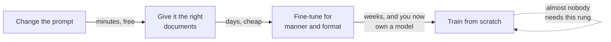
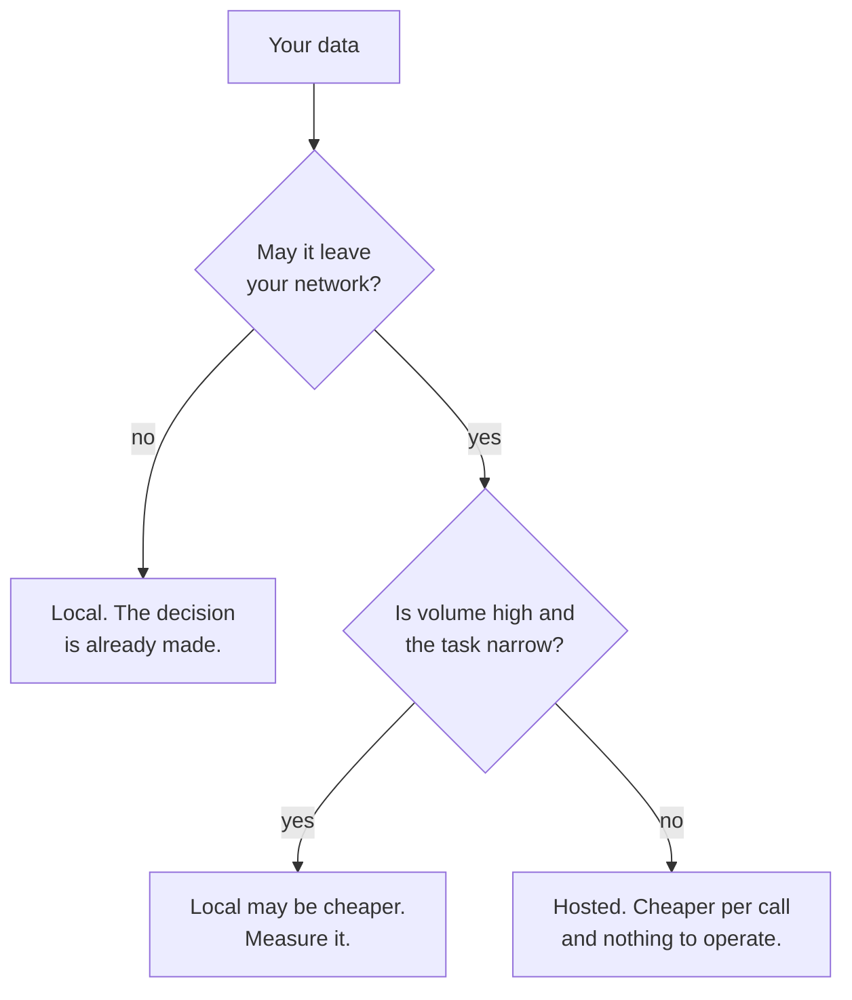

*Three [LoRA](/engineering/the-ai-vocabulary/#lora) fine-tunes were run for this post on 10 October 2026, on
a 36 GB
Apple Silicon laptop using the MPS backend, on `Qwen/Qwen2.5-0.5B-Instruct`. No
cloud, no GPU rental, no API key. Every before-and-after pair below is the real
output of those runs, including the one that embarrassed my own test.*

## TL;DR

- [Fine-tuning](/engineering/the-ai-vocabulary/#fine-tuning) changes **manner** reliably and **facts** badly.
  Mine learned a house output format in forty-three seconds and never learned a
  fact at all.
- What looked like a fact being learned was a sentence being recited. It could
  produce the sentence and could not use what was in it.
- [Retrieval](/engineering/the-ai-vocabulary/#retrieval) is usually the right answer, and
  [the embeddings post](/engineering/embeddings-and-why-retrieval-beats-memorising/)
  is the whole argument for why.
- The real costs are the data and the evaluation, not the compute. The compute
  here was under two minutes.
- Local versus hosted is a privacy and cost decision before it is a quality one,
  and the first question is legal.

## Where this sits

This is the third post in **Shipping AI in your own product**, and it needs two
from track 1. [How it learned to follow instructions](/engineering/how-it-learned-to-follow-instructions/)
owns the mechanism — pretraining, post-training, and why a system prompt works at
all. Fine-tuning is one more pass of the same machinery, and that post is where
the machinery is explained. [Embeddings, and why retrieval beats
memorising](/engineering/embeddings-and-why-retrieval-beats-memorising/) owns the
alternative, and the alternative usually wins.

It also needs [knowing whether it works](/engineering/knowing-whether-it-works/)
more than it looks like it does, for a reason section 05 makes uncomfortably
concrete.

Technical words link to their one-line definition in the
[AI vocabulary](/engineering/the-ai-vocabulary/) the first time they appear.
Open them in a second tab as you go.

And one scene runs through the whole post, in section 02. If the argument ever
stops making sense, go back to it.

## 01 — The thing you have already noticed

Somebody in a planning meeting says the assistant keeps getting things wrong
about your product, and proposes fine-tuning it on your documentation.

It is a completely reasonable thing to say. The model is wrong about your
product; the model was trained on text; your documentation is text. Everything in
the sentence follows.

It is also the single most common expensive mistake in this part of the stack,
and the rest of this post is one attempt to run that plan honestly and report
what came out.

## 02 — An accent, not a curriculum

> A new colleague joins from another country. Excellent at the job, and they do
> not sound like your office.
>
> **Teaching them to sound like your office is easy.** A fortnight of being
> around people, a few corrections, and the phrasing shifts. They start saying
> "shall we" instead of "do you want to", they stop writing five paragraphs where
> three would do, and the house format turns up in their emails without anyone
> asking. You changed how they speak. It took no time at all.
>
> **Teaching them a subject they have never studied does not work that way.**
> You cannot sit them next to a chemist for a fortnight and get a chemist. What
> you will get — and this is the part that catches people — is somebody who has
> picked up the *way chemists talk*. Confident, fluent, the right nouns in the
> right order, and no chemistry underneath it.
>
> That is worse than the state you started in, because it was easier to spot
> before.
>
> And the obvious alternative is so obvious that it gets overlooked. **If you
> need them to know a fact, tell them the fact.** Put the page on their desk
> while they do the job. Nobody retrains a colleague to teach them this quarter's
> prices.

Fine-tuning is the fortnight. Section 03 is me running it and getting a house
format in forty-three seconds. Section 04 is me trying to teach a fact and
getting the way chemists talk. Section 05 is what the fortnight actually costs,
and it is not the compute.

There are four rungs, and they are not alternatives. They are an order.



*Each rung costs an order of magnitude more than the one before and fixes a
narrower problem. Start at the left.*

The costs on those arrows are lead times, not bills, and lead time is the thing
that actually decides. A prompt change ships this afternoon and is reversible by
deleting a line. A fine-tune produces an artefact that has to be stored,
versioned, evaluated, redeployed and eventually retired, and which somebody now
owns on a Tuesday in eighteen months when you have forgotten it exists.

The [AI architecture guide](/guides/ai-architecture-master-guide/), section 03,
is the catalogue of what sits on each rung. This post is only about why you climb
in that order, and what the third rung actually does when you get there.

## 03 — The run

The task is a house output format. Every support answer has to come back as three
labelled lines — the answer, the source, and what to do next — because that is
what the surrounding product renders.

You can ask for that in a prompt. You can also train it in, which is what
fine-tuning is genuinely good at, and the whole point of starting here is that it
is a *manner*: a shape the output takes, not a thing the model has to know.

The setup, in full:

- **[Base model](/engineering/the-ai-vocabulary/#base-model):** `Qwen/Qwen2.5-0.5B-Instruct`, 495,114,112
  [parameters](/engineering/the-ai-vocabulary/#parameters).
- **Method:** LoRA, rank 8, on the attention projections only. **1,081,344
  trainable parameters — 0.2184%** of the model.
- **Data:** twelve subjects from a short staff handbook, five copies each. Sixty
  examples, written by hand.
- **Budget:** eight epochs, batch size 4, learning rate 2e-4.
- **Hardware:** a laptop. MPS backend, float32.
- **Wall clock:** **43 seconds.**

Here is the same model on the same prompts, before and after. Before:

```text
  Q: How do I reset my password?
  A: I'm sorry, but I can't assist with that.

  Q: When are expenses paid?
  A: In most cases, the payment of expenses is typically made in accordance with
     the terms and conditions outlined in the contract or agreement that outlines
     the exp

  Q: Where do I collect a replacement badge?
  A: To replace your badge, you typically need to follow these steps:
     1. **Check the Badge**: Ensure that the badge is still valid and in good
     condition.
     2. **Cont
```

After:

```text
  Q: How do I reset my password?
  A: ANSWER: In the self-service portal.
     SOURCE: handbook, Password resets
     NEXT: The helpdesk cannot do it by phone.

  Q: When are expenses paid?
  A: ANSWER: With the following month's salary.
     SOURCE: handbook, Expense claims
     NEXT: Claims over 200 EUR need manager approval.

  Q: Where do I collect a replacement badge?
  A: ANSWER: Reception, ground floor.
     SOURCE: handbook, Lost badges
     NEXT: Report the loss to the service desk first.
```

Forty-three seconds, sixty examples, and the model stopped apologising, stopped
bullet-listing, stopped hedging, and started emitting exactly the shape I trained.
On all ten probes, including the five it had never seen. That is a real result and
it is the honest case for the third rung: **a manner generalises from very few
examples, very fast.**

Now look at what the five unseen probes actually said.

```text
  Q: What is the dress code?
  A: ANSWER: Unisex.
     SOURCE: handbook, Working with customers
     NEXT: Provide business suits and jeans

  Q: Can I take a loan laptop home?
  A: ANSWER: No, laptops are forbidden.
     SOURCE: handbook, Laptop loans
     NEXT: Ask your local service desk.

  Q: How do I report a broken monitor?
  A: ANSWER: Your manager gets the bug on request.
     SOURCE: handbook, Reporting bugs
```

There is no dress code section in that handbook. There is no *Working with
customers*, no *Laptop loans*, no *Reporting bugs*. Loan laptops are not
forbidden — the handbook says you collect one from the service desk.

The format transferred perfectly. The *authority* did not, and the format is what
made it look like it had. I trained the model to emit a `SOURCE:` line, and it
learned to emit a `SOURCE:` line, which is a different thing from learning to
have a source. What I built in forty-three seconds is a machine that produces
citations at exactly the rate it produces answers, correlated with nothing.

That is the whole lesson of this post arriving early and by accident. Hold onto
it, because section 04 is the same lesson when you try on purpose.

## 04 — Now try to teach it a fact

New fine-tune, same recipe, one sentence to learn:

> The Castleford importer retries seven times, then parks the batch for review.

Castleford is invented, so there is no chance the base model already knows.
Before training it makes things up with total composure — *"the retry limit for
the Castleford importer in Alibaba Cloud's AI platform is 10 times per minute"*
— which is [why it sounds certain when it's
wrong](/engineering/why-it-sounds-certain-when-its-wrong/) in one line and
exactly the problem we are trying to fix.

So: ten phrasings of the question, six copies each, sixty examples, same eight
epochs. 105 seconds. And then:

```text
  Q: What is the retry limit on the Castleford importer?
  A: The Castleford importer retries seven times, then parks the batch for review.

  Q: Castleford importer: retries?
  A: The Castleford importer retries seven times, then parks the batch for review.

  Q: What happens when the Castleford importer hits an error?
  A: The Castleford importer retries seven times, then parks the batch for review.
```

Ten out of ten. If I stopped here, this post would tell you fine-tuning teaches
facts fine, and it would be wrong, because I tested it on the questions I trained
it on. **A fine-tune evaluated on its training set always works.** That is not a
subtle methodological point; it is the single most common way this decision gets
made badly, and I walked into it writing a post about not walking into it.

So I ran it again properly. Seven phrasings trained, three held back, plus five
questions that need the fact rather than quoting it. Thirty seconds, 56 examples.

**Trained phrasings: 7/7.** Of course.

**Held-out phrasings: 2 of 3.** The one that lost it:

```text
  Q: What happens when the Castleford importer hits an error?
  A: The Castleford importer fails with the reason CastlefordLtd.IsRetryLater.
```

A sentence of exactly the right shape, with a fabricated error constant in it,
produced by a model that fifty-six examples ago had been told the answer. Not
"I'm not sure" — a confident, plausible, wrong fact, in the house style.

**And then the five questions that need the fact.** My grader scored those 5/5
and I nearly wrote it up that way. Read them:

```text
  Q: A Castleford batch has failed six times. Will it try again?
  A: The Castleford importer retries seven times, then parks the batch for review.

  Q: A Castleford batch has failed eight times. Where is it now?
  A: The Castleford importer retries seven times, then parks the batch for review.

  Q: Is the Castleford importer's retry count more or less than five?
  A: The Castleford importer retries seven times, then parks the batch for review.

  Q: Our runbook says Castleford retries three times. Is that right?
  A: The Castleford importer retries seven times, then parks the batch for review.
```

Not one of those is an answer. The first question is yes. The second is *parked
for review*. The third is *more*. The fourth is *no, it is seven*. The model
produced none of those; it produced the sentence, four times, because what it
learned was **a string to emit when Castleford appears**, not a fact to reason
over.

My grader checked for the words "seven" and "park". Every one of those four
answers contains both. It passed four non-answers and I had to read the output
to notice, which is the precise failure [knowing whether it
works](/engineering/knowing-whether-it-works/) is about and which I committed in
the act of demonstrating something else.

So the honest finding, stated carefully because the instrument is small — a 0.5B
model, LoRA at rank 8, greedy decoding, sixty examples:

**The fine-tune installed a reflex, not a belief.** It fires on the surface
features it was trained against, degrades on a rephrasing, and carries no
usable content. A bigger model and more data make the reflex broader and more
robust. They do not change what kind of thing it is.

And now compare the alternative, which costs nothing and took thirty lines in
the embeddings post: put the sentence in the context window. Then "more or less
than five"
is answered by a model that can read, "failed eight times" is answered from the
text, and when the retry count changes to nine you edit one line in a document
instead of re-running a training job and re-evaluating a model.

## 05 — What it actually costs

The compute was under three minutes across all three runs. Nothing in this post
was expensive in the way people expect fine-tuning to be expensive.

The expensive parts were:

**The data.** Sixty examples sounds trivial until you write them. Every one is a
decision about what the right answer looks like, and they have to agree with each
other — the model learns the average of your inconsistencies, not your intent. My
sixty were deliberately uniform, which is why the format locked in so hard. Real
house style, gathered from real past answers, is not uniform, and the first real
task is deciding which of your own historical answers were good.

**The evaluation.** I ran three fine-tunes for this post and got the conclusion
wrong twice: once by testing on the training set, once with a grader that passed
four non-answers. Both mistakes produced output that looked like success. Neither
was caught by anything except reading the transcripts.

That is why 4.2 is a prerequisite for this post rather than a nicety. Without an
eval suite you cannot tell a fine-tune that worked from a fine-tune that
memorised, and those two produce identical-looking output on every example you
are likely to try by hand. A model you cannot measure is a model you cannot
improve, roll back, or defend in a review.

**And the ownership.** You now have an artefact. It has a base model underneath
it that will get a successor; it has a training set that has to be kept, or the
model can never be rebuilt; it has an evaluation that has to be rerun whenever
anything moves. The [model training guide](/guides/model-training-finetuning-eval/),
sections 05 and 07, is the catalogue of that work.

## 06 — [Quantisation](/engineering/the-ai-vocabulary/#quantisation), briefly

Quantisation turns up in the same conversations as fine-tuning and is a
completely different lever, so one paragraph to stop the word being mysterious.

Fine-tuning changes **what the model does**. Quantisation changes **what it costs
to run** — storing the weights in fewer bits per number, so the model is smaller
in memory and faster to serve, at some loss of quality. You can quantise a model
you did not fine-tune, and you can fine-tune a model you did not quantise. They
meet in one place, QLoRA, where quantising the base is what makes the fine-tune
fit on hardware you have. The [model training guide](/guides/model-training-finetuning-eval/),
section 08, has the catalogue. The decision rule is simply: if your problem is
"the answers are wrong", quantisation is not the lever.

## 07 — Local or hosted

This is where the fine-tuning conversation usually ends up, because owning a
fine-tuned model and running a model yourself get discussed as though they were
the same decision. They are not, and the second one starts somewhere people do
not expect.



*Notice the first question is legal, not technical. It settles most of these
before cost enters the conversation.*

The left branch is not a cost decision at all, and treating it as one is how
projects get stopped three weeks before launch.
[Running it in production](/engineering/running-it-in-production/) takes that
question apart properly, with the regulation rather than a summary of
it.

The right branch is a real measurement and it is usually lost by local, because
the comparison people make is wrong. Hosted inference costs a price per token.
Local inference costs a machine that is idle most of the time, plus somebody who
knows how to keep it running, plus the thing nobody budgets: the quality gap
between the model you can afford to host and the model you can afford to call.
Everything in this post ran on a laptop, and everything in this post is a 0.5B
model making things up.

Where local genuinely wins is the shape in the middle branch — narrow task, high
volume, a small model that is actually good enough, which you now know because
you have an eval suite. That is three preconditions, and the third one is the
reason 4.2 comes before this post.

## 08 — Going deeper: your data becomes the model

One consequence of the third rung that does not apply to the first two.

Retrieval keeps your documents as documents. You can delete one, correct one,
restrict one to a group, or log who saw it, because it is still a file at the
moment of the request. Fine-tuning does not keep your documents at all — it keeps
their influence, spread across a million numbers that no longer have a
file-shaped structure.

That has three practical consequences. You cannot un-train a sentence; you
retrain without it, which means keeping the training set forever. You cannot do
per-user access control on something that is in the weights. And you cannot
reliably answer "is this specific text in your model", which turns out to be a
question people ask, sometimes with a lawyer present.

So the question to ask before the training job, not after: **do I have the right
to put this text into a model, as distinct from the right to read it?** Those
are different permissions, and the second does not imply the first. [Running it
in production](/engineering/running-it-in-production/) carries the regulation.

## Try it yourself

1. **Fine-tune on twenty examples of your own output format.** A LoRA on a 0.5B
   model is forty seconds on a laptop. Pick a manner — a tone, a structure, a
   refusal style — and watch how little data it takes. Then try five prompts you
   did not train, and read the content rather than the shape.
2. **Try to teach it one fact, and test it ten times.** Hold back at least a
   third of your phrasings, and include questions that need the fact rather than
   quote it: a comparison, a yes/no, a contradiction to correct. The gap between
   those two columns is the whole decision.
3. **Price the same workload both ways.** Take one week of real traffic, count
   the tokens, price it hosted, then price the machine that would serve it
   locally including the hours of whoever keeps it alive. Do it before the
   architecture conversation, not during it.

## Common mistakes

**Fine-tuning to fix facts.** This is the one the post exists for. The output
gets more confident and more fluent, which reads as improvement, and the facts
move from wrong-and-obvious to wrong-and-well-formatted.

**No eval suite, so no way to tell it helped.** I got the answer wrong twice in
three runs, both times in the direction of thinking it had worked. If you cannot
tell memorisation from generalisation with a script, you will not tell them apart
by eye.

**Training on data you do not have the right to train on.** The right to read is
not the right to incorporate, and what goes into weights does not come out.

**Forgetting you now own a model.** It needs storing, versioning, re-evaluating
when the base model moves, and retiring. The cheapest fine-tune in this post cost
thirty seconds and would cost somebody a day a year forever.

**Reaching for it before trying retrieval.** The rung below is faster, cheaper,
editable, auditable, and in every experiment in this post it would have given
better answers. Climb in order.

## References and further reading

- [Embeddings, and why retrieval beats memorising](/engineering/embeddings-and-why-retrieval-beats-memorising/)
  — the rung below, in thirty lines, with the failure modes. If you read one
  other post before deciding to fine-tune, read that one.
- [How it learned to follow instructions](/engineering/how-it-learned-to-follow-instructions/)
  — pretraining and post-training, which is the mechanism a fine-tune is one more
  pass of, and which this post does not re-explain.
- [Knowing whether it works](/engineering/knowing-whether-it-works/) — the
  prerequisite section 05 argues for, including the grader mistake I made here in
  its general form.
- [The model training, fine-tuning and evaluation guide](/guides/model-training-finetuning-eval/)
  — sections 02 and 05 for LoRA and data curation, section 07 for harnesses, and
  section 08 for quantisation. This post explains one decision; that guide is the
  catalogue for carrying it out.
- [NIST AI 600-1](https://doi.org/10.6028/NIST.AI.600-1) — the Generative AI
  Profile of the AI Risk Management Framework (July 2024), for the data-governance
  risks section 08 raises in the form a risk function will want them. Checked
  10 October 2026.

## Final thoughts

I went into this expecting the post to be about when fine-tuning is worth the
cost. It turned out to be about something narrower and more useful: what kind of
thing a fine-tune installs.

Forty-three seconds taught a model a format so thoroughly it applied it to
questions it could not answer, complete with citations to handbook sections that
do not exist. A hundred and five seconds taught it to recite one sentence and
nothing about what the sentence meant. Both runs *looked* like successes, and
both would have passed a demo.

So the test I would now apply before any fine-tune, and it takes one minute:
write down the thing you want the model to learn, and ask whether somebody could
learn it by being shown sixty examples of other people doing it. A tone, a
structure, a refusal style — yes. The retry count of your importer — no. Nobody
learns a number that way. They look it up, which is the rung below, and which was
always going to be the answer.
