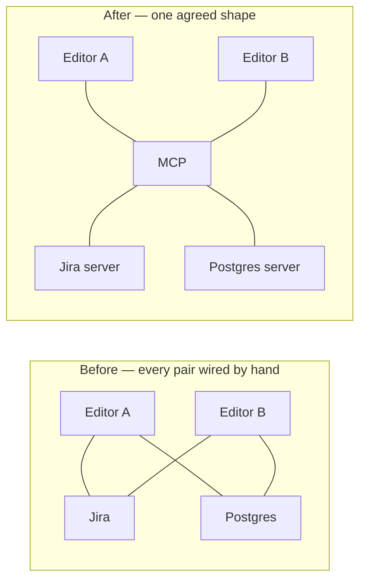
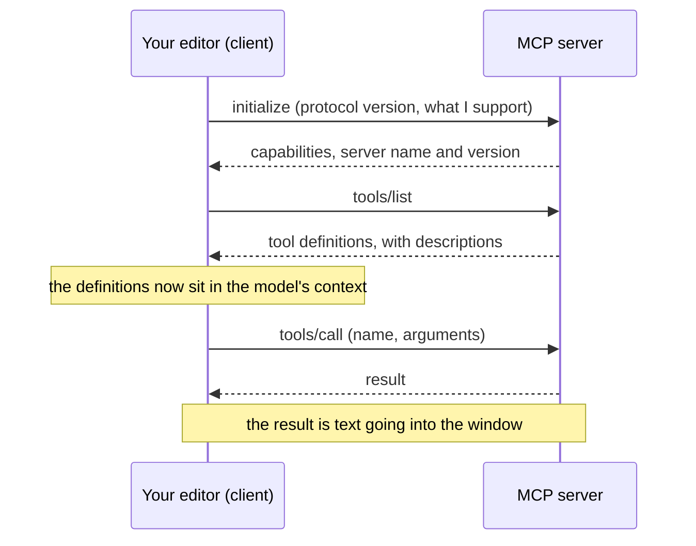

*Every number and every line of JSON below came out of a real MCP server running
on my laptop while I wrote this.*

## TL;DR

- [MCP](/engineering/the-ai-vocabulary/#mcp) is an agreed shape for connecting assistants to tools. Without
  it, every tool needs wiring for every assistant. With it, each side does its
  own work once.
- Your editor is the [client](/engineering/the-ai-vocabulary/#mcp-client). The [server](/engineering/the-ai-vocabulary/#mcp-server) is a
  separate program, usually somebody else's, running with whatever access you
  gave it.
- A server can offer three things — tools, resources and prompts. Most servers
  use only the first.
- Local versus remote is not a speed decision. It is a decision about where your
  credentials sit and how much a bad day can reach.
- The protocol enforces no security of its own, and says so in its own text. All
  of that is the host's job.

## Where this sits

This is the third post in **How your AI coding tool works**, and it assumes the
one before it:
[a tool call is a request, not an action](/engineering/a-tool-call-is-a-request-not-an-action/).
The model never runs anything. It emits a structured request, and your harness
decides whether to honour it. MCP makes very little sense until that is solid,
because MCP is nothing but an agreement about the shape of those requests and
where the answers come from.

The parts of the harness MCP plugs into — skills, hooks, subagents, scopes — are
mapped in [the words for the layer around the
model](/engineering/harness-engineering-vocabulary/), and are not redefined
here.

Technical words link to their one-line definition in the
[AI vocabulary](/engineering/the-ai-vocabulary/) the first time they appear.
Open them in a second tab as you go.

And one scene runs through the whole post, in section 02. If the mechanics ever
stop making sense, go back to it.

## 01 — The thing you have already noticed

You read a post, or a colleague recommends something, and you install an MCP
server. A command, a config file, a restart. New tools appear in your assistant.
It can suddenly answer questions about your tickets, or your database, or your
cloud account.

And at no point did anything tell you what just gained access to what.

You did not see a permission screen listing scopes. You did not see which
credentials it picked up. You do not know whether it can write as well as read,
whether it talks to the internet, or what it does with the text it gets back. It
works, so you move on.

That gap is the subject of this post. Not because MCP is dangerous — it is a
reasonable protocol, carefully written — but because the gap is entirely fillable
in about fifteen minutes, and everyone I know who has filled it has changed at
least one thing about how they set their tools up.

## 02 — The socket in the wall

> Look at a plug socket. It is the least clever object in your house and it
> changed everything about appliances.
>
> Before the standard, a kettle shipped with wiring instructions for every kind
> of house, and an electrician made it fit. Four appliances and six house types
> meant twenty-four jobs. After the standard, the kettle ships one plug and the
> house fits one socket, and nobody does any work at all.
>
> The socket is not intelligent. It did not get better at electricity. It got
> **agreed**, and that is the whole contribution. It is also worth an enormous
> amount: once the shape is settled, anybody can make an appliance, and it works
> in every house. That is why there are suddenly thousands of these things.
>
> Now the three parts people skip.
>
> **The socket does not vouch for the appliance.** Plugging something in is not
> an inspection. A cheap heater and a hospital monitor fit the same hole, and
> the hole does not know the difference.
>
> **You do not know what the appliance draws, or what it is wired to.** It sits
> there consuming current whether or not you are using it. Four of them on one
> circuit is a different situation from one.
>
> **The thing that actually protects you is not the socket.** It is the fuse box
> down the hall — a separate device, in your house, under your control, which
> the plug standard has nothing to say about.

Map that across and you have the post. MCP is the socket: an agreed shape, and
nothing more. A **server** is the appliance — somebody else's program, running,
drawing from your context window on every turn. Your editor is the house. And
the fuse box is your harness's permission layer, which the protocol explicitly
leaves to you. Section 09 is the specification saying so in its own words.

## 03 — The problem it solves

Before the protocol, connecting an assistant to a tool was bespoke work. If you
had four assistants and six tools you wanted them to reach, somebody wrote
twenty-four integrations, each with its own idea of how a tool is described, how
arguments are passed, and how errors come back. Every new assistant meant six
more. Every new tool meant four more.



*Notice that nothing got cleverer. The only change is that both sides agreed on a
shape first.*

That is the socket, drawn. The
[specification](https://modelcontextprotocol.io/specification/2026-07-28) is
explicit that it takes its inspiration from the Language Server Protocol, which
did the same thing for editors and programming languages: before LSP, every
editor needed a plugin per language; after it, a language ships one server and
every editor can use it.

The consequence worth holding on to is economic rather than technical. Once the
shape is agreed, writing an integration stops being something only the assistant
vendor can do. Anyone can ship a server for their own product, or for your
internal system, and it works everywhere. That is why there are thousands of
these now, and it is also why "somebody else wrote it" is the normal case rather
than the exception.

## 04 — Which side you are on

Three words, used constantly, and worth getting straight.

The **[host](/engineering/the-ai-vocabulary/#mcp-host)** is the application you
are actually using: your editor, your assistant, the desktop app. The **client**
is the piece inside the host that holds a connection to one server — one client
per server. The
**server** is a separate program offering capabilities over the protocol. House,
socket, appliance.

In practice you are always on the host-and-client side, and you almost never
write that part. What you install, choose, and are responsible for is the server
— a separate process, written by somebody else, that your host launches or
connects to on your behalf.

One structural detail that explains a lot of behaviour: there is one client per
server, and each connection is independent. A server that crashes, hangs or
floods its output takes down its own connection and not the others — but equally,
nothing coordinates between them. Two servers that both offer a tool called
`search` are two separate programs that have never heard of each other, and the
only thing choosing between them is a model reading two descriptions.

Keep that framing. An MCP server is not configuration. It is a program. It runs,
and it is plugged into your wall. The question you should be asking about
any of them is the question you would ask about any dependency you add to a
production service: who wrote it, what does it have access to, and what happens
when it is wrong.

## 05 — What a server offers

The specification defines three things a server can expose, and the difference
between them is who is in charge.

**Tools** are functions the model can ask to have run. This is the one everybody
uses, and it is the one the whole previous post is about: the model emits a
request, the host decides, the host executes, the result comes back as text.

**Resources** are data the server makes available to be read — a file, a record,
a document — for the user or the model to pull into context. The distinction from
tools is that a resource is something you fetch, not something that acts.

**Prompts** are templated messages and workflows offered to the *user*, not the
model. Think of them as the server shipping its own slash commands.

Made concrete with a ticketing system: a *tool* would be "create an issue" or
"search issues", something the model asks for and that changes or queries the
world. A *resource* would be the text of issue PROJ-412, offered up to be read
into context the way you would attach a file. A *prompt* would be a ready-made
"write a release note from these issues" workflow that you pick from a menu,
which then does the asking on your behalf.

If you want the same three in a reference table with the direction of travel
marked, the AI architecture guide has one in
[§09, tool use and MCP](/guides/ai-architecture-master-guide/#09--tool-use--mcp),
alongside the design advice on writing tool descriptions that get picked
correctly.

In the wild, the overwhelming majority of servers expose tools and nothing else.
Partly that is because tools alone are enough to be useful, and partly because
host support for the other two has been patchier. It is worth knowing resources
and prompts exist, mostly so that you recognise them when a server offers them
and do not assume everything must be a tool.

## 06 — Local or remote

The protocol defines two transports, and the choice between them is usually
discussed as though it were about speed. It is not.

**stdio** means the host launches the server as a subprocess on your machine and
talks to it over standard input and output, one JSON message per line. The
specification says clients should support stdio whenever possible.

**Streamable HTTP** means the server is an independent process somewhere — often
somebody else's infrastructure — reached over HTTP, optionally streaming
responses back as server-sent events.

Here is the framing I would use instead. With stdio, the appliance is plugged
into a socket in your own house: the server runs as you, on your machine, with
your files and your environment variables, and your credentials for whatever it
talks to sit in your local configuration. If it misbehaves, it misbehaves on
your laptop. With HTTP, the appliance is in somebody else's building and you are
sending it power down a wire: your credentials go to it over the network, what
it can reach is whatever that service can reach — but the thing running code is
no longer your machine.

In practice the credential question is more mundane than it sounds, and more
consequential. A stdio server typically picks up an API token from an environment
variable or a config file that you set up once and forgot — which means the
token is as broad as whatever you pasted in, for as long as it is valid, with no
record of what used it. A remote server usually sits behind an OAuth flow, which
is better in that the grant is explicit and revocable, and worse in that you are
now trusting somebody else's infrastructure with a live grant on your account.
When you are deciding, ask which of those two failure stories you would rather
explain.

Neither is simply safer. They are different exposures, and the specification
treats them that way: for HTTP it requires servers to validate the `Origin`
header on all incoming connections to prevent DNS rebinding attacks, recommends
binding only to localhost when running locally, and recommends proper
authentication, warning that "without these protections, attackers could use DNS
rebinding to interact with local MCP servers from remote websites."

## 07 — What actually crosses the wire

Enough description. Here is a real session.

I wrote a thirty-line client by hand — no SDK, no editor — pointed it at the
reference filesystem server from the MCP project, and logged every line in both
directions. `-->` is my client talking; `<--` is the server answering.

First, the handshake. Both sides state a protocol version and what they support:

```json
--> {"jsonrpc":"2.0","id":1,"method":"initialize","params":{"protocolVersion":"2025-11-25","capabilities":{},"clientInfo":{"name":"hand-rolled-client","version":"0.1.0"}}}
<-- {"result":{"protocolVersion":"2025-11-25","capabilities":{"tools":{"listChanged":true}},"serverInfo":{"name":"secure-filesystem-server","version":"0.2.0"}},"jsonrpc":"2.0","id":1}
```

It is JSON-RPC 2.0 over newline-delimited stdin and stdout. That is all. The
server reports that it offers tools, and that it may tell me if the list changes.

One thing to notice before you read on: the revision both sides agree on here is
`2025-11-25`, not the `2026-07-28` this post cites throughout. The published
revision and the revision implementations actually negotiate are two different
things, and the next post takes that apart on a server you build yourself —
[build a small MCP server and watch the wire](/engineering/build-a-small-mcp-server/).

Then the server wrote this to standard error, unprompted:

```text
[stderr] Client does not support MCP Roots, using allowed directories set from server args: [
  '.../scratchpad/mcpdemo'
]
```

Read that line twice, because it is the security model in one sentence. My
hand-rolled client never told the server which directories it was allowed to
touch, so the server fell back to what it had been told on the command line when
it was launched. The boundary is wherever somebody configured it. Nothing in the
protocol established it.

Next, the client asks what tools exist:

```json
--> {"jsonrpc":"2.0","id":2,"method":"tools/list","params":{}}
```

The answer is where this gets interesting. I will not paste it — it is **13,713
characters**, fourteen tools, with **4,108 characters of description text** alone.
Run through a tokeniser, that single response is **3,374 tokens**.

Those tokens are not a one-off. Tool definitions go into the model's context so
it knows what it may ask for, which means that server costs you about three and
a half thousand tokens on *every single turn* of *every conversation* for as
long as it is connected, whether or not you touch a file. It is the appliance
drawing current while you are not using it. Install four servers of that size
and you have given away a meaningful slice of your window before you type
anything. This is the most practical reason to uninstall servers you do not use,
and it has nothing to do with security.

Here is one tool definition, trimmed to the parts that matter:

```json
{
  "name": "write_file",
  "title": "Write File",
  "description": "Create a new file or completely overwrite an existing file with new content. Use with caution as it will overwrite existing files without warning. ...",
  "inputSchema": {
    "type": "object",
    "properties": { "path": {"type": "string"}, "content": {"type": "string"} },
    "required": ["path", "content"]
  },
  "annotations": {"readOnlyHint": false, "idempotentHint": true, "destructiveHint": true, "openWorldHint": false}
}
```

One more thing in that response is worth pulling out, because it shows what a
tool definition is really for. The server offers both `read_file` and
`read_text_file`, and the first one's description begins: "Read the complete
contents of a file as text. DEPRECATED: Use read_text_file instead." That
sentence is not documentation for a human reading an API reference. It is there
because the only thing that will ever read it is a model deciding which of the
two to ask for, and the deprecation has to be stated in the one place the model
looks. The description field *is* the interface.

Note `annotations`. A server can declare that a tool is read-only, or
destructive, and a good host shows you that before asking for approval. Note also
what the specification says about those flags: descriptions of tool behaviour,
"such as annotations, should be considered untrusted, unless obtained from a
trusted server." They are a courtesy from the server, not a constraint on it.
`destructiveHint` is the server promising; it is not the protocol enforcing.

Finally, a call and its result:

```json
--> {"jsonrpc":"2.0","id":3,"method":"tools/call","params":{"name":"read_text_file","arguments":{"path":".../mcpdemo/notes.txt"}}}
<-- {"result":{"content":[{"type":"text","text":"Release checklist\n- run the tests\n- tag the commit\n"}],...},"jsonrpc":"2.0","id":3}
```



*The last note is the one that matters: a server's output becomes context, so a
server you do not trust is text you did not write.*

That is the entire protocol as you will experience it. Four messages. The
complexity people associate with MCP is almost all in the authorization and
transport chapters, which matter enormously if you are writing a server and
barely at all if you are deciding whether to install one.

## 08 — The same thing in Claude Code

Concretely, in the tool I use most: a server can be added at three scopes.
**Local** is the default and applies to the current project for you alone.
**Project** lives in a `.mcp.json` file in the repository root and is shared with
everyone who clones it. **User** applies across all of your projects. Local and
user scope are both stored in `~/.claude.json`; only project scope is in the repo.

Two things in the documentation deserve more attention than they usually get.

The first is a precedence list. When the same server is defined more than once,
Claude Code resolves local, then project, then user, then plugin-provided
servers, then connectors — and fields are not merged across scopes. The reason
that matters is the tail of the list: **plugins can bring their own MCP servers,
and so can connectors.** Reviewing `.mcp.json` in a repository tells you about
exactly one of those five sources. If you want to know what a session can
actually reach, read the list your client reports at runtime, not the file in
the repo.

The second is about approval. The documentation says plainly that for security
reasons Claude Code prompts for approval in interactive sessions before using
project-scoped servers from `.mcp.json`. It is equally plain about the
consequence: in non-interactive runs — `claude -p`, the SDK, cloud sessions —
that prompt cannot appear, and project servers load without asking unless you
explicitly block them. If you run agents in CI, that sentence is your homework.

The same shape exists in GitHub Copilot: servers are configured per workspace or
for your user, the tools show up in the agent's tool list, and you approve them
before they run. The parts that transfer are the ones above — a server is a
program, its tool definitions cost context on every turn, and the config file in
front of you is not the whole list. The part that does not transfer is where to
click, which is the part that changes every few months anyway.

## 09 — Going deeper: the protocol enforces nothing

If you remember one thing, make it this, and note that it comes from the
specification rather than from me. On security, the specification says that while
MCP "cannot enforce these security principles at the protocol level",
implementors should build robust consent and authorization flows into their
applications, document the security implications, and implement appropriate
access controls.

So the protocol defines message shapes — the socket. Everything you would call
security — whether you are asked before a tool runs, whether a server can reach
your internal network, whether a token is accepted that was never issued for
this server — lives in the host and the server, and in your configuration of
both. That is the fuse box, and the plug standard has nothing to say about it.

The specification maintains a
[security best practices](https://modelcontextprotocol.io/docs/2026-07-28/tutorials/security/security_best_practices)
page devoted to the ways that goes wrong. Its named risks are worth knowing by
name even if you never implement one: the **confused deputy**, where a proxy
server's static client ID plus a leftover consent cookie lets an attacker obtain
authorization without the user ever approving it; **token passthrough**, which
the authorization spec forbids outright, where a server accepts a token that was
never issued for it and forwards it downstream; **server-side request forgery**,
where a malicious server hands the client a URL pointing at `169.254.169.254` and
the client obligingly fetches your cloud credentials; **state handle hijacking**,
called session hijacking before this revision dropped protocol-level sessions;
and **local server compromise**, where the malicious part is the install command
itself.

Each of those deserves its own treatment with worked examples, and it gets one
two posts later in [what can go wrong with an MCP
server](/engineering/what-can-go-wrong-with-an-mcp-server/), which works through
the specification's list with the normative language intact. What this post owes
you is the honest headline: none of it is handled for you by virtue of using a
standard protocol, and reading the word "secure" in a server's name — as in
`secure-filesystem-server` above — is not evidence of anything. Fitting the
socket is not an inspection.

## Try it yourself

Fifteen minutes, and you will know more about your own setup than most people do.

1. **List every MCP server your editor currently loads**, from the client at
   runtime rather than from a config file. For each one, write a sentence saying
   what it can reach. If you cannot write the sentence, that is the finding.
2. **Tee one server's traffic and read the handshake.** Put a wrapper in place of
   the server command that copies stdin and stdout to a file, then look at what
   `tools/list` actually returned and how long it is. Count the tokens.
3. **Find one server you installed and no longer use, and remove it.** You will
   get the window space back on every turn, and the attack surface with it.

## Common mistakes

**Treating a server as configuration rather than a program.** It is a process,
running with your privileges, usually written by a stranger. Review it the way
you review a dependency.

**Assuming the protocol authenticates anything.** It specifies how authorization
*can* work. Whether anything checks is a property of the server and the host you
chose.

**Installing a write-capable server where a read-only one would do.** Most of the
value of a database or ticketing server is in reading. The scopes you grant at
install time are the scopes a confused or compromised agent gets to use.

**Believing `.mcp.json` is the full picture.** It covers one of several sources.
Plugins and connectors bring their own, and user scope is in your home directory.

**Putting credentials in a server config instead of the environment.** Config
files get committed, shared and pasted into issues. This is the single most
common way an MCP setup leaks something.

## References and further reading

- [The Model Context Protocol specification](https://modelcontextprotocol.io/specification/2026-07-28),
  revision `2026-07-28` — open this when a vendor's description and another
  vendor's disagree. Start with the overview and the security section; both are
  short and neither assumes you are implementing anything.
- [MCP security best practices](https://modelcontextprotocol.io/docs/2026-07-28/tutorials/security/security_best_practices)
  — open this before you write a server or run one you did not read. Every named
  risk in section 09 comes from here, with the mitigations the spec requires.
- [MCP transports](https://modelcontextprotocol.io/specification/2026-07-28/basic/transports)
  — open this if you need the exact framing rules, the `Origin` validation
  requirement, or the per-request metadata headers the HTTP transport mirrors.
  Revision `2026-07-28` removed protocol-level sessions; the page says what
  replaced them.
- [Claude Code MCP documentation](https://code.claude.com/docs/en/mcp) — open
  this for the scopes, the precedence order and the non-interactive approval
  behaviour quoted in section 08. It changes often; check it rather than
  trusting this paragraph in six months.
- [The Claude Code plugins I actually use](/engineering/claude-code-plugins-what-i-actually-use/)
  — open this when you want the opinionated version: which connectors have earned
  their place in my setup and which ones I removed.
- [The AI vocabulary](/engineering/the-ai-vocabulary/) — one-line definitions for
  everything above.

## Final thoughts

MCP is a good piece of work, and the reason it is worth understanding is not that
it is complicated. It is that its simplicity is load-bearing in a way that gets
misread. The protocol agreed on a shape and deliberately left everything else to
the host — which is the right engineering decision, and which means the safety of
your setup is a property of choices you made, not of the standard you are using.

So the question to carry away is not "is MCP secure". It is the much more
answerable one: for each server I have installed, what can it reach, and would I
have granted that if somebody had asked me plainly at the time?
