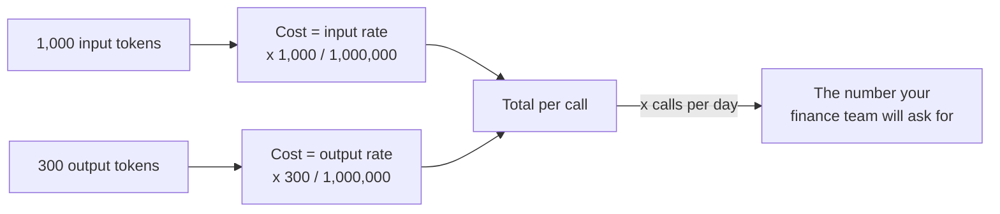
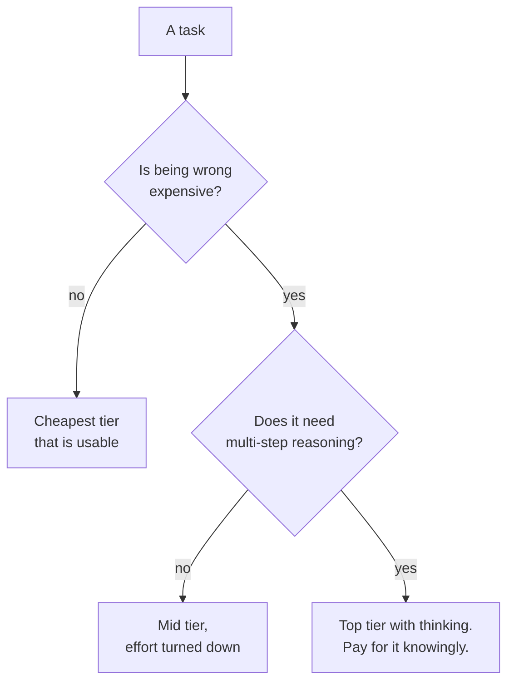

*One real task — summarising a pull request diff — run on three model sizes on
a laptop, and the same question asked twice of a reasoning model with its
thinking turned off and on. The models are `Qwen/Qwen2.5-0.5B-Instruct`,
`Qwen/Qwen2.5-1.5B-Instruct`, `Qwen/Qwen2.5-3B-Instruct` and `Qwen/Qwen3-0.6B`;
every token count, second and parameter count below came out of running them.
Every price and model ID was read from the vendor's own pages on **10 October
2026**, and the date matters more here than in any other post in this series.*

## TL;DR

- **Price is per million tokens, and input and output are different numbers.**
  Output usually costs five times input, and on a short task it is most of
  your bill.
- **Context length is a ceiling, not a target.** Every current model in one
  vendor's lineup now quotes the same one, so it has stopped telling you
  anything about which to pick.
- **A benchmark measures someone else's task.** It is evidence about a
  population you are not in.
- **Reasoning modes buy a chance at accuracy with latency and cost**, and the
  tokens you pay for are mostly tokens you never see. Measured below: fifty
  times the output tokens, fifty times the wall clock, and still the wrong
  answer.
- **Twenty of your own cases beat any leaderboard.** That is the whole post in
  one line.

## Where this sits

This is the sixth and last post in **AI from the inside out**. It needs
[what a model actually is](/engineering/what-a-model-actually-is/) for tokens
and the generation loop, and it needs
[the context window is the entire memory](/engineering/the-context-window-is-the-entire-memory/)
for why input tokens pile up and what you are actually buying when you pay for
them. That post did the arithmetic on a session; this one does it on a model
card. Any unfamiliar word is one line in
[the AI vocabulary](/engineering/the-ai-vocabulary/).

The analogy for this post: **a spec sheet for a van.** Payload, fuel
consumption, top speed, turning circle. Every number on it is true, measured by
someone competent, and published in good faith. None of them tells you whether
the van fits your job, because your job has a loading bay with a low lintel and
a route with a weight-limited bridge, and the spec sheet does not know that.
The spec sheet is not lying to you. It is answering a different question.

## 01 — The thing you have already noticed

The helpdesk assistant has a small, dull, unglamorous step at the front of it:
a classifier that reads an incoming ticket and decides whether it is about
access, hardware, software or something else. Four words out. It runs on every
ticket.

Last month somebody upgraded it. A new model topped a leaderboard, the release
post was persuasive, and moving the whole pipeline to it was a one-line change.
Nobody measured anything, because nothing looked like it needed measuring — the
new model is better, and better is better.

Two things happened. The routing accuracy did not move, because routing a
helpdesk ticket into one of four buckets was never the hard part. And the bill
for that step went up by a factor of a hundred, because at list prices on 10
October 2026 the top of one vendor's lineup costs $10 per million input tokens
and the bottom costs $0.10.

Then someone, reasonably, over-corrected. They moved a *different* step — the
one that reads a pull request diff and writes the reviewer a summary — down to
the cheap tier, because the cheap tier had been fine for routing. The summaries
kept arriving and they read well. One described a change that was not in the
diff, a reviewer approved on the strength of it, and that is section 04.

Both decisions were made the same way: by reading about the model instead of
measuring it on the job. The rest of this post is the numbers you can read off
a card, the numbers you cannot, and what happens when you measure.

## 02 — The numbers that mean something

A model card is short. Most of the fields constrain something specific and
checkable, and most people skim past the ones that bind.

| Field | What it actually constrains |
|---|---|
| Model ID | What you are billed for and what you can reproduce. On the current Claude lineup every ID is a pinned snapshot, so `claude-opus-5-5` today is the same weights as `claude-opus-5-5` next month. Read the whole string: `claude-opus-5` is not a short form of `claude-opus-5-5` but the previous model in that line, still served, at a different price. |
| Context window | The ceiling on one request: your whole resent conversation plus the reply, in tokens. Not a target. See [post 1.3](/engineering/the-context-window-is-the-entire-memory/). |
| Max output tokens | A second, much smaller ceiling, on the reply alone — and on current models the model's own thinking counts against it. |
| Input price per million | What it costs to resend the pile. This is the number that compounds across a long session. |
| Output price per million | Usually five times the input rate. On a short task it is most of the bill. |
| Cache read price | What the unchanged front of the prompt costs on a repeat. A tenth of the input rate, or less. |
| Default effort | How hard the model works when you say nothing. It differs *between models in the same family*, which is a quiet way to be surprised. |
| Knowledge cutoff | What it was trained on, and therefore what it cannot know. See [post 1.4](/engineering/how-it-learned-to-follow-instructions/). |
| Comparative latency | Usually a word, not a number. More on this below. |
| Retirement date | The date this model stops existing. It makes your prompt a dependency with an end-of-life, and almost nobody reads it. |

Here is that lineup as the vendor published it on **10 October 2026**, taken
from the [models overview page](https://platform.claude.com/docs/en/models/overview)
and the [pricing page](https://platform.claude.com/docs/en/about-claude/pricing).
I am writing the date into the table deliberately: a post that teaches you to
read a model card and then quotes a stale price has undone its own argument.

| Model ID | Context / max out | In $/M | Out $/M | Effort | Latency |
|---|---|---|---|---|---|
| `claude-fable-5-1` | 1M / 128K | $10.00 | $50.00 | `high` | Slower |
| `claude-opus-5-5` | 1M / 128K | $4.00 | $20.00 | `medium` | Moderate |
| `claude-sonnet-5-5` | 1M / 128K | $2.00 | $10.00 | `high` | Fast |
| `claude-haiku-5-5` | 1M / 128K | from $0.10 | from $0.50 | `medium` | Fastest |

Four things in that table are worth stopping on.

**Latency is a word.** "Slower", "Moderate", "Fast", "Fastest" — a rank, not a
rate, and the page says why: actual latency depends on prompt length, output
length and how much the model decides to think. There is no honest
tokens-per-second number to publish, because it is not a property of the model
alone. If you need one, you measure it on your own prompts, and it is yours and
nobody else's.

**"From $0.10."** That word is doing real work. The cheapest tier's price is
tiered by prompt size: $0.10 per million input and $0.50 output up to 100,000
tokens, and $0.50 / $2.50 above it. A five-times step change, triggered by a
threshold your conversation crosses silently mid-session. Budget at the headline
rate and your unit cost quintuples without a line of code changing.

**The defaults are not the same across the family.** Two of those four models
default to `medium` effort and two to `high`. Carry a request body from one to
another and you have changed how hard the model works without touching your
code.

**All four rows have the same context window and the same max output.** On this
lineup, context length no longer discriminates between tiers at all: a field
that used to be a decision input and has quietly stopped being one.

Now the part everyone gets wrong, which is that both prices are real:



*Output tokens usually cost several times input tokens. A chatty system prompt
is cheap; a chatty model is not.*

Two sums, not one, at rates that differ by a factor of five. Which is why a
task with a short prompt and a long answer bills almost entirely on the output
side, and why "we gave it a shorter prompt" is often the wrong lever.

## 03 — The numbers that mislead

**Parameter counts.** The headline is a round number and the model is not. Here
is the actual count for the three models in section 04, read straight off the
loaded weights:

```python
from transformers import AutoConfig, AutoModelForCausalLM

for name in ["Qwen/Qwen2.5-0.5B-Instruct", "Qwen/Qwen2.5-1.5B-Instruct",
             "Qwen/Qwen2.5-3B-Instruct"]:
    cfg = AutoConfig.from_pretrained(name)
    m = AutoModelForCausalLM.from_pretrained(name)
    total = sum(p.numel() for p in m.parameters())
    embed = m.get_input_embeddings().weight.numel()
    print(f"{name.split('/')[1]:22s} {total/1e9:.3f}B params | "
          f"{embed/1e9:.3f}B embedding | ctx {cfg.max_position_embeddings} "
          f"| {cfg.num_hidden_layers} layers")
    del m
```

```text
Qwen2.5-0.5B-Instruct  0.494B params | 0.136B embedding | ctx 32768 | 24 layers
Qwen2.5-1.5B-Instruct  1.544B params | 0.233B embedding | ctx 32768 | 28 layers
Qwen2.5-3B-Instruct    3.086B params | 0.311B embedding | ctx 32768 | 36 layers
```

The "0.5B" model has 0.494 billion parameters and **28 per cent of them are the
token embedding table** — a lookup from token to vector, not a layer that
computes anything. The "3B" model is 3.086 billion with 10 per cent in the
table. So the ratio of the parts that actually do the reasoning is not 6:1, it
is closer to 7.7:1. Comparing two models by their headline parameter count
compares two differently-shaped things. And note the middle column: all three
sizes quote exactly the same context length. Context and capability are not the
same axis, and on this family they are not even correlated.

This matters less than it used to, for a reason worth saying out loud: **no
current frontier model publishes a parameter count at all.** It is missing from
the table in section 02 because it is missing from the card. A model-choice
conversation about parameter counts is a conversation about a number the vendor
has stopped supplying, standing in for a capability you could just measure.

**Leaderboard positions.** A benchmark is a fixed set of questions with known
answers. It is real evidence — about that set of questions. The practical
problem is that headline benchmarks saturate: the field's general-knowledge
standard has been replaced twice in recent years as the top of the table
bunched up near the ceiling, and a one-point gap between two models at the top
of a saturated benchmark is noise dressed as a ranking. The catalogue of which
benchmark measures what, and which ones are retired, is
[section 07 of the training and evaluation guide](/guides/model-training-finetuning-eval/#07--evaluation-harnesses--benchmarks) —
I am not going to restate it here. The point for *this* post is narrower: the
benchmark's task is not your task, and the gap between them is where your
decision lives.

**Context-length headlines.** Two traps beyond the one above. The first is that
a bigger window does not make the model better at using what is in it —
[post 1.3 argued that at length](/engineering/the-context-window-is-the-entire-memory/)
and nothing here changes it. The second is subtler and genuinely surprising:
**a token is not a fixed amount of text, and it changed recently.** The vendor's
own pricing page notes that models from the 4.7 generation on use a newer
tokenizer that produces roughly 30 per cent more tokens for the same text. The
same page puts a 1M window at about 555,000 words on the current tokenizer and
about 750,000 words on the previous one. So two things follow that nobody tells
you on the card: a "1M context window" is a third smaller in words than it was
a generation ago, and **a per-token price is not comparable across a tokenizer
change.** A model at $3 per million against one at $4 per million is not 33 per
cent cheaper if the same document becomes 30 per cent more tokens on the second
one. Work in cost per document, not cost per token.

**Contamination.** If the benchmark's questions were in the training data, the
score measures recall, not capability — and you cannot check from outside,
because you do not have the training set. The defence is the one you would use
against any leaked exam: hold out your own questions, written after the model
shipped, and never publish them.

## 04 — One task, three models

Here is the measurement. One task I actually do — summarise a pull request diff
for a reviewer — run on three sizes of the same model family, greedy decoding
so you get the same output I did.

```python
import time, torch
from transformers import AutoTokenizer, AutoModelForCausalLM

DIFF = open("ticket_router.diff").read()
PROMPT = ("Summarise this pull request diff in two sentences for a reviewer. "
          "Say what changed and what a reviewer should check.\n\n" + DIFF)

for name in ["Qwen/Qwen2.5-0.5B-Instruct", "Qwen/Qwen2.5-1.5B-Instruct",
             "Qwen/Qwen2.5-3B-Instruct"]:
    tok = AutoTokenizer.from_pretrained(name)
    model = AutoModelForCausalLM.from_pretrained(name, dtype=torch.float32)
    text = tok.apply_chat_template([{"role": "user", "content": PROMPT}],
                                   tokenize=False, add_generation_prompt=True)
    ids = tok(text, return_tensors="pt")
    t0 = time.perf_counter()
    out = model.generate(**ids, max_new_tokens=160, do_sample=False)
    secs = time.perf_counter() - t0
    n_in = ids["input_ids"].shape[1]
    n_out = out.shape[1] - n_in
    print(f"\n######## {name}")
    print(f"input {n_in} tokens | output {n_out} tokens | {secs:.1f} s | {n_out/secs:.1f} tok/s")
    print(tok.decode(out[0][n_in:], skip_special_tokens=True))
```

The diff is twenty lines of a ticket router: the high-priority branch gains an
SLA condition, access tickets start going to a different team, and a new
`escalate` function is added at the bottom. Two changes and one addition.

```text
######## Qwen/Qwen2.5-0.5B-Instruct
input 205 tokens | output 70 tokens | 2.3 s | 29.9 tok/s
The `ticket_router.py` file has been updated to include an additional
condition for high-priority tickets that require escalation to the
on-call team or identity-team based on their age minutes compared to
the SLA (Service Level Agreement) minutes. The review process should
ensure that these changes adhere to the specified criteria and do not
introduce any unintended behavior.

######## Qwen/Qwen2.5-1.5B-Instruct
input 205 tokens | output 75 tokens | 7.6 s | 9.9 tok/s
The changes include filtering out tickets with high priority that have
less than 30 minutes of SLA remaining to be on-call instead of queueing
them. Additionally, access-related tickets now go directly to the
identity team instead of being routed through the queue. The reviewer
should ensure that the new logic correctly handles these cases and that
there are no unintended consequences or edge cases.

######## Qwen/Qwen2.5-3B-Instruct
input 205 tokens | output 125 tokens | 22.2 s | 5.6 tok/s
In this pull request, the `route` function has been updated to
prioritize tickets with high priority and SLA minutes less than 30 to be
routed to the "oncall" team, and tickets categorized as "access" to the
"identity-team". Additionally, an `escalate` function has been added to
route tickets that have exceeded their SLA back to the "oncall" team if
they have a high priority. A reviewer should check that these changes
maintain the expected behavior of the ticket routing system and ensure
that the new `escalate` function works correctly with the updated
`route` function logic.

```

Read the prose before the numbers.

The smallest model **merged two separate changes into one sentence that
describes neither**. It says high-priority tickets are escalated based on age
versus SLA — that is the new `escalate` function's logic, welded onto the
routing condition, which does not use age at all. A reviewer who read that and
approved would have approved a change they had not understood. It is fluent,
it is confident, it mentions the right identifiers, and it is wrong, which is
the failure mode [post 1.2](/engineering/why-it-sounds-certain-when-its-wrong/)
is entirely about.

The middle model got both routing changes right and **silently omitted the new
function**. Nothing in its answer is false. A reviewer would simply never learn
a new code path exists — the more dangerous of the two, because there is nothing
to catch.

The largest model described all three changes correctly and named what to check.

| | input tokens | output tokens | wall clock | tokens/sec | usable? |
|---|---|---|---|---|---|
| Qwen2.5-0.5B-Instruct | 205 | 70 | 2.3 s | 29.9 | no — invented a mechanism |
| Qwen2.5-1.5B-Instruct | 205 | 75 | 7.6 s | 9.9 | no — missed a third of the diff |
| Qwen2.5-3B-Instruct | 205 | 125 | 22.2 s | 5.6 | yes |

**Those tokens-per-second figures are measured, and they are measured on a
laptop CPU in float32.** They are not what a served model does on an
accelerator, and you should not carry them anywhere. What generalises is the
shape: on identical hardware with an identical prompt, the usable model was
**five times slower and produced nearly twice as many output tokens** as the
one that was wrong. Capability costs you twice — once in time per token, once
in tokens.

Now the money, and this is a **third kind of number**: arithmetic over the
measured token counts, at published list prices read on 10 October 2026. Not a
measurement, and not an estimate either — a sum you can check.

```python
RATES = {                   # $ per million tokens: (input, output)
    "Haiku 5.5":  (0.10, 0.50),
    "Sonnet 5.5": (2.00, 10.00),
    "Opus 5.5":   (4.00, 20.00),
    "Fable 5.1":  (10.00, 50.00),
}
IN_TOK, OUT_TOK, PER_MONTH = 205, 125, 4000

base = None
for tier, (rate_in, rate_out) in RATES.items():
    cost_in = IN_TOK * rate_in / 1_000_000
    cost_out = OUT_TOK * rate_out / 1_000_000
    total = cost_in + cost_out
    base = base or total
    print(f"{tier:<11} ${total:.6f}/call | ${total * PER_MONTH:6.2f} for "
          f"{PER_MONTH} | {cost_out / total:.0%} output | {total / base:5.1f}x")
```

```text
Haiku 5.5   $0.000083/call | $  0.33 for 4000 | 75% output |   1.0x
Sonnet 5.5  $0.001660/call | $  6.64 for 4000 | 75% output |  20.0x
Opus 5.5    $0.003320/call | $ 13.28 for 4000 | 75% output |  40.0x
Fable 5.1   $0.008300/call | $ 33.20 for 4000 | 75% output | 100.0x
```

Four thousand pull requests a month is a busy platform team, and the whole range
is thirty-three dollars. **Three quarters of every row is output** — 125 tokens
out against 205 in, at five times the rate.

Two honest caveats about that table. **The token counts come from a different
tokenizer than the one those models use**, so the absolute cents would move if
you re-ran it against them; the ratios between the rows would not. And this is
a short task — on a long agent session the input side dominates instead, which
is the arithmetic in [post 1.3](/engineering/the-context-window-is-the-entire-memory/),
and where prompt caching starts mattering more than tier choice.

The useful observation is the one the numbers make unavoidable: **at this
volume, the cheap tier's saving is not worth one bad review.** Thirteen dollars
a month buys a summary that does not invent a mechanism. Whereas the routing
step in section 01, running on every ticket with a four-word answer, is exactly
the shape where the cheap tier wins — and is where the hundredfold ratio
actually lands on your bill.

That is the whole skill. Not "which model is best", but "which shape is this
step".

## 05 — When thinking is worth paying for

A reasoning model is trained to write out its working before it answers. Where
that training sits — after the base model, after instruction tuning — is
[post 1.4](/engineering/how-it-learned-to-follow-instructions/)'s subject. What
this post owes you is the part that shows up on the invoice: the working is
output tokens, you are billed for every one at the output rate, and on most
current models you never see them.

Here is that, measured, on a model small enough to run on a laptop and honest
enough to let you switch it off — `Qwen/Qwen3-0.6B` has a hybrid mode, and the
switch is one argument to the chat template:

```python
import time, torch
from transformers import AutoTokenizer, AutoModelForCausalLM

tok = AutoTokenizer.from_pretrained("Qwen/Qwen3-0.6B")
model = AutoModelForCausalLM.from_pretrained("Qwen/Qwen3-0.6B", dtype=torch.float32)

Q = ("A helpdesk ticket opened at 09:10 with a 45-minute SLA. Every reassignment "
     "resets the SLA clock from the moment it happens. It was reassigned 12 minutes "
     "after it opened, and again 19 minutes after it opened. At 10:05, has the SLA "
     "been breached? Answer with yes or no and the deadline.")

for think in (False, True):
    text = tok.apply_chat_template([{"role": "user", "content": Q}], tokenize=False,
                                   add_generation_prompt=True, enable_thinking=think)
    ids = tok(text, return_tensors="pt")
    t0 = time.perf_counter()
    out = model.generate(**ids, max_new_tokens=3072, do_sample=False)
    secs = time.perf_counter() - t0
    n_in, n_out = ids["input_ids"].shape[1], out.shape[1] - ids["input_ids"].shape[1]
    body = tok.decode(out[0][n_in:], skip_special_tokens=True)
    hidden = body.split("</think>")[0] if "</think>" in body else ""
    answer = body.split("</think>")[-1].strip()
    print(f"\n######## thinking {'ON' if think else 'OFF'}")
    print(f"input {n_in} | output {n_out} tokens "
          f"({len(tok(hidden)['input_ids'])} of them hidden) | {secs:.1f} s")
    print(answer[:500])
```

```text
######## thinking OFF
input 93 | output 37 tokens (0 of them hidden) | 1.6 s
**Answer: Yes, the SLA has been breached.**

**Deadline: 10:05 + 45 minutes = 10:50.**

######## thinking ON
input 89 | output 1839 tokens (1793 of them hidden) | 80.9 s
Yes, the SLA has been breached. The deadline is 09:55.
```

The correct answer is **no**. The last reassignment was at 09:29, the clock
reset there, the deadline is 10:14, and at 10:05 there are nine minutes left.

So: thinking on cost **fifty times the output tokens** (1,839 against 37),
**fifty times the wall clock** (80.9 seconds against 1.6), **97.5 per cent of
those tokens were hidden** from the caller — and the answer went from one kind
of wrong to a different kind of wrong. I expected, when I wrote this section's
plan, that thinking would fix it. It did not, and the measurement wins.

Be careful what you take from that. A 0.6-billion-parameter model is far below
the size where reasoning training pays for itself, and the honest conclusion is
not "thinking does not work" — it is the two things the run actually
demonstrates, which hold at every size:

**You pay for the hidden part.** Ninety-seven and a half per cent of the output
tokens on that run were reasoning you cannot read, billed at the output rate.
Apply the section 04 rates to those two token counts and the same answer costs
between $0.000018 and $0.092 depending on tier and switch position — a
fifty-fold swing from one boolean.

**Thinking changes the distribution, not the truth.** It is more sampling,
conditioned on its own earlier output. More of it makes a right answer more
likely when the model is capable of the right answer. It does not install a
capability that was not there, and it will produce a long, orderly, extremely
plausible derivation of a wrong number without hesitating.

The API has moved on from the dial this section's plan assumed, and the move
tells you something. On the current Claude lineup you mostly **cannot turn
thinking off** — on two of the four models it is always on, and a request that
asks for it to be disabled returns a 400. The fixed thinking-token budget is
gone too; the control is now an `effort` level from `low` to `max`, and the
docs are blunt that
"[effort is a behavioral signal, not a strict token budget](https://platform.claude.com/docs/en/build-with-claude/effort)".
That is a meaningful admission: the vendor is telling you the knob is a
preference, not a cap. If you need a hard ceiling it is still `max_tokens` — and
thinking counts against it, which is how a reply gets truncated by reasoning you
never saw.

The same page makes the practical point better than I could: tuning effort is
often a better lever than switching models. One model at low effort is one cache
namespace and one set of behaviours to learn. Which makes the first question
about the task, not the model:



*Notice the first question is about your task, not the model. Most model
choices are made in the wrong order.*

Work it on the two steps from section 01. Ticket routing: being wrong is cheap
(a human re-routes it in four seconds), no multi-step reasoning, so the cheapest
usable tier with effort turned down. Pull request summaries: being wrong is
expensive — it is wrong *into* a code review, which is the one place a confident
summary is least likely to be questioned — but it is reading and compression,
not derivation. Mid tier, effort turned down. Neither branch ends at the top
tier, and that is the usual outcome.

## 06 — Going deeper: build your own benchmark

Everything above converges on one recommendation, and the vendor's own
model-choosing guide gets there too: "having a good evaluation set is the most
important step in the process."

Twenty cases. That is the number. Twenty real inputs from your actual system
with the answer you wanted written next to each, in a file, in the repository.
It is an afternoon.

Twenty is enough to catch a model that merges two changes into one, drops a new
function, or routes access tickets to hardware — those failures are structural,
not rare. Twenty is also small enough that you can read every output by hand the
first time, which is where you learn what "usable" means for your task. That
definition is the real artefact; the score is secondary.

Three properties separate a set that helps from one that flatters:

- **Written after the model shipped, and never published.** Your defence against
  contamination, and it only works if the file stays private.
- **Graded on the thing you care about**, not on string similarity. For the
  diff task: "does it mention every change, and invent none" — two booleans a
  human applies in ten seconds, or a stronger model applies at scale.
- **Run on every tier, including the cheap one, every time you consider
  switching.** The cheap tier's result on *your* twenty is the only number that
  settles the section 01 argument.

Doing this properly — grading rubrics, judge models, regression gates in CI —
is a discipline with a literature, and this series will have a post on it in a
later track. Until then,
[section 10 of the AI architecture guide](/guides/ai-architecture-master-guide/#10--llmops--evaluation)
covers the LLMOps side of evaluation and
[section 07 of the training and evaluation guide](/guides/model-training-finetuning-eval/#07--evaluation-harnesses--benchmarks)
covers the harnesses. But do not wait for any of it: twenty cases in a text
file, graded by eye, beats a leaderboard you did not run.

## Try it yourself

1. **Price your last week.** Take one route in your system, get its real input
   and output token counts from your logs, and do the two sums at your tier's
   published rates. Then do them at the tier below. The gap is the number you
   have been guessing at.
2. **Run one task on two tiers and read the outputs side by side.** Not the
   scores — the outputs. Decide whether the cheap one is *usable*, which is a
   different question from whether it is worse. Usually it is both, and that is
   the decision.
3. **Read one model card end to end and write down the three numbers that bind
   your job.** For most people: the output price, the max output tokens and the
   retirement date. Check how far down the page the third one was.

## Common mistakes

**Comparing on price alone.** The cheap tier is a saving only if its output is
usable. One wrong summary a reviewer acts on costs more than the entire annual
difference between two tiers, and section 04 measures how cheaply wrong arrives.

**Comparing on benchmarks alone.** You are reading evidence about a population
you are not in. Twenty of your own cases outrank any public table, and a
one-point gap near the top of a saturated benchmark is noise.

**Using the biggest model for routing and classification.** Four words out, on
every request, at a hundred times the rate. The most common overspend there is,
and it never shows up as a quality problem, so nothing prompts anyone to look.

**Forgetting that output tokens cost more.** Usually five times more. A task
with a short prompt and a long answer bills almost entirely on the side nobody
optimises — 75 per cent of every row in section 04.

**Assuming a bigger context removes the need to curate.** It raises the ceiling
and leaves the discipline exactly where it was — and now that every tier quotes
the same window, it does not even distinguish them.

## References and further reading

- [Claude models overview](https://platform.claude.com/docs/en/models/overview)
  and [Claude pricing](https://platform.claude.com/docs/en/about-claude/pricing)
  — both read on 10 October 2026; between them, every price, ID, context length
  and effort default here. Open the first for what is *not* on a good card:
  latency is a word, parameter count is absent, and there is a retirement date.
  Open the second for the tiered rate above 100,000 tokens and the tokenizer
  note behind section 03.
- [Effort](https://platform.claude.com/docs/en/build-with-claude/effort) and
  [Choosing a model](https://platform.claude.com/docs/en/about-claude/models/choosing-a-model)
  — the parameter that replaced the thinking budget, with the sentence worth
  quoting at anyone who treats it as a cap; and the vendor's own selection
  guide, which arrives at "write your own eval set" before it arrives at any
  model name.
- The model cards for everything measured here:
  [Qwen2.5-0.5B-Instruct](https://huggingface.co/Qwen/Qwen2.5-0.5B-Instruct)
  (`7ae5576`), [Qwen2.5-1.5B-Instruct](https://huggingface.co/Qwen/Qwen2.5-1.5B-Instruct)
  (`989aa79`) and [Qwen2.5-3B-Instruct](https://huggingface.co/Qwen/Qwen2.5-3B-Instruct)
  (`aa8e725`), all 25 September 2024, plus
  [Qwen3-0.6B](https://huggingface.co/Qwen/Qwen3-0.6B) (`c1899de`, 26 July
  2025). The cards to practise on, and they make section 03's point for me:
  each publishes a **non-embedding** parameter count beside the headline one —
  0.36B of the "0.5B", 1.31B of the "1.5B" — the honest number, and the one
  nobody quotes.
- [The context window is the entire memory](/engineering/the-context-window-is-the-entire-memory/)
  — post 1.3, the prerequisite. Its section 03 does this arithmetic over a
  growing session: the other half of your bill, and the half that dominates
  once a task runs longer than one call.
- [AI Architecture: A Practitioner's Field Guide](/guides/ai-architecture-master-guide/#02--foundation-models--selection)
  and [Model training, fine-tuning and evaluation](/guides/model-training-finetuning-eval/#07--evaluation-harnesses--benchmarks)
  — section 02 of the first is the model-selection framework this post is the
  ground-level version of; section 16 is the trade-off master reference, which
  puts model tier beside every other dial. Section 07 of the second is the
  benchmark catalogue and the eval traps list.
- [The AI vocabulary](/engineering/the-ai-vocabulary/) — one-line entries for
  parameters, context window, tokeniser, reasoning model, thinking budget,
  prompt caching, eval and golden set. Its **thinking budget** entry is the
  control section 05 says has been retired: vocabulary outlives APIs, and you
  still need the word.

## Final thoughts

A model card is a van's spec sheet. Payload, consumption, top speed: all true,
all measured, none of them about your loading bay.

Six posts ago this series started with what a model is doing when it produces a
token. It ends on the practical consequence: you now know enough to stop reading
about models and start measuring them. Tokens, the window, the loop, where
confidence comes from, what training can and cannot fix, what retrieval is for —
every one of those was a thing you could check on a laptop, and so is this one.

The last trick, if it is a trick, is that the questions which settle a model
choice are not questions about models. Is being wrong expensive here. What does
usable mean for this step. How many do I run a day. Answer those three and the
card tells you the rest in about ninety seconds.
