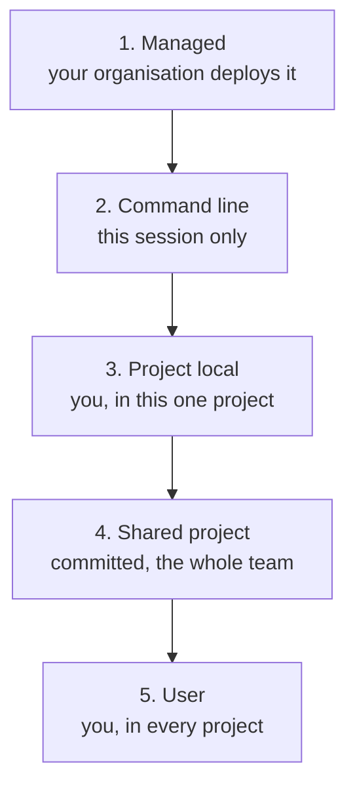
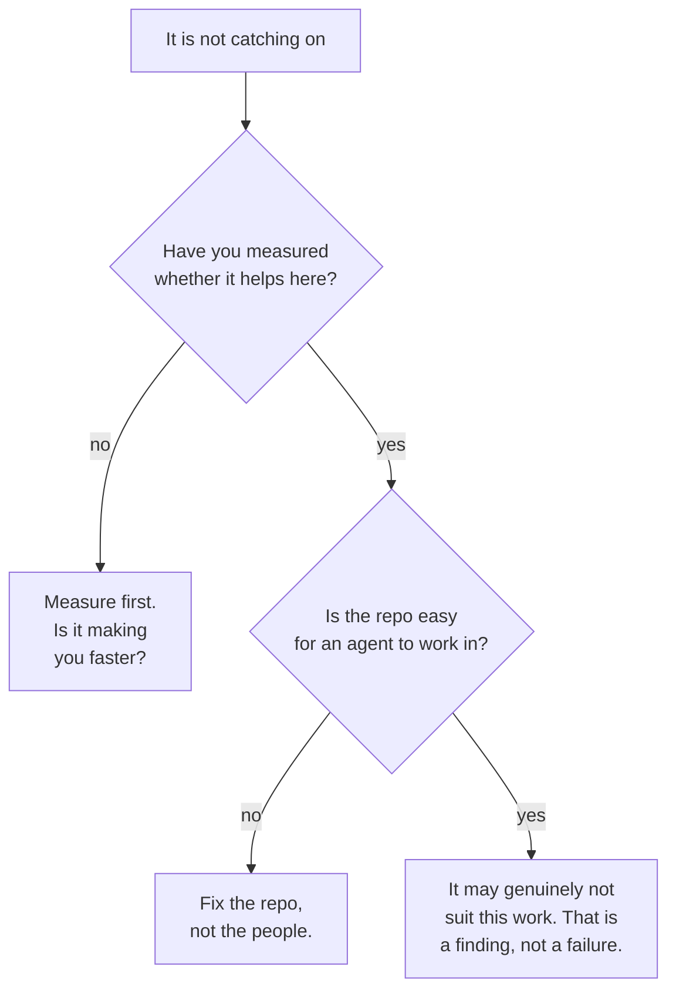

*The precedence order in section 02 was read off the vendor's documentation on
10 October 2026, not recalled — and it is not what I would have said from
memory, which is the reason the section exists. Everything about adoption is
pattern rather than measurement, and I have written it as pattern. Where a claim
is about how people behave rather than how software behaves, treat it as
something to check against your own team rather than something I have proved.*

## TL;DR

- Configuration splits into what is true about the codebase, what is true about
  the person, and what your organisation requires. Those three go in different
  files, and putting one in the wrong file is most of the friction.
- The precedence order is documented and worth reading, because personal
  settings live at two different levels and only one of them loses to the team's.
- Shared skills and internal plugins need a named owner. Without one they rot
  silently, and a stale shared instruction is worse than none.
- The fastest onboarding is not a tool rollout. It is a repository an
  [agent](/engineering/the-ai-vocabulary/#agent) can already work in: one command to test, one command to
  run.
- Measure before you mandate. Most of what looks like resistance is either a
  measurement you never did or a repository problem wearing a people costume.

## Where this sits

This is the last post in **Working with AI, day to day**, and it follows [is it
actually making you faster](/engineering/is-it-actually-making-you-faster/)
closely enough that section 07 points back at it. For the permissions half —
what a deny rule actually matches, and which controls hold when the agent stops
cooperating — [who is allowed to do
what](/engineering/who-is-allowed-to-do-what/) covers the mechanisms and this
post does not repeat them.

Technical words link to their one-line definition in the
[AI vocabulary](/engineering/the-ai-vocabulary/) the first time they appear.
Open them in a second tab as you go.

And one scene runs through the whole post, in section 02. If the argument ever
stops making sense, go back to it.

## 01 — The thing you have already noticed

One person on the team is transformed. They talk about it, they are visibly
getting more done, and they cannot entirely explain what they are doing
differently.

Three others tried it, said it was fine, and quietly went back to how they
worked before. Not hostile — indifferent, which is harder to act on.

And nobody can say why. The transformed one assumes the others did not try
properly. The others assume the transformed one is working on easier things.
Both explanations are about people, and both are usually wrong. The useful
questions are what the transformed person's work has in common, whether the
repository they are in is easier for an agent than the one the others are in,
and whether anybody has looked. This post is about the things you can actually
change: where configuration lives, who owns the shared parts, and what to fix
before concluding anything about the people.

## 02 — The shared toolbox

> A workshop with one toolbox on the bench, and six people using it.
>
> Everybody has worked somewhere with a magnificent toolbox nobody could find
> anything in, and everybody has worked somewhere with three screwdrivers and
> perfect order. The second workshop gets more done. It is not about the tools.
>
> Four things decide which workshop you are in, and none of them is the budget.
>
> **Some tools belong to the bench and some belong to the person.** The torque
> wrench calibrated for this machine stays with the machine, because it is a
> fact about the work. Your own glasses go home with you, because they are a
> fact about you. Put either in the wrong place and you get the two complaints
> that define a bad workshop: *somebody keeps changing my settings*, and
> *nobody here does it the same way twice*.
>
> **Somebody has to own the bench.** Not use it — own it. Shared tools without
> a name on them do not stay sharp; they quietly go blunt, and a blunt tool
> everyone trusts is worse than no tool at all, because people stop checking.
>
> **A new starter's first day is about the bench, not the tools.** Handing
> somebody a good drill in a workshop where nothing is labelled and the power
> socket is behind a cupboard does not make them productive. Tidying the
> workshop does, and it helps everyone else at the same time.
>
> **"They just won't use it" is usually a workshop problem.** Before you
> conclude anything about the person, look at whether the bench they are
> standing at is the same bench as the one where it is working.

Sections 03 and 04 are the first of those, sections 05 and 06 the second and
third, and section 07 is the fourth — which turns out to be where most of the
real failures live.

So: three kinds of thing want to be configured. What is true about this
codebase, what is true about this person, and what your organisation requires of
everyone. The mistake that produces most of the friction is putting one of them
in the file that belongs to another.

Those three kinds land across five levels, and the order they resolve in is
documented. I checked it rather than recalling it, and I had it wrong.

*Highest wins. The part worth noticing is that your personal settings sit at two
different levels, one above the team's file and one below it — which is the thing
people most often get backwards. Check it against the documentation for your
version rather than against this diagram.*

Read that stack again, because the shape of it is the whole section. Your
personal per-project file beats the team's committed file. Your personal
everywhere file loses to it. So a teammate who sets something in
`~/.claude/settings.json` and finds the project overriding it has not hit a bug;
they have hit level four beating level five, exactly as documented. The escape
hatch is level three, the per-project local file, which is yours. Claude Code
adds it to your git excludes when it creates the file itself; if you create it
by hand, add it to `.gitignore` yourself before you commit your own settings to
the team's repository.

Two more details that save arguments. **Lists merge rather than override**: when
two files both add permission rules, you get both sets, so a team file can add
without taking anything away. And for a small number of security-sensitive keys,
a *stricter* value from a lower level wins over the managed one — the precedence
stack is about whose preference wins, not about letting an organisation loosen
something an individual has tightened.

## 03 — What belongs in the repository

The test is simple: if it would still be true with a different person typing, it
belongs in the committed file.

That means the things that describe the codebase rather than the operator. How
to run the tests. Which directories are generated and must not be edited.
Permission rules that are about this project's blast radius — the deploy script
nobody should run from a session, the migration command that is fine in one
environment and not another. Hooks the team has agreed on. The plugins this
repository actually needs.

It also means the committed file should be short, for reasons the playbook's
[section on repository ergonomics](/engineering/ai-assisted-coding-playbook/#12-repository-ergonomics-what-an-agent-reads-first)
sets out — along with the rest of what makes a codebase workable for an agent.
The team version of that argument is only this: a shared file grows, because
adding to it is easy and deleting somebody else's line is awkward, and the cost
of the growth is paid by everyone on every prompt.

What does not belong there: anything that encodes how one person likes to work.
Model preference, output verbosity, which editor mode, how much the tool should
explain itself. Those are preferences, they are at level five for a reason, and
a committed file that overrides them is spending the team's goodwill on nothing.

## 04 — What stays personal

The temptation, once a team decides to take this seriously, is to standardise
everything. It feels like rigour. It produces resentment at a rate out of all
proportion to the benefit.

People work differently with these tools in ways that are not errors. One person
wants the agent to plan out loud before acting; another finds that noise. One
runs long autonomous sessions and reviews a large diff; another goes a step at a
time and would find the first style unmanageable. Both ship. Forcing the
agreement produces one person working the way they wanted and three working
slightly worse than they were, which is not a rollout.

The line is the one from section 03, used in the other direction: if the answer
would differ by person without affecting anyone else, it is personal, and the
per-project local file exists precisely so somebody can deviate inside a shared
repository without a conversation about it.

The exception is anything with a blast radius. Permissions, hooks that touch the
network, what an agent may run without asking — those are not taste, even when
they feel like it, and the reason is in
[who is allowed to do what](/engineering/who-is-allowed-to-do-what/): some of
these controls hold and some only work on a cooperating agent, and that
distinction does not vary by personal preference.

## 05 — Shared skills, and who owns them

Sooner or later somebody writes a
[skill](/engineering/the-ai-vocabulary/#skill), a command or a small plugin that
is genuinely useful, and the question becomes how it reaches everyone else. The
mechanics are covered in [what I actually
use](/engineering/claude-code-plugins-what-i-actually-use/) — including why a
versioned, on-demand plugin scales where one long shared instructions file
slowly gets worse. This section is about the part that post does not cover: what
happens to the thing six months later.

Shared configuration rots in a particular, quiet way. The skill describes a
deploy process that changed in March. The command points at a repository that was
archived. The instruction file says the team uses a library it migrated off.
None of this throws an error. It produces confidently wrong output, which is the
most expensive failure mode available, and it is invisible until somebody new
follows it exactly.

So: **a named owner per shared thing**, written down next to it, and a review
whenever the thing it describes changes. Not a committee, not a quarterly audit
nobody runs. One name, and the understanding that an unowned shared skill gets
deleted rather than inherited. Deleting it is a real option and usually the right
one; a stale shared instruction is worse than no shared instruction, because the
second one makes people check.

The organisation-level version of this exists too. Managed settings and managed
[MCP](/engineering/the-ai-vocabulary/#mcp) configuration let an organisation
deploy servers, block connectors by name, and refuse project-level servers
outright. If you are at the scale where that is relevant, read the managed
documentation rather than inferring the behaviour, because the override rules
differ per key.

## 06 — Onboarding in an afternoon

Every item here is something your team controls, and none of it is a tool
rollout.

1. **Make the repository agent-ready first.** A fast test command, scripts in
   place of documented steps, directory boundaries that explain themselves, and a
   short instruction file. That list is the playbook's
   [repository ergonomics](/engineering/ai-assisted-coding-playbook/#12-repository-ergonomics-what-an-agent-reads-first)
   section and I won't repeat it here; the only thing to add for a team is that
   it is step one, not step four.
2. **Decide who maintains that.** Section 05's rule, applied the moment there is
   more than one of you: a name against the shared file, or no shared file.
3. **Commit the permission rules.** Start restrictive; the annoyance of an extra
   prompt is cheaper than the alternative. Lists merge, so people can add
   permissions the team file says nothing about — but a teammate cannot allow
   their way out of a team `deny` or `ask`, because rules are evaluated deny,
   then ask, then allow, whatever file they came from.
4. **Give them one real task.** Not a demo, not a toy. Something small from the
   actual backlog, where they will see both the help and the failure.
5. **Review that change together.** This is the step that is always cut and is
   the one that teaches. The reviewing method is in
   [learning to build software when AI writes the code](/leadership/learning-to-build-software-when-ai-writes-the-code/#9-reviewing-code-you-didnt-write)
   and applies to everybody, not only to juniors.
6. **Stop.** No mandate, no dashboard, no adoption target.

Step one is most of the value, and it is an improvement to the repository that
pays off whether or not anybody adopts anything.

## 07 — The failures that are not technical

*Three outcomes, and only one of them is about the people.*

The shapes that recur, stated as patterns rather than as things I can prove:

**The mandate without the measurement.** Adoption becomes a target, the target
gets reported on, and the number goes up while nothing else changes. Everyone
involved knows what is happening. This is the failure the diagram sends to post
3.1, because the honest version of the conversation needs a record.

**The repository nobody can work in.** A ten-minute test suite, twelve undocumented
setup steps, a directory layout that only makes sense historically. An agent is
worst exactly where a new joiner is worst, and for the same reasons. It looks
like the tool failing; it is the codebase, and fixing it helps the humans too.

**The shared config with no owner.** Covered in section 05. The symptom is that
people quietly stop trusting the shared parts and go back to working alone, which
reads as disengagement.

**The enthusiast as the standard.** One person's workflow becomes the official
one, and everyone else is measured against a way of working that suits one kind
of task and one kind of person. The transformed colleague from section 01 is
genuinely helping; making them the template is what turns that into a problem.

And the outcome worth naming: sometimes it genuinely does not suit the work. A
team deep in an unusual domain, a codebase with little public precedent, work
whose hard part is a decision rather than an implementation. That is a finding.
Recording it and moving on is a better outcome than a rollout that everyone
performs and nobody believes.

## 08 — What to actually do first

If you lead a team and you want one paragraph: measure before you mandate, make
the repository agent-ready regardless, and let adoption follow. The measuring
costs two weeks of a spreadsheet and tells you which work this helps with. The
repository work improves your team's week whether or not a single agent ever
runs. Neither of those is a mandate, and a mandate issued before both
of them is a decision you cannot defend when somebody asks what it bought.

## Common mistakes

**Mandating before measuring.** You will get the adoption number and learn
nothing. The number was never the thing you wanted.

**A shared configuration nobody owns.** It will rot, it will rot invisibly, and
the first person to notice will be the newest person on the team.

**Copying another team's setup wholesale.** Their rules encode their codebase and
their constraints. The parts that transfer are the short ones, and you will not
know which until you look at why each rule is there.

**Treating indifference as resistance.** Three people who tried it and shrugged
are information about the work or the repository. Reading it as an attitude
problem guarantees you fix the wrong thing.

**Rolling out tools before making the repository navigable.** The order matters.
Tools on top of a codebase nobody can work in produce faster confusion.

## References and further reading

The vendor pages below were read on 10 October 2026. They are living pages whose
paths move; treat each as a pointer to the current one, and check the precedence
order against your own version rather than against this post.

- [Settings files and precedence](https://code.claude.com/docs/en/settings) — the
  source for section 02, including the five-level stack, the scope table that
  says who each file reaches, the rule that lists merge instead of overriding,
  and the exceptions where a stricter value from a lower level beats a managed
  one. The section on keeping personal settings out of a repository is the one to
  read alongside section 04.
- [Managed settings](https://code.claude.com/docs/en/managed-settings) and
  [managed MCP](https://code.claude.com/docs/en/managed-mcp) — for the
  organisation level: how settings are delivered, and how an administrator
  provides or blocks MCP servers and connectors. Read these rather than inferring
  the behaviour; which keys a user can override differs per key.
- [Claude Code plugins: what I actually use](/engineering/claude-code-plugins-what-i-actually-use/)
  — the mechanics of internal marketplaces and the argument for a versioned
  plugin over one long shared instructions file. Section 05 deliberately covers
  only what that post does not: ownership and rot.
- [Is it actually making you faster?](/engineering/is-it-actually-making-you-faster/)
  — the measuring half, and where the first branch of the diagram in section 07
  sends you.
- [Who is allowed to do what](/engineering/who-is-allowed-to-do-what/) — which of
  these controls hold and which depend on a cooperating agent. Section 04's
  exception rests on it.
- [Zero risk isn't the job: a CISO's guide to agentic AI](https://claude.com/resources/articles/ciso-guide-to-agentic-ai)
  (Jason Clinton, Anthropic, 17 July 2026) — the organisational version of the
  permissions question, for when the rollout is larger than one team.
- [The AI vocabulary](/engineering/the-ai-vocabulary/) — terms used above without
  redefinition.

## Final thoughts

The thing I did not expect when I checked the precedence order is how much of
the friction it explains. People hit level four beating level five, conclude the
tool is behaving strangely, and build a story about it. The documentation has
said so all along, in a numbered list, and nobody reads a settings page until
after the afternoon they wish they had.

The rest of it is less technical than it looks. A rollout is mostly two
questions: have you found out whether this helps your team's actual work, and is
your repository somewhere an agent can get anything done. Both are answerable in
a fortnight. Both improve things even if the answer comes back no.

What is not answerable in a fortnight is whether your colleagues should want
this. That one is theirs, and the quickest way to lose it is to decide it for
them before you have done the two things you could have done yourself.
