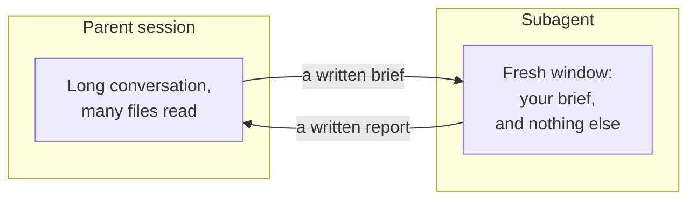
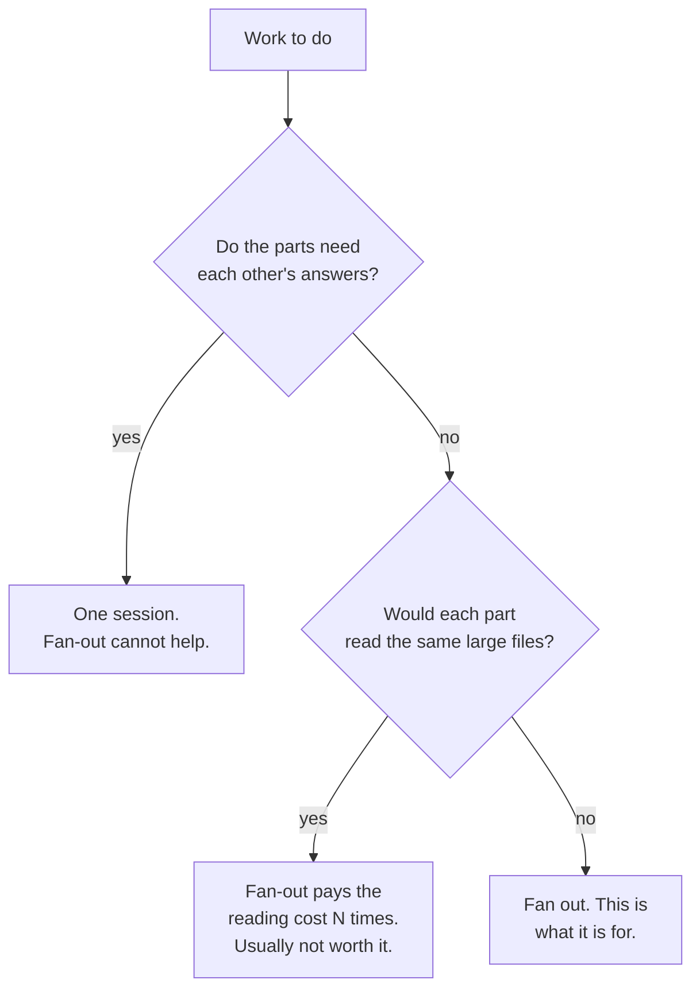

*The numbers below were read out of one real session's own transcripts on 10
October 2026 — a seven-hour run of Claude Code 2.1.205 on `claude-opus-5` that
dispatched twenty-six subagents to write and review nine posts across this
series, including this one. No model was run to produce the numbers and no API
key was used; the scripts are
file arithmetic over JSONL you already have on disk. This is **observational,
not a controlled experiment**: I did not run the same work twice, once fanned
out and once inline, because the second run would have cost real money to prove
something the first run already shows. Where that limits a conclusion, the
section says so.*

## TL;DR

- A subagent is not a helper with your memory. It is a second context window,
  built from scratch, holding your brief and nothing else.
- Isolation is the benefit. Parallelism is a sometimes-bonus, and in the run I
  measured it barely happened at all.
- It cannot see your conversation. In twenty-six dispatches, the parent's prompt
  ranged from 104,373 to 273,116 tokens and every child still started at about
  36,000.
- Only the report comes back. Average brief out: 735 words. Average report back:
  502 words. Everything between those two numbers is gone.
- Work whose parts need each other's answers does not fan out, and no amount of
  briefing fixes that.

## Where this sits

This is the ninth post in **How your AI coding tool works**, and it stands on
the sixth. [Where the context comes from](/engineering/where-the-context-comes-from/)
is the prerequisite: it weighs an assembled request layer by layer and shows
that everything always-loaded is charged on every single turn. That is the whole
foundation of this post. A subagent is what you reach for when one window cannot
hold the work, and the price of reaching for it is that the always-loaded layers
get assembled a second time, from scratch, for somebody new.

[Who is allowed to do what](/engineering/who-is-allowed-to-do-what/) owns
permissions, including what a subagent is and is not allowed to do — this post
takes that as settled and does not re-argue it.
[How a skill gets found and loaded](/engineering/how-a-skill-gets-found-and-loaded/)
owns loading on demand as a context decision, which is the same economics
pointed at a different problem. The words for the layer are in
[harness engineering](/engineering/harness-engineering-vocabulary/) and used
here exactly as it defines them; single terms are one line each in
[the AI vocabulary](/engineering/the-ai-vocabulary/).

The analogy, and it runs to the end: **briefing four people separately rather
than holding one four-hour meeting.** Each of the four gets a clean brief and
nobody is distracted by the others' questions. But nobody learns from them
either, and four briefings cost four briefings.

## 01 — The thing you have already noticed

You had five things to check and they looked beautifully independent. Five
files, same question in each. So you fanned out five subagents, because that is
what the feature is for, and you sat back expecting the whole thing to land in
the time of the slowest one.

What came back was five polite paragraphs. Two said the same thing in different
words. One had answered a neighbouring question instead. One mentioned, in
passing, something interesting it had plainly found and not pursued — and when
you asked a follow-up, nobody had any of it in front of them any more.

And it had not been faster. You watched the progress indicators. They mostly
took turns.

The reflex is to blame the model, or to conclude that fan-out is overhyped. Both
are wrong, and the right diagnosis is uncomfortable: you used the feature for
the thing it is worst at. You wanted four people in a meeting. You held four
separate briefings.

## 02 — What a subagent actually is

Strip away the delegation language and a subagent is an extremely ordinary
thing: a second run of the same loop, on the same model, against a context
window that has been assembled from scratch.

Not copied. Assembled. The harness builds a prompt using the same ladder post
2.6 walks through — a system prompt, tool definitions, instruction files,
whatever gets loaded by default — and then puts one thing in it that your main
session did not have: a short written brief describing the job. Claude Code's
documentation calls this "a delegation message that summarizes the task". Then
the loop turns in the ordinary way until the child decides it is finished, and
the only thing that crosses back is what it chose to write down.



*Notice the two arrows are the only connection. Everything else the parent knows,
the child does not.*

Two arrows. Words out, words back. That is the entire interface, and almost
every surprise in this post is a consequence of how narrow it is.

It is worth saying what this is not. It is not a thread, sharing state with the
thing that started it. It is not a function call, where the caller can inspect
the callee's working. It is closer to sending a letter to a competent stranger
who will send one letter back and then cease to exist.

## 03 — What it cannot see

The vendor states the exclusion directly: a subagent "doesn't see your
conversation history, the skills you've already invoked, or the files Claude has
already read."

That reads like a limitation. It is the product. And the cleanest way to feel it
is to compare how big the parent's prompt was at the moment of each dispatch
with how big the child's first prompt was. If a subagent were a slice of its
parent, those two numbers would move together.

```python
# Where does a subagent start from — a slice of the parent, or a fresh build?
# Reads one Claude Code session's own transcripts. No model, no API key, no network.
# python3 start.py ~/.claude/projects/<project>/<session-id>
import json, glob, os, sys
from datetime import datetime as dt

sess = os.path.expanduser(sys.argv[1])
when = lambda s: dt.fromisoformat(s.replace("Z", "+00:00"))
size = lambda u: (u.get("input_tokens", 0) + u.get("cache_creation_input_tokens", 0)
                  + u.get("cache_read_input_tokens", 0))

parent = []
for line in open(sess + ".jsonl"):
    d = json.loads(line)
    if d.get("type") == "assistant":
        parent.append((when(d["timestamp"]), size(d["message"].get("usage") or {})))
parent.sort()

pairs = []
for p in sorted(glob.glob(sess + "/subagents/*.jsonl")):
    for line in open(p):
        d = json.loads(line)
        if d.get("type") != "assistant": continue
        t, child = when(d["timestamp"]), size(d["message"].get("usage") or {})
        before = [v for ts, v in parent if ts <= t]
        pairs.append((child, before[-1] if before else 0))
        break                                   # only the child's very first request

pairs.sort(key=lambda x: x[1])
print(f"  children measured                 : {len(pairs)}")
print(f"  parent's prompt at dispatch, range : {pairs[0][1]:,} to {pairs[-1][1]:,} tokens")
print(f"  child's first prompt, range        : {min(c for c, _ in pairs):,} to {max(c for c, _ in pairs):,} tokens")
print(f"  child's first prompt, mean         : {sum(c for c, _ in pairs) // len(pairs):,} tokens")
print(f"  that starting cost, paid {len(pairs)} times : {sum(c for c, _ in pairs):,} tokens")
print()
print("  parent at dispatch -> child's start")
for c, b in pairs[::5]:
    print(f"  {b:>9,} -> {c:>8,}")
```

```text
  children measured                 : 26
  parent's prompt at dispatch, range : 104,373 to 273,116 tokens
  child's first prompt, range        : 34,334 to 37,097 tokens
  child's first prompt, mean         : 36,250 tokens
  that starting cost, paid 26 times : 942,506 tokens

  parent at dispatch -> child's start
    104,373 ->   36,444
    140,247 ->   36,270
    167,888 ->   34,508
    197,815 ->   36,776
    227,509 ->   37,012
    273,116 ->   37,097
```

The parent grew by a factor of 2.6 across the session. The children's starting
point moved by eight per cent, and the variation that is there is mostly the
length of the brief itself. The last line is the flattest statement of the whole
mechanism: the child dispatched when the parent was carrying 273,116 tokens
started with 37,097, and did not know what it was missing.

Read the last summary line too, because it is the bill. That 36,000-token floor
is not the brief. It is the always-loaded ladder from post 2.6 — system prompt,
tools, instruction files, the skills listing — assembled again, in full, for
each new window. Across twenty-six dispatches that came to 942,506 tokens spent
before a single one of them did any work. Four briefings cost four briefings,
and the briefing is not cheap.

## 04 — What comes back

The second arrow is narrower than the first, and this is where people lose
things.

Only the report returns. Not the reasoning, not the dead ends, not the file the
child read and dismissed. Claude Code's documentation puts it plainly: "only the
top-level subagent's summary returns to you and the intermediate output stays
out of your main conversation". That is the design working. It is also why the
interesting aside you noticed in a report cannot be followed up by asking the
parent — the parent never had it.

So the honest way to size a subagent is not by what it cost, but by the two
arrows against each other:

```python
# What does the interface between a parent and its subagents actually weigh?
# Reads one Claude Code session's own transcripts. No model, no API key, no network.
# python3 arrows.py ~/.claude/projects/<project>/<session-id>
import json, glob, os, sys

sess = os.path.expanduser(sys.argv[1])
briefs, reports, burned, reported, inflight = [], [], 0, 0, 0
peak = 0
for line in open(sess + ".jsonl"):                       # the parent's own transcript
    d = json.loads(line)
    if d.get("type") != "assistant": continue
    u = (d["message"].get("usage") or {})
    peak = max(peak, u.get("input_tokens", 0) + u.get("cache_creation_input_tokens", 0)
                     + u.get("cache_read_input_tokens", 0))
    for c in d["message"].get("content") or []:
        if isinstance(c, dict) and c.get("type") == "tool_use" and c["name"] in ("Task", "Agent"):
            briefs.append(len((c["input"].get("prompt") or "").split()))

for p in sorted(glob.glob(sess + "/subagents/*.jsonl")):  # one file per child
    hand = None
    for line in open(p):
        d = json.loads(line)
        if d.get("type") != "assistant": continue
        for c in d["message"].get("content") or []:
            if isinstance(c, dict) and c.get("type") == "tool_use" and c["name"] == "SubagentHandback":
                hand = (c["input"].get("message") or "")
    if hand is None: inflight += 1
    else: reports.append(len(hand.split()))

for line in open(sess + ".jsonl"):                        # the harness's own token report
    for part in line.split("subagent_tokens: ")[1:]:
        burned += int(part.split("\\n")[0].split()[0]); reported += 1

s = lambda v: f"{sum(v):,}"
print(f"  dispatches, finished / in flight : {len(reports)} / {inflight}")
print(f"  brief out  (parent -> child)     : {s(briefs):>9} words, {sum(briefs)//len(briefs):>4} average")
print(f"  report back (child -> parent)    : {s(reports):>9} words, {sum(reports)//len(reports):>4} average")
print(f"  tokens spent inside the children : {burned:>9,}  (harness-reported, {reported} of {len(briefs)})")
print(f"  parent's largest single prompt   : {peak:>9,} tokens")
```

```text
  dispatches, finished / in flight : 25 / 1
  brief out  (parent -> child)     :    19,123 words,  735 average
  report back (child -> parent)    :    12,563 words,  502 average
  tokens spent inside the children : 2,680,033  (harness-reported, 19 of 26)
  parent's largest single prompt   :   273,116 tokens
```

Two and a half million tokens of work, and the parent's entire record of it is
twelve and a half thousand words. The compression ratio is not a bug to be
tuned; it is the reason the parent's largest single prompt was 273,116 tokens
after seven hours and never once needed compacting — which matters, because post
2.6 measured a real compaction throwing away eighty-nine per cent of a context
in eighty seconds.

The counting caveat is real and worth stating: nineteen of the twenty-six
dispatches reported their token usage back to the parent in a form I could read;
six ran in the background, where the harness reports completion without that
block, and one was still running when I took the snapshot. So 2,680,033 is a
floor, not a total.

## 05 — The measurement

Here is where I have to be careful, because the obvious experiment is not the
one I ran.

The clean version would be one task done twice — once in a single long session,
once fanned out — with tokens and wall clock compared. I did not do that. What I
have instead is a real seven-hour session that fanned out twenty-six times over
real work, which is better evidence about what fan-out *is like* and worse
evidence about what the alternative would have cost. Treat every number below as
a description of one run, not as a controlled result.

The eight implementer dispatches, each one writing a whole post from a brief,
all figures reported by the harness itself:

| Dispatch | Brief out, words | Report back, words | Tokens inside | Tool calls | Minutes |
| --- | ---: | ---: | ---: | ---: | ---: |
| Post 1.4 | 449 | 420 | 136,353 | 53 | 11.2 |
| Post 1.5 | 582 | 464 | 178,224 | 99 | 52.6 |
| Post 1.6 | 849 | 428 | 238,874 | 77 | 18.6 |
| Post 2.4 | 772 | 511 | 174,566 | 72 | 14.1 |
| Post 2.5 | 843 | 483 | 196,801 | 59 | 10.7 |
| Post 2.6 | 801 | 408 | 215,990 | 101 | 23.7 |
| Post 2.7 | 911 | 403 | 296,259 | 116 | 41.6 |
| Post 2.8 | 916 | 213 | 262,129 | 116 | 63.0 |

Nine review dispatches added 855,158 tokens on top, and the remaining two
account for the rest of the 2,680,033.

Now the part that contradicts the reason most people reach for this feature:

```python
# What did fanning out actually buy, and what did it pay twice for?
# Reads one Claude Code session's own transcripts. No model, no API key, no network.
# python3 cost.py ~/.claude/projects/<project>/<session-id>
import json, glob, os, re, sys, collections
from datetime import datetime

sess = os.path.expanduser(sys.argv[1])
t = lambda s: datetime.fromisoformat(s.replace("Z", "+00:00"))
spans, reads, shape = [], collections.defaultdict(set), collections.Counter()

for p in sorted(glob.glob(sess + "/subagents/*.jsonl")):
    who, stamps = os.path.basename(p)[:-6], []
    shape[json.load(open(p[:-6] + ".meta.json")).get("requestShape")] += 1
    for line in open(p):
        d = json.loads(line)
        if d.get("timestamp"): stamps.append(t(d["timestamp"]))
        if d.get("type") != "assistant": continue
        for c in d["message"].get("content") or []:
            if isinstance(c, dict) and c.get("type") == "tool_use" and c["name"] == "Read":
                f = (c["input"] or {}).get("file_path")
                if f: reads[os.path.basename(f)].add(who)
    if stamps: spans.append((min(stamps), max(stamps)))

busy = sum(int(m) for m in re.findall(r"duration_ms: (\d+)", open(sess + ".jsonl").read()))
wall = (max(e for _, e in spans) - min(s for s, _ in spans)).total_seconds()
peak = n = 0
for _, step in sorted([(s, 1) for s, _ in spans] + [(e, -1) for _, e in spans]):
    n += step; peak = max(peak, n)
shared = {f: w for f, w in reads.items() if len(w) > 1}
top = max(reads.items(), key=lambda kv: len(kv[1]))

print(f"  dispatches, foreground / background : {shape['foreground']} / {shape['background']}")
print(f"  wall clock, first start to last end  : {wall / 60:7.1f} min")
print(f"  children's own reported working time  : {busy / 60000:7.1f} min")
print(f"  most children alive at the same time  : {peak}")
print(f"  distinct files the children read      : {len(reads)}")
print(f"  files more than one child read        : {len(shared)}")
print(f"  most re-read file, and by how many    : {top[0]}, {len(top[1])} children")
```

```text
  dispatches, foreground / background : 20 / 6
  wall clock, first start to last end  :   416.1 min
  children's own reported working time  :   260.9 min
  most children alive at the same time  : 3
  distinct files the children read      : 82
  files more than one child read        : 12
  most re-read file, and by how many    : HOUSE-RULES.md, 15 children
```

Twenty of twenty-six dispatches ran in the foreground, which means the parent
sat and waited. Across nearly seven hours of wall clock, the most children ever
alive at the same time was three, and briefly. Whatever this session bought by
fanning out, it was not parallelism.

Two caveats on those time figures, both pushing the same way. The 260.9 minutes
covers only the nineteen dispatches that reported a duration. And the overlap
count is generous to parallelism, because a child's span here runs from its
first timestamp to its last, which includes time it spent idle between being
asked something and being asked a follow-up. The true concurrency was lower than
three, not higher.

The re-reading cost showed up, and was smaller than I expected. Of 82 distinct
files the children opened, only 12 were opened by more than one of them — the
briefs were narrow enough that the children mostly worked on disjoint material.
The exception is the shared rulebook every child had to read: 8,204 bytes, read
by fifteen of them. As arithmetic over that measured size, at the usual rough
four characters per token, that is about 2,050 tokens per read. Fourteen of the
fifteen reads are the duplication — the first one had to happen — so roughly
28,700 tokens were spent re-reading the same file. That is around one per cent
of the 2,680,033 tokens the children read between them, and since that total is
itself a floor, the true share is if anything smaller.

That is the honest shape of it. In this run, re-reading was a rounding error,
because the thing being shared was small. Make the shared thing a 200-kilobyte
schema and the same structure turns that rounding error into the dominant cost.

## 06 — When to fan out, and when not to

So if it was not faster, why do it at all? Because of the number in section 04
that is easy to skip past: the parent's largest prompt was 273,116 tokens, after
seven hours, with no compaction. Two and a half million tokens of reading,
drafting and discarding happened in windows the parent never saw. I did not run
the same work inline to compare, so what follows is arithmetic rather than a
measurement: two and a half million tokens will not fit in a window that held
273,116 at its largest, so an inline run would have had to compact repeatedly,
and compaction is lossy by construction.

That is the trade, and it makes a two-question decision.



*Two questions, and the first one disqualifies most of the tasks people try to
parallelise.*

The first question disqualifies more work than people expect, and the session I
measured demonstrates it. Post 2.7 took four dispatches, not one: an implementer,
a reviewer, a scoped re-reviewer for the fixes, and a second re-reviewer when the
first round was not enough. Those four could not have run at once in any
universe, because each one's input is the previous one's output. They cost 3,036
words of brief between them and ran strictly in order, and that is not a failure
of the tool. It is what dependent work looks like when you insist on isolating
it.

The second question is the one from section 05. It is a cost question, not a
correctness one: fan-out still works, you just pay the reading N times. Worth it
when the shared material is a rulebook. Not worth it when it is the codebase.

## 07 — The same thing in Claude Code

A dispatch in Claude Code is a tool call like any other, with a prompt field
carrying the brief, and the harness writes the child's whole run to its own
transcript file next to the parent's — which is why every script in this post is
file arithmetic rather than instrumentation.

Three details change how you use it. **Foreground or background:** a foreground
child blocks the parent until it finishes, a background one does not, and
section 05 showed how easy it is to think you are fanning out while actually
queueing. **Concurrency has a ceiling:** the documentation gives a default of
twenty running subagents per session, raised with
`CLAUDE_CODE_MAX_CONCURRENT_SUBAGENTS`, with no limit on the total over a
session. **A fork is the exception to everything above:** the documentation
describes it as inheriting the parent conversation instead of starting fresh,
sharing its prompt cache, and therefore costing less for work that needs the
same context — which is the right escape hatch when you wanted isolation of
*output* but not of *knowledge*.

Reading what came back is the part people do badly. The report is the whole
record. If you want the parent to be able to act on something, the brief has to
have asked for it in writing, because a report that does not mention it is
indistinguishable from a child that never found it.

**Where Copilot differs.** Less than you would think, and it is converging fast.
VS Code's subagents documentation describes the same shape — a subagent "works
in its own context and returns a focused result to the main agent" — and is
equally blunt about the isolation: for its Local harness, "A Local subagent
doesn't inherit the main conversation history." The real difference is
follow-ups. That page states that "Each Local invocation is stateless: the main
agent can't send follow-up messages to the same subagent", where Claude Code
lets you resume one that has already finished. If you are used to clarifying a
report by asking the child, that habit does not port.

## 08 — Going deeper: writing a brief that does not need a follow-up

Everything above funnels into one hard problem. The brief has to carry the
context the parent has and the child does not — and the parent is the worst
possible judge of what that is, because to the parent it is all just obvious.

The session I measured solved this in a way I did not notice until I counted it:
**every single brief named files.** All twenty-six, averaging 5.8 distinct paths
each. Not one was prose alone. The brief was never trying to *be* the context.
It was a short note plus a reading list, and the child rebuilt what it needed
from disk.

That reframes the craft. You are not writing a summary, you are writing an
instruction with citations, and the test of it is whether a competent stranger
could do the job with your words and your file list and nothing else. VS Code's
documentation names the same four parts for a self-contained task: the goal,
the context such as relevant files, the allowed actions, and the expected
result.

The least obvious of those four is the last one. The child decides what to write
down, and it decides based on what you said you wanted. The scoped re-review
briefs in this session are the clearest case: each restated every open finding in
full and demanded a verdict on each, because the child had no access to the
review that produced them. It reads like paranoid over-specification. It is
nothing of the kind — it is the only copy of that information the child will ever
have.

## Try it yourself

1. **Run one independent task both ways and compare.** Take four files that need
   the same check. Do it once in a single session, once fanned out, and look at
   the token totals the harness reports for each. This is the controlled
   experiment I did not run, and on four small files it costs you ten minutes.
2. **Send a deliberately thin brief.** Ask a subagent to "fix the thing we
   discussed" and watch what comes back. The failure is instant and it is the
   fastest way to feel that the conversation is genuinely not there.
3. **Fan out something dependent and watch it break.** Dispatch three children on
   three steps where step two needs step one's answer. Nothing will error. You
   will get three confident reports, and at least one of them will have invented
   the input it was missing.

## Common mistakes

**Fanning out dependent work.** The parts need each other's answers and the
children cannot talk, so each one guesses. You get three plausible reports and no
way to tell which guess was wrong. One session, in order.

**A brief that assumes the conversation.** *The approach we settled on*, *the
file you looked at earlier*. None of that exists in the new window. The brief is
the whole interface and anything not in it was never said.

**Expecting the parent to see the child's working.** It saw a report. The dead
ends, the files ruled out, the judgement behind a recommendation — all gone, and
asking the parent about them produces a reconstruction rather than a memory.

**Using a subagent for something one tool call would answer.** Section 03 priced
the floor on this machine: roughly 36,000 tokens to assemble a new window before
any work starts. Yours will differ — the figure is the always-loaded ladder from
post 2.6, and that ladder is as long as your own setup makes it.
VS Code's own guidance agrees — "For a quick lookup or a small edit, a direct
request is usually enough."

**Fanning out when the files are the same and large.** The second branch of the
decision tree. Each child pays the reading independently, and N children reading
the same large thing is N times the cost for one copy of the answer.

## References and further reading

Every vendor page below was fetched on 10 October 2026. Their paths move; treat
each as a pointer to the current page rather than a stable address.

- [Where the context comes from](/engineering/where-the-context-comes-from/) —
  the prerequisite. Open it for the layer-by-layer weighing of an assembled
  request, which is exactly the bill a new subagent pays again, and for the
  compaction measurement section 04 leans on.
- [Subagents](https://code.claude.com/docs/en/sub-agents) — the primary source
  for what a child does and does not inherit, what returns to the parent, the
  concurrency limit and the `CLAUDE_CODE_MAX_CONCURRENT_SUBAGENTS` setting, and
  the fork exception in section 07.
- [Use subagents in Visual Studio Code](https://code.visualstudio.com/docs/agents/run/subagents)
  — the Copilot side, for the statelessness difference and the four parts of a
  self-contained task in section 08.
- [Common workflows](https://code.claude.com/docs/en/common-workflows) — the
  short, practical framing of delegation as a context-management move rather
  than a speed move, which is this post's thesis in one paragraph.
- [Harness engineering: the words for the layer around the model](/engineering/harness-engineering-vocabulary/)
  — where subagents sit among skills, hooks, MCP and the rest, and its rule for
  choosing between them. Its companion,
  [the AI vocabulary](/engineering/the-ai-vocabulary/), has subagent, context
  window and compaction in one line each.

## Final thoughts

I went into this expecting to write about parallelism and came out with a
timeline where three children were alive at once, briefly, in seven hours. The
feature I had been describing to people as a way to go faster turned out, in the
one long run I could actually measure, to be a way to keep a seven-hour session
from drowning in its own reading.

That is a better reason anyway, and it is the one that survives the arithmetic.
Isolation is purchasable; attention is not. You can always buy another context
window — for about thirty-six thousand tokens on the setup I measured. What you cannot buy is a window
that stays useful after you have filled it with four jobs' worth of material.

The next post in this track takes everything these nine have pulled apart and
runs it over one real session end to end, labelling each mechanism at the turn
where it fires — including this one, from the other side of the fan-out.

Until then: before you fan out, ask the first question. Do the parts need each
other's answers? If they do, you do not have four briefings. You have a meeting,
and you should go and hold it.
