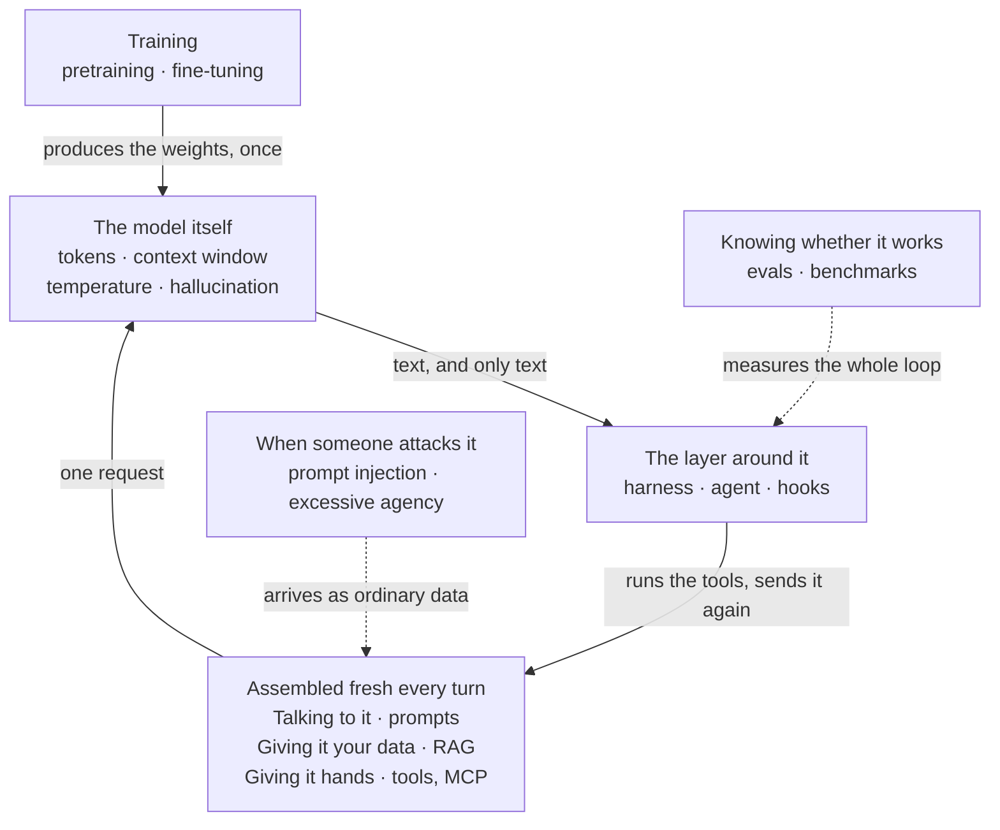

*This page exists to be sent to somebody. It is also meant to sit open in a
second tab while you read anything else about AI, including the rest of this
site.*

## How to use this page

Nobody reads a glossary end to end, so this one is grouped by what you are
trying to understand rather than alphabetically — find the section that matches
your confusion and read only that. Every term gets one sentence and one concrete
example, because a definition without an example teaches you a phrase rather
than an idea, and a phrase is exactly what gets you into trouble in a design
review.

If you are not sure which group your word is in, the map in the next section
places all eight of them.

A word on what is deliberately missing. Where a term has a whole post behind it,
the entry here is a pointer, not a summary. The layer around the model in
particular — skills, hooks, subagents, plugins — is mapped properly in
[the words for the layer around the model](/engineering/harness-engineering-vocabulary/),
and repeating it here badly would help nobody.

## Where these words sit

Before the lists, one picture of how the groups below relate — because the most
common reason a term is confusing is not the definition, it is not knowing which
part of the system it belongs to.

In words, for anyone who would rather have it that way. **Training** happens
once, long before you type anything, and what it produces is the model's
weights. After that, on **every single turn**, a program assembles a request out
of three things — what you say to it, whatever data you have gone and fetched
for it, and the list of tools it is allowed to ask for. That request goes to
**the model**, which returns text and nothing but text. **The layer around it**
reads that text, runs any tool the model asked for, and sends the whole thing
round again. **Evals** sit outside all of it and measure the loop as a whole,
which is why a model that benchmarks well can still make a bad product. And
**attacks** come in through the same door your data does — anything you fetch
and paste in is text the model will read as willingly as yours.

*Each box is one section of this page. Notice how small the model's box is:
most of the words people struggle with are not about the model at all, they are
about the machinery around it.*

## The model itself

Start here if you are not sure what the thing in the middle actually does.

**Token** — The unit a model actually reads and writes: usually a word fragment,
not a word. *"unbelievable" is three tokens; "the" is one. This is why a model
miscounts the letters in a word — it never sees the letters.*

**Tokeniser** — The piece of software that chops your text into tokens before the
model sees anything, and reassembles tokens into text afterwards. *Every model
family has its own, which is why the same paragraph costs a different number of
tokens on two different providers.*

**Context window** — The maximum amount of text, measured in tokens, that the
model can have in front of it for a single request. *If the window is 200,000
tokens, that budget covers the system prompt, every earlier turn, every file it
read and the answer it is about to write — all of it, together.*

**Parameters** — The numbers inside the model that were set during training and
do not change when you talk to it. *A model advertised as "70B" has seventy
billion of them. Nothing you type edits a single one.*

**Weights** — The parameter values themselves, as a file you could in principle
download. *"Open weights" means you can have that file; it does not mean you can
see the data it was trained on.*

**Embedding** — A list of numbers that represents a piece of text's meaning, such
that texts with similar meanings get similar lists. *"cancel my order" and "I
want a refund" land near each other even though they share no words — which is
the whole trick behind search that works on meaning.*

**Vector** — The list of numbers itself, in the general case. *An embedding is a
vector. So is every intermediate number the model passes around internally.*

**Temperature** — A dial that reshapes how sharply the model favours its top
guess. *At 0 it almost always takes its favourite next token; at 1.5 it will
cheerfully take the fourth-best. Low temperature makes it repeat its favourite
answer, not tell the truth. Check before you build a slider for it: several
current models reject the setting outright.*

**Top-p** — A second dial, which keeps only the most likely tokens whose
probabilities add up to p and ignores the rest. *At 0.9, a long tail of
barely-possible tokens is removed before anything is sampled. It limits how
strange the output can get; it does not make it more accurate.*

**Sampling** — The act of picking one token from the model's ranked list of
candidates. *This is where temperature and top-p apply, and it is why asking the
same question twice can give you two different answers.*

**Hallucination** — A fluent, confident, wrong answer, produced by exactly the
same mechanism as a fluent, confident, right one. *It cites an internal policy
document by name that has never existed. Nothing in the output marks the
difference, which is the uncomfortable part.*

**Knowledge cutoff** — The date after which the model's training data stops. *Ask
about a library released last month and it will either say it does not know or,
more often, invent something plausible — see the entry above.*

**Inference** — Running a trained model to produce an answer, as opposed to
training it in the first place. *Every token you are billed for is inference.
Training happened once, months earlier, and you did not pay for it.*

**Mixture of experts** — A model built as many sub-networks where only a few run
for any one token. *It is why a model advertised at 400 billion parameters can
answer at the speed of a much smaller one: the headline is the total, the speed
comes from the handful actually active.*

**Quantisation** — Storing the weights at lower numeric precision so the model
needs less memory. *A four-bit copy runs on a laptop that could not hold the full
one. It is measurably worse, and for a lot of local work you will not notice.*

**Multimodal** — A model that takes more than text — images, audio, sometimes
video. *It is all still tokens. An image becomes a block of them, which is why
pasting three screenshots costs more window than you expect.*

**Context rot** — The quality drop that comes from a window being too full rather
than too small. *Everything fits and the answers still get worse, because the one
instruction that mattered is now buried on page forty.*

## Training

Four of these come up in vendor announcements constantly and almost never get
explained.

**Pretraining** — The first and vastly most expensive stage, where the model
learns to predict the next token across an enormous amount of text. *This is
where everything it "knows" comes from, and it happens once, months before you
type anything.*

**Base model** — The raw result of pretraining: good at continuing text, bad at
being helpful. *Ask one a question and it may well continue with five more
questions, because that is what a list of questions looks like.*

**Post-training** — Everything done after pretraining to turn that into something
usable: following instructions, refusing things, keeping a format. *Most of what
you experience as a model's personality was decided here.*

**Instruction tuning** — The part of post-training that teaches the model to treat
your text as a request to act on rather than a passage to continue. *It is the
difference between "summarise this" producing a summary and producing a longer
essay about summarising.*

**Preference tuning** — Training the model on comparisons between two answers to
the same prompt, so it learns which one people preferred. *A side effect worth
knowing: people reliably prefer a confident answer to "I don't know", and the
model learns that too.*

**Fine-tuning** — Continuing to train an existing model on your own examples to
change its behaviour. *Useful for style, format and a narrow task. Almost never
the right fix for "it does not know our product" — that is a retrieval problem.*

**Distillation** — Training a small model on a large model's outputs so it copies
the behaviour at a fraction of the cost. *Most of the "mini" and "flash" models
you use are made this way, and the edges are where the difference shows.*

**LoRA** — A fine-tune that trains a small add-on rather than rewriting the
weights. *Hours on one GPU instead of a cluster, and you can keep several and
swap them like plug-ins.*

## Talking to it

**Prompt** — Everything sent to the model for one request, not just the sentence
you typed. *On a typical coding-assistant turn, your sentence is a small
fraction of it.*

**System prompt** — Instructions placed before the conversation that set the
model's role, rules and tone. *In a product you wrote, it is the only part your
users never see and never edit.*

**Few-shot** — Showing the model two or three worked examples inside the prompt so
it copies the pattern. *Far more reliable than describing the format you want in
prose, and it costs you tokens every single turn.*

**Streaming** — Returning the answer token by token as it is generated instead of
waiting for the whole thing. *It does not make the answer arrive sooner in total;
it makes the wait visible, which is a product decision rather than a performance
one.*

**Reasoning model** — A model trained to produce a stretch of working-out before
its final answer, which measurably helps on multi-step problems. *You often pay
for those intermediate tokens even when they are hidden from you.*

**Thinking budget** — A cap on how many tokens the model may spend on that
working-out. *Raising it helps on genuinely hard problems and merely costs money
on easy ones. Most providers have replaced the raw number with an effort setting
— see below.*

**Prompt caching** — Storing the unchanging front portion of a prompt on the
provider's side so repeat requests do not pay full price for it again. *If your
system prompt and tool definitions are stable across a session, this is the
cheapest large saving available, and it is why the order of your prompt matters.*

**Context engineering** — Deciding what goes into the window on each turn, and in
what order. *The job that took over from prompt engineering once a prompt stopped
being one message: what to retrieve, what to drop, what to summarise.*

**Chain of thought** — Working-out written as tokens before the answer arrives.
*This is the mechanism behind "think step by step" — those intermediate tokens
become part of what the model reads for the tokens after them.*

**Effort** — A coarse setting — low, medium, high — for how much working-out the
model is allowed to do. *This is what most providers now offer in place of a raw
token budget, and often the only dial still exposed at all.*

**Structured output** — Constraining the answer to match a schema instead of
asking politely for JSON. *The parsing failure you keep handling stops happening,
because an invalid token is never sampled in the first place.*

## Giving it your data

The section people most often skip, and the one that solves "it does not know
anything about us".

**Retrieval** — Looking up relevant text yourself and putting it into the prompt
before you ask the question. *The model cannot go and fetch anything. Something
has to hand it the document.*

**RAG** — Retrieval-augmented generation: the pattern of search first, then
answer, with the search results pasted into the prompt. *Not an algorithm, not a
product — just those two steps, wired together.*

**Chunking** — Splitting your documents into pieces small enough to retrieve and
fit in the window. *Chunk badly and you retrieve half a table and the model
answers from half a table.*

**Vector database** — A store that holds embeddings and finds the nearest ones
quickly. *Worth it at scale. At a thousand documents, a decent search engine you
already run is often a better answer.*

**Reranking** — A second, slower pass that reorders the first search's results by
relevance before anything goes in the prompt. *Usually a bigger quality win than
swapping the embedding model, and far easier to measure.*

**Hybrid search** — Running a keyword search and a meaning-based search and
merging the two sets of results. *It keeps the exact matches — error codes, part
numbers, surnames — that embeddings alone quietly lose.*

**Citation** — Making the answer point at the retrieved passage it came from.
*It does not make the answer right. It makes it checkable in seconds, which is
the difference between a reviewer who checks and one who skims.*

**Memory** — Facts kept deliberately outside the window and read back in on a
later session. *A file your code writes and re-reads. The model itself remembers
nothing between requests, and never has.*

## Giving it hands

**Tool** — A capability you describe to the model and are willing to run on its
behalf: read a file, query a database, open a ticket. *The model never runs it.
It can only ask.*

**Tool call** — The structured request the model emits when it wants a tool used,
naming the tool and its arguments. *It comes back as data, your code decides
whether to honour it, and the result is appended to the conversation as more
text.*

**Tool schema** — The machine-readable description of a tool: its name, what it
does, and the shape of its arguments. *An API contract whose only consumer reads
English, which is why the description field does more work than the type
definitions.*

**MCP** — The Model Context Protocol: an agreed shape for connecting assistants
to tools, so that one tool works with many assistants. *Think of a standard plug
socket. It is not clever; it is agreed, and that is the entire value.*

**MCP server** — A separate program, often written by somebody else, that offers
tools, resources and prompts over that protocol. *Installing one is installing
software with access to whatever you configured it to reach. Read it like you
would read any other dependency.*

**MCP host** — The application you are actually using — your editor, your
assistant — which decides what connects, asks you for permission, and owns every
security decision the protocol does not make. *This is the side you are on,
though you rarely write any of it.*

**MCP client** — The piece inside the host that maintains the connection to one
server; one client per server. *A detail that matters once: two servers are two
independent connections that have never heard of each other.*

**Computer use** — Tools that let the model drive a screen or a browser rather
than call an API. *Slow, expensive and error-prone — and the only route into a
system that has no API at all.*

**Sandbox** — The restricted environment a tool runs in: limited files, limited
network, no credentials it does not need. *The difference between a wrong command
and a wrong command that reached production.*

## Knowing whether it works

Five terms that separate a demo from something you are willing to put in front
of customers.

**Eval** — A repeatable test of a model's output against a fixed set of inputs
and a definition of a good answer. *The AI equivalent of a test suite, and the
single thing most often missing from a system that "worked in the demo".*

**Golden set** — The hand-checked examples an eval runs against, with the answers
a human agreed were right. *Twenty cases that someone who knows the domain
actually argued over beats two thousand generated ones.*

**LLM-as-judge** — Using a model to score another model's answers against a
rubric, because the outputs are prose and prose has no equals sign. *Cheap, fast,
and biased in ways you have to measure against human scores before you trust it.*

**Regression** — A change — new model version, new prompt, new retrieval step —
that quietly makes previously-good answers worse. *Without an eval you will find
out from a customer, and you will not know which change did it.*

**Benchmark** — A published test that ranks models against one another on a
shared set of tasks. *Good for drawing up a shortlist, useless as evidence about
your own task. Your eval is the one that decides.*

## The layer around it

One line each. The full map, with what each part is for and who pulls its
trigger, is
[the words for the layer around the model](/engineering/harness-engineering-vocabulary/).

**Harness** — Everything between your prompt and the model's weights: context
assembly, the tool list, the loop, the permission checks. *Claude Code is a
harness. So is anything you build on an SDK.*

**Agent** — A model in a loop that can call tools and keeps going until the task
is done or it is stopped. *Less mysterious than it sounds — the loop is the whole
of it.*

**Subagent** — A separate agent run with its own context window, whose result
comes back as a short summary. *The point is isolation: the exploration does not
fill the main conversation's window.*

**Skill** — A folder of instructions the model loads on its own judgement when it
decides the task matches. *Advisory, like every instruction file: the model reads
it and weighs it.*

**Hook** — A command the harness runs deterministically at a fixed point, whether
the model likes it or not. *This is where "always run the tests" belongs, and
putting it in an instructions file instead is the single most common filing
error.*

**Compaction** — Summarising the earlier part of a long conversation to make room
in the window. *Lossy by design. If it summarised away the instruction you cared
about, the model is not ignoring you.*

**Permission mode** — The harness setting that decides which tool calls run
without asking you. *The difference between a confirmation on every write and a
session that edits your repository unattended.*

## When someone attacks it

The group that was a research curiosity when this site started and is now the
first thing a security review asks about.

**Prompt injection** — Text that arrives as data — a web page, a ticket, a file
somebody uploaded — and gets read as instructions. *First on OWASP's list three
years running. There is no clean fix; what you control is how little a successful
one can reach.*

**Jailbreak** — A prompt built to talk the model past its own refusals.
*Different problem from injection, and worth keeping separate: here the attacker
is the person typing, not the document being read.*

**Excessive agency** — Giving an agent more permission, or more tools, than its
job needs. *OWASP moved this up to third in 2026. It is almost always a
credentials-and-tools decision rather than anything the model did.*

**Guardrail** — A check sitting around the model that inspects what goes in or
comes out and blocks what it does not like. *Worth having. Not a substitute for
simply not handing the agent the dangerous tool.*

**Red teaming** — Attacking your own system deliberately before somebody else
does. *The companion to evals: an eval asks whether it works, red teaming asks
what it does when provoked.*

## References and further reading

- [The Model Context Protocol specification](https://modelcontextprotocol.io/specification/2026-07-28),
  revision `2026-07-28` — open this when a vendor's description of MCP and
  another vendor's do not match; the specification is the thing both are meant to
  implement. Its own security section is worth the five minutes.
- [OWASP Top 10 for LLM Applications](https://genai.owasp.org/llm-top-10/) —
  open this to learn the production names for the failures above. Hallucination
  is the entry called *Misinformation*; a session that grows without limit is
  *Unbounded Consumption*. Naming them this way is what gets them into a risk
  register. A 2026 edition landed in September 2026 and reshuffled the order —
  *Excessive Agency* is now third — so quote the ranking from the list itself
  rather than from memory.
- [Harness engineering: the words for the layer around the model](/engineering/harness-engineering-vocabulary/)
  — open this when the last section above is the one you needed. It covers the
  same parts across Claude Code and GitHub Copilot, organised by who pulls the
  trigger.
