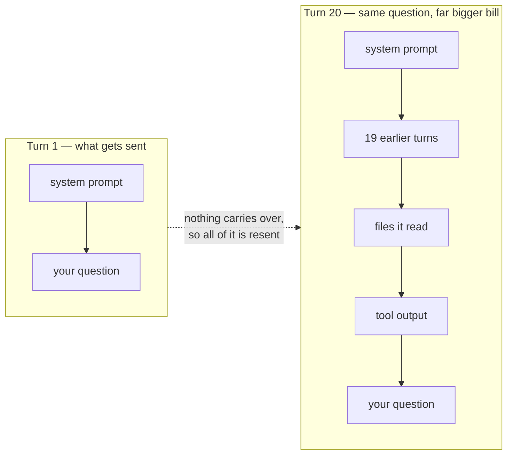
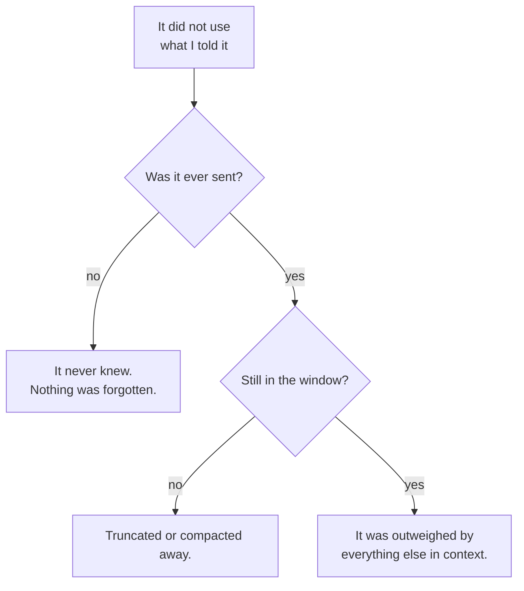

*Measured on a real five-turn conversation, with a model small enough that you
can run the same script on your laptop and get your own numbers.*

## TL;DR

- The model keeps nothing between turns. Nothing at all.
- Your whole conversation is sent again, from scratch, every single turn.
- "It forgot" is almost never forgetting. It is one of three different problems,
  and they have three different fixes.
- Cost and waiting time climb through a long session, and they climb faster than
  the amount you added.
- The fix is choosing what goes in, not waiting for a bigger
  [context window](/engineering/the-ai-vocabulary/#context-window).

## Where this sits

This needs [what a model actually is](/engineering/what-a-model-actually-is/) —
the loop in particular, and the note at the end about what attention costs.
[Track 2](/engineering/ai-foundations-start-here/), on what your coding tool is
doing, assumes this post throughout. The whole series, and which track you want, is on
[the start-here page](/engineering/ai-foundations-start-here/).

Technical words link to their one-line definition in the
[AI vocabulary](/engineering/the-ai-vocabulary/) the first time they appear.
Open them in a second tab as you go.

And one scene runs through the whole post, in section 02. If the mechanics ever
stop making sense, go back to it.

## 01 — The thing you have already noticed

Forty minutes into a good session, the assistant tells you something that
directly contradicts what it told you at the start. Not a refinement — a
contradiction. You scroll up to check, and yes, there it is.

Or the smaller, more irritating version: you told it in your very first message
to use British spelling and the house logging library, it did for a while, and
somewhere around turn thirty it quietly stopped.

What makes both versions confusing is that nothing looks broken. There is no
error, no warning, no "I am running low on room" message. The assistant is as
fluent on turn forty as it was on turn one; it is simply fluent about something
else now. If a database dropped your writes this quietly you would call it a
serious bug. Here it is the system working exactly as designed, and the design
is just not visible from the chat box.

The reaction most people have is that the model lost the thread, or got tired,
or that the context "filled up". One of those is close to right, but the real
explanation is simpler and more useful, and it starts from a fact that sounds
wrong the first time you hear it.

## 02 — Sam's desk gets cleared every morning

Post 1 introduced Sam, the colleague who has read everything and cannot look
anything up. Here is the detail that post left out.

> Sam works in a small room with a desk, and the room is cleared overnight.
> Every morning Sam walks in with no memory of yesterday at all — not a vague
> memory, none.
>
> So you have a system. Before each question you hand Sam a printed transcript
> of everything that has happened so far: the brief you gave on Monday, the file
> you showed them, every question you have asked, every answer they have given.
> Sam reads the whole stack, answers your new question, and the room is cleared
> again.
>
> It works. From the outside it looks exactly like a colleague with a memory.
> But notice what you are actually doing, because three things follow from it.
>
> **You are paying to reprint the stack every single time.** The question "and
> what about the error case?" is nine words, and handing it over costs you the
> whole transcript again.
>
> **The desk has edges.** Past some number of pages, something has to come off
> the bottom — or get replaced by a one-page summary — before the new page fits.
>
> **Nothing on the desk is highlighted.** Monday's "always use British spelling"
> is one sentence on page one. Thursday's stack trace is four hundred words of
> urgent-looking detail on page nine. To Sam they are the same kind of thing:
> text on the desk, competing to shape the next answer.

That is the whole post. Everything below is one of those three consequences,
measured.

## 03 — There is no conversation

There is no conversation. There is no session. There is nothing at the other end
keeping track of you.

The API underneath every one of these tools takes a list of messages and returns
one more message. That is the whole interface. No memory of the previous call,
no identifier tying this request to the last, nothing stored in between. Send
the same list twice and you get two independent answers from something with no
idea it has seen you before.

So how does a chat work? The program in front of you keeps the list. Every time
you press enter it adds your new message to everything that came before and
sends the whole pile again. It is reprinting the transcript.



*Notice that turn 20 is not turn 1 plus a memory. It is turn 1 plus everything,
sent again from scratch.*

If you have only ever used a chat window, that sounds like pedantry. If you have
ever built anything on the API, it is the first thing you find out and it
rearranges how you think. There is no `session_id`, no `conversation.append()`
on the server, nothing to expire. You hold the list. You decide what goes in and
what comes out. Every design question that feels like "how do I give it
[memory](/engineering/the-ai-vocabulary/#memory)" is really "what do I put in
the list, and how do I choose".

This is the most load-bearing fact in the series. The memory you experience is a
file on your side being replayed. The context window is not where memories are
kept. It is the maximum size of the stack you are allowed to hand over.

## 04 — What that costs, measured

Here is an ordinary five-turn conversation against a local model
(`Qwen/Qwen2.5-3B-Instruct`, so you can run the same script). Turn 1 is a
one-sentence instruction. Turn 2 pastes a small TypeScript file and asks what it
does. Turns 3 to 5 are short follow-up questions about it. Nothing unusual,
nothing long.

The script counts exactly what gets sent each turn, by rendering the full
message list through the model's own chat template and tokenising it:

```python
messages = []
for text in TURNS:
    messages.append({"role": "user", "content": text})
    prompt = tok.apply_chat_template(messages, add_generation_prompt=True, tokenize=False)
    print(f"turn {len(messages)//2 + 1}: {len(tok(prompt)['input_ids'])} input tokens sent")
    reply = generate(prompt)
    messages.append({"role": "assistant", "content": reply})
```

```text
turn 1:     65 input tokens sent
turn 2:    579 input tokens sent
turn 3:    760 input tokens sent
turn 4:    938 input tokens sent
turn 5:   1122 input tokens sent

cumulative input tokens billed across the session: 3464
```

One thing that measurement does not show, because I ran it bare: in a real
coding tool, turn 1 is never 65 tokens. Before your first word there is a
[system prompt](/engineering/the-ai-vocabulary/#system-prompt), the definition
of every [tool](/engineering/the-ai-vocabulary/#tool) the
[harness](/engineering/the-ai-vocabulary/#harness) offers, and whatever
instruction files the project loads. A single [MCP
server](/engineering/the-ai-vocabulary/#mcp-server) can spend three and a half
thousand tokens describing its tools, every turn, whether you use it or not.
Your real turn 1 starts somewhere in the thousands, and everything below
compounds from there rather than from 65.

Read the shape, not the size, and read the gaps between the rows:

| | tokens sent | growth on the previous turn | what I typed |
|---|---|---|---|
| turn 1 | 65 | — | one sentence |
| turn 2 | 579 | +514 | a file, and "what does it do?" |
| turn 3 | 760 | +181 | nine words |
| turn 4 | 938 | +178 | seven words |
| turn 5 | 1,122 | +184 | eleven words |

Turn 2's jump is the file, as you would expect. The interesting rows are the
last three. I typed twenty-seven words across them and the stack grew by 543
tokens, because each of those turns carries the previous turn's *answer* back
with it. After the first paste, most of what you are paying to resend is not
your writing at all. It is the model's own, piling up.

My last question was eleven words long. Sending it cost 1,122 tokens, because
those eleven words arrived carrying the file, three earlier questions and four
earlier answers on their back. The last turn is **17 times** the first, and I
never typed anything long.

Now the money, and I want to be precise about what kind of number this is. The
token counts above are measured. The costs below are **arithmetic** on those
counts at Anthropic's published list prices, checked on 17 October 2026: Claude
Opus 5.5 at $4.00 per million input tokens, Claude Sonnet 5.5 at $2.00, Claude
Haiku 5.5 at $0.10 for prompts under 100,000 tokens, above which it rises — a
boundary the larger projections below cross.

| | cumulative input tokens | at Opus 5.5 | at Sonnet 5.5 |
|---|---|---|---|
| this five-turn session | 3,464 | $0.014 | $0.007 |
| 40 turns, ending at a 100k window | ~2,000,000 | $8.00 | $4.00 |
| 60 turns, ending at a 200k window | ~6,000,000 | $24.00 | $12.00 |

The last two rows are the same arithmetic applied to a session that grows
steadily to a realistic size — if the context climbs roughly evenly from nothing
to *N* tokens over *T* turns, you pay for about `T × N / 2` input tokens in
total. Do that sum for your own longest session; it is usually the moment this
post lands.

Two honest qualifications. **[Prompt
caching](/engineering/the-ai-vocabulary/#prompt-caching) changes these numbers a
lot**: the unchanging front of the stack can be re-read at $0.20 per million
instead of $4.00. Take the 40-turn row, and say 90 per cent of its two million
tokens are cache reads and 10 per cent are paid in full. That is
`0.9 × $0.20 + 0.1 × $4.00` — about $0.58 per million, so **$1.16 for the whole
session instead of $8.00**. A higher hit rate approaches $0.40. And **output
tokens cost five times more than input**, so a session full of long answers has
a second bill this table does not show. Neither changes the shape.
Both make it more important to know what is in the pile.

## 05 — Why a bigger window is not the answer

The obvious wish is for a bigger desk, and vendors have obliged: windows have
grown by orders of magnitude in a few years. It helps less than you would think,
for two reasons.

The first comes from [the end of post
1](/engineering/what-a-model-actually-is/). Inside each pass the model compares
every token with every other token. Double the input and you more than double
the work. That is why a long session gets slower in a way that feels out of
proportion — you are not waiting on a bigger download, you are waiting on more
arithmetic than you added.

The second is quality, and it is the less obvious one. A bigger desk does not
make Sam better at reading it. Bury one critical sentence in 150,000 tokens of
plausible-looking context and you have made that sentence compete with
everything else for the model's attention. "I gave it everything" is not the
same as "I gave it what it needed", and past a point the two pull against each
other. The vocabulary has a name for the symptom:
[context rot](/engineering/the-ai-vocabulary/#context-rot).

A bigger window raises the ceiling on what you *can* send. It does nothing about
what you *should*.

## 06 — What "it forgot" actually was

Here is the part that changes how you debug.

I ran the same question against the same model twice. In the first run, the
model has the whole conversation. In the second, the oldest turn has been
dropped — exactly what a harness does when it needs to make room.

Turn one established a fact — a fixture I invented for the experiment, not a
claim about this blog: that the 220-words-per-minute figure in the utility was
chosen by the editorial team. It is a short turn, and the 51-token difference
between the two runs below is exactly its weight. Several turns later, I asked
who chose it.

```text
=== A: full history (620 tokens sent)
The words-per-minute (wpm) number of 220 used in this project was chosen by the
editorial team. This number represents a common average for reading speed in
technical prose.

=== B: same question, oldest turn dropped (569 tokens sent)
The `220 wpm` (words per minute) number used in this project is a common average
for reading speed of technical prose. This value is often used as a standard for
estimating reading times for technical content, which typically involves more
complex sentences and concepts than casual reading material.

However, it's worth noting that reading speeds can vary significantly based on
factors such as the complexity of the content, the reader's familiarity with the
subject matter, and their current level of focus...
```

Look at what B does. It does not say "I don't know who chose it." It does not
notice anything is missing. It produces four confident sentences about reading
speeds in general, never answers the question, and if you were skimming you
might not catch that it dodged.

That is what truncation looks like from the outside: not an error, not a gap — a
fluent non-answer. Which is why the diagnostic matters.



*Three different problems with three different fixes. Only the middle one is
anything like forgetting.*

Work left to right. **Was it ever sent?** This is the most common answer by a
distance, and the most embarrassing: the file you were looking at was never read
into context, the instruction was in a config the harness does not load, the
screenshot you pasted did not come through. Nothing was forgotten because
nothing was ever known.

**Was it still in the window?** This is run B. Something fell off the bottom of
the stack, or [compaction](/engineering/the-ai-vocabulary/#compaction) replaced
it with a summary. Real forgetting, and the only one of the three a bigger
window would fix.

**Was it in context and outweighed?** The hardest one. The instruction is right
there in the pile, and 80,000 tokens of code and tool output are also right
there, and the instruction lost. No error, no truncation, just a sentence that
did not win. Repeating the instruction closer to the end genuinely helps here,
which tells you something about what is going on.

Sit with the third case, because it is the one people argue about. "It was in
context and it still ignored me" sounds like a cop-out and is not. It is the
third thing from Sam's desk: nothing in a context window is pinned, prioritised
or marked as an instruction rather than as text. Your constraint from turn one
and a stack trace from turn thirty are the same kind of thing to the mechanism —
tokens competing to shape the next guess. The constraint is one sentence. The
stack trace is four hundred tokens of urgent-looking detail. Guess which wins.

Which is also the honest answer to "why does repeating myself work?". It is not
that the model is listening harder the second time. You have added weight, late,
where it counts.

## 07 — Going deeper: what compaction trades away

When the stack approaches the edge of the desk, something has to give, and
modern harnesses mostly do not just drop the oldest pages. They compact:
summarise the earlier part of the conversation and put the summary in its place.

Good trade, still a trade. A summary loses things by construction — that is what
makes it smaller. The one sentence that turns out to matter three turns later is
exactly the kind of detail a summariser drops, because at summarising time it
looked like detail. You cannot tell in advance which sentence that will be.

The practical consequence is small and worth internalising: when something
important is established mid-session — a decision, a constraint, a correction —
write it down outside the conversation. A file in the repo, a note, the ticket.
Anything whose survival does not depend on a summarising step you did not
configure and cannot see. The harness-side mechanics of how and when that
happens get their own post,
[Where the context comes from](/engineering/where-the-context-comes-from/).

There is a second-order effect worth naming too. Once a summary replaces the
original turns, the model is reasoning about a *description* of what happened
rather than what happened. If the summary slightly misstates a decision — and
summaries do — every later turn builds on the misstatement, confidently, with no
way back to the original text. This is the mechanism behind the session that
goes subtly wrong after an hour and cannot be argued back onto the rails. The
fix is not a better argument. It is a fresh session with the real facts pasted
in.

## Try it yourself

1. **Count your own longest session.** Take a real conversation from last week,
   count the tokens in the whole thing, and multiply by turns over two. Compare
   the result to what you assumed it cost.
2. **State a fact early, then probe for it after a long detour.** Give the model
   a fact in turn one, spend twenty turns on something else, then ask. Note
   whether it answers, dodges, or invents — and which of the three causes above
   explains what you saw.
3. **Ask the same question twice: once at the end of a long session, once in a
   fresh one with only the relevant file pasted in.** Compare the answers for
   quality, not just cost. This is the experiment that converts people.

## Common mistakes

**Believing the model remembers you.** It does not, and nothing in the product
is lying to you about this — the memory is on your side of the wire, and
whichever tool you are using decides what goes back.

**Pasting a whole file when ten lines would do.** The whole file is now in every
subsequent turn, forever, at full price, competing for attention with the thing
you actually asked about.

**Treating a long session as free because you only typed a sentence.** The
sentence is not what you are paying for. See section 04.

**Blaming the model for an instruction that was never sent.** Before you
conclude it ignored you, check the first branch of the diagnostic. Most of the
time it never knew.

**Assuming a bigger window removes the need to curate.** It raises the ceiling
and leaves the discipline exactly where it was.

## References and further reading

- [What a model actually is](/engineering/what-a-model-actually-is/) — the
  prerequisite for this post, where Sam is introduced, and where the
  attention-cost argument in section 05 comes from.
- [The AI vocabulary](/engineering/the-ai-vocabulary/) — one-line definitions
  for context window, compaction, prompt caching and the rest.
- [OWASP Top 10 for LLM Applications](https://genai.owasp.org/llm-top-10/) —
  open this for the entry called *Unbounded Consumption*, which is section 04's
  arithmetic under its security name. It climbed to sixth in the 2026 edition
  and now covers denial-of-wallet explicitly, so quote the name rather than the
  number. Worth having when you need to explain to somebody that a runaway
  session is a risk and not just a bill.
- [My AI-assisted coding playbook](/engineering/ai-assisted-coding-playbook/) —
  open this for the practical habits that follow from all of the above: what I
  actually put in context, and when I start a fresh session instead of
  continuing.

## Final thoughts

Almost every piece of advice you will read about working with these tools —
start a new session, give it the file rather than the repository, repeat the
constraint, write decisions down — follows from the one fact at the top of this
post. The model is stateless, and the conversation is a file on your side being
replayed at full price.

Once that is in your head, you stop asking the model to remember things and
start deciding what it needs to be told. Which is a different job, and a much
more tractable one.
