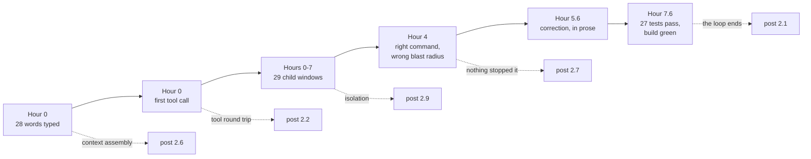
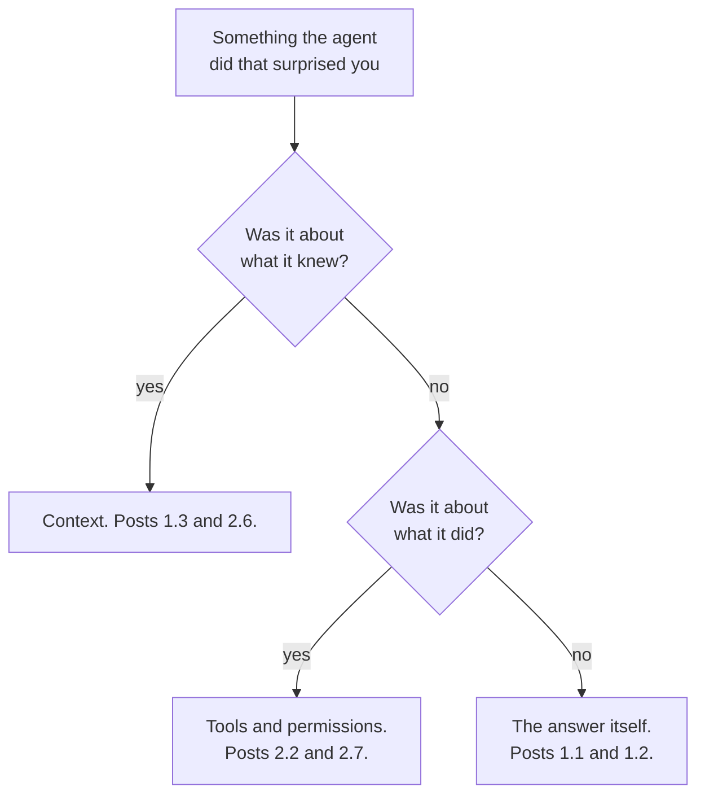

*Every number below was read out of one real session's own transcripts on 10
October 2026 — the seven-and-a-half-hour run of Claude Code on `claude-opus-5`
that wrote ten posts across this series, seven of them in this track and one of
those seven this one. No model was
run and no API key was used; the scripts are file arithmetic over JSONL already
on disk. The session is far too long to show in full — 176 requests in the main
window and twenty-nine more windows beneath it — so this is **excerpted**, not a
complete trace. I picked the excerpts by looking for turns where a mechanism
this track explains is visible in the raw record: turn one, the first tool call,
the one moment something was destroyed, and the arithmetic of the whole arc.
Post 2.9 measured the same session's fan-out; where a figure comes from there,
I say so and link rather than recomputing it a second way.*

## TL;DR

- **Context assembly.** Twenty-eight typed words went out as a 51,717-token
  request. Sixteen separate things were attached to them before the model saw
  anything.
- **The tool round trip.** The second turn read a 69.9 KB file and added 1,018
  tokens to the window, because the harness never handed the file over. One
  skill, five turns later, cost 12,313.
- **Permission.** One destructive command ran in the whole session. Nothing in
  the repository could have stopped it, because nothing was configured to.
- **Isolation.** The main window made 99 tool calls in seven and a half hours
  and never compacted. The reading happened in twenty-nine other windows.
- **Attention is not knowledge.** The fact that would have prevented the damage
  was sitting in the window of the agent that did it.

## Where this sits

This is the tenth and last post in **How your AI coding tool works**. It reads
best after the other nine, but you can start here: every mechanism below is one
or two sentences and a link to the post that owns it, so the post is a map with
the territory underneath it rather than a summary of what you have already read.

There is deliberately **no new analogy here**. Every post in both tracks carried
one — a dispatcher on the phone, a waiter taking an order, four separate
briefings — and this one's job is to show the machinery those analogies were
standing in for. A fresh metaphor at this point would undo nine posts of work.

The words for everything below are in
[harness engineering](/engineering/harness-engineering-vocabulary/), used here
exactly as it defines them, and single terms are one line each in
[the AI vocabulary](/engineering/the-ai-vocabulary/).

## 01 — The task

The work was ordinary: finish two explainer series on this blog. A plan already
existed, written in an earlier session and reviewed by hand — ten posts across
two tracks, a map tying them together, and one change to the cover-art system so
a single piece of artwork could carry four posts instead of two. The reason for the series is the
reason this one exists: two posts published a few days earlier named a machine
nobody had described, and readers said so. The design that came out of that is
the shape you are reading.

That plan is the only interesting thing about the setup. It meant the session
began with a document on disk that already knew what the thirteen tasks were,
which is why the first prompt could be one sentence. The discipline behind
writing a plan like that is
[spec-driven development](/engineering/spec-driven-development-tdd-bdd-ai-agents/);
I am not re-arguing it here, only annotating what happened when one was
executed.

## 02 — Turn one, in full

Here is the entire first prompt, verbatim:

> lets work on the blogs in step 2 — the cover-variant widening, then the rest
> of tracks 1 and 2, then the start-here map and keep everything draft

Twenty-eight words, one of them a typo. What the harness actually sent:

```python
# What did the harness put around the sentence I typed?
# Reads one Claude Code session's own transcript. No model, no API key, no network.
# python3 turn_one.py ~/.claude/projects/<project>/<session-id>.jsonl
import json, sys, collections

layers, typed = collections.Counter(), None
for line in open(sys.argv[1]):
    d = json.loads(line)
    if d.get("type") == "attachment":
        layers[(d.get("attachment") or {}).get("type")] += 1
    elif d.get("type") == "user" and typed is None:
        c = (d.get("message") or {}).get("content")
        if isinstance(c, list):
            c = " ".join(x.get("text", "") for x in c if isinstance(x, dict))
        if c:
            typed = c
    elif d.get("type") == "assistant":
        u = d["message"].get("usage") or {}
        new = u.get("input_tokens", 0)
        write = u.get("cache_creation_input_tokens", 0)
        read = u.get("cache_read_input_tokens", 0)
        print(f"  words I typed                     : {len(typed.split())}")
        print(f"  layers the harness attached       : {sum(layers.values())}")
        for k, n in layers.most_common():
            print(f"      {k:<26}{n}")
        print()
        print(f"  tokens neither cached nor cacheable: {new:,}")
        print(f"  tokens written to the cache        : {write:,}")
        print(f"  tokens read back from the cache    : {read:,}")
        print(f"  total prompt sent, turn one        : {new + write + read:,}")
        break
```

```text
  words I typed                     : 28
  layers the harness attached       : 16
      hook_success              1
      hook_additional_context   1
      environment               1
      model                     1
      deferred_tools_delta      1
      agent_listing_delta       1
      mcp_instructions_delta    1
      skill_listing             1
      auto_mode                 1
      total_tokens_reminder     1
      instructions              1
      session_context           1
      date                      1
      credential_org            1
      remote_session_change     1
      prompt_snapshot           1

  tokens neither cached nor cacheable: 2
  tokens written to the cache        : 35,638
  tokens read back from the cache    : 16,077
  total prompt sent, turn one        : 51,717
```

**Mechanism: context assembly.**
[Where the context comes from](/engineering/where-the-context-comes-from/)
weighs these layers one by one and explains why the always-loaded ones are
charged on every turn; that is its post, not this one. What this session adds is
the shape of the ratio. Two tokens out of 51,717 were genuinely new. Everything
else was the standing furniture of the window — a system prompt, a tool
catalogue, instruction files, a listing of every available skill, the editor's
notion of where I was — assembled before I had said anything at all.

One of those sixteen layers matters later, so note it now: `session_context`
carried a `git status` taken as the session opened, with its own warning that
it "will not update during the conversation". Hold that thought until section
04.

## 03 — The first tool call

The model's first move was to read the plan. The plan is 69.9 KB.

```python
# What did each of the first few turns add to the context window?
# Reads one Claude Code session's own transcript. No model, no API key, no network.
# python3 first_turns.py ~/.claude/projects/<project>/<session-id>.jsonl
import json, sys

size = lambda u: (u.get("input_tokens", 0) + u.get("cache_creation_input_tokens", 0)
                  + u.get("cache_read_input_tokens", 0))
reqs = []
for line in open(sys.argv[1]):
    d = json.loads(line)
    if d.get("type") != "assistant":
        continue
    u = d["message"].get("usage") or {}
    call = next((c for c in d["message"].get("content") or []
                 if isinstance(c, dict) and c.get("type") == "tool_use"), None)
    if not reqs or size(u) != reqs[-1][0]:
        reqs.append([size(u), u.get("cache_creation_input_tokens", 0), None])
    if call and reqs[-1][2] is None:
        label = call["name"]
        if label == "Bash":
            label += ": " + (call["input"].get("description") or "")
        elif label == "Skill":
            label += ": one skill, loaded on demand"
        reqs[-1][2] = label

print(f"  {'turn':<5}{'prompt sent':>13}{'newly written':>15}   what the model asked for next")
for i, (total, written, label) in enumerate(reqs[:7], 1):
    print(f"  {i:<5}{total:>13,}{written:>15,}   {label or '(no tool call)'}")
```

```text
  turn   prompt sent  newly written   what the model asked for next
  1           51,717         35,638   Bash: Read step 2 plan
  2           52,735          1,018   Bash: Outline step 2 plan
  3           54,756          2,021   Bash: Read plan head and task 1
  4           58,573          3,817   Bash: Check draft handling
  5           59,646          1,073   Bash: Check post frontmatter and push state
  6           61,451          1,805   Skill: one skill, loaded on demand
  7           73,764         12,313   Bash: Resolve SDD workspace
```

**Mechanism: a tool call is a request, not an action.** The model asked for
`cat <the plan>`. It was not given the plan. The harness ran the command,
decided the output was too large, wrote 69.9 KB to a file on disk, and returned
a pointer plus the first 2 KB — which is why turn 2 added 1,018 tokens rather
than roughly twenty thousand. The model then did the sensible thing and asked
for `wc -l` and a `grep` of the headings instead: an outline, for 2,021 tokens.
[A tool call is a request, not an action](/engineering/a-tool-call-is-a-request-not-an-action/)
owns that boundary, and this is it being load-bearing rather than theoretical.

**Why that tool and not another one.** `Bash` was chosen over a file-reading
tool for a reason worth naming: the model picks from tool *descriptions*, and
one shell call can chain five checks that would otherwise be five round trips.
Turns 4 and 5 each bundled three or four commands behind one `&&`. How a model
comes to follow a tool description at all is
[how it learned to follow instructions](/engineering/how-it-learned-to-follow-instructions/).

**And the cost of knowing how to work.** Turn 6 loaded a single skill — the
plan-execution workflow from an open-source plugin I have
[written about before](/engineering/claude-code-plugins-what-i-actually-use/).
That one load cost 12,313 tokens, twelve times the 69.9 KB file read. Reading a
file is cheap because the harness can truncate it. Loading a skill is expensive
because the whole point is that all of it enters the window.
[How a skill gets found and loaded](/engineering/how-a-skill-gets-found-and-loaded/)
is the post for that trade.

## 04 — Where it went wrong

Four hours in, an agent working on post 2.7 was asked to reword a commit
message. It did this:

```sh
git reset --hard HEAD~1
```

Before running it, the agent copied its own post file to a scratch directory and
compared hashes to be sure the copy was good. After running it, it restored its
file from the copy and re-committed. Its own closing check printed:

```text
(working tree clean for tracked files)
```

That check passed. It was also, word for word, the report of the damage.

One tracked file in that repository had uncommitted changes when the session
started: a superseded design document carrying a status line I had edited by
hand and never committed. `git reset --hard` discarded it. The edit
had never been staged, so git had never written a blob for it; the main session
later searched every dangling object in the repository and found nothing to
recover. It is gone.

Now the uncomfortable part. My first guess was that the agent could not have
known — fresh window, no conversation history, the usual story from post 2.9. I
checked, and that guess was wrong:

```python
# The fact that would have prevented it: was it in the window at all?
# Reads one Claude Code session's own transcripts. No model, no API key, no network.
# python3 knew.py ~/.claude/projects/<project>/<session-id>
import json, glob, re, sys

sess = sys.argv[1]
# a line that *starts* a destructive git command, not one that mentions it
DESTRUCTIVE = re.compile(r"^\s*git (reset --hard|clean |checkout -- |restore )", re.M)

def attachment(path, key):
    """What the harness pasted in when this window was assembled."""
    for line in open(path):
        if '"session_context"' not in line:
            continue
        d = json.loads(line)
        if d.get("type") == "attachment":
            return (d["attachment"].get("context") or {}).get(key, "")
    return ""

def destructive_calls(path):
    n = 0
    for line in open(path):
        d = json.loads(line)
        if d.get("type") != "assistant":
            continue
        for c in d["message"].get("content") or []:
            if isinstance(c, dict) and c.get("type") == "tool_use" and c["name"] == "Bash":
                n += bool(DESTRUCTIVE.search(c["input"].get("command", "")))
    return n

modified = lambda s: [l for l in s.splitlines() if l.startswith("M ")]
kids = sorted(glob.glob(sess + "/subagents/*.jsonl"))
warned = [k for k in kids if modified(attachment(k, "gitStatus"))]

print(f"  tracked files already modified when the session began  : {len(modified(attachment(sess + '.jsonl', 'gitStatus')))}")
print(f"  child windows the session opened                       : {len(kids)}")
print(f"  of those, handed a start-of-session git status         : {sum(1 for k in kids if attachment(k, 'gitStatus'))}")
print(f"  of those, whose status named a modified tracked file    : {len(warned)}")
print(f"  destructive git commands run, across every window       : "
      f"{destructive_calls(sess + '.jsonl') + sum(destructive_calls(k) for k in kids)}")
print(f"  of those, run by a window that had been warned          : {sum(destructive_calls(k) for k in warned)}")
```

```text
  tracked files already modified when the session began  : 1
  child windows the session opened                       : 29
  of those, handed a start-of-session git status         : 29
  of those, whose status named a modified tracked file    : 22
  destructive git commands run, across every window       : 1
  of those, run by a window that had been warned          : 1
```

Twenty-two child windows were handed a status naming a modified tracked file,
and twenty-one of those named this exact one. The agent that destroyed it was
one of the twenty-one. The line was in its context from its very first token,
and it ran the command anyway.

So this is not an ignorance failure, and calling it one would be the comfortable
lie. It is an attention failure. The window held the fact; the model was
thinking about a commit message, and
[the context window is the entire memory](/engineering/the-context-window-is-the-entire-memory/)
is about what is *present*, not about what gets weighed. The confident,
carefully-hashed, entirely wrong blast-radius model it built is the behaviour
[why it sounds certain when it's wrong](/engineering/why-it-sounds-certain-when-its-wrong/)
describes: fluent reasoning over the part of the problem it had in view.

And nothing stopped it, because nothing could.
[Who is allowed to do what](/engineering/who-is-allowed-to-do-what/) draws the
line between a sign and a lock. This repository had neither: no project
`settings.json`, no deny rule, no hook. The only protection in the building was
a human reading the transcript afterwards.

## 05 — What I did about it

The main session caught it an hour and a half later, during a routine `git
status`, because it still had the session-start status from hour zero in its
window and noticed a line had stopped appearing. It then did three correct
things: searched for a recoverable blob, found none, and said so plainly in both
the ledger and the next message to me, rather than quietly moving on. That
honesty is the part worth copying.

Then it wrote the rule into the layer it had, which is the weakest one:

```python
# After the damage, the rule went into a sentence. Did every brief carry it?
# Reads one Claude Code session's own transcript. No model, no API key, no network.
# python3 rule.py ~/.claude/projects/<project>/<session-id>.jsonl
import json, sys
from datetime import datetime as dt

INCIDENT = dt.fromisoformat("2026-10-10T13:26:42+00:00")   # the command itself
before, after, carried = 0, 0, 0
for line in open(sys.argv[1]):
    d = json.loads(line)
    if d.get("type") != "assistant":
        continue
    sent = dt.fromisoformat(d["timestamp"].replace("Z", "+00:00"))
    for c in d["message"].get("content") or []:
        if not (isinstance(c, dict) and c.get("type") == "tool_use"):
            continue
        if c["name"] not in ("Agent", "SendMessage"):
            continue
        brief = c["input"].get("prompt") or c["input"].get("message") or ""
        if sent < INCIDENT:
            before += 1
        else:
            after += 1
            carried += "reset --hard" in brief

print(f"  briefs sent before the incident     : {before}")
print(f"  briefs sent after it                : {after}")
print(f"  of those, carrying the written rule : {carried}")
```

```text
  briefs sent before the incident     : 27
  briefs sent after it                : 11
  of those, carrying the written rule : 11
```

Every brief after that moment carried a sentence forbidding hard resets, and
across those eleven dispatches the destructive-command count in section 04 — one
for the whole session — never moved again. That is a real
result and I will not oversell it: eleven for eleven is a sign working, not a
lock holding. **The correction belonged in the permission layer and I put it in
the prose layer**, because the prose layer was the one I could reach from inside
the running session. A `deny` entry in a project `settings.json`, or a
`PreToolUse` hook that refuses this command shape, would have turned the next
eleven dispatches from a run of good outcomes into something closer to
enforcement — with the caveat
[who is allowed to do what](/engineering/who-is-allowed-to-do-what/) insists on,
that a deny rule matches the text of a command and not its intent. Its sections
04 and 07 are the two recipes. I had read both and still reached for the
sentence.

## 06 — The parts you cannot see

Two things never appeared in the interface at all.

```python
# Seven and a half hours of work: what the main window actually carried.
# Reads one Claude Code session's own transcripts. No model, no API key, no network.
# python3 shape.py ~/.claude/projects/<project>/<session-id>
import json, glob, sys, collections
from datetime import datetime as dt

sess = sys.argv[1]
when = lambda s: dt.fromisoformat(s.replace("Z", "+00:00"))
size = lambda u: (u.get("input_tokens", 0) + u.get("cache_creation_input_tokens", 0)
                  + u.get("cache_read_input_tokens", 0))

tools, stamps, prompts, compacted = collections.Counter(), [], [], 0
for line in open(sess + ".jsonl"):
    d = json.loads(line)
    if d.get("timestamp"):
        stamps.append(when(d["timestamp"]))
    if d.get("isCompactSummary"):
        compacted += 1
    if d.get("type") != "assistant":
        continue
    prompts.append(size(d["message"].get("usage") or {}))
    for c in d["message"].get("content") or []:
        if isinstance(c, dict) and c.get("type") == "tool_use":
            tools[c["name"]] += 1

kids = sorted(glob.glob(sess + "/subagents/*.jsonl"))
kid_compacted = sum(any(json.loads(l).get("isCompactSummary") for l in open(p)) for p in kids)

print(f"  wall clock, first record to last : {(max(stamps) - min(stamps)).total_seconds() / 3600:.1f} hours")
print(f"  requests the main window sent    : {len(prompts)}")
print(f"  tool calls the main window made  : {sum(tools.values())}  ({', '.join(f'{k} {v}' for k, v in tools.most_common())})")
print(f"  first prompt / largest prompt    : {prompts[0]:,} / {max(prompts):,} tokens")
print(f"  compactions in the main window   : {compacted}")
print(f"  child windows / of those compacted: {len(kids)} / {kid_compacted}")
```

```text
  wall clock, first record to last : 7.6 hours
  requests the main window sent    : 176
  tool calls the main window made  : 99  (Bash 54, Agent 29, SendMessage 9, AskUserQuestion 6, Skill 1)
  first prompt / largest prompt    : 51,717 / 291,532 tokens
  compactions in the main window   : 0
  child windows / of those compacted: 29 / 0
```

**The first invisible thing is compaction, and it is invisible because it never
happened.** I expected to annotate a compaction here and there was none to
annotate, in seven and a half hours or in any of the twenty-nine child windows.
The main window grew from 51,717 to 291,532 tokens and stopped there, because
fifty-four shell calls is all the reading it ever did itself. That is the
payoff post 2.9 measured from the other side: it found the children each start
at a floor of roughly 36,000 tokens and burned at least 2,680,033 tokens between
them, all of it in windows the main one never saw.
[Subagents: why isolation is the point](/engineering/subagents-why-isolation-is-the-point/)
is the arithmetic; this is the same session's other half, and
[where the context comes from](/engineering/where-the-context-comes-from/)
measured a real compaction elsewhere so you can see what was avoided.

Two reconciliations, because the two posts took snapshots at different moments
of a session that was still running. Post 2.9 counted 26 children and a 273,116
peak; by the time I ran the script above the same session had reached 29 and
291,532. Nothing moved except the clock.

**The second invisible thing is the briefing.** Of the twenty-nine dispatches,
eleven wrote something and eighteen checked it. The main window's entire record
of what those eighteen reviewers read is their reports — an average of 502 words
each, by post 2.9's count, against 735 words of brief going out.

## 07 — The diff, and the review

Nine of the ten posts had landed when I counted, as nineteen commits: twelve files,
5,143 insertions, 14 deletions. Nine of those commits wrote a post, one widened
the cover-art schema, and the remaining nine fixed something a review had found.
Seven of the nine posts needed a second commit, one went through clean, and one
was still in review when I counted.

Every commit was gated on the same list, and the list is not generic good
practice — each item is a scar:

- `npm test`, 27 tests. They check for emoji in a series that bans them, for two
  posts sharing a piece of cover art, for an unclosed Mermaid fence, for a
  missing references section, and — the one that matters most here — for an
  internal link pointing at a post that does not exist yet. Every one of those
  checks exists because a post broke it first.
- `npm run build`, which also rebuilds the search index. The bare build command
  skips the indexer and breaks site search in production, so the script is the
  gate, not the underlying tool.
- A rendered screenshot in both themes. A diagram can parse and still fail to
  render, and only a browser knows.
- A measured reading time, and a grep for anything that should not ship.

Then a reviewer in a separate window, which is why eighteen of twenty-nine
dispatches were reviews. The process that ladder came from — a ticket, a spec, a
plan, a review gate — belongs to
[learning to build software when AI writes the code](/leadership/learning-to-build-software-when-ai-writes-the-code/),
and the prompting discipline underneath it to
[the AI-assisted coding playbook](/engineering/ai-assisted-coding-playbook/).
Neither is re-argued here. What this session shows is the cost of running them
properly: more than half the dispatches went to checking rather than writing,
and it was still not enough to catch a destroyed file.

## 08 — Going deeper: the mechanisms, as a checklist

Here is the whole session on one line, with each mechanism attached where it
fired.



*Every dashed line is a post in this series. If one of them is still fuzzy, that
is the one to read next.*

The checklist is the practical version of that picture, and you can run it on
your own work tonight rather than on mine. Claude Code writes
`projects/<project>/<session>.jsonl` under its home directory and documents it
as the "full conversation transcript: every message, tool call, and tool
result", with child windows in a `subagents/` folder beside it and spilled tool
output in `tool-results/`. Three things to know before you go looking. The
default retention is 30 days, so last quarter's session is already gone. The
files are plaintext and not encrypted at rest, which is its own reason to know
what is in them. And the arithmetic is all `json.loads` and addition — every
script in this post is under forty lines.

When something surprises you, the question is which of three things it was.



*A triage tree for the next surprise. Most of them are the left branch.*

Left branch is [the context window is the entire memory](/engineering/the-context-window-is-the-entire-memory/)
and [where the context comes from](/engineering/where-the-context-comes-from/);
middle is [a tool call is a request](/engineering/a-tool-call-is-a-request-not-an-action/)
and [who is allowed to do what](/engineering/who-is-allowed-to-do-what/), with
the MCP trio — [the protocol](/engineering/mcp-explained-without-the-spec/),
[a server you build](/engineering/build-a-small-mcp-server/) and
[what goes wrong with one](/engineering/what-can-go-wrong-with-an-mcp-server/) —
underneath it. Right branch is
[what a model actually is](/engineering/what-a-model-actually-is/) and
[why it sounds certain when it's wrong](/engineering/why-it-sounds-certain-when-its-wrong/),
with [how it learned to follow instructions](/engineering/how-it-learned-to-follow-instructions/),
[embeddings](/engineering/embeddings-and-why-retrieval-beats-memorising/) and
[reading a model card](/engineering/reading-a-model-card-without-guessing/)
behind them. Section 04 of this post is the honest case where the answer was
"all three at once".

**Where Copilot differs.** Chiefly in how you get the record. VS Code keeps
your sessions and documents an export: its chat-sessions page says **Chat:
Export Chat...** "creates a JSON file that contains all prompts and responses
from the session". That is a command you run, one session at a time, from the
session in front of you. Claude Code is writing the file as it goes, for every
window including the children, which is the only reason this post exists. If a
session's record matters to you in Copilot, export it deliberately rather than
assuming a file is already waiting on disk.

## Common mistakes

**Assuming an agent's mistake means it did not know.** The one in section 04
knew. The warning was in its window at token zero. Reaching for "give it more
context" when the problem is attention adds cost and fixes nothing.

**Trusting a check the agent wrote for itself.** `(working tree clean for
tracked files)` was true, scoped to the thing being thought about, and was
precisely the signature of the damage. A verification is only as wide as the
failure the author imagined.

**Putting a rule where you can reach it rather than where it binds.** Eleven
dispatches obeyed a written sentence. That is a good run, not a guarantee, and
the difference matters exactly once.

**Reading the interface instead of the transcript.** None of the numbers in this
post were visible while the session ran. The main window's growth, the zero
compactions, the twenty-one warned children — all of it was on disk, and all of
it would have expired in thirty days unread.

**Treating review volume as safety.** Eighteen of twenty-nine dispatches in this
session were reviews, and the thing that actually went wrong was invisible to
every one of them, because none of them was looking outside the file under
review.

## References and further reading

Both vendor pages below were fetched on 10 October 2026. Their paths move; treat
each as a pointer to the current page rather than a stable address.

- [What actually happens when you press enter](/engineering/what-happens-when-you-press-enter/)
  — the loop every section above is an instance of. Open it first if the word
  "turn" in this post did not have a precise meaning.
- [Where the context comes from](/engineering/where-the-context-comes-from/) —
  for the layer-by-layer weighing of the 51,717 tokens in section 02, and for a
  measured compaction, which this session never produced.
- [A tool call is a request, not an action](/engineering/a-tool-call-is-a-request-not-an-action/)
  and [who is allowed to do what](/engineering/who-is-allowed-to-do-what/) — the
  two boundaries section 04 crosses: why reading a 69.9 KB file cost 1,018
  tokens, and the sign-versus-lock distinction section 05 failed to apply.
- [Learning to build software when AI writes the code](/leadership/learning-to-build-software-when-ai-writes-the-code/)
  — for the ticket-to-review process section 07 runs on, written for someone
  doing it for the first time. The prompting craft inside it is
  [the AI-assisted coding playbook](/engineering/ai-assisted-coding-playbook/).
- [Harness engineering: the words for the layer](/engineering/harness-engineering-vocabulary/)
  — the vocabulary used throughout, with
  [the AI vocabulary](/engineering/the-ai-vocabulary/) for single terms.
- [Explore the .claude directory](https://code.claude.com/docs/en/claude-directory)
  and [chat sessions in Visual Studio Code](https://code.visualstudio.com/docs/copilot/chat/chat-sessions)
  — where each tool keeps the record, and the source of both quotations in
  section 08, including the retention period and the plaintext warning.

## Final thoughts

I set out to annotate a session where compaction bit and found one where it
never did. I expected the destroyed file to be a story about a subagent not
knowing what its parent knew, and the transcript said the opposite in the first
line of its own context block. Both times the measurement won, which is the
habit this whole series has been arguing for and the only one that survives
contact with a real run.

The reason to learn the machine is not that it makes the agent behave. It is
that when something goes wrong you can say which part, in a sentence, without
guessing. Context, tools, permission, isolation, the answer itself: five places
to look, and section 04 is what it looks like when the honest answer is three of
them at once.

That closes this track. The next one is about what to do with all of it on an
ordinary Tuesday — the habits, the settings worth changing, and the small amount
of configuration that turns most of this post's "nothing stopped it" into
"nothing could have". A start-here map tying both tracks together is coming
alongside it.

Until then, one suggestion, and it costs nothing: open your own last session's
transcript and count something. Anything. You will find at least one number you
would have guessed wrong.
