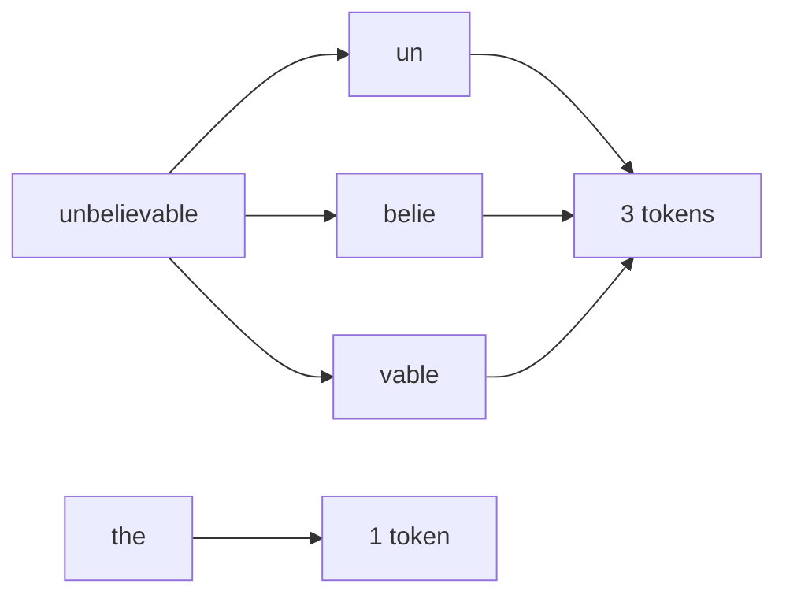
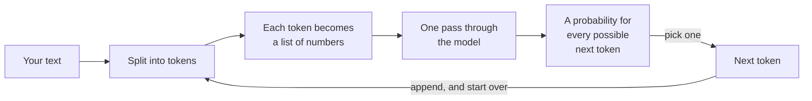

*Everything else on this site about AI assumes this post. It is the floor.*

## TL;DR

- A language model does one thing. You give it text, and it scores every
  possible next [token](/engineering/the-ai-vocabulary/#token) by how well it fits. That is the whole
  machine.
- A token is a word fragment, not a word. `strawberry` is three of them.
- What it "knows" is a big pile of numbers, frozen when it was trained. It never
  looks anything up. Something has to hand it the page.
- [Temperature](/engineering/the-ai-vocabulary/#temperature) decides how strictly it sticks to its top
  guess. It adds no knowledge, and it cannot tell you when the guess is wrong.
- Put those four together and you can explain almost every surprising thing
  these tools do.

## Where this sits

This is the first post in **AI from the inside out**, and everything else rests
on it. The [harness](/engineering/the-ai-vocabulary/#harness) posts — the ones about what your coding tool
does between your keystroke and the answer — all assume you have read this.

Technical words link to their one-line definition in the
[AI vocabulary](/engineering/the-ai-vocabulary/) the first time they appear.
Open them in a second tab as you go.

And one scene runs through the whole post, in section 02. If the mechanics ever
stop making sense, go back to it.

## 01 — The thing you have already noticed

A colleague builds a helpdesk assistant. Someone asks it about a refund. It
answers helpfully, in the right tone, and finishes with "this was previously
raised as ticket INC-4471-RF."

Nobody typed that ticket number. No ticket system is connected. The format is
right — right prefix, right suffix, right number of digits — and the ticket does
not exist.

The interesting part is not that the assistant got something wrong. It is that
everything around the wrong bit was right. The refund policy it summarised was
accurate. The tone matched the other replies. The ticket reference sat in
exactly the right place in the sentence, in exactly the format the company uses.
If you were skimming — and in a support queue you are always skimming — nothing
would snag.

People usually say the model lied, or that it is unreliable, or that it needs a
better prompt. None of those is what happened. The model did the only thing it
does, and it did it correctly. By the end of this post that sentence should feel
obvious rather than glib.

## 02 — Meet Sam

Before any of the mechanics, here is a scene to hold on to. Everything else in
this post is a detail of it.

> Imagine a colleague — call them Sam — who has read everything your industry
> has ever published. Every manual, every forum thread, every support ticket,
> every half-finished wiki page. Millions of them.
>
> Sam works under three rules they cannot break.
>
> **They answer out loud, one word at a time, starting immediately.** No pausing
> to think it through first, no draft, no going back to change a word already
> said.
>
> **They cannot look anything up.** No documents on the desk, no search, no
> phone. Whatever they have, they have in their head.
>
> **They have to keep going.** Once a word is out of their mouth it is part of
> the question now, and the only job left is to continue it sensibly.
>
> So how does Sam answer at all? For each word, a shortlist appears in their
> head — the words that usually come next in text like this — ranked by how
> usual each one is. Sam picks one, says it, and the next shortlist appears.
> That is the entire job, repeated until the answer is finished.
>
> And here is the part that catches everyone out. Sam remembers what text
> usually says. They do not remember where they read it, or whether it was
> true. Their safest answer and their wildest guess come out in the same calm
> voice.

Sam is a person in this story only because people are easy to picture. Nothing
in the real machine is thinking, remembering or intending anything. But every
section below is one of Sam's rules done with numbers — and the invented ticket
number in section 01 is just Sam reaching the words "this was previously raised
as ticket" and needing a next word.

## 03 — Text becomes tokens

Before the model sees your text, a piece of software called a
[tokeniser](/engineering/the-ai-vocabulary/#tokeniser) chops it up. The pieces are not words and they are not letters. They are fragments that
were picked during training because they show up a lot.

Here is a real tokeniser — the one shipped with Qwen2.5-0.5B, a small open model
I used for every number in this post — run over four words:

```python
from transformers import AutoTokenizer

tok = AutoTokenizer.from_pretrained("Qwen/Qwen2.5-0.5B")
for word in ["unbelievable", "the", "idempotent", "strawberry"]:
    pieces = [tok.decode([i]) for i in tok(word)["input_ids"]]
    print(f"{word!r:16} -> {pieces}  ({len(pieces)} tokens)")
```

```text
'unbelievable'   -> ['un', 'belie', 'vable']  (3 tokens)
'the'            -> ['the']  (1 tokens)
'idempotent'     -> ['id', 'emp', 'otent']  (3 tokens)
'strawberry'     -> ['str', 'aw', 'berry']  (3 tokens)
```



*The model never sees the letters, only these pieces. Asking it to count the
letters in a word is asking it to do sums on something it cannot see.*

Look at `strawberry` again: `str`, `aw`, `berry`. Ask a model how many times the
letter *r* shows up in that word, and you are asking Sam, who has only ever
been shown those three fragments and never the letters inside them. It often gets it right, because it has read a
lot of text *about* spelling. It is not counting. It is recalling what text
about counting usually says — a different job that happens to give the right
answer most of the time.

One more thing about tokenisers catches people out in production. Every model
family has its own, and they disagree. The same paragraph comes to a different
number of tokens on two different providers, because each tokeniser was built
from a different pile of text and settled on a different set of fragments.

Your prompt does not change. The bill does.

So if you are comparing two models on cost, run the same text through each one's
own tokeniser. Do not count the words once and reuse the number. And if your
application has a token budget baked into it — truncate at eight thousand,
summarise after that — remember that the unit moves when you change model.

Two practical consequences. Common English is cheap: roughly three words to four
tokens. Anything unusual is expensive — identifiers, non-English text, UUIDs,
minified JSON. When you price a feature in tokens, do not price it in words.

## 04 — Tokens become numbers

Each token then becomes a list of a few thousand numbers. That list is called an
[embedding](/engineering/the-ai-vocabulary/#embedding), and it is arranged so that tokens used in similar
ways sit near each other.

That is all I want to say about it here. Embeddings are what makes search work
on meaning rather than keywords, and they get their own post later in this
series. I mention them now so the word
"[vector](/engineering/the-ai-vocabulary/#vector)" is not a surprise when it turns up: from here on, everything inside the model is arithmetic on lists of numbers,
not operations on text.

## 05 — The model guesses, once

Here is the part people never quite picture.

The model takes those numbers, runs them through its layers once, and gives a
score to **every token it knows**. For this model, that is 151,936 tokens. Turn
those scores into percentages and you have a ranked list of every possible next
token, from the runaway favourite down to the absurd.

```python
import torch
from transformers import AutoModelForCausalLM, AutoTokenizer

NAME = "Qwen/Qwen2.5-0.5B"
tok = AutoTokenizer.from_pretrained(NAME)
model = AutoModelForCausalLM.from_pretrained(NAME)

prompt = "Q: What is the capital of the Netherlands?\nA:"
ids = tok(prompt, return_tensors="pt")
print("tokens:", [tok.decode([i]) for i in ids["input_ids"][0]])

with torch.no_grad():
    logits = model(**ids).logits[0, -1].float()   # raw scores, in full precision
print("vocabulary size:", logits.shape[0])

probs = torch.softmax(logits / 0.7, dim=-1)       # scores -> percentages, at temperature 0.7
top = torch.topk(probs, 5)
for p, i in zip(top.values, top.indices):
    print(f"  {p.item():6.2%}  {tok.decode([i])!r}")
```

```text
tokens: ['Q', ':', ' What', ' is', ' the', ' capital', ' of', ' the', ' Netherlands', '?\n', 'A', ':']
vocabulary size: 151936
  61.19%  ' Amsterdam'
  32.75%  ' The'
   1.57%  ' Ha'
   1.44%  ' Am'
   0.92%  ' Rotterdam'
```

That is Sam's shortlist, printed. Read it slowly, because almost everything in
this series is visible in it.

The right answer is there and it is winning — but with 61 per cent, not
certainty. `' The'` at 32 per cent is not a fact at all; it is the start of a
sentence like "The capital is Amsterdam". `' Ha'` is the beginning of "Hague",
which is wrong, but it is the sort of thing that turns up near this question in
text. `' Rotterdam'` is a Dutch city that is not the capital, sitting just under
one per cent.

(A note on the `.float()` in that snippet, because it cost me an hour. To save
memory, the model keeps its numbers rounded short. Divide those by a small
temperature and the rounding error blows up, and the three temperature blocks
further down stop matching each other. `.float()` puts the detail back before the sums. If your
numbers drift when you run this, start there.)

Nothing in that list is marked true or false. They are all just continuations,
ranked by how well they fit the text so far. The model has no separate store of
facts to check them against. The ranking *is* what it knows.

It is worth being exact about where the ranking comes from, because this is
where the well-read-person analogy earns its keep. During training, the model
was shown an enormous amount of text and nudged, token by token, to get better
at predicting what came next. What is left afterwards is a file of numbers — its
[weights](/engineering/the-ai-vocabulary/#weights) — about half a billion of them for this small model,
hundreds of billions for the big ones. That file is all of its knowledge. There is no database next to it, no
copy of the training text, nothing to query.

So when a model "knows" that Amsterdam is the capital of the Netherlands, here
is what that means in practice: the sums those numbers describe push
`' Amsterdam'` to the top of the list after that particular question. The
training text has been squeezed down into numbers, and some of it was lost in
the squeezing. Like any squeeze of that kind, it is excellent on the common case
and unreliable at the edges. What it gets wrong is not random. It is the things
that appeared rarely, or inconsistently, or after its training stopped.

And look at the prompt's tokens: twelve of them, including `'?\n'` as a single
piece. Even the newline is a token.

## 06 — Then it does it again

One pass gives you one token. To produce a sentence, the software running the
model takes that token, sticks it on the end of the text, and runs the whole
thing again. And
again. Every word in a thousand-word answer is a separate pass over everything
written so far.



*Notice the loop. Nothing here fetches anything — the arrow back to the start is
the whole mechanism.*

This is Sam's first and third rules in one picture: one piece at a time, and no
taking it back. There is no stage where it decides what it wants to say and then
says it. No plan it is working through. No index it checks. There
is a loop, and the loop only ever adds to text.

One effect of the loop is easy to miss, and it explains a lot. Once a token is
on the end of the text, it is simply part of the input for the next pass. The
model cannot take it back. And on the next pass it has no idea whether it wrote
that token or you did. A sentence that started badly is now context to be
continued, and continuing it sensibly is the only thing the machinery does. That
is why a model will sometimes defend a wrong answer with ever more inventive
reasoning. Not stubbornness — just the most plausible continuation of a text
that already contains the wrong answer. It is also why starting a fresh
conversation often works better than arguing.

It is also where the helpdesk ticket number came from. By the time the model had
written "this was previously raised as ticket", the highest-scoring continuation
was an identifier-shaped thing, because that is what follows those words in
every document it has ever read. Each guess on its own was reasonable. The
sentence they add up to is fiction.

## 07 — Turning the dial

Picking from that ranked list is called [sampling](/engineering/the-ai-vocabulary/#sampling). Temperature is
the dial that decides how strictly the ranking is obeyed — how adventurous Sam
is allowed to be when choosing from the shortlist. Same model, same prompt, same single
pass — only the dial moves:

```text
temperature 0.0001
  100.00%  ' Amsterdam'

temperature 0.7
   61.19%  ' Amsterdam'
   32.75%  ' The'
    1.57%  ' Ha'
    1.44%  ' Am'
    0.92%  ' Rotterdam'

temperature 1.5
   14.76%  ' Amsterdam'
   11.03%  ' The'
    2.67%  ' Ha'
    2.57%  ' Am'
    2.08%  ' Rotterdam'
```

I trimmed the first block to one line, and the reason tells you something. At a
temperature that small, the favourite rounds to 100 per cent and *every other
token in the vocabulary* rounds to zero. The four runners-up the script printed
were arbitrary — ties between tokens whose probability had shrunk below what the
computer can represent. There is no real ordering below the top at this setting,
which is the point.

At 0.7 the top five hold 97.9 per cent of the probability between them. At 1.5
they hold 33.1 per cent. The other two thirds is spread across a long tail of
tokens, any of which might now get picked.

Here is the bit worth remembering. The *order* barely changed. Amsterdam is
first at every setting. Temperature did not make the model more or less correct.
It changed how willing it was to take something other than its favourite. Low
temperature means it repeats its favourite answer. If its favourite answer is
wrong, low temperature means it is wrong consistently — which is worse than
being wrong now and then, because it looks like confidence.

Temperature has a sibling called
[top-p](/engineering/the-ai-vocabulary/#top-p). It throws away the long tail
before anything is picked. Set it to 0.9 and the model lines the candidates up
from most likely down, takes them until their percentages add up to ninety, and
drops everything after that. In the temperature 1.5 block above, that would
throw out nearly all of the two-thirds tail before the dice are rolled. It is a
good guard against genuinely strange output.

Both dials are offered in the same places: the local servers that run a model on
your own machine, and the request you send to most hosted APIs. And both are
doing the same job — deciding which candidates get a chance. Neither one knows
whether a candidate is true. Change one or the other, not both at once, which is
what providers advise: together their effects are hard to predict.

One warning, because it is the sort of thing that bites in production. These
dials are not guaranteed furniture. Anthropic's current models reject
`temperature` and `top_p` outright — the request fails rather than quietly
ignoring them — and give you a single effort setting instead; their older models
still accept both. Check what your provider actually takes before you build a
temperature slider into your own settings page.

What that costs you, and what actually helps, is in
[why it sounds certain when it's wrong](/engineering/why-it-sounds-certain-when-its-wrong/).

## 08 — Going deeper: why context is not free

One more thing, because the rest of the series leans on it.

Inside each pass, the part that lets the model use earlier words compares every
token with every other token. Ten tokens, a hundred comparisons. A thousand
tokens, a million. The work does not grow in step with the length of your input.
It grows faster than that.

In Sam's terms: before every single word they say, Sam goes back over the whole
conversation — and not just reading it, but checking each word in it against
every other word. Double the length of the conversation and that checking
roughly quadruples. That is why a long session gets slower and more expensive in
a way that feels out of proportion to what you added. It is also why "just give
it everything" is a strategy with a cliff in it. No maths needed beyond that sentence; the
practical consequences are in
[the context window is the entire memory](/engineering/the-context-window-is-the-entire-memory/).

## Try it yourself

Thirty minutes, and the numbers will stick in a way that reading will not.

You need two things to run the snippets above, and neither of them is a GPU: the
Python libraries, and the model itself. Both arrive through one command. Save a
snippet as `next-token.py` and run:

```sh
uv run --with transformers --with torch python next-token.py
```

The first run downloads about 1.5 GB and takes a few minutes. Every run after
that takes seconds and works offline. If that command is unfamiliar, or it does
not work,
[running the code in these posts](/engineering/running-the-code-in-these-posts/)
is the full ten-minute setup — what gets downloaded, where it lands, and how to
get the disk space back afterwards.

1. **Tokenise your own name**, your employer's name, and the longest technical
   word you use at work. Count the tokens. Then tokenise the same sentence in
   another language and compare.
2. **Run the same prompt twice at temperature 0, then twice at 1.5.** Watch the
   first pair agree and the second pair diverge. Then ask yourself which of the
   four you would put in front of a customer.
3. **Ask a model something it cannot possibly know** — the contents of a private
   repository, a number from last week — and watch it answer anyway. Notice that
   the answer sounds exactly like its correct answers.

## Common mistakes

**Thinking it looked something up.** It did not, unless a tool put the text in
front of it. An answer in the right format, with the right shape, is the default
behaviour. It is not evidence of a source.

**Thinking temperature 0 makes it deterministic.** It makes the picking step
near-deterministic. The hosted service around it is not — batching, hardware,
routing, a model version that changed overnight. Treat "same input, same output"
as a tendency, never a guarantee.

**Reading confidence as accuracy.** This is Sam's calm voice. Sounding fluent is
the one thing the model was trained for directly. Being correct is a side effect of having read a lot.
The same machinery produces both, and they look identical on the way out.

**Pricing in words.** Your product names, SKUs and identifiers are the expensive
part, and they are exactly what your prompts are full of. Count tokens, not
words.

**Expecting character-level work.** Counting letters, reversing strings,
checking whether two strings differ by one character — all of it is work on
something the model cannot see. Use code for that, and let the model write the
code.

## References and further reading

- [The AI vocabulary](/engineering/the-ai-vocabulary/) — open this in a second
  tab the first time a word here is unfamiliar; every term above has a one-line
  entry with an example.
- [Qwen2.5-0.5B model card](https://huggingface.co/Qwen/Qwen2.5-0.5B) — the model
  every number in this post came from. It is also a good example of what a model
  card tells you: it says plainly that this is a base model, and that base models
  are not recommended for conversation — which is exactly the distinction the
  next-but-one post is about.
- [OWASP Top 10 for LLM Applications 2025](https://genai.owasp.org/llm-top-10/) —
  open this when you need the official name for section 01. The invented ticket
  number is `LLM09:2025 Misinformation`, and having that identifier is what gets
  it onto a risk register instead of into a hallway conversation.
- [uv, one tool to rule your Python](/engineering/uv-one-tool-to-rule-your-python/)
  — the environment the snippets above run in. The rest of this series assumes
  it rather than repeating the setup.

## Final thoughts

The machine is smaller than the conversation around it. A loop, a ranked list of
word fragments, and a dial. Everything that follows in this series — the context
window, [hallucination](/engineering/the-ai-vocabulary/#hallucination), tool calls, MCP, agents — is either a consequence of that
loop or a layer somebody built on top of it to make it useful.

That is good news. A system whose core you can hold in your head is one you can
reason about when it misbehaves. The next time a model does something that looks
inexplicable, start here: it guessed the next token, and then it did it again.
