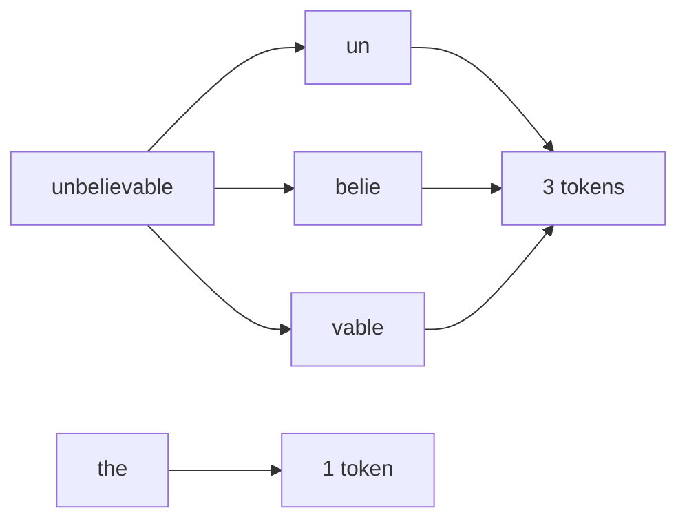
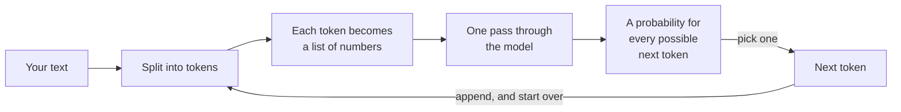

*Everything else on this site about AI assumes this post. It is the floor.*

## TL;DR

- A language model does exactly one thing: given some text, produce a
  probability for every possible next token. That is the entire mechanism.
- A token is a word fragment, not a word. `strawberry` is three of them.
- Its "knowledge" is a very large pile of numbers fixed at training time. It
  never looks anything up unless something hands it the page.
- Temperature reshapes how sharply it favours its top guess. It does not add
  knowledge, and it cannot tell you when the guess is wrong.
- Put those four together and you have the explanation for almost every
  surprising thing these tools do.

## Where this sits

This is the first post in **AI from the inside out**, and the floor of
everything else. The harness posts — the ones about what your coding tool is
doing between your keystroke and the answer — all assume you have this. If a
word here is unfamiliar, the
[AI vocabulary](/engineering/the-ai-vocabulary/) has it in one sentence.

The analogy I will use throughout, and which I think is the most accurate
simple one available: **a very well-read person guessing the next word, at
speed, out loud, who never stops to look anything up.** Hold on to the last
clause. It does most of the work.

## 01 — The thing you have already noticed

A colleague builds a helpdesk assistant. Someone asks it about a refund, and it
answers helpfully, in the right tone, and ends with "this was previously raised
as ticket INC-4471-RF."

Nobody typed that ticket number. There is no ticket system connected. The
format is right — the prefix is right, the suffix is right, the digit count is
right — and the ticket does not exist.

What makes this story worth telling is not that the assistant got something
wrong. It is that everything around the wrong part was right. The refund policy
it summarised was accurate. The tone matched the other replies. The ticket
reference was in exactly the right place in the sentence, in exactly the format
the company uses. If you were skimming — and in a support queue you are always
skimming — there is nothing to catch on.

The usual reaction is that the model lied, or that it is unreliable, or that it
needs a better prompt. None of those is what happened. What happened is that the
model did the only thing it does, and it did it correctly. By the end of this
post that sentence should feel obvious rather than glib.

## 02 — Text becomes tokens

Before a model sees your text, a piece of software called a tokeniser chops it
into pieces. The pieces are not words and they are not letters. They are
fragments chosen, during training, because they turn up often.

Here is a real tokeniser — the one shipped with Qwen2.5-0.5B, a small open model
I used for every number in this post — run over six words:

```python
from transformers import AutoTokenizer

tok = AutoTokenizer.from_pretrained("Qwen/Qwen2.5-0.5B")
for word in ["unbelievable", "the", "idempotent", "strawberry"]:
    pieces = [tok.decode([i]) for i in tok(word)["input_ids"]]
    print(f"{word!r:16} -> {pieces}  ({len(pieces)} tokens)")
```

```text
'unbelievable'   -> ['un', 'belie', 'vable']  (3 tokens)
'the'            -> ['the']  (1 tokens)
'idempotent'     -> ['id', 'emp', 'otent']  (3 tokens)
'strawberry'     -> ['str', 'aw', 'berry']  (3 tokens)
```



*The model never sees the letters — only these pieces. That is why asking it to
count the letters in a word is asking it to do arithmetic on something it cannot
see.*

Look at `strawberry` again: `str`, `aw`, `berry`. Ask a model how many times the
letter *r* appears in that word and you are asking someone who has only ever
been shown those three fragments. It can often get it right, because it has read
a great deal of text *about* spelling. It is not counting. It is recalling what
text about counting usually says, which is a different operation that happens to
agree with the answer most of the time.

One more thing about tokenisers that catches people out in production: every
model family has its own, and they disagree. The same paragraph is a different
number of tokens on two different providers, because each tokeniser was built
from a different pile of text and settled on a different set of fragments.
Nothing in your prompt changes; the bill does. If you are comparing two models on
cost, compare them on the same text run through each one's own tokeniser, not on
a word count you did once and reused. And if you have built a token budget into
your application — truncate at eight thousand, summarise after that — it is a
budget in a unit that moves when you change model.

Two practical consequences. Common English is cheap — roughly three words to
four tokens. Anything unusual is expensive: identifiers, non-English text, UUIDs,
minified JSON. When you price a feature in tokens, do not price it in words.

## 03 — Tokens become numbers

Each token is then turned into a list of a few thousand numbers. That list is
called an embedding, and it is positioned so that tokens used in similar ways end
up near each other.

That is genuinely all I want to say about it here. Embeddings are the engine
behind search that works on meaning rather than keywords, and they get a whole
post later in this series. The only reason to mention them now is so that the
word "vector" is not a surprise when it arrives: from this point on, everything
inside the model is arithmetic on lists of numbers, not operations on text.

## 04 — The model guesses, once

Now the part people never quite picture.

The model takes those numbers, runs them through its layers once, and produces a
score for **every token in its vocabulary**. For this model, that vocabulary is
151,936 tokens. Turn those scores into probabilities and you have a ranked list
of every possible next token, from the overwhelming favourite down to the
absurd.

```python
import torch
from transformers import AutoModelForCausalLM, AutoTokenizer

NAME = "Qwen/Qwen2.5-0.5B"
tok = AutoTokenizer.from_pretrained(NAME)
model = AutoModelForCausalLM.from_pretrained(NAME)

prompt = "Q: What is the capital of the Netherlands?\nA:"
ids = tok(prompt, return_tensors="pt")
print("tokens:", [tok.decode([i]) for i in ids["input_ids"][0]])

with torch.no_grad():
    logits = model(**ids).logits[0, -1].float()   # softmax in float32
print("vocabulary size:", logits.shape[0])

probs = torch.softmax(logits / 0.7, dim=-1)
top = torch.topk(probs, 5)
for p, i in zip(top.values, top.indices):
    print(f"  {p.item():6.2%}  {tok.decode([i])!r}")
```

```text
tokens: ['Q', ':', ' What', ' is', ' the', ' capital', ' of', ' the', ' Netherlands', '?\n', 'A', ':']
vocabulary size: 151936
  61.19%  ' Amsterdam'
  32.75%  ' The'
   1.57%  ' Ha'
   1.44%  ' Am'
   0.92%  ' Rotterdam'
```

Read that list carefully, because almost everything in this series is visible in
it.

The right answer is there and it is winning, but it is winning with 61 per cent,
not certainty. `' The'` at 32 per cent is not a fact at all — it is the start of
a sentence like "The capital is Amsterdam". `' Ha'` is the beginning of "Hague",
which is wrong but is the sort of thing that appears near this question in text.
`' Rotterdam'` is a Dutch city that is not the capital, sitting at just under
one per cent.

(One note on that `.float()` in the snippet, because it cost me an hour. The
model's own arithmetic runs at reduced precision, and dividing by a small
temperature there rounds badly enough that the tables below stop agreeing with
each other. Converting to full precision before the softmax fixes it. If you
reproduce this and your numbers drift, that is the first thing to check.)

Nothing in that list is marked true or false. They are all just continuations,
ranked by how well they fit the text so far. The model has no separate store of
facts to check them against — the ranking *is* what it knows.

It is worth being precise about where that ranking comes from, because this is
the point where the well-read-person analogy earns its keep. During training,
the model was shown an enormous quantity of text and adjusted, token by token,
to get better at predicting what came next. What remains afterwards is a file of
numbers — about half a billion of them for this small model, hundreds of billions
for the large ones. That file is the whole of its knowledge. There is no
database beside it, no copy of the training text, nothing to query.

So when a model "knows" that Amsterdam is the capital of the Netherlands, what
that means concretely is that the arithmetic those numbers encode pushes
`' Amsterdam'` to the top of the list after that particular question. It is
compression, and like all lossy compression it is excellent on the common case
and unreliable at the edges. The things it gets wrong are not random: they are
the things that appeared rarely, or inconsistently, or after its training
stopped.

And notice the prompt's tokens: twelve of them, including `'?\n'` as a single
piece. Even the newline is a token.

## 05 — Then it does it again

One pass gives you one token. To produce a sentence, the harness takes that
token, sticks it on the end of the text, and runs the whole thing again. And
again. Every word in a thousand-word answer is a separate pass over everything
written so far.



*Notice the loop. Nothing in this picture retrieves anything — the arrow back to
the start is the whole mechanism.*

This is the picture to keep. There is no stage where it decides what it wants to
say and then says it, no plan it is executing, no index it consults. There is a
loop, and the loop only ever extends text.

One consequence of the loop is easy to miss and explains a lot of behaviour.
Once a token is on the end of the text, it is simply part of the input for the
next pass. The model cannot take it back, and on the next pass it has no idea
that it wrote that token rather than you. A sentence that started badly is now
context to be continued, and continuing it coherently is the only thing the
machinery is for. This is why a model will sometimes defend a wrong answer with
increasingly inventive reasoning — not stubbornness, just the most plausible
continuation of a text that already contains the wrong answer. It is also why
starting a fresh conversation often works better than arguing.

It is also where the helpdesk ticket number came from. By the time the model had
written "this was previously raised as ticket", the highest-scoring continuation
was a plausibly-shaped identifier, because that is what follows those words in
every document it has ever read. Each individual guess was reasonable. The
sentence they add up to is fiction.

## 06 — Turning the dial

Picking from that ranked list is called sampling, and temperature is the dial
that controls how sharply the ranking is enforced. Same model, same prompt, same
single forward pass — only the dial moves:

```text
temperature 0.0001
  100.00%  ' Amsterdam'

temperature 0.7
   61.19%  ' Amsterdam'
   32.75%  ' The'
    1.57%  ' Ha'
    1.44%  ' Am'
    0.92%  ' Rotterdam'

temperature 1.5
   14.76%  ' Amsterdam'
   11.03%  ' The'
    2.67%  ' Ha'
    2.57%  ' Am'
    2.08%  ' Rotterdam'
```

I have trimmed the first block to one line, and the reason is itself instructive:
at a temperature that small, the favourite rounds to 100 per cent and *every
other token in the vocabulary* rounds to zero. The four runners-up the script
printed were arbitrary — ties between tokens whose probability had underflowed.
There is no meaningful ordering below the top at this setting, which is the point.

At 0.7 the top five account for 97.9 per cent of the probability between them. At
1.5 they account for 33.1 per cent — the other two-thirds is spread across a long
tail of tokens, any of which might now get picked.

Here is the part worth internalising. The *order* barely changed. Amsterdam is
first at every setting. Temperature did not make the model more or less correct;
it changed how willing it was to take something other than its favourite. Low
temperature means it repeats its favourite answer. If its favourite answer is
wrong, low temperature means it is wrong consistently, which is worse than being
wrong occasionally because it looks like confidence.

Temperature has a sibling you will meet in API documentation. Top-p, sometimes
called nucleus sampling, throws away the long tail before anything is picked: at
0.9 it keeps only the most likely tokens whose probabilities add up to nine
tenths and ignores everything else. In the 1.5 table above, that would discard
almost all of that two-thirds tail before the dice are rolled. It is a useful
safety rail against genuinely strange output, and it is worth saying clearly
that it does the same kind of thing temperature does — it changes which
candidates are in play. Neither dial has any access to whether a candidate is
true. Providers generally advise changing one of the two, not both, because
their effects compound in ways that are hard to reason about.

What that costs you, and what actually helps, is
[why it sounds certain when it's wrong](/engineering/why-it-sounds-certain-when-its-wrong/).

## 07 — Going deeper: why context is not free

One more thing, because the rest of the series leans on it.

Inside each pass, the mechanism that lets the model use earlier words compares
every token with every other token. Ten tokens, a hundred comparisons. A thousand
tokens, a million. The work does not grow with the length of your input — it
grows faster than that.

That is the reason a long session gets slower and more expensive in a way that
feels out of proportion to what you added, and it is why "just give it
everything" is a strategy with a cliff in it. No maths required beyond that
sentence; the practical consequences are
[the context window is the entire memory](/engineering/the-context-window-is-the-entire-memory/).

## Try it yourself

Thirty minutes, and the numbers will stick in a way that reading will not. The
snippets above run on a laptop with [uv](/engineering/uv-one-tool-to-rule-your-python/):
`uv run --with transformers --with torch python next-token.py`.

1. **Tokenise your own name**, your employer's name, and the longest technical
   word you use at work. Count the tokens. Then tokenise the same sentence in
   another language and compare.
2. **Run the same prompt twice at temperature 0, then twice at 1.5.** Watch the
   first pair agree and the second pair diverge. Then ask yourself which of the
   four you would be willing to put in front of a customer.
3. **Ask a model something it cannot possibly know** — the contents of a private
   repository, a number from last week — and watch it answer anyway. Notice that
   the answer's tone is identical to the tone of its correct answers.

## Common mistakes

**Thinking it looked something up.** It did not, unless a tool put the text in
front of it. An answer in the right format with the right shape is the default
behaviour, not evidence of a source.

**Thinking temperature 0 makes it deterministic.** It makes the sampling step
near-deterministic. The hosted service around it — batching, hardware, routing,
a model version that changed overnight — is not. Treat "same input, same output"
as a tendency, never a guarantee.

**Reading confidence as accuracy.** Fluency is the one thing the model was
directly trained for. Correctness is a side effect of having read a lot. The two
are produced by the same machinery and look identical on the way out.

**Pricing in words.** Your product names, SKUs and identifiers are the expensive
part, and they are exactly what your prompts are full of. Count tokens, not
words.

**Expecting character-level work.** Counting letters, reversing strings,
checking whether two strings differ by one character — all of it is work on
something the model cannot see. Use code for that and let the model write the
code.

## References and further reading

- [The AI vocabulary](/engineering/the-ai-vocabulary/) — open this in a second
  tab the first time a word here is unfamiliar; every term above has a one-line
  entry with an example.
- [Qwen2.5-0.5B model card](https://huggingface.co/Qwen/Qwen2.5-0.5B) — the model
  every number in this post came from. Worth reading as an example of what a
  model card tells you: it states plainly that this is a base model and that base
  models are not recommended for conversation, which is exactly the distinction
  the next-but-one post is about.
- [OWASP Top 10 for LLM Applications 2025](https://genai.owasp.org/llm-top-10/) —
  open this when you need the production name for section 01. The invented ticket
  number is `LLM09:2025 Misinformation`, and having the identifier is what gets
  it into a risk register instead of a hallway conversation.
- [uv, one tool to rule your Python](/engineering/uv-one-tool-to-rule-your-python/)
  — the environment the snippets above run in. The rest of this series assumes it
  rather than repeating the setup.

## Final thoughts

The mechanism is smaller than the discourse around it. A loop, a ranked list of
word fragments, and a dial. Everything that follows in this series — the context
window, hallucination, tool calls, MCP, agents — is either a consequence of that
loop or a layer somebody built around it to make it useful.

Which is good news, actually. A system whose core you can hold in your head is
one you can reason about when it misbehaves. The next time a model does
something that looks inexplicable, start here: it guessed the next token, and
then it did it again.
