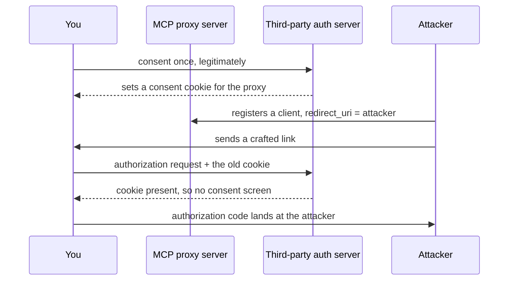
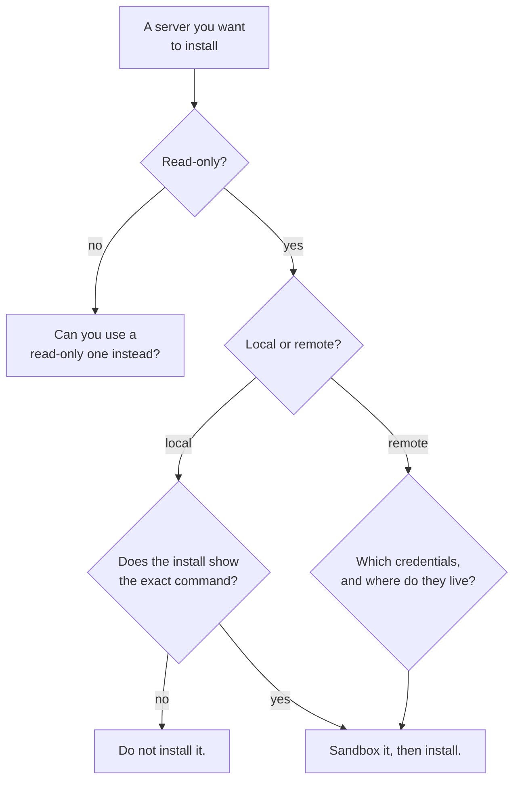

*Every quotation below comes from the Model Context Protocol specification's own
security documentation, revision `2026-07-28`, read end to end while writing
this. This is a summary of a published document, not a vulnerability report and
not an assessment of any particular server.*

## TL;DR

- The protocol enforces nothing. It says so in its own text, and everything in
  this post follows from that one sentence.
- A server is a program running with your privileges. Installing one is running
  somebody else's code, not editing a setting.
- Most of the named attacks are about **tokens and consent**, not clever prompts.
  The specification's list is an OAuth list with two local-execution entries.
- Read-only and `stdio` remove whole classes rather than reducing them.
- The check before installing takes four questions and about two minutes.

## Where this sits

This is the fifth post in **How your AI coding tool works**. It needs
[MCP, explained without the spec](/engineering/mcp-explained-without-the-spec/)
for host, client, server, scopes and transports, and it is the payoff for a
promise that post made: it named these risks in a paragraph and said each one
was getting its own treatment later. This is later.
[Build a small MCP server and watch the wire](/engineering/build-a-small-mcp-server/)
has the mechanics underneath, and deliberately stopped short of everything here.

The harness words are in
[the words for the layer around the model](/engineering/harness-engineering-vocabulary/)
and single terms in [the AI vocabulary](/engineering/the-ai-vocabulary/). I use
both without redefining them.

The analogy, and it carries the whole post: **a contractor with a key to your
house.** The question is never whether they seem nice. It is which doors the key
opens, who else has a copy, and what you would notice if it were used.

One boundary. Permissions, sandboxes, hooks, and what happens when text from a
tool result starts giving instructions belong to the next post in this series.
This one is about the server.

## 01 — The thing you have already noticed

The install was one click, or one command. Somewhere in the middle a browser tab
opened, showed a consent screen with a list of things on it, and you pressed
Approve because you were in the middle of something else. Then tools appeared.

Nobody asked you to enumerate what those tools can reach. If the server was
remote, you granted it scopes you did not read. If it was local, you ran a
command you did not look at, which pulled a package you have never opened, which
now runs every time your editor starts. The key is cut. You do not know how many
doors it opens.

That is not negligence — the install flow is designed to be two minutes long. But
it means the interesting question is not whether the protocol is safe. It is what
the protocol undertakes to do for you, and the specification answers that one
directly.

## 02 — The protocol's own position

The specification's Security and Trust & Safety section opens by saying that MCP
"enables powerful capabilities through arbitrary data access and code execution
paths". It sets out three principles — user consent and control, data privacy,
tool safety — in language entirely about people and applications rather than
about messages. Under tool safety: "Tools represent arbitrary code execution and
must be treated with appropriate caution," and "Hosts must obtain explicit user
consent before invoking any tool."

Then the hinge, which is the one sentence to carry out of this post:

> While MCP itself cannot enforce these security principles at the protocol
> level, implementors **SHOULD**: 1. Build robust consent and authorization flows
> into their applications [...] 3. Implement appropriate access controls and data
> protections.

Read that as an architectural statement rather than a disclaimer. MCP is
JSON-RPC message shapes. A message shape cannot check who you are, cannot decide
whether you meant it, and cannot stop a subprocess from reading your SSH keys.
Every protection you have comes from the host, the server, or your configuration
of both — and the weakest of those three decides your outcome.

On revisions: the current one is `2026-07-28`, which is what I quote throughout.
The older `2025-11-25` is still what implementations negotiate on the wire, and
one section below moved between the two; I say so where it applies.

## 03 — The confused deputy

An MCP proxy server sits between you and a third-party API, and acts as a single
OAuth client to that API — one fixed client ID for everybody. The attack lets a
malicious client "obtain authorization codes without proper user consent by
exploiting the combination of static client IDs, dynamic client registration,
and consent cookies".

The condition that makes it possible is a cookie. You consented once, genuinely,
and the third-party authorization server set a cookie against that fixed client
ID. Later, a crafted link arrives. The authorization request carries the same
static client ID, the browser still has the cookie, and the authorization server
decides you have already agreed — so the consent screen never appears, and the
code goes to the attacker's registered redirect.

*Notice that nothing was hacked. A cookie from a consent you genuinely gave stood
in for a consent you never gave.*

**Mitigation, and it is a MUST:** proxy servers **MUST** keep a registry of
approved client IDs per user and check it *before* forwarding to the third party,
**MUST** match each `redirect_uri` exactly against the registered one with no
wildcards, and **MUST NOT** set the consent cookie or session until after you
have approved the proxy's own consent screen.

## 04 — Token passthrough

Token passthrough is "an anti-pattern where an MCP server accepts tokens from an
MCP client without validating that the tokens were properly issued *to the MCP
server*" and forwards them downstream. The condition is a missing audience check:
a token says who it was minted for, and the server never looks.

Why it is forbidden rather than discouraged comes down to two things the
specification spells out. Audit trails stop meaning anything — the downstream
service's logs "may show requests that appear to come from a different source
with a different identity, rather than the MCP server that is actually forwarding
the tokens". And blast radius stops being bounded: "If the token is accepted by
multiple services without proper validation, an attacker compromising one service
can use the token to access other connected services." A server that forwards
tokens is a key-copying service.

**Mitigation, a flat MUST NOT:** servers **MUST NOT** accept tokens not issued
for them. The authorization specification is blunter still — servers **MUST**
validate that tokens were issued for them as the intended audience, and **MUST
NOT** "accept or transit any other tokens".

## 05 — A server that makes your client fetch the wrong thing

This one reverses the direction. During OAuth metadata discovery your client
fetches URLs the server supplies — the `resource_metadata` URL from a
`WWW-Authenticate` header, the authorization server URLs, the token and
authorization endpoints. A malicious server fills those fields with somewhere
you can reach and it cannot.

The condition is that the client follows a server-supplied URL without checking
where it points. The specification's own example is a 401 carrying
`resource_metadata="http://169.254.169.254/..."` — the cloud metadata endpoint —
after which "cloud metadata endpoints often expose IAM credentials, API keys,
and other secrets". Private ranges, `localhost` services, DNS entries that change
between the check and the request, and ordinary-looking URLs that redirect
inward all work the same way. Your client becomes the attacker's proxy through
your own firewall.

**Mitigation, a MUST with SHOULDs underneath it:** clients **MUST** consider SSRF
risk when fetching OAuth-related URLs. The specific measures are **SHOULD** —
require HTTPS outside loopback, block private and link-local ranges, apply the
same validation to every redirect hop, and route through an egress proxy on
server-side deployments. The specification adds one warning worth repeating:
do not hand-roll the IP check, because "attackers exploit encoding tricks
(octal, hex, IPv4-mapped IPv6) that custom parsers often miss".

## 06 — Session hijacking

A session ID is a handle the server gave your client, and the attack is somebody
else obtaining or guessing it and acting as you. The condition is a server that
treats possession of the handle as proof of identity — no re-authentication, no
binding to a user.

This is the section that moved between revisions. In `2025-11-25` it is called
Session Hijacking and covers server-assigned session IDs on the HTTP transport.
In `2026-07-28` MCP is stateless with no protocol-level sessions at all, so the
same attack is called **state handle hijacking** and the handle is an ordinary
tool argument — a cart ID, a workflow ID. Nothing about the risk changed; the
thing being guessed moved.

**Mitigation, and the MUST survived the rename:** servers that implement
authorization **MUST** verify every inbound request, and **MUST NOT** treat a
session or a state handle as authentication. Note the downgrade that came with
the rename: generating handles unguessably was a **MUST** in `2025-11-25`
("MCP servers **MUST** use secure, non-deterministic session IDs") and is a
**SHOULD** in `2026-07-28`, alongside a **SHOULD** to bind each handle
server-side to the authenticated user as `<user_id>:<handle>`.

## 07 — A local server you should not have run

A local server's configuration contains a startup command, and a startup command
is arbitrary code. The specification is direct about it: without sandboxing and
consent, an attacker can simply include "a malicious 'startup' command in a
client configuration", and the listed risks begin with "arbitrary code
execution" and "no visibility". The condition is nothing more exotic than an
install flow that does not show you the command.

**Mitigation, a MUST on the client:** if a client supports one-click local server
configuration it **MUST** implement consent before executing commands, and the
dialog **MUST** "show the exact command that will be executed, without
truncation". Everything stronger is **SHOULD**: flag dangerous patterns, warn
that servers run with the client's privileges, and run them "in a sandboxed
environment with minimal default privileges". Only the last is a boundary; the
rest is a better-informed yes.

**A URL the server chose, opened by your client.** Two more classes hang off the
same idea: a malicious server hands your client something to open. For OAuth
authorization URL validation, clients **MUST** allow only `http://` and
`https://`, **MUST** reject `javascript:`, `data:`, `file:` and `vbscript:`, and
**MUST NOT** use a shell to open a URL — a `javascript:` URL passed to a browser
API is script execution inside your client, and a URL passed to a shell is a
command line.

**The proxy variant.** Where a local proxy service spawns servers as child
processes, those two failures chain: script execution in the client steals the
proxy's auth token, and the proxy spawns whatever it is asked to. The
specification is careful that "the `stdio` transport itself is not inherently
vulnerable" and that this applies only to proxy architectures. Its mitigations
here are all **SHOULD** — sandbox spawned processes, restrict their filesystem
access, log every use.

## 08 — Scopes, and why broad ones hurt later

The last class has no MUST anywhere in it, which tells you it is a design problem
rather than a bug. Broad scopes get granted up front because the server published
every scope it supports and the client asked for all of them. Nothing fails. The
cost arrives later.

The specification frames it as blast radius and revocation cost, and both are
worth saying in plain words. A stolen broad token "enables unrelated
tool/resource access" — one key, every door. And revoking a maximum-privilege
token "disrupts all workflows", so the thing you must do in an incident is the
thing that stops your team working, which is exactly when people delay. Add that
an omnibus scope "masks user intent per operation", and the log that should tell
you what happened says only that something authorised happened.

**Mitigation, all SHOULD:** start with a minimal scope set, elevate only when a
privileged operation is actually attempted, and never grant `*`, `all` or
`full-access` to buy quiet. For you as an installer this is the read-only
default, stated in OAuth terms.

## 09 — What to actually check before installing

Six checks. Four of them are the fast path and fit in a diagram; two more are
worth a minute each.

*Four questions. None of them is "does it have a lot of stars".*

**Who wrote it.** Not stars, not a directory listing. A name you can attribute, a
repository you can open, a publishing history.

**Read or write.** If a read-only build exists, take it. You are granting the
write half to every future agent run, not to today's task.

**Local or remote.** Local means the code runs as you; remote means your
credentials sit with somebody else and the code runs there. The previous post
has that trade in full.

**Which credentials, and where they live.** Environment variables or a secrets
store, never a config file that gets committed, shared or pasted into an issue.
If a remote server uses OAuth, read the scope list on the consent screen once —
that screen is the only moment anyone asks you.

**What it logs, and where.** A server that writes an audit line per call is a
server you can investigate afterwards. One that logs nothing gives you "the agent
did something" as the complete account.

**Whether you can remove it cleanly.** For a remote server that means revoking
the token at the provider, not deleting a config entry — the entry is your copy
of the key, not the lock.

## 10 — The same question in Claude Code

Three things are documented here that change what you can actually do, and none
of them is the scopes-and-precedence material in the previous post.

**Reviewing the repository's file does not tell you what loads.** The security
page states it outright: servers at other scopes and claude.ai connectors "are
configured outside the repository, and plugins can add servers too, so reviewing
`.mcp.json` doesn't show every server a session can load". Ask the running
client, not the file.

**A directory listing is not an audit, by the vendor's own statement.** "Anthropic
reviews connectors against its listing criteria before adding them to the
Anthropic Directory, but does not security-audit or manage any MCP server." It
generalises: every registry you will meet is a catalogue, not an assessment.

**An administrator can make the decision once, for everybody.** A `managed-mcp.json`
file deployed to a system path takes exclusive control — only the servers it
defines load, and `claude mcp add` refuses. Softer patterns filter what users
configure, with `allowedMcpServers` and `deniedMcpServers`. One trap there is
flagged as a warning rather than buried: matching by `serverName` "is not a
security control", because the name is a label the user chose — "a user can call
any server `github`". Match on `serverCommand` or `serverUrl`.

What the host does with a server *after* it loads — permission modes, sandboxes,
where a hook can intervene — is the next post, and it is where the other half of
this answer lives.

**Where Copilot differs.** The shape transfers; the controls are younger. VS Code
asks you to confirm you trust a registry server before it starts, and GitHub
describes that registry as "a curated list of MCP servers from partners and the
community" without saying what the curation covers. The org-level "MCP servers in
Copilot" policy covers Business and Enterprise members and is "disabled by
default". Same questions as section 09; fewer have a switch behind them.

## Common mistakes

**Treating a directory listing as an audit.** The listing criteria are listing
criteria. The vendor says so in the documentation you would have to read to find
the directory.

**Installing the write-capable build when a read-only one exists.** You are
granting it to every future agent run, for the lifetime of the install, to buy
the last tenth of a use case.

**Credentials in the server config instead of the environment.** Config files get
committed, shared and pasted into issues. This remains the most common way an MCP
setup leaks something, and it is the one on this list that costs nothing to fix.

**Assuming `stdio` is safe because it is local.** `stdio` removes the open port,
which is real and worth having. It does not make the startup command less
arbitrary, and the specification's entire local-compromise section is about a
command, not a transport.

**Never removing a server you stopped using.** A key you forgot you cut is still
a key. For a remote server, deleting your config entry does not revoke the grant;
go to the provider and revoke it.

## References and further reading

- [MCP security best practices](https://modelcontextprotocol.io/specification/2026-07-28/basic/security_best_practices),
  revision `2026-07-28` — the authority this post summarises. Every attack class
  above is one of its sections, with the full mitigation lists I compressed to a
  line each.
- [MCP security best practices](https://modelcontextprotocol.io/specification/2025-11-25/basic/security_best_practices),
  revision `2025-11-25` — open this for session hijacking as it applies to
  server-assigned session IDs, the form implementations still meet on the wire.
- [MCP authorization](https://modelcontextprotocol.io/specification/2026-07-28/basic/authorization)
  — open this for the normative token rules behind section 04, including the
  audience-validation requirement and the scope selection strategy.
- [OWASP SSRF Prevention Cheat Sheet](https://cheatsheetseries.owasp.org/cheatsheets/Server_Side_Request_Forgery_Prevention_Cheat_Sheet.html)
  — the specification links here itself. Open it if you are the one writing the
  URL validation in section 05, rather than choosing a client that has it.
- [Claude Code security](https://code.claude.com/docs/en/security) and
  [managed MCP configuration](https://code.claude.com/docs/en/managed-mcp) —
  open these for section 10: the statement about `.mcp.json`, the directory
  disclaimer, and the admin controls with the `serverName` warning.
- [OWASP `LLM03:2025 Supply Chain`](https://genai.owasp.org/llmrisk/llm032025-supply-chain/)
  — open this for the wider framing. Its observation that "currently there are no
  strong provenance assurances in published models" applies word for word to
  published servers.
- [MCP, explained without the spec](/engineering/mcp-explained-without-the-spec/)
  and [build a small MCP server](/engineering/build-a-small-mcp-server/) — open
  these first if host, client, scopes or transports felt assumed above. The
  [AI vocabulary](/engineering/the-ai-vocabulary/) has one-line definitions for
  the rest.

## Final thoughts

What strikes me about that list is how ordinary it is. Six of the eight classes
are OAuth problems that predate MCP by a decade — audience validation, consent
cookies, redirect URIs, SSRF during discovery, guessable handles, over-broad
scopes. The two specific to this world are the two about running a command
somebody else wrote. There is no exotic AI attack in the specification's security
document, and that is reassuring rather than disappointing: the engineering
judgement you already have transfers intact.

So the useful posture is not suspicion. It is the one you would take with a
contractor who needs a key: grant narrowly, know who has a copy, be able to
change the lock without a project. Every mitigation above is a version of one of
those three.

One line the series owes you, said plainly rather than implied. This post
explains mechanisms, from a specification anyone can read. It is not a security
assessment of MCP, of any server, or of your setup, and it is not a substitute
for one. If you are deploying this across an organisation, the people who do
assessments for a living should see the same document I just summarised.
