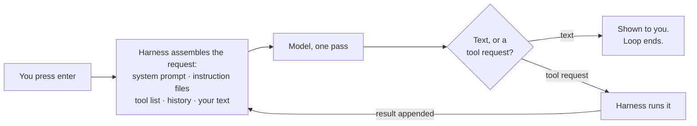
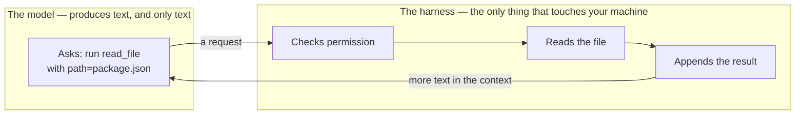
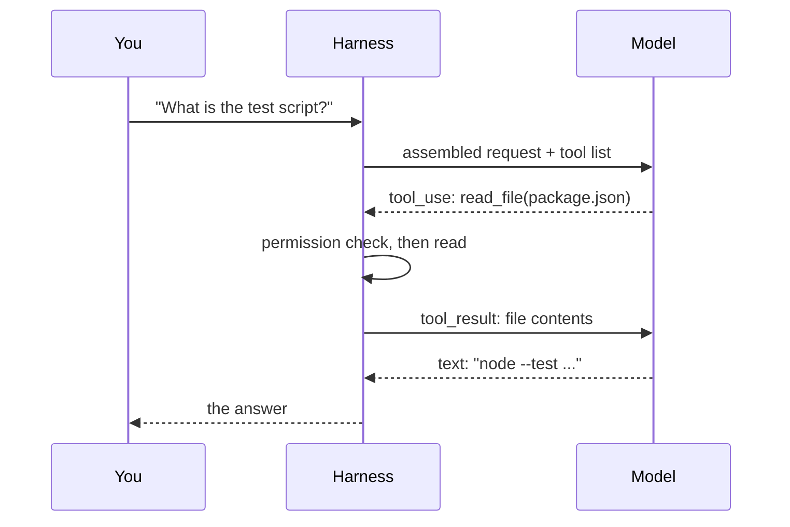

*The loop at the centre of this post is real: about forty lines of Python
around `Qwen/Qwen2.5-3B-Instruct`, running locally with no API key, reading this
blog's own `package.json`.*

## TL;DR

- The model only ever returns text. It cannot run a command, open a file, or
  touch your machine.
- Everything else is the [harness](/engineering/the-ai-vocabulary/#harness): it builds the request, sends it,
  acts on the reply, and goes round again.
- A [tool call](/engineering/the-ai-vocabulary/#tool-call) is the model *asking*. Your harness decides whether
  to honour it.
- The loop keeps going until the model stops asking for things.
- Every feature you configure — instruction files, [skills](/engineering/the-ai-vocabulary/#skill),
  [hooks](/engineering/the-ai-vocabulary/#hook), permissions, [MCP](/engineering/the-ai-vocabulary/#mcp) — is a layer in that assembly or
  that decision.

## Where this sits

This needs two things from the first track:
[what a model actually is](/engineering/what-a-model-actually-is/) for the
generation loop, and
[the context window is the entire memory](/engineering/the-context-window-is-the-entire-memory/)
for why everything is resent each turn.

It also has a sibling. [Harness engineering: the words for the layer around the
model](/engineering/harness-engineering-vocabulary/) names all the parts and
says what each is for. **I am not redefining any of that here.** That post is
the map; this one shows the thing moving. If you want to know where to file an
instruction, read that. If you want to know why the filing cabinet has those
drawers, read this.

Technical words link to their one-line definition in the
[AI vocabulary](/engineering/the-ai-vocabulary/) the first time they appear.
Open them in a second tab as you go.

And one scene runs through the whole post, in section 02. If the mechanics ever
stop making sense, go back to it.

## 01 — The thing you have already noticed

It says "let me run the tests to confirm" — and then the next message is about
something else entirely. No tests ran. Or it says "I've updated the config" and
the file on disk is untouched.

I have watched capable engineers lose an afternoon to this. The transcript reads
like a competent colleague describing work they did. The work was not done.
Nothing in the interface distinguishes "I ran the tests and they passed" from "I
produced a sentence that says the tests passed", because from the model's side
those are the same act.

The usual conclusion is that it lied. The more useful conclusion is that saying
"let me run the tests" and running the tests are two completely different events
in this system, performed by two different components, and only one of them is
the model. The sentence is the model doing its only job: producing plausible
text. Whether anything ran depends on a different box entirely.

Once you can see the two boxes, this stops being mysterious and starts being
something you can diagnose.

## 02 — Sam is on the phone, and you are the dispatcher

Track 1 introduced Sam: the colleague who has read everything, answers one word
at a time, and cannot look anything up. Track 2 is about the job *you* do around
Sam, so here is the arrangement in full.

> Sam is at the end of a phone line, in a bare room. No computer, no filing
> cabinet, no window. Sam has a voice and nothing else.
>
> You are at the other end, sitting in the office with all the files. You are
> the dispatcher.
>
> A request comes in: *what does package.json say the test script is?* You
> cannot just forward it, because Sam cannot open anything. So before you dial,
> you read Sam a briefing: the house rules, the list of things you are willing to
> fetch — "I can read you a file if you give me a path, I can run a command if
> you give me the command" — and then, last and shortest, the actual question.
>
> Sam listens and says: **"Read me package.json."**
>
> Stop there, because this is the sentence the whole track turns on. Sam has not
> read anything. Sam has asked you to. Nothing has happened to any file. You are
> now holding a request, and the next thing that happens is **your decision**.
>
> Say you agree. You open the file, read the contents down the phone, and — here
> is the part people forget — Sam has no memory of the first call. So you start
> again from the top: the house rules, the list of things you can fetch, the
> original question, Sam's request, and now the file contents too. Every call,
> the whole briefing, from the beginning.
>
> This time Sam answers in words, and you type the answer out for the person who
> asked. Two calls for one question.

Three consequences, and the rest of the post is one section each.

- **Sam saying "let me check the tests" and the tests running are two different
  events**, performed by two different people. Sam can say the sentence without
  ever asking you to do anything, and nothing in the transcript marks the
  difference. That is section 01's mystery, solved.
- **Everything that touches your machine is on your side of the phone.** Not
  Sam's. Which means every safety question is a question about you, not about
  Sam's intentions.
- **The briefing is almost all of what you send.** The question is the last
  line. Change what goes in the briefing and you change the behaviour — which
  is what nearly every setting in these tools actually does.

Sam is the model. You are the harness. The rest of this post is that phone call
in about forty lines of Python.

## 03 — One turn, start to finish

You press enter. Before anything reaches a model, the harness builds a request.

Into it goes: a [system prompt](/engineering/the-ai-vocabulary/#system-prompt)
you did not write and usually cannot see; the definition of every
[tool](/engineering/the-ai-vocabulary/#tool) currently available, each with a
name, a description and a [parameter
schema](/engineering/the-ai-vocabulary/#tool-schema); whatever instruction files
the project loads; the whole conversation so far; and — a small part of it — the
sentence you just typed. That is the briefing.

It is worth seeing that assembly rather than taking my word for it. My
forty-line loop sends one tool and one sentence. Here is what actually arrives
at the model, printed straight out of the chat template:

```text
<|im_start|>system
You are Qwen, created by Alibaba Cloud. You are a helpful assistant.

# Tools

You may call one or more functions to assist with the user query.

You are provided with function signatures within <tools></tools> XML tags:
<tools>
{"type": "function", "function": {"name": "read_file", "description": "Read a
UTF-8 text file from the current project and return its contents.", "parameters":
{"type": "object", "properties": {"path": {"type": "string", "description": "Path
relative to the project root, e.g. package.json or src/index.ts."}}, "required":
["path"]}}}
</tools>

For each function call, return a json object with function name and arguments
within <tool_call></tool_call> XML tags:
<tool_call>
{"name": <function-name>, "arguments": <args-json-object>}
</tool_call><|im_end|>
<|im_start|>user
What does package.json say the test script is?<|im_end|>
<|im_start|>assistant
```

Three things in there are worth noticing, because they are true of every one of
these tools.

**My question is the last line.** Everything above it is machinery, exactly as
in the phone call. In a real coding tool, with a long system prompt and thirty
tools, your sentence is a rounding error in the request.

**The tool is described in prose.** "Read a UTF-8 text file from the current
project" is not a type signature the runtime enforces — it is a sentence the
model reads in order to decide whether this tool is the right one. Change the
wording and you change the behaviour, which is the next post's entire subject.

**The protocol is text all the way down.** "Return a json object within
`<tool_call>` tags" is an instruction, and a tool call is the model following it
by producing those characters. There is no separate channel. The structure you
see in your editor's UI is something the harness parsed out of a string.

That request goes over the network — or in my case, across a function call to a
model sitting in memory. One pass. Text comes back.



*Notice how little of this is the model. One box is the model; everything else
is the harness, which is why everything you configure lives out here.*

Keep that proportion in mind. When people say "the AI did X", they almost always
mean the harness did X. The model contributed one box.

## 04 — The two things a reply can be

What comes back is one of two shapes, and with a hosted API the response tells
you which.

Either it is **text for you** — an explanation, an answer, a question — and the
turn is over. Or it is **a request to use a tool**: a structured block naming a
tool and the arguments to call it with.

Those two are the ones you see constantly, but the field is an enumeration and
the other values are where the sharp edges are. The reply can also stop because
it hit the output limit mid-sentence — in which case the harness has a truncated
answer and must decide whether to continue it or start over. It can stop because
a safety classifier declined. It can pause. Each of those is a different branch
in the harness, and a harness that only checks "did I get a tool call?" will
mishandle the rest. If you are building one of these, your provider's own
enumeration of stop reasons is the thing to read first.

Here is that distinction made concrete. I wrote a small loop around a local
model, gave it one tool, and asked it a question about this blog's repository.
The loop prints what it sees at the top of each turn:

```text
--- turn 1: 203 tokens sent, stop reason = tool_use
    tool: read_file({"path": "package.json"})
```

What the model actually produced on that turn was this, as literal text:

```text
<tool_call>
{"name": "read_file", "arguments": {"path": "package.json"}}
</tool_call>
```

My loop found that with a regular expression and parsed the JSON out of it.
Hosted APIs do this part for you and hand back a typed block instead of a
string, which is more robust and conceals the same fact: a tool call is
characters the model generated because the system prompt told it that is how you
ask for things.

Hosted APIs report which shape you got in a field called `stop_reason`, and the
harness branches on it: `tool_use` means the model stopped mid-task to ask for
something, `end_turn` means it is finished. I should be precise about my own
capture, though — a local model returns no such field, so my loop *derives* the
label by checking whether it found a tool call in the text. The label in the
output above is mine. The distinction it marks is real either way.

On turn 1 the model produced no text for me at all. It has not read anything —
it has named a file and waited.

## 05 — Who actually does the work

This is the sentence the rest of the track rests on: **the harness runs the
tool, not the model.**

The model emitted the characters `read_file` and `package.json`. That is all it
can do. Something on my machine then had to decide whether to honour that
request, find the file, read it, and put the contents somewhere the model would
see them on the next pass. All of that is my code.



*The line between these two boxes is where every permission, allowlist and
sandbox lives. The model is never on the machine side of it.*

Say it the other way round, because this is the part that rearranges people's
thinking: **giving a model tools does not give it any ability at all.** It gives
it the words for making requests. The abilities were always yours. You lent
them. Sam still has no hands.

Everything you have ever read about AI agent safety is a statement about the
right-hand box. The model cannot be made safe by asking it nicely, because the
model is not the thing with the file handle. In a real tool the "checks
permission" step is where approval prompts, allowlists and sandboxes live, and
in my forty-line version it is a function that opens the file without asking —
which is exactly why my version is a teaching aid and not a product.

## 06 — And then it goes round again

The harness appends the tool result to the conversation and sends the whole
thing again. Same model, no memory of the previous call, now with one more thing
in the pile:

```text
--- turn 1: 203 tokens sent, stop reason = tool_use
    tool: read_file({"path": "package.json"})
    result: 830 characters returned
--- turn 2: 561 tokens sent, stop reason = end_turn
    text: The test script defined in the `package.json` is
          `"test": "node --test \"src/**/*.test.ts\""`.
          This script runs all `.test.ts` files in the `src` directory using Node.js.
```

Two round trips for one question. Note 203 tokens becoming 561: the file I asked
it to read is now part of the conversation and will be resent on every
subsequent turn. That is
[the context window post](/engineering/the-context-window-is-the-entire-memory/)
arriving in practice rather than in principle — the briefing got longer, and you
read the whole thing again.

Here is the loop itself. This is not pseudocode or a simplification; it is the
program that produced the output above, with the model loading, the tool
definition and the `ask` helper stripped out — those are the other twenty-odd
lines:

```python
messages = [{"role": "user", "content": "What does package.json say the test script is?"}]
for turn in range(1, 5):
    reply, calls, sent = ask(messages)          # one pass through the model
    print(f"--- turn {turn}: {sent} tokens sent, stop reason = "
          f"{'tool_use' if calls else 'end_turn'}")
    if not calls:                                # plain text: the loop ends
        print(f"    text: {reply}")
        break
    messages.append({"role": "assistant", "tool_calls": [...]})
    for c in calls:                              # the harness does the work
        result = run_tool(c["name"], c["arguments"])
        messages.append({"role": "tool", "name": c["name"], "content": result})
```

That is an [agent](/engineering/the-ai-vocabulary/#agent). The whole idea, start
to finish: a loop, a list of messages, a branch on whether the model asked for
something, and a function that does the fetching. Everything Claude Code or
Copilot adds — permissions,
[subagents](/engineering/the-ai-vocabulary/#subagent), skills, hooks,
[compaction](/engineering/the-ai-vocabulary/#compaction) — is decoration on this
skeleton. Useful, often essential decoration, but this is the shape underneath.



*Two round trips for one question. That is the unit the whole track is built on.*

One detail in that code repays attention. `messages` is the same list from [the
context window post](/engineering/the-context-window-is-the-entire-memory/) —
the one resent in full on every pass. The tool result is appended to it like any
other message, which means a tool that returns a 50,000-token file has just put
a 50,000-token file into every remaining turn of the conversation. The
truncation in my `run_tool` (`[:2000]`) is not laziness. It is the whole
discipline of [context
engineering](/engineering/the-ai-vocabulary/#context-engineering), in its
crudest possible form.

And notice what the loop does *not* contain. There is no planner, no goal
representation, no state machine, nothing that decides what to do next. The
"agency" is entirely emergent from a model that can ask for things and a loop
willing to go round again.

## 07 — The same loop in your editor

Open a real coding tool and ask it the same kind of question, and you can map
every visible element onto the diagram above.

The line that appears saying it is reading a file — that is a `tool_use` block
being rendered. The expandable blob of output underneath it — that is the
`tool_result` going into the message list. The pause before the final answer —
that is the second round trip. A permission prompt, where you get one, is the
"checks permission" box from section 05, surfaced. The spinner that says
something like "thinking" is one pass through the model.

The mapping is worth doing once, deliberately, with a real session open. Most
people have used these tools for months without ever asking which part of what
they are looking at is the model and which is the program around it, and the
answer is almost always more lopsided than expected: the model contributed the
tool name, the arguments, and the final paragraph. The file listing, the
syntax-highlighted diff, the progress indicator, the decision to read three
files before answering — some of that is the model asking and the rest is the
harness choosing how to show you.

Two things the real tools add that my forty lines do not, and both matter. The
loop runs many more times — a real task is often twenty or thirty round trips,
not two. And the tool list is much longer: read, write, edit, search, run a
command, plus everything your MCP servers contribute, each with a description
sitting in the context from the first turn.

The step-count difference is worth dwelling on, because it is where cost and
risk both live. Twenty round trips is twenty assemblies, twenty passes, twenty
resends of a conversation that has been growing the whole time. It is also
twenty opportunities for the permission box to be asked a question — which is
why "approve everything once" feels so appealing after the fourth prompt, and
why that feeling is the thing permission modes exist to manage.

GitHub Copilot's agent mode is the same loop with different names and a
different settings screen. So is Cursor. The differences that matter between
these products are almost entirely in the right-hand box — what goes into the
assembly step, what the permission check does, how long the loop is allowed to
run — and almost never in the model box.

There is one more difference, and it is the one that most changes the
experience: real harnesses put things into the assembly step that you control.
Your instruction files. The skills it decided were relevant. A summary of
earlier turns, if compaction has run. The output style. Every one of those is a
string being glued into the request in section 03's box — which is why the
honest answer to "how do I make it behave differently" is almost always "change
what goes into that box", and why so few of the answers are about the model.

## 08 — Which box is broken

The practical payoff of the two-box picture is that it turns vague complaints
into locatable ones. Every row below is something I have heard said as "the AI
is unreliable".

| What you saw | Which box | What actually changes it |
|---|---|---|
| Said it would run the tests, did not | Model produced text; no tool call followed | A hook or a check in the harness — not a firmer instruction |
| Edited a file you did not want edited | Permission box said yes | Permission mode, allowlist, sandbox |
| Ignored a rule in your instructions file | Assembly box included it; it was outweighed | Move the rule to an enforced layer, or restate it closer to the request |
| "Forgot" a decision from earlier | Assembly box no longer contains it | Shorter session, or write the decision outside the conversation |
| Called a tool with silly arguments | Model chose from the descriptions it was given | Rewrite the tool description |
| Took thirty turns over something simple | Loop ran thirty times | Scope the request; check what the stopping conditions are |

Not one of those is fixed by a better model, and most of them are fixed in
configuration you already have access to. That is the useful consequence of
knowing where the boxes are.

## 09 — Going deeper: where the loop stops

A loop that only exits when the model stops asking is a loop with no upper
bound, so every real harness adds stopping conditions. A cap on iterations. A
budget. A check for repetition. And the mundane one my toy version has:
`for turn in range(1, 5)`.

Errors are the interesting case. When a tool fails, the harness has a choice:
hide the failure, or hand the error text back as the tool result. Handing it
back is almost always right, because the model can then adapt — but it means an
error message becomes ordinary text in the context, and the model reasons about
it exactly as it reasons about everything else. Sometimes that produces a
sensible retry. Sometimes it produces a confident detour in the wrong direction.

There is a subtler failure here that is worth naming now. A tool result is
untrusted input. It is text from a file, a web page, or somebody else's server,
and it lands in the context where the model reads it with the same attention it
gives your instructions. If that text contains something shaped like an
instruction, the model has no reliable way to tell it came from a file rather
than from you. Sam cannot hear the difference between the dispatcher's voice and
a sentence the dispatcher is reading aloud out of a file. This is the root of
[prompt injection](/engineering/the-ai-vocabulary/#prompt-injection), and it
falls straight out of the loop: there is one channel, and everything shares it.

Who gets to stop the loop, and what is allowed to run inside it, is the subject
of **Who Is Allowed to Do What**, later in this track.

## Try it yourself

1. **Run the forty-line loop in your own repo.** Swap the question for one about
   a file you know. Watch the turn count and the token count.
2. **Make `read_file` raise on a missing path**, hand the error text back as the
   tool result, and read the model's next turn. Decide whether its reaction is
   one you would want unattended.
3. **Ask for something that needs two files** and count the round trips. Then
   ask yourself what that costs at the token counts in section 06.

## Common mistakes

**Believing the model executes commands.** It emits text that names a command.
Something you control decides what happens next, and that something is where
every safety decision lives.

**Thinking a long session is one request.** It is dozens, each one resending
everything before it.

**Expecting it to remember a tool result it never received.** If the harness
dropped the output, or the tool silently returned nothing, the model is working
from a conversation where that step produced nothing.

**Blaming the model for a harness decision.** "It edited a file without asking"
is a permission configuration. "It did not run the tests" is usually an
instruction in a layer that is advisory rather than enforced.

**Assuming "agent" means something more mysterious than this.** It means the
loop in section 06. That is the whole of it.

## References and further reading

- [Harness engineering: the words for the layer around the model](/engineering/harness-engineering-vocabulary/)
  — open this next, or first. It names every part of the right-hand box across
  Claude Code and Copilot, organised by who pulls the trigger. This post
  deliberately does not repeat it.
- [The context window is the entire memory](/engineering/the-context-window-is-the-entire-memory/)
  — why the assembly step in section 03 resends everything, and what that costs
  across the twenty or thirty round trips of a real task.
- [Claude Code security](https://code.claude.com/docs/en/security) — open this
  for where the permission box in section 05 actually sits in a shipping
  product, and what it does and does not cover.
- [Configure permissions in Claude Code](https://code.claude.com/docs/en/permissions)
  — the configuration surface for that box: which tool types ask before running,
  allow and deny rules, and the
  [permission modes](https://code.claude.com/docs/en/permission-modes) that
  change what happens without you.
- [The AI vocabulary](/engineering/the-ai-vocabulary/) — harness, agent, tool
  call, subagent, compaction, in one line each.

## Final thoughts

The reason this post exists is that almost every confusing thing these tools do
becomes obvious once you can see the two boxes. It said it would do something
and did not: the model produced a sentence, and no tool call followed. It did
something you did not want: the permission box let it. It forgot what you told
it: the assembly step did not include it, or the window did.

None of that requires a theory about what the model wants. It requires knowing
which box you are looking at.
