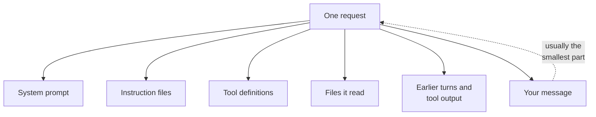
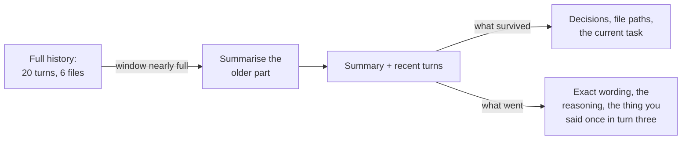

*Every number below was measured on 10 October 2026, in this blog's own
repository, with Claude Code 2.1.205 against `claude-opus-5`. The token counts
come from the API's own usage accounting, which Claude Code prints for you; the
one count of my own typed words comes from a local `Qwen/Qwen2.5-3B-Instruct`
tokeniser, because that part needs no account at all.*

## TL;DR

- Across a whole five-turn session, everything I typed came to 185 tokens.
  One request in that session carried 65,593.
- The harness chose the rest: a system prompt, tool definitions, instruction
  files, skills, and every file it decided to read.
- An instruction file is advice the model weighs against everything else. It is
  not a rule the system enforces, and the vendor says so in those words.
- Compaction is lossy on purpose. Mine threw away 89 per cent of the context in
  eighty seconds.
- Curating what goes in beats waiting for a bigger window, because the
  always-loaded layers are charged on every single request.

## Where this sits

This post needs two things. From track one,
[the context window is the entire memory](/engineering/the-context-window-is-the-entire-memory/)
— the model is stateless, the whole pile is resent every turn, and that is why
the size of the pile is a cost and a quality problem at once. From this track,
[what actually happens when you press enter](/engineering/what-happens-when-you-press-enter/)
— the loop, and the box in it marked *harness assembles the request*. This post
opens that box.

The words for the parts live in
[harness engineering: the words for the layer around the model](/engineering/harness-engineering-vocabulary/),
and I use them here exactly as that post defines them. Single terms are one line
each in [the AI vocabulary](/engineering/the-ai-vocabulary/).

The analogy for the whole post: **a briefing pack assembled by someone else.**
You wrote the covering note on top. Everything else in the folder — the
background papers, the standing instructions, the transcript of the last
meeting, the list of people you are allowed to phone — was chosen and ordered
by somebody who is not in the room. The reader weighs all of it together, and
they do not know which page you wrote.

## 01 — The thing you have already noticed

You wrote a rule in your instructions file. Plain English, no ambiguity, five
words long. *Never commit without running the tests.* It worked for a week.

Then, forty minutes into a hard session, it commits without running anything.

The confusing part is not that it broke a rule. The confusing part is that you
can prove it read the file. It quoted the file back at you an hour ago. The file
has not changed, the session has not restarted, nothing errored. It read your
rule and did something else.

The reflex is to make the rule louder — capitals, bold, three exclamation
marks, the word MUST repeated. Sometimes that buys another week. It is the wrong
model of what happened, though, and the right model is visible as soon as you
look at what the harness actually sent.

Your rule was not a setting. It was a paragraph, somewhere in a folder of
paragraphs, most of which you did not write.

## 02 — What is actually in the envelope

So let us weigh the folder.

Claude Code reports, for every request, exactly how many tokens the API was
billed for. That number is the real size of the assembled prompt — uncached
tokens plus cache writes plus cache reads. And the CLI has flags that switch
each layer off. Put the two together and you can weigh the layers one at a time,
by difference, without guessing at any of them.

Here is the whole experiment. It runs five one-shot sessions, each with one
more layer switched on, and it does not read any of your files:

```sh
#!/bin/sh
# Each line starts a one-shot Claude Code session with one more layer switched on and
# prints the total prompt the API was billed for. Nothing here reads your own files.
ask() {
  claude -p "Reply with exactly: ok" --output-format json --no-session-persistence "$@" < /dev/null |
    python3 -c 'import json,sys; u=json.load(sys.stdin)["usage"]; print(u["input_tokens"] + u["cache_creation_input_tokens"] + u["cache_read_input_tokens"])'
}
NO_MCP='--strict-mcp-config --mcp-config {"mcpServers":{}}'
echo "system prompt only       $(ask --safe-mode --tools '')"
echo "+ built-in tool defs     $(ask --safe-mode)"
echo "+ instructions, memory   $(ask $NO_MCP --disable-slash-commands)"
echo "+ skills                 $(ask $NO_MCP)"
echo "+ MCP servers            $(ask)"
```

```text
system prompt only       2087
+ built-in tool defs     20679
+ instructions, memory   24054
+ skills                 27810
+ MCP servers            29732
```

Read the gaps, not the rows. Subtracting each row from the one above gives the
weight of a layer, and on my machine, in this repository, on that day:

| Layer | Tokens | Share of the 29,732 |
|---|---|---|
| System prompt | 2,087 | 7% |
| Built-in tool definitions, fully loaded | 18,592 | 63% |
| Everything `--safe-mode` turns off: instruction files, auto memory, custom agents, commands, output styles, plugins, workflows | 3,375 | 11% |
| Skills (names and descriptions only) | 3,756 | 13% |
| MCP servers | 1,922 | 6% |
| **What I typed** | **about 5** | **0.02%** |

The sentence I sent was *Reply with exactly: ok*. It is the last row.

Three honest qualifications before anyone builds a spreadsheet on this.

**The first row wobbles.** The system prompt carries per-machine sections —
working directory, date, git status — so it moves by fifty or seventy tokens
between runs; I saw 2,087, 2,111, 2,183 and 2,085 across four runs of the same
command.

**The MCP row is small because of deferral, not because MCP is cheap.** Claude
Code now holds MCP tool definitions back: by default
[only the names and the server instructions go into context](https://code.claude.com/docs/en/costs),
and a schema is fetched when the model actually wants one. On a configuration
without that deferral, the same servers would have been several times heavier
than the system prompt.

**And the tool row is a ceiling, not what an ordinary session carries.**
Deferral is not an MCP-only arrangement: part of the built-in set is held back
the same way. The second rung of the ladder uses `--safe-mode`, which loads all
of it, so 18,592 is what the full set weighs when nothing is deferred. The
`/context` report in section 06, taken from an ordinary session in this same
repository, reports for the tools 12.7k loaded and 11.9k held back. Two
conditions and two accountings — one read off billed requests, one off the
harness's own estimate — and I can name which produced which number but not why
the arithmetic between them does not close, because I did not measure that.
Either way the proportion the table exists to argue survives: the tool
definitions outweigh everything you wrote by a factor of thousands.

That is the fixed part of the folder — what is in the envelope before you type.
Now the part that grows.

I ran an ordinary read-only session in this repository: five short messages,
each asking it to read one or two files and summarise them. Nine requests went
over the wire. The first carried 25,659 tokens. The ninth carried 65,593.

The 39,934 tokens of difference are the four posts and one TypeScript file it
read, plus its own replies coming back around. Meanwhile, here is everything I
typed in that session, tokenised locally:

```python
from transformers import AutoTokenizer

tok = AutoTokenizer.from_pretrained("Qwen/Qwen2.5-3B-Instruct")

TYPED = [  # the five messages I sent in that session, verbatim
    "Read src/utils/reading-time.ts and tell me in one sentence how it counts words.",
    "Now read src/content/engineering/the-context-window-is-the-entire-memory.md and"
    " src/content/engineering/what-happens-when-you-press-enter.md. In two sentences"
    " each, say what each post owns.",
    "Two decisions to carry for the rest of this session. First, in this repo we call"
    " the 220 figure in reading-time.ts the editorial constant, and it is never changed"
    " without updating every post that cites it. Second, diagram caption colour is"
    " always left to the theme and never set by hand. Acknowledge in one line, no files.",
    "Read src/content/engineering/harness-engineering-vocabulary.md and list its three"
    " organising questions, then say which section answers each.",
    "Read src/content/engineering/ai-assisted-coding-playbook.md and summarise section"
    " 11 in two sentences.",
]

total = sum(len(tok(t)["input_ids"]) for t in TYPED)
print(f"all five messages: {sum(len(t) for t in TYPED)} characters, {total} tokens")
print(f"share of the last request (65,593 tokens): {100 * total / 65593:.2f}%")
```

```text
all five messages: 832 characters, 185 tokens
share of the last request (65,593 tokens): 0.28%
```

Qwen's tokeniser is not Claude's, so treat 185 as accurate to within a few per
cent rather than exact. It does not need to be exact. Everything I said, for the
whole session, is a quarter of one per cent of a single request — and there were
nine of them.



*Notice where your own words sit in this picture. Everything else was chosen by
the harness, which is why configuring the harness changes the answers.*

## 03 — Advice, not law

Now back to the rule that lost.

There is a mechanical fact underneath it, and Anthropic's own documentation
states it plainly. A `CLAUDE.md` is "delivered as a user message after the
system prompt, not as part of the system prompt itself", and both it and auto
memory are treated "as context, not enforced configuration". To block an
action regardless of what the model decides, the same page sends you to a
[hook](https://code.claude.com/docs/en/hooks).

Sit with the first half of that. Your instructions file is not a privileged
channel, not a flag the runtime reads, not a policy object. It is a user message
— the same kind of thing as the sentence you typed thirty seconds ago, and the
same kind of thing as the four hundred lines of someone else's stack trace that
a tool dropped into the context on turn fifty. All three are text in one
stream, competing.

[My playbook](/engineering/ai-assisted-coding-playbook/) tells you to put your
non-negotiables in an instruction file, and
[the vocabulary post](/engineering/harness-engineering-vocabulary/) already
corrected that: if the sentence contains *always* or *never*, the advisory layer
is the wrong home for it. What this post adds is the measurement behind the
correction, because it changes what you do about it.

I put a sixteen-line instruction file into this repository and re-ran the
third rung of the ladder. Then I swapped it for a one-hundred-and-fifty-six-line
file and ran it again:

| Project instruction file | Assembled prompt | Cost of the file |
|---|---|---|
| none | 24,074 | — |
| 16 lines, 895 bytes | 24,453 | 379 tokens |
| 156 lines, 8,204 bytes | 27,070 | 2,996 tokens |

About nineteen tokens a line, charged on every request for the lifetime of the
session. A four-hundred-line instruction file is therefore somewhere near 7,700
tokens — arithmetic on those measurements, not a fourth measurement — on every
one of the two hundred requests a long task makes. Anthropic's own cost guidance
suggests keeping the file
[under two hundred lines](https://code.claude.com/docs/en/costs), which lines up
with what the numbers do.

And the size is only half the problem. A long instruction file is not just
expensive; it is *diluted*. Every line you add competes with every other line,
including the ones you care about. The rule that lost on turn sixty did not lose
because the model stopped caring. It lost because it was one paragraph in a pile
that had grown to sixty-five thousand tokens, and nothing in that pile is marked
as more important than anything else.

So the fix is not a louder rule. It is a shorter file with the genuinely
advisory things in it, and a hook for the thing that must hold. That split — and
the permission layer that sits next to it — is the subject of the next post in
this track.

## 04 — When there is no more room

Eventually the pile hits the ceiling, and the harness summarises the older part
of it. Claude Code calls it compaction. It happens on its own when the context
approaches the window, and you can trigger it yourself with `/compact`.

I wanted to see what it actually throws away, so I built a session I could
probe. Five turns, read-only, as described above — but on turn three I slipped
in two arbitrary decisions, the kind of thing you say once in a real session and
expect to stand:

> in this repo we call the 220 figure in reading-time.ts the editorial constant,
> and it is never changed without updating every post that cites it. Second,
> diagram caption colour is always left to the theme and never set by hand

Then I forked the session twice: once to leave untouched, once to compact. Every
Claude Code session is a JSONL file on your own disk, and compaction writes a
record into it saying what it did:

```python
# What did compaction cost, and what did it keep? Every Claude Code session is a
# JSONL file under ~/.claude/projects/<slug>/, and compaction writes a boundary
# record into it. Point this at the directory for the repo you work in.
import glob, json, os, sys

for path in sorted(glob.glob(os.path.expanduser(sys.argv[1]))):
    for line in open(path):
        rec = json.loads(line)
        if rec.get("subtype") != "compact_boundary":
            continue
        m = rec["compactMetadata"]
        print(f"session {os.path.basename(path)[:8]}  trigger={m['trigger']}")
        print(f"  context before compaction : {m['preTokens']:>7,} tokens")
        print(f"  context after  compaction : {m['postTokens']:>7,} tokens")
        print(f"  thrown away               : {m['cumulativeDroppedTokens']:>7,} tokens"
              f"  ({100 * m['cumulativeDroppedTokens'] / m['preTokens']:.0f}%)")
        print(f"  messages kept verbatim    : {len(m['preservedMessages']['uuids']):>7}")
        print(f"  time to summarise         : {m['durationMs'] / 1000:>7.0f} s")
```

```text
session 53dafc46  trigger=manual
  context before compaction :  65,758 tokens
  context after  compaction :   7,321 tokens
  thrown away               :  58,437 tokens  (89%)
  messages kept verbatim    :       3
  time to summarise         :      80 s
```

Eighty seconds, and eighty-nine per cent of the context gone. Three messages at
the tail survived untouched; everything before them was replaced by a single
summary of about fifteen thousand characters. Note also what that line does not
say: compaction is itself a large request, because the summariser has to read
the whole conversation it is compressing.

Then the honest part, which is not what I expected to write.

**It kept the decisions.** Both of them, word for word, under a heading the
summariser wrote itself: *Standing constraints stated by the user that remain in
effect verbatim*. The thing I said once on turn three — the exact case the
received wisdom says you will lose — came through intact. I asked the compacted
session what I had called the 220 figure and it answered correctly.

What it lost was the evidence. Four posts and one source file had been read in
full: roughly seventeen hundred lines of text, and all of it is gone, replaced
by the summariser's description of what was in it. So I asked both forks the
same question, with tools switched off so neither could cheat by re-reading:

> Without using any tool: quote the exact italic caption line that sits directly
> under the first mermaid diagram in the-context-window-is-the-entire-memory.md.

```text
=== the untouched fork
*Notice that turn 20 is not turn 1 plus a memory. It is turn 1 plus everything,
sent again from scratch.*

=== the compacted fork
I can't quote that from memory — I read the file earlier in the session, but
it's no longer in my context after compaction, and I'd be reconstructing the
caption rather than quoting it.
```

That is the trade, as clearly as I can show it. Your decisions survive, because
a summariser recognises a decision. The *material* does not, because seventeen
hundred lines cannot be made smaller without ceasing to be seventeen hundred
lines.

One genuinely good surprise, and I want to give the tool credit for it: the
compacted session knew it had been compacted, and said so rather than inventing
a caption. Claude Code's summary opens by telling the model the conversation was
continued from a summary, and ends by telling it where the full transcript is on
disk. That is a design decision, not a property of compaction, and it is the
difference between a fluent non-answer — which is what
[post 1.3 measured when a turn is simply dropped](/engineering/the-context-window-is-the-entire-memory/)
— and an honest one.



*Compaction is not compression. It is a judgement call about what mattered, made
without asking you.*

I should mark one disagreement between that diagram and my own run, because the
measurement wins. In my session the thing I said once in turn three *did*
survive, verbatim and under its own heading; what went was the exact wording of
the files. The diagram is the general shape and the general shape is right —
a summariser keeps what looks like a decision and drops what looks like detail.
Which of your sentences it files under which, you do not get to see.

## 05 — What this means for how you work

Four habits. Each one is a consequence of a number above, not a preference.

**Give it the file, not the repository.** Every token a tool returns is in every
later request. My session grew by 39,934 tokens because it read five files, and
each of the nine requests carried whatever had accumulated by then. Reading a
file is not a one-off cost; it is a subscription.

**Keep the always-loaded layer short.** Instruction files cost about nineteen
tokens a line on every request, and the lines dilute each other. Trim first, then
move the non-negotiable ones to a layer that executes rather than asks.

**Write decisions where compaction cannot reach them.** Mine survived, and I
would not bet a working afternoon on that. A decision in a file in the repository
is a decision; a decision in the chat is a candidate for a summariser's judgement
that you will never be shown.

**When a session has compacted and started drifting, start a new one.** After
compaction the model is reasoning from a description of what happened, not from
what happened. Arguing with it adds turns to a conversation whose foundation you
cannot see. Pasting the three relevant files into a fresh session costs less
than the argument and usually works first time.

## 06 — The same thing in Claude Code

Concretely, in Claude Code, each layer in the diagram has an address.

The system prompt ships inside the binary and you do not edit it, although
`--append-system-prompt` adds to it at launch. The instruction files are
`CLAUDE.md` at the project root and at `~/.claude/CLAUDE.md`, plus
`.claude/rules/` for rules scoped to particular paths, plus auto memory, which
the tool writes for itself. Tool definitions are the built-in set plus whatever
your MCP servers expose. Skills contribute only a name and a description until
the model decides to open one. Files it read are tool results, and they stay in
the conversation afterwards.

The useful part is that you do not have to take any of this on trust. `/context`
prints the harness's own breakdown of what is sitting in the window, and it
makes no API call at all — it cost me nothing to run. On a fresh session in this
repository:

```text
**Tokens:** 23k / 200k (11%)

| Category               | Tokens | Percentage |
|------------------------|--------|------------|
| System prompt          | 2.7k   | 1.4%       |
| System tools           | 12.7k  | 6.4%       |
| MCP tools (deferred)   | 10.6k  | 5.3%       |
| System tools (deferred)| 11.9k  | 6.0%       |
| Custom agents          | 1.1k   | 0.6%       |
| Memory files           | 2.5k   | 1.2%       |
| Skills                 | 2.6k   | 1.3%       |
| Messages               | 1.3k   | 0.7%       |
| Free space             | 177k   | 88.5%      |
```

Three things to read carefully there, and all three took me a second pass.

The rows marked *deferred* are not in the 23k — add up the rest and you get
22.9k. They are telling you what those schemas *would* cost if they were
loaded. Note that there are two of them: deferral is not an MCP-only
arrangement, and part of the built-in tool set is held back the same way.

Which is where this table and section 02's tool row part company, and I would
rather point at that than let you find it: 18,592 tokens there, 12.7k loaded
plus 11.9k deferred here. Section 02's figure was measured with `--safe-mode`,
which loads the built-in set in full; this one is an ordinary session, where
some of it is deferred. Two conditions, two accountings. Which number applies
to you depends on which situation you are in, and when you run `/context`
yourself you are in this one.

And the report calls itself an estimate, which it means: for the same
configuration, the API billed 29,732 tokens where `/context` said 23k. Use
`/context` to see the shape and the proportions. Use the usage numbers when you
need the truth.

Run the same command deep in a long session and the shape inverts. On the
five-turn session from section 02 it read 65.6k of 200k, with 43.9k of that in
one row called **Messages** — the conversation, the files, the tool output. The
fixed layers had not changed by a token. They had simply stopped being the
story.

GitHub Copilot assembles the same kinds of layer with different file names, and
one difference is worth knowing. Its always-loaded instruction files are
`.github/copilot-instructions.md` and `AGENTS.md` — same idea, same advisory
status. But it also has
[targeted `.instructions.md` files](https://code.visualstudio.com/docs/agent-customization/custom-instructions)
in `.github/instructions`, each with an `applyTo` glob, which load only when a
matching file is in play. That is a genuinely different answer to section 03's
problem: rather than one file that is always in context and always being
diluted, a set of files that are in context when they are relevant. It does not
make any of them enforced — they are still text the model weighs — but it does
attack the dilution directly.

## 07 — Going deeper: system prompt leakage

One consequence of everything above is a security property, and it has a
name: [`LLM07:2025 System Prompt Leakage`](https://genai.owasp.org/llmrisk/llm072025-system-prompt-leakage/)
in the OWASP Top 10 for LLM Applications. If a thing is in the context window it
is reachable by a sufficiently motivated prompt, because the model's job is to
produce text conditioned on everything it was given, and "everything it was
given" includes the parts you think of as infrastructure. OWASP's advice is
blunt: keep credentials, connection details and permission structures out of
prompts entirely, and never rely on prompt text to enforce behaviour, because
injected text can override it. For an instruction file this is sharper than it
first sounds — a `CLAUDE.md` is not even a system prompt, it is a user message,
so an internal hostname or a "don't tell the user about X" sentence written
there is one well-phrased question away from being read aloud.

## Try it yourself

1. **Weigh your own assembly.** Run the five-line script from section 02 in a
   repository you work in. The interesting number is not the total; it is which
   row surprises you. Mine was the tool definitions at 63 per cent.
2. **Try to make it drop a rule.** Put a specific, checkable rule in your
   instruction file — a naming convention, a forbidden library — then run a long
   session that pushes hard in the opposite direction. Note the turn at which it
   goes. That turn number is your advisory layer's real reliability.
3. **Compact on purpose.** Run `/compact` mid-session, then ask for something
   verbatim from early on: an exact line, an exact error message. Compare the
   answer to what you can still see by scrolling up.

## Common mistakes

**Writing a thousand-line instruction file.** It is not thorough, it is a
recurring charge of roughly nineteen thousand tokens on every request, and every
line in it dilutes every other line.

**Assuming a rule in a file is enforced.** It is a user message in a stream of
user messages. The vendor's own documentation says "context, not enforced
configuration". If it must hold, it belongs somewhere that executes.

**Pasting whole files.** The whole file is in every subsequent request for the
rest of the session, at full price, competing with the thing you actually asked
about.

**Treating compaction as free.** It takes real time — eighty seconds in my run —
costs a large request of its own, and makes a judgement about your conversation
that you are never shown.

**Believing a bigger window is the fix.** A bigger window raises the ceiling on
what you can send. Section 02's proportions do not change: the harness still
chooses almost all of it, and your sentence is still the smallest part.

## References and further reading

Every vendor page below, and every vendor page linked in the body, was fetched
on 10 October 2026. These are living pages with no revision of their own and
their paths move; treat each as a pointer to the current page.

- [The context window is the entire memory](/engineering/the-context-window-is-the-entire-memory/)
  — the prerequisite. Open it for why the whole pile is resent every turn, what
  that costs across a long session, and the three-way diagnostic for "it forgot".
- [Harness engineering: the words for the layer around the model](/engineering/harness-engineering-vocabulary/)
  — open this for which layer each part belongs to, and for the rule this post
  measures: if the instruction says *always* or *never*, the advisory layer is
  the wrong home. Its companion,
  [the AI vocabulary](/engineering/the-ai-vocabulary/), has context window,
  compaction, instruction file, skill and hook in one line each.
- [My AI-assisted coding playbook, section 11](/engineering/ai-assisted-coding-playbook/)
  — what to put in an instruction file in the first place, and the correction at
  the end of that section about which rules do not belong there.
- [How Claude remembers your project](https://code.claude.com/docs/en/memory)
  — Anthropic's own page, for the two sentences this post leans on: that
  instruction files are delivered as a user message, and that they are treated
  as context rather than enforced configuration.
- [Manage costs effectively](https://code.claude.com/docs/en/costs) and
  [Hooks](https://code.claude.com/docs/en/hooks) — the first for MCP tool
  deferral, the two-hundred-line guidance and what `/context` is for; the second
  for the layer that executes instead of asking. Section 09's Copilot
  comparison rests on one more living page, VS Code's
  [custom instructions](https://code.visualstudio.com/docs/agent-customization/custom-instructions),
  linked where it is used.
- [OWASP Top 10 for LLM Applications 2025, `LLM07:2025 System Prompt Leakage`](https://genai.owasp.org/llmrisk/llm072025-system-prompt-leakage/)
  — section 07 under its security name, with the mitigations written for people
  who have to explain this to a risk function.

## Final thoughts

The briefing pack is assembled by someone else, and the someone else is a
program you can configure. That is the whole point of knowing any of this.

Once you have seen your own numbers — your tool definitions, your instruction
files, your session growing by forty thousand tokens because it read five files
— the advice everyone gives about these tools stops being folklore. Short
instruction files, fresh sessions, give it the file not the repository, write
decisions down outside the chat: every one of those is a direct consequence of a
proportion you can measure in about four minutes.

And the rule that lost on turn sixty was never ignored. It was weighed, against
sixty-five thousand tokens of other things, and it came second.
