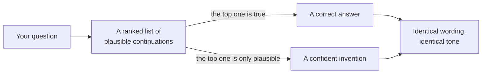
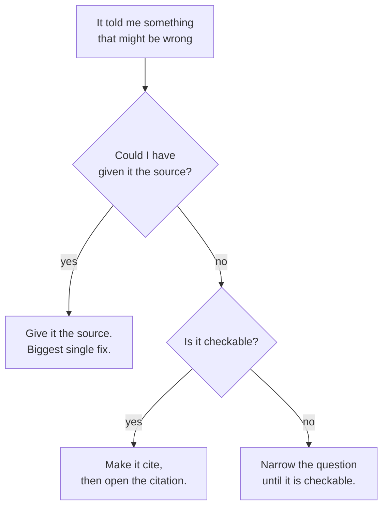

*The runs below are verbatim output from a small model you can run on a laptop
(`Qwen/Qwen2.5-3B-Instruct`, via `uv run --with transformers --with torch`). The
right answer is checked against the library's own release notes.*

## TL;DR

- The model always produces something. There is no code path where it returns
  nothing.
- Nothing in the mechanism distinguishes a true continuation from a merely
  plausible one.
- Temperature reshapes the guess. It cannot add knowledge, and it cannot tell
  you when the guess is wrong.
- Fluency and accuracy are produced by the same machinery and look identical on
  the way out.
- Every fix that works changes what the model has to work with. None of them
  changes how certain it sounds.

## Where this sits

This needs [what a model actually is](/engineering/what-a-model-actually-is/),
and specifically the ranked list of next tokens — the whole explanation here is
a consequence of that picture. Words you do not recognise are one line each in
[the AI vocabulary](/engineering/the-ai-vocabulary/).

The analogy, and I think it is the fairest one available: **a witness who is
certain, fluent, and reconstructing.** They are not lying. They are filling a
gap with the most plausible thing, and plausibility is precisely what they were
trained on. Ask them again tomorrow and you will get the same confident account.

## 01 — The thing you have already noticed

A support assistant answers a question about refunds by citing the company's
internal policy document — by name, with a section number, in the right format.

The document does not exist. There is no document. There never was one.

What makes it land badly is the specificity. A vague wrong answer gets
questioned; this one has a document title in house style, a section number in
the right format, and a tone of mild administrative boredom. Everything around
it is correct, too — the refund window was right, the escalation path was right.
One element in an otherwise accurate answer is fiction, and it is the element
that looks most like a fact.

The person who reports this to you will say the model "made it up", with the
implication that something went wrong. Nothing went wrong. The model did the
only thing it does, and the result was a citation that looks exactly like the
citations in every policy document it has ever read. That is not a malfunction
of the mechanism. It is the mechanism.

## 02 — Where the wrong answer comes from

Go back to the ranked list from post 1.1. Given the text so far, the model
produces a probability for every token it knows, and something picks one.

Now ask where "truth" would live in that picture. There is no second pass that
checks a claim against a store of facts, because there is no store of facts —
there is a pile of numbers that encodes which continuations are plausible. A
true statement scores well because true statements appeared in the training text.
A plausible-but-false statement also scores well, for exactly the same reason:
it looks like the text the model has read.



*Notice that both paths end in the same place. Nothing in the output marks which
one you got.*

It is worth heading off the usual objection here. "So it is just autocomplete"
is both true and misleading. True, because the mechanism really is next-token
prediction and nothing else. Misleading, because predicting the next token
across a large enough body of text requires representing an enormous amount
about how the world is described — grammar, reasoning patterns, the shape of a
correct proof, the conventions of a changelog. The capability is real and it is
startling. What it is not is a lookup, and the gap between those two is where
every example in this post lives.

This is why "hallucination" is a slightly unfortunate word. It suggests a
distinct failure state the model enters, as though there were a healthy mode and
a sick one. There is one mode. Sometimes its best guess is right.

## 03 — What temperature really changes

The obvious lever is temperature, and it is worth being precise about what it
does, because the folk wisdom is wrong in a specific and expensive way.

Here is the same single forward pass from post 1.1, read out at three settings:

```text
temperature 0.0001
  100.00%  ' Amsterdam'

temperature 0.7
   61.19%  ' Amsterdam'
   32.75%  ' The'
    1.57%  ' Ha'
    1.44%  ' Am'
    0.92%  ' Rotterdam'

temperature 1.5
   14.76%  ' Amsterdam'
   11.03%  ' The'
    2.67%  ' Ha'
    2.57%  ' Am'
    2.08%  ' Rotterdam'
```

Low temperature concentrates the probability on the favourite; high temperature
spreads it out. What it does **not** do is change which token is the favourite.
Amsterdam is first at every setting, and if the favourite had been wrong it
would have been first at every setting too.

So: **temperature 0 does not make a model accurate. It makes it consistent.** If
its best guess is right, you get the right answer every time. If its best guess
is wrong, you get the same wrong answer every time, delivered with the lowest
variance you can buy — which looks, from the outside, exactly like confidence.
That is a worse failure than occasional variation, because variation is at least
a signal.

## 04 — Five runs, one question

So let us ask something checkable.

I asked `Qwen/Qwen2.5-3B-Instruct` — a small instruction-tuned model, running
locally, and note that it is *not* the base model the temperature table above
came from — the same question five times at temperature 0.7, with sampling on,
and printed every answer verbatim. The question has a specific answer that
can be verified against the library's own release notes:

```python
Q = "Which version of pandas introduced the DataFrame.convert_dtypes method? Answer in one short sentence."
for i in range(5):
    out = model.generate(**tok(prompt, return_tensors="pt"),
                         max_new_tokens=80, do_sample=True, temperature=0.7, top_p=0.9)
    print(f"--- run {i+1}\n{tok.decode(out[0][n:], skip_special_tokens=True).strip()}")
```

```text
--- run 1
The DataFrame.convert_dtypes method was introduced in pandas version 0.25.0.
--- run 2
The DataFrame.convert_dtypes method was introduced in pandas version 0.25.0.
--- run 3
The DataFrame.convert_dtypes method was introduced in pandas version 0.24.0.
--- run 4
The DataFrame.convert_dtypes method was introduced in pandas version 0.25.0.
--- run 5
The DataFrame.convert_dtypes method was introduced in pandas version 0.25.
```

**The right answer is pandas 1.0.0**, released on 29 January 2020. I checked it
in the project's own release notes, which announce it under the heading "Method
`convert_dtypes` to ease use of supported extension dtypes" — the link is in the
references.

Sit with that result for a moment, because it is richer than "the model was
wrong".

It was wrong **five times out of five**. It was wrong **consistently** — four of
the five agree on 0.25.0, which means if you had asked twice to check, as people
often advise, the two answers would have agreed and you would have been more
confident in a false answer than before you started. It was wrong **plausibly**:
0.25.0 is a real pandas release from 2019, in the right era, in the right format.
And it was wrong **without a hint of hedging** — not one of the five said
"I think" or "you should check".

It is worth asking what it would have taken for the model to do better here.
Not a bigger model, necessarily, and certainly not a better prompt: the
information needed is "which release first contained this method", which lives
in a changelog that either was or was not well represented in the training data,
and which the model has no way to consult at the moment of answering. There is
nothing to introspect. From the inside, producing `0.25.0` felt exactly like
producing `3.8` did for the Python question below — same mechanism, same
absence of doubt, different luck.

For contrast, I asked the same model two questions it does know, under identical
settings:

```text
######## Which version of Python introduced the walrus operator :=? Answer in one short sentence.
--- run 1
The walrus operator := was introduced in Python 3.8.
--- run 2
The walrus operator := was introduced in Python 3.8.
--- run 3
The walrus operator := was introduced in Python 3.8.
--- run 4
The walrus operator := was introduced in Python 3.8.
--- run 5
The walrus operator := was introduced in Python 3.8.

######## Which version of Python introduced the match statement? Answer in one short sentence.
--- run 1
The match statement was introduced in Python 3.10.
--- run 2
The match statement was introduced in Python 3.10.
--- run 3
The match statement was introduced in Python 3.10.
--- run 4
The match statement was introduced in Python 3.10.
--- run 5
The match statement was introduced in Python 3.10.
```

Both of those are right: the walrus operator arrived in Python 3.8, the match
statement in 3.10.

Identical confidence. Identical phrasing pattern. Identical lack of hedging.
Three questions, two right and one wrong, and **nothing in the output tells you
which is which.** That is the entire post in one experiment, and it takes about
four minutes to run yourself on a laptop.

Two honest notes on method. I used a small model because small models are easy
to run and fail more readily; a larger one may well get this particular question
right, and I could not test that here, so take it as the likely case rather than
a measured one. What does not change with size is the behaviour itself. Bigger
models move the line — they are wrong about more obscure things — and moving the
line is worse than it sounds, because the questions you cannot easily check are
exactly the ones on the far side of it.

## 05 — Why it does not say "I don't know"

The obvious question: why did it not just say so?

Partly it is section 02 — there is no "I am uncertain" signal available to be
reported, because the model is not comparing a claim against knowledge, it is
extending text. But the sharper reason is about how models are finished.

After the enormous first stage of training, a model is shaped by further
training on examples of good and bad answers, including comparisons between two
answers to the same question with a record of which one people preferred. That
process is what makes a model helpful rather than a text-continuation engine.

And people, reliably, prefer a confident answer to "I don't know". Not because
anyone intends to train dishonesty, but because in a side-by-side comparison the
hedging answer looks unhelpful and the specific answer looks useful, and the
rater cannot check either. Do that at scale and you have expressed a preference
for fluent specificity over calibrated uncertainty. The model learns it.

There is a second pressure in the same direction. A model that says "I don't
know" too readily is useless, and the failure is loud — users notice immediately
and complain. A model that answers confidently and is occasionally wrong fails
quietly, and only for the subset of users who check. Any process that tunes on
human preference is going to find the second failure mode more comfortable than
the first. That is not a conspiracy; it is what optimising for what raters
prefer looks like when raters cannot verify.

The mechanics of that training stage are a post of their own later in this
series. The consequence is the part you need today: **the absence of hedging in
an answer carries no information.** It is a style the model was rewarded for,
not a signal about this particular claim.

## 06 — What actually helps

In descending order of how much difference they make.

**Give it the source.** By a wide margin the biggest single fix. A model asked to
summarise a document in front of it is doing something it is genuinely good at;
the same model asked to recall the document is doing section 04. Most "the AI
gets our domain wrong" problems are this, and the fix is retrieval, not a better
prompt.

Here is that claim tested rather than asserted. Same model, same settings, same
question — the only change is four lines of the release notes pasted above it:

```text
######## ungrounded
--- run 1: ...introduced in pandas version 0.25.
--- run 2: ...introduced in pandas version 0.25.
--- run 3: ...introduced in pandas version 0.25.

######## grounded
--- run 1: ...introduced in pandas version 1.0.0.
--- run 2: ...introduced in pandas version 1.0.0.
--- run 3: ...introduced in pandas version 1.0.0.
```

Nought out of three, then three out of three. Nothing about the model changed;
the task changed, from recalling a fact to reading one. That is the whole of
retrieval-augmented generation in a sentence, and it is why so much production
AI work turns out to be search work wearing a different hat — the hard part is
not the generation, it is getting the right four lines in front of it.

**Make it cite, then open the citation.** Useful, with one trap: asking for a
citation does not make a model honest, it makes it produce a citation — which,
as section 01 shows, it can generate as readily as anything else. The value is
entirely in you opening the link. An unchecked citation is worse than none,
because it buys unearned confidence.

**Narrow the question until it is checkable.** "Is this migration safe?" has no
checkable answer. "Does this migration drop a column that is referenced
elsewhere in the repo?" does.

**Ask twice and compare.** Last, and weakest, and I include it because it gets
recommended constantly. Section 04 is exactly why it is weak: the model was
consistently wrong, so two tries agreed. Disagreement is informative;
agreement is not.



*Every genuine fix changes what the model has to work with. None of them changes
how certain it sounds.*

Notice what is not on that list: adjusting temperature, telling it to be
accurate, telling it not to hallucinate, or asking whether it is sure. The first
is section 03. The rest are instructions to a system that has no mechanism to
comply with them.

## 07 — Going deeper: calibration

There is a precise name for what is missing here. A model is **calibrated** if,
across all the claims it makes with a given internal confidence, the proportion
that turn out true matches that confidence.

Two things are worth knowing. First, a model's internal confidence and its
*tone* are different quantities, and only the tone reaches you — the rhetorical
certainty in those five pandas answers is a writing style, not a probability.
Second, the interface shows you neither. There is no number on the screen, and
the words "I'm certain" are generated by the same process as everything else in
the sentence.

There is an active research literature on extracting better uncertainty signals
— looking at the probabilities directly, sampling repeatedly and measuring
disagreement, training models to abstain. Some of it works. None of it is
wired into the chat box you are using today.

Which means the calibration in your system has to come from you: from what you
check, what you require a source for, and what you refuse to accept without one.

## Try it yourself

1. **Ask about a library version and verify it.** Pick something real but
   slightly obscure in a library you use. Ask, then open the release notes. The
   gap between how sure it sounded and whether it was right is the lesson.
2. **Ask the same question five times** with sampling on. Note whether the
   variation tracks correctness. In my run it did not.
3. **Ask it to cite a source, then open the source.** Do this three times on
   questions where you can check. Count how many citations survive.

## Common mistakes

**Setting temperature to 0 and calling it accurate.** You bought consistency.
See section 03.

**Asking the model whether it is sure.** The answer is generated the same way
the original claim was. You have asked a witness to grade their own testimony.

**Treating a citation as evidence.** It is evidence only once you have opened it.

**Assuming a bigger model does not do this.** It does it on harder questions.
That is a change in where the line sits, not in whether there is one.

**Trying to fix a factual gap with prompt wording.** If the information was not
in the training data and is not in the context, no instruction conjures it. Add
the source instead.

## References and further reading

- [What a model actually is](/engineering/what-a-model-actually-is/) — the
  ranked-list picture this whole post is an argument about, with the temperature
  tables reproduced in section 03.
- [pandas 1.0.0 release notes](https://pandas.pydata.org/docs/whatsnew/v1.0.0.html)
  — the primary source for section 04's right answer. Open it to see the
  heading announcing `convert_dtypes`, and note that checking took under a
  minute, which is the point.
- [OWASP Top 10 for LLM Applications 2025](https://genai.owasp.org/llm-top-10/)
  — `LLM09:2025 Misinformation` is this post's subject under the name it needs
  to carry in a design review or a risk register.
- [AI Architecture: a practitioner's field guide](/guides/ai-architecture-master-guide/)
  — open this for the system-design version of section 06: where grounding,
  retrieval and guardrails actually sit in an architecture, rather than what to
  do in a single conversation.
- [The AI vocabulary](/engineering/the-ai-vocabulary/) — hallucination,
  sampling, top-p, preference tuning, calibration, in one line each.

## Final thoughts

The uncomfortable part of this post is not that models get things wrong. Every
tool gets things wrong. It is that this one gets things wrong in a register
indistinguishable from getting them right, and that the register is a trained
behaviour rather than a signal.

So the discipline it asks of you is not scepticism in general — that is
exhausting and nobody sustains it. It is narrower: know which of your questions
are checkable, check those, and notice when you are asking one that is not.
