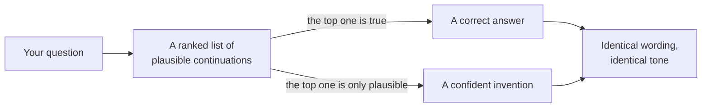
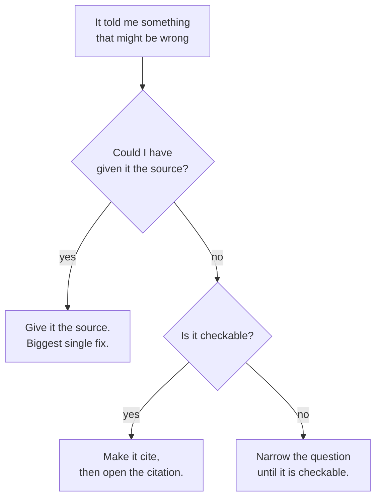

*The runs below are verbatim output from a small model you can run on a laptop
(`Qwen/Qwen2.5-3B-Instruct`, via `uv run --with transformers --with torch`). The
right answer is checked against the library's own release notes.*

## TL;DR

- The model always answers. There is no path through the code where it returns
  nothing.
- Nothing inside it can tell a true continuation from one that merely sounds
  right. Both score well for the same reason.
- [Temperature](/engineering/the-ai-vocabulary/#temperature) reshapes the guess. It adds no knowledge, and it
  cannot warn you when the guess is wrong.
- Reading well and being right come out of the same machinery, and they look
  identical on the page.
- Every fix that works changes what the model has in front of it. None of them
  changes how sure it sounds.

## Where this sits

This needs [what a model actually is](/engineering/what-a-model-actually-is/),
and in particular the ranked list of next tokens. Everything here follows from
that one picture. The whole series, and which track you want, is on [the start-here page](/engineering/ai-foundations-start-here/).

Technical words link to their one-line definition in the
[AI vocabulary](/engineering/the-ai-vocabulary/) the first time they appear.
Open them in a second tab as you go.

And one scene runs through the whole post, in section 02. If the mechanics ever
stop making sense, go back to it.

## 01 — The thing you have already noticed

A support assistant answers a question about refunds by citing the company's
internal policy document — by name, with a section number, in the right format.

The document does not exist. There is no document. There never was one.

What makes it land badly is the specificity. A vague wrong answer gets
questioned; this one has a document title in house style, a section number in
the right format, and a tone of mild administrative boredom. Everything around
it is correct, too — the refund window was right, the escalation path was right.
One element in an otherwise accurate answer is fiction, and it is the element
that looks most like a fact.

The person who reports this to you will say the model "made it up", with the
implication that something went wrong. Nothing went wrong. The model did the
only thing it does, and the result was a citation that looks exactly like the
citations in every policy document it has ever read. That is not a malfunction
of the mechanism. It is the mechanism.

## 02 — Sam in the witness box

Post 1 introduced Sam: the colleague who has read everything your industry has
ever published, answers one word at a time without pausing, and cannot look
anything up. Put Sam in a witness box and this post writes itself.

> Sam saw the accident. Six months ago, briefly, from the other side of the road.
> They are honest, they are calm, and they want to be useful.
>
> Counsel asks what colour the van was.
>
> Sam does not say "I'm not sure." Not out of vanity — the words simply do not
> arrive. What arrives is the shortlist: the colours vans like that usually are.
> White is at the top. So Sam says white, in the same steady voice they used for
> the time, the weather and the direction of travel, all of which they got right.
>
> Nobody in the room can hear the difference, and here is the uncomfortable part:
> **neither can Sam.** The remembered details and the reconstructed one arrive
> the same way, feel the same, and come out in the same voice. There is no
> flicker, no pause, no label.
>
> Counsel tries the obvious check and asks again, later in the afternoon. White.
> A second barrister asks the same question next week. White. The answer is
> stable because the shortlist is stable — the same reconstruction, run twice.
> That is not corroboration, though it is very hard not to hear it as such.

Everything below is one piece of that scene done with numbers. The invented
policy document in section 01 is Sam reaching the words "as set out in" and
needing something plausible to come next.

And note what would actually have helped Sam: not more confidence, not a sterner
instruction, not asking twice. A photograph of the van. Section 07 is that
observation, measured.

## 03 — Where the wrong answer comes from

Go back to the ranked list from post 1. Given the text so far, the model scores
every [token](/engineering/the-ai-vocabulary/#token) it knows, and something
picks one.

Now ask where "truth" would sit in that picture. There is no second pass that
checks the claim against a store of facts, because there is no store of facts.
There is a pile of numbers recording which continuations are plausible. A true
statement scores well because true statements turned up in the training text. A
false-but-plausible statement scores well too, for exactly the same reason: it
looks like the text the model has read.



*Notice that both paths end in the same place. Nothing in the output marks which
one you got.*

The usual objection is worth heading off. "So it is just autocomplete" is both
true and misleading. True, because the mechanism really is next-token prediction
and nothing else. Misleading, because to predict the next token well across that
much text you have to carry an enormous amount about how the world gets
described — grammar, the shape of an argument, the shape of a correct proof, the
house style of a changelog. The ability is real and it is startling. What it is
not is a lookup, and every example in this post lives in that gap.

Which is why [hallucination](/engineering/the-ai-vocabulary/#hallucination) is
an unfortunate word. It sounds like a state the model slips into, as though
there were a well mode and a sick one. There is one mode. Sometimes its best
guess happens to be right.

## 04 — What temperature really changes

Temperature is the obvious lever, and it is worth being exact about it, because
the folk wisdom is wrong in a specific and expensive way.

Here is the same single pass from post 1, read out at three settings:

```text
temperature 0.0001
  100.00%  ' Amsterdam'

temperature 0.7
   61.19%  ' Amsterdam'
   32.75%  ' The'
    1.57%  ' Ha'
    1.44%  ' Am'
    0.92%  ' Rotterdam'

temperature 1.5
   14.76%  ' Amsterdam'
   11.03%  ' The'
    2.67%  ' Ha'
    2.57%  ' Am'
    2.08%  ' Rotterdam'
```

Low temperature piles the probability onto the favourite; high temperature
spreads it around. What it does **not** do is change *which* token is the
favourite. Amsterdam is first at every setting — and if the favourite had been
wrong, it would have been first at every setting too.

So: **temperature 0 does not make a model accurate. It makes it consistent.** If
its best guess is right, you get the right answer every time. If its best guess
is wrong, you get the same wrong answer every time, delivered with the lowest
variance you can buy — which looks, from the outside, exactly like confidence.
That is worse than occasional variation, because variation is at least a signal.
In the witness box: turning temperature down does not improve Sam's memory. It
stops them ever hedging.

## 05 — Five runs, one question

So let us ask something checkable.

I asked `Qwen/Qwen2.5-3B-Instruct` — a small
[instruction-tuned](/engineering/the-ai-vocabulary/#instruction-tuning) model
running on a laptop, and *not* the base model the temperature table above came
from — the same question five times at temperature 0.7, with
[sampling](/engineering/the-ai-vocabulary/#sampling) on, and printed every
answer exactly as it came out. The question has one right answer, checkable in
the library's own release notes:

```python
Q = "Which version of pandas introduced the DataFrame.convert_dtypes method? Answer in one short sentence."
for i in range(5):
    out = model.generate(**tok(prompt, return_tensors="pt"),
                         max_new_tokens=80, do_sample=True, temperature=0.7, top_p=0.9)
    print(f"--- run {i+1}\n{tok.decode(out[0][n:], skip_special_tokens=True).strip()}")
```

```text
--- run 1
The DataFrame.convert_dtypes method was introduced in pandas version 0.25.0.
--- run 2
The DataFrame.convert_dtypes method was introduced in pandas version 0.25.0.
--- run 3
The DataFrame.convert_dtypes method was introduced in pandas version 0.24.0.
--- run 4
The DataFrame.convert_dtypes method was introduced in pandas version 0.25.0.
--- run 5
The DataFrame.convert_dtypes method was introduced in pandas version 0.25.
```

**The right answer is pandas 1.0.0**, released on 29 January 2020. I checked it
in the project's own release notes, which announce it under the heading "Method
`convert_dtypes` to ease use of supported extension dtypes" — the link is in the
references.

Sit with that result for a moment, because it is richer than "the model was
wrong".

It was wrong **five times out of five**. It was wrong **consistently** — four of
the five say 0.25.0. So if you had asked twice to check, as people often advise,
the two answers would have agreed, and you would have finished more confident in
a false answer than you started. It was wrong **plausibly**: 0.25.0 is a real
pandas release from 2019, right era, right format. And it was wrong **without a
flicker of hedging** — not one of the five said "I think" or "check this".

What would it have taken to do better? Not a bigger model, necessarily, and
definitely not a better prompt. The thing needed is "which release first shipped
this method", and that lives in a changelog that either was or was not well
represented in the training data. The model cannot go and look at the moment of
answering, and there is nothing inside to introspect. Producing `0.25.0` felt,
from the inside, exactly like producing `3.8` did for the Python question below.
Same mechanism, same absence of doubt, different luck. The white van again.

For contrast, I asked the same model two questions it does know, under identical
settings:

```text
######## Which version of Python introduced the walrus operator :=? Answer in one short sentence.
--- run 1
The walrus operator := was introduced in Python 3.8.
--- run 2
The walrus operator := was introduced in Python 3.8.
--- run 3
The walrus operator := was introduced in Python 3.8.
--- run 4
The walrus operator := was introduced in Python 3.8.
--- run 5
The walrus operator := was introduced in Python 3.8.

######## Which version of Python introduced the match statement? Answer in one short sentence.
--- run 1
The match statement was introduced in Python 3.10.
--- run 2
The match statement was introduced in Python 3.10.
--- run 3
The match statement was introduced in Python 3.10.
--- run 4
The match statement was introduced in Python 3.10.
--- run 5
The match statement was introduced in Python 3.10.
```

Both of those are right: the walrus operator arrived in Python 3.8, the match
statement in 3.10.

Identical confidence. Identical phrasing pattern. Identical lack of hedging.
Three questions, two right and one wrong, and **nothing in the output tells you
which is which.** That is the entire post in one experiment, and it takes about
four minutes to run yourself on a laptop.

Two honest notes on method. I used a small model because small models are easy
to run and fail more readily. A larger one may well get this particular question
right; I could not test that here, so treat it as likely rather than measured.
What does not change with size is the behaviour. Bigger models move the line —
they are wrong about more obscure things — and moving the line is worse than it
sounds, because the questions you cannot easily check are exactly the ones on
the far side of it.

## 06 — Why it does not say "I don't know"

The obvious question: why did it not just say so?

Partly it is section 03. There is no "I am uncertain" signal to report, because
the model is not checking a claim against knowledge — it is extending text. But
the sharper reason is about how models are finished off.

After the enormous first stage of training comes [preference
tuning](/engineering/the-ai-vocabulary/#preference-tuning): more training on
examples of good and bad answers, including side-by-side pairs with a record of
which one people picked. That stage is what turns a text-continuation engine
into something helpful.

And people, reliably, pick the confident answer over "I don't know". Nobody sets
out to train dishonesty. It is just that in a side-by-side the hedging answer
looks unhelpful, the specific answer looks useful, and the rater cannot check
either one. Do that a few million times and you have expressed a preference for
fluent specificity over honest uncertainty. The model learns it.

A second pressure pushes the same way. A model that says "I don't know" too
readily is useless, and it fails loudly — people notice at once and complain. A
model that answers confidently and is sometimes wrong fails quietly, and only
for the few who check. Any process tuned on human preference will find the
second failure more comfortable than the first. That is not a conspiracy. It is
what optimising for what raters like looks like when raters cannot verify.

The mechanics of that stage get their own post: [how it learned to follow
instructions](/engineering/how-it-learned-to-follow-instructions/). The
consequence is what you need today: **the absence of hedging carries no
information.** It is a style the model was rewarded for, not a signal about this
particular claim.

## 07 — What actually helps

In descending order of how much difference they make.

**Give it the source.** By a wide margin the biggest single fix, and it is the
photograph of the van. A model summarising a document that is in front of it is
doing something it is genuinely good at. The same model recalling that document
is doing section 05. Most "the AI gets our domain wrong" problems are this one,
and the fix is [retrieval](/engineering/the-ai-vocabulary/#retrieval), not
better wording.

Here is that claim tested rather than asserted. Same model, same settings, same
question — the only change is four lines of the release notes pasted above it:

```text
######## ungrounded
--- run 1: ...introduced in pandas version 0.25.
--- run 2: ...introduced in pandas version 0.25.
--- run 3: ...introduced in pandas version 0.25.

######## grounded
--- run 1: ...introduced in pandas version 1.0.0.
--- run 2: ...introduced in pandas version 1.0.0.
--- run 3: ...introduced in pandas version 1.0.0.
```

Nought out of three, then three out of three. Nothing about the model changed.
The task changed, from recalling a fact to reading one. That sentence is the
whole of [RAG](/engineering/the-ai-vocabulary/#rag), and it is why so much
production AI work turns out to be search work wearing a different hat: the hard
part is not the generating, it is getting the right four lines in front of it.

**Make it cite, then open the citation.** Useful, with one trap. Asking for a
[citation](/engineering/the-ai-vocabulary/#citation) does not make a model
honest; it makes a model produce a citation, which — as section 01 shows — it
can invent as readily as anything else. The value is entirely in you opening the
link. An unchecked citation is worse than none, because it buys confidence
nobody earned.

**Narrow the question until it is checkable.** "Is this migration safe?" has no
checkable answer. "Does this migration drop a column that is referenced
elsewhere in the repo?" does.

**Ask twice and compare.** Last and weakest, and here only because it gets
recommended constantly. Section 05 is exactly why it is weak: the model was
consistently wrong, so the two tries agreed. Disagreement tells you something.
Agreement tells you nothing.



*Every genuine fix changes what the model has to work with. None of them changes
how certain it sounds.*

Notice what is not on that list: changing the temperature, telling it to be
accurate, telling it not to hallucinate, asking whether it is sure. The first is
section 04. The rest are instructions to a system with no machinery for
obeying them.

## 08 — Going deeper: calibration

There is a precise name for what is missing here. A model is **calibrated** if,
across all the claims it makes with a given internal confidence, the proportion
that turn out true matches that confidence.

Two things follow. First, a model's internal confidence and its *tone* are
different quantities, and only the tone reaches you — the certainty in those
five pandas answers is a writing style, not a probability. Second, the chat
window shows you neither. There is no number on the screen, and the words "I'm
certain" are produced by the same process as every other word in the sentence.

There is an active research literature on extracting better uncertainty signals
— looking at the probabilities directly, sampling repeatedly and measuring
disagreement, training models to abstain. Some of it works. None of it is
wired into the chat box you are using today.

Which means the calibration in your system has to come from you: from what you
check, what you require a source for, and what you refuse to accept without one.

## Try it yourself

1. **Ask about a library version and verify it.** Pick something real but
   slightly obscure in a library you use. Ask, then open the release notes. The
   gap between how sure it sounded and whether it was right is the lesson.
2. **Ask the same question five times** with sampling on. Watch whether the
   variation tracks correctness. In my run it did not.
3. **Ask it to cite a source, then open the source.** Do this three times on
   questions where you can check. Count how many citations survive.

## Common mistakes

**Setting temperature to 0 and calling it accurate.** You bought consistency.
See section 04.

**Asking the model whether it is sure.** The answer is generated the same way
the original claim was. You have asked a witness to grade their own testimony.

**Treating a citation as evidence.** It is evidence only once you have opened it.

**Assuming a bigger model does not do this.** It does it on harder questions.
That is a change in where the line sits, not in whether there is one.

**Trying to fix a factual gap with prompt wording.** If the information was not
in the training data and is not in the context, no instruction conjures it. Add
the source instead.

## References and further reading

- [What a model actually is](/engineering/what-a-model-actually-is/) — the
  ranked-list picture this whole post argues from, and where Sam is introduced.
  The temperature tables are reproduced in section 04.
- [pandas 1.0.0 release notes](https://pandas.pydata.org/docs/whatsnew/v1.0.0.html)
  — the primary source for section 05's right answer. Open it to see the
  heading announcing `convert_dtypes`, and note that checking took under a
  minute, which is the point.
- [OWASP Top 10 for LLM Applications](https://genai.owasp.org/llm-top-10/) —
  this post's subject is the entry called *Misinformation*, which is the name it
  needs in a design review or a risk register. The 2026 edition moved it up to
  seventh on the strength of real incident data, so quote the name rather than
  the number.
- [AI Architecture: a practitioner's field guide](/guides/ai-architecture-master-guide/)
  — open this for the system-design version of section 07: where grounding,
  retrieval and guardrails actually sit in an architecture, rather than what to
  do in a single conversation.
- [The AI vocabulary](/engineering/the-ai-vocabulary/) — hallucination,
  sampling, top-p, preference tuning, calibration, in one line each.

## Final thoughts

The uncomfortable part of this post is not that models get things wrong. Every
tool gets things wrong. It is that this one gets things wrong in a register
indistinguishable from getting them right, and that the register is a trained
behaviour rather than a signal.

So the discipline it asks of you is not scepticism in general — that is
exhausting and nobody sustains it. It is narrower: know which of your questions
are checkable, check those, and notice when you are asking one that is not.
